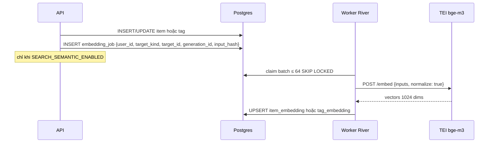

# engram — Project Specification

> Phiên bản: 0.7 · Ngày: 2026-09-15 · Trạng thái: chia triển khai thành **P01–P08**, có [spec từng phase](phases/README.md); giữ baseline sản phẩm/thiết kế v0.6, MVP = P01–P06. P02 bổ sung contract session/CSRF/enrollment vào §3.1, §8, §9, §10.2 — xem [ADR 0001](adr/0001-auth-session-va-reauth-assurance.md). 2026-10-29: embedding qua API tương thích OpenAI (`qwen3-embedding-8b`, 1024 dims) — xem [ADR 0004](adr/0004-embedding-provider-openai-compat.md); ADR thắng các đoạn TEI-only còn sót. 2026-11-01: contract P04 (mục, tag, entry text/JSON lossless) — If-Match theo `version`, `Idempotency-Key` cho mọi mutation content, gán tag cộng dồn, provenance xoá, feed thay đổi — xem [ADR 0005](adr/0005-content-lossless-va-concurrency.md) và [plan P04](plans/2026-11-01-P04-content.md) mục 2–3.
>
> Tài liệu này là spec tổng thể cho sản phẩm **engram** (repo `zone17th/engram`): lưu thông tin theo **mục (Item)** — một `name`, nhiều **tag**, nhiều **entry có kiểu** — tìm lại cực nhanh (lexical + semantic trên name và tag), **chỉ thân entry** được **mã hoá đầu-cuối (E2E)**.

## Mục lục

1. [Tổng quan, mục tiêu, non-goals, personas](#1-tổng-quan-mục-tiêu-non-goals-personas)
2. [Domain model](#2-domain-model)
3. [User stories & main flows](#3-user-stories--main-flows)
4. [Kiến trúc tổng thể](#4-kiến-trúc-tổng-thể)
5. [Mô hình mã hoá E2E](#5-mô-hình-mã-hoá-e2e)
6. [Search & suggestion design](#6-search--suggestion-design)
7. [UI/UX spec](#7-uiux-spec)
8. [Data model / Postgres schema](#8-data-model--postgres-schema)
9. [API design](#9-api-design)
10. [Non-functional requirements](#10-non-functional-requirements)
11. [Project structure & dev tooling](#11-project-structure--dev-tooling)
12. [Roadmap](#12-roadmap)
13. [Câu hỏi mở còn lại](#13-câu-hỏi-mở-còn-lại)
14. [Glossary](#14-glossary)

---

## 1. Tổng quan, mục tiêu, non-goals, personas

### 1.1 Tổng quan

**engram** là web app (online-only) cho phép người dùng lưu nhanh các mẩu thông tin dưới một **mục (Item)**: một tên mô tả (`name`), kèm **nhiều tag**, và **nhiều entry** — mỗi entry có **kiểu lưu** (`text` hoặc `json` ở MVP). Tìm lại bằng cách gõ vài ký tự vào một ô omnibox.

Điểm khác biệt:

- **Search-first**: một ô omnibox vừa tìm **tên mục** và **tag**, vừa thêm nhanh (`name: nội dung`). Gõ `#tag` để lọc / gán tag.
- **Gợi ý thông minh** trên **hai corpus** (item name và tag): prefix, fuzzy, và **semantic** (gõ "mật khẩu wifi" ra mục `wifi-password` hoặc tag `mạng-nhà`) nhờ pgvector. Cùng một model, cùng một semantic toggle.
- **E2E chỉ cho thân entry**: server thấy `name`, tag, kiểu entry, timestamps; **không** thấy text hay JSON. Key chỉ nằm ở browser.
- **Entry có kiểu**: `text` (văn bản tự do) và `json` (tài liệu JSON, UI render **bảng lồng nhau**). Schema sẵn cho `link` / `file` / `image` (không làm ở MVP).
- **Server-first, multi-user, multi-device**: đăng nhập máy khác, **unlock vault** bằng passphrase, **passkey (PRF)**, hoặc **một recovery key** (rồi đặt passphrase mới).
- **Miễn phí, embedding qua provider cấu hình được**: không gói trả phí; mặc định production gọi API tương thích OpenAI (`qwen/qwen3-embedding-8b`, 1024 dims) qua router của sản phẩm, TEI tự host vẫn là lựa chọn ([ADR 0004](adr/0004-embedding-provider-openai-compat.md)). Khi bật gợi ý gần nghĩa, name/tag/hint/query **được gửi** tới dịch vụ embedding bên thứ ba; tắt `≈` thì không gửi gì của user đó.

**Tên sản phẩm: `engram`** — dấu vết vật lý mà một ký ức để lại. Viết thường trong mọi ngữ cảnh (`engram`, không `Engram`). Chốt ở v0.6, thay cho tên tạm cũ; lý do chọn và các tên đã loại nằm trong [README](../README.md#tên). **Tên repo cũng là `engram`** (`github.com/zone17th/engram`), thư mục gốc trong §11.1 theo tên repo. Chưa tra domain và nhãn hiệu — phải kiểm trước khi đăng ký gì.

Thực thể chính **không** còn là "keyword". Xem §2 và §14.

### 1.2 Mục tiêu (Goals)

| # | Mục tiêu | Đo lường |
|---|----------|----------|
| G1 | Thêm một text entry mới trong ≤ 3 giây từ lúc focus omnibox | UX test |
| G2 | Gợi ý lexical name/tag hiển thị p95 < 150 ms từ lúc gửi request; semantic bổ sung sau không làm nhảy hàng | 100k item + 20k tag / user; đo riêng debounce 120 ms và hybrid §6.9 |
| G3 | Thân entry (text hoặc JSON) không bao giờ rời browser ở dạng plaintext | Code review + threat model §5.8 |
| G4 | Hỗ trợ đầy đủ tiếng Việt và tiếng Anh (UI + search) | i18n en/vi, embedding multilingual |
| G5 | Mô hình key không chặn chia sẻ Item ở phase sau | Thiết kế §5.3 |
| G6 | Import JSON và xem/sửa như bảng lồng nhau mà **không mất** JSON gốc | UX test + round-trip JSON |

### 1.3 Non-goals (MVP)

- **Không** offline / PWA / local-first sync. App yêu cầu online.
- **Không** tìm kiếm full-text trong thân entry ở phía server (không thể — body đã mã hoá). Client-side content search là P07.
- **Không** chia sẻ dữ liệu giữa user (P08).
- **Không** kiểu `link` / `file` / `image` (schema chừa chỗ; P07).
- **Không** native mobile app, browser extension (P08).
- **Không** collaborative editing, comment, version history chi tiết.
- **Không** BIP39 / mnemonic 12–24 từ (đã loại — dễ nhầm, UX tệ; dùng 10 recovery key entropy cao, §5.9).
- **Không** email khôi phục, không câu hỏi bí mật, không KMS ngoài: chỉ khi không còn passphrase, RK dùng được, passkey, DevKey hoặc VK trong phiên đang mở mới không còn đường unlock trực tiếp. Kiểm tra backup trước khi reset; reset vault xoá entry, giữ item/tag. Email thông báo bảo mật không phải phương thức khôi phục.
- **Không** login-with-passkey ở MVP (P07). **Không** WebAuthn largeBlob; **không** đăng ký passkey khi thiếu PRF.
- **Không** pricing / gói / tier: sản phẩm miễn phí; marketing chỉ landing + docs.
- **Không** để user tự chọn model embedding. Provider cấp deployment: `noop` \| `tei` \| `openai_compat` ([ADR 0004](adr/0004-embedding-provider-openai-compat.md)); không gọi thẳng SDK riêng của từng hãng.
- **Không** "private name" / blind index: `name` và tag luôn plaintext — không có roadmap mã hoá tên.
- **Không** quan hệ entry ↔ nhiều item: một entry thuộc **đúng một** Item.

### 1.4 Personas

| Persona | Mô tả | Nhu cầu chính |
|---------|-------|---------------|
| **Minh — Developer** | Lưu snippet, config, JSON API sample | Gõ `docker: lệnh xoá volume`; import `compose.json` thành bảng; tag `ops`, `home-lab` |
| **Lan — Knowledge worker** | Note họp, ý tưởng, danh sách có cấu trúc | Semantic: "họp marketing tuần này" ra mục `meeting-mkt`; lọc `#okrs` |
| **An — Privacy-conscious** | Số hợp đồng, ghi chú nhạy cảm | Server không đọc body; hiểu `name`/tag là plaintext; giữ passphrase, **10 recovery key**, và passkey |

---

## 2. Domain model

### 2.1 Vì sao gọi là **Item** (mục), không phải Keyword / Key

"Keyword" / "key" gợi một **khoá tra cứu unique** — sai với sản phẩm: người dùng mô tả một **mục thông tin** (`name` = tiêu đề / mô tả chính), gắn **nhiều nhãn**, rồi nhét **nhiều mẩu nội dung có kiểu** vào đó. `name` **được phép trùng**.

| Ứng viên | Vì sao không chọn làm mặc định |
|----------|--------------------------------|
| **Keyword / Key** | Sai nghĩa: không phải chìa khoá, không unique, không phải kênh search duy nhất |
| **Note** | Nghèo: một Note thường là một body; ở đây một mục có nhiều entry typed (kể cả bảng JSON) |
| **Record** | Nghe như một hàng DB / form cố định, không khớp "bó thông tin + tag" |

**Chọn trong spec: `Item` (EN) / mục (VI).** URL `/items/:id`, bảng `item`, API `/items`. Đây là khuyến nghị có chủ đích, chưa khoá brand-language cuối — xem Q1 §13.

Thuật ngữ **keyword** chỉ còn trong glossary: *cũ, đã thay bằng `Item.name` + `Tag`*.

### 2.2 Các thực thể

| Entity | Plaintext trên server? | Mô tả |
|--------|------------------------|-------|
| **User** | ✔ | Tài khoản; email, locale, theme, `auto_lock_minutes`, `settings` |
| **AuthIdentity** | ✔ | OAuth (google/github) hoặc password hash |
| **Session** | ✔ | Refresh token hash, device info, thời hạn |
| **Vault** | ✔ (metadata + wrapped keys) | `vault_key` wrap bởi KEK (passphrase); **thêm** tối đa 10 wrap bởi recovery key và N wrap bởi passkey PRF. Keypair X25519/Ed25519 (pub plaintext, priv wrapped). Mọi đường unlock lấy được VK đều có quyền tạo KEK wrap mới, kèm re-auth tài khoản (§3.9) |
| **Item** | ✔ `name`, `hint?`, timestamps, counts | Mục per-user. `name` = mô tả chính / title. **Trùng `name` được phép.** Disambiguate ở UI bằng tag + `created_at` |
| **Tag** | ✔ `display`, `normalized` | Nhãn first-class, tái sử dụng giữa các item. Unique per-user theo `normalized` (khác `item.name`) |
| **ItemTag** | ✔ | N–N Item ↔ Tag |
| **Entry** | ✘ body (ciphertext) · ✔ `type`, `position`, envelope meta, size, timestamps | Một mẩu thuộc **đúng một** item. MVP `type`: `text` \| `json` |
| **ItemEmbedding** | ✔ | Vector của `item.name` (+ hint), `model`, `model_version`, `dims` = 1024 |
| **TagEmbedding** | ✔ | Vector của `tag.display` / `normalized` (cùng model) |
| **EmbeddingJob** | ✔ | Hàng đợi embed/re-embed (River); target = item hoặc tag |
| **AuditLog** | ✔ | Sự kiện bảo mật (login, đổi passphrase, recover RK, regenerate/rotate RK, passkey register/revoke, export, reset vault…). ID `bigserial` → JSON decimal string. Retention mặc định 90 ngày. |
| **UserNotification** | ✔ in-app · ✘ `email_targets` khỏi DTO | Notice bảo mật; snapshot email verified lúc event để gửi cảnh báo địa chỉ cũ. Retention cùng audit. |
| **EmailVerification** | ✔ hash · ✘ plaintext token | Purpose `signup` / `email_change` / `password_enroll`. |
| **OAuthTransaction / ReauthReceipt** | ✔ hash binding/state/receipt | Login tách callback `ready` và `POST /auth/oauth/complete`. |
| **VaultRecoveryKey** | ✔ `lookup_hash`, wrap · ✘ plaintext RK | 10 slot; mỗi RK bọc **trực tiếp** một bản VK. Single-use. Không lưu bí mật RK |
| **VaultPasskey** | ✔ `cred_id`, `prf_salt`, `vk_wrap`, `pubkey?`, meta | WebAuthn; PRF → wrap VK. Nhiều passkey / user. Không fallback secret phía server |
| **DeviceKey** (client-only) | — không có trên server | `DevKey` WebCrypto non-extractable + `seal(VK, DevKey)` trong IndexedDB khi bật "Nhớ thiết bị này" (§5.6) |

**Settings** (cột `app_user.settings` jsonb + cột riêng): `semantic_suggest` (default `true`), `auto_lock_minutes` (default `15`; `0` = never).

### 2.3 Quan hệ

```
User  1 ─── 1  Vault
Vault 1 ─── N  VaultRecoveryKey   // tối đa 10 hàng (slot 1..10, consume = DELETE)
Vault 1 ─── N  VaultPasskey
User  1 ─── N  Item
User  1 ─── N  Tag
Item  N ─── N  Tag     (item_tag)
Item  1 ─── N  Entry   // entry thuộc đúng một item; không còn N–N entry↔keyword
```

- Xoá Item → soft-delete item và mọi entry **sống** của item trong cùng một lô (`delete_batch`, `deleted_via='item'`); **giữ** `item_tag` để Undo/restore khôi phục đúng tag. Entry user đã xoá riêng trước đó không bị khôi phục theo item (provenance, [ADR 0005](adr/0005-content-lossless-va-concurrency.md)).
- Xoá Tag → soft-delete tag; `item_tag` giữ nguyên nhưng tag đã xoá không còn tính là tag của item; **không** xoá item.
- Restore: entry (chỉ entry xoá riêng, `deleted_via='entry'`), item (kèm đúng các entry đã xoá theo item cùng lô) và tag, trong 30 ngày, vẫn tuân trần 20 tag / 200 entry. Purge sau 30 ngày (job `content_purge`) xoá vĩnh viễn entry, item (cascade entry, `item_tag`) và tag (cascade `item_tag`, item còn nguyên). Chi tiết §8, §9.2.
- Reset vault → xoá **entries** (+ vault cũ, recovery key, passkey wrap) → tạo vault mới (10 RK mới, onboard lại); **giữ Item + Tag** (plaintext, không phụ thuộc VK).

### 2.4 Quyết định thiết kế

**`Item.name` — plaintext, trùng được.**
User muốn nhiều mục cùng tên (hai "wifi": nhà vs công ty). Server **không** unique `name`. UI phân biệt bằng chip tag + ngày tạo. Trade-off giống keyword cũ: plaintext để search/suggest chạy được.

Chuẩn hoá để search, **không** để identity:

`name_normalized` (một hàm duy nhất phía Go `internal/textnorm.Normalize`, dùng cho `item.name_normalized`, `tag.normalized`, exact lookup và lọc `q`; fixture chung `packages/content-fixtures/normalize.json`):

1. Từ chối chuỗi không phải UTF-8 hợp lệ, có ký tự điều khiển C0/C1 (trừ space), ký tự bidi override (U+202A–U+202E, U+2066–U+2069), hoặc rỗng sau trim (`400 name_invalid` / `400 tag_display_invalid`).
2. NFC → lowercase Unicode theo từng rune (`unicode.ToLower`, **không** special-casing theo locale) → NFC lần nữa (advisor-dec-125) → thay mọi chuỗi ký tự `White_Space` bằng một space → trim → bỏ ký tự category `P*` ở **đầu và cuối** (lặp tới khi hết; dấu câu ở giữa như `c++`, `wi-fi` giữ nguyên). **Giữ dấu tiếng Việt** (`mã` ≠ `ma`).
3. Kết quả chuẩn hoá rỗng (ví dụ `"!!!"`) → từ chối `name_invalid`. Độ dài đếm theo rune, kiểm cả trên giá trị gốc (sau trim) lẫn kết quả chuẩn hoá.

Web không tự chuẩn hoá để quyết định danh tính; khi UI cần so (ví dụ gộp tag trùng trong quick-add) thì dùng bản TS chạy cùng fixture. Fuzzy/unaccent ở tầng search (§6).

Độ dài: `name` 1–200 rune. `hint` opt-in, ≤ 120 ký tự, plaintext, có nhãn "server đọc được" — dùng khi tên quá ngắn/viết tắt (`k8s`) để embedding tốt hơn.

**`Tag` — first-class, unique theo `normalized`.**
Catalog per-user. `display` giữ cách viết lần đầu (hoặc lần rename). Cùng thuật toán normalize như name. Unique `(user_id, normalized) WHERE deleted_at IS NULL`. Đổi `display` (hoặc restore tag) mà `normalized` trùng tag sống khác → `409 tag_conflict` (merge tag = P07). Mã lỗi luôn `snake_case` (§9.1).

**Giới hạn (ý kiến, dùng xuyên spec):**

| Giới hạn | Giá trị | Lý do |
|----------|---------|-------|
| Tag / item | **20** | Chip UI; quá nhiều tag làm filter mất nghĩa |
| Entry / item | **200** | Mục là một bó, không phải dump vô hạn; vẫn dư cho journal + nhiều bảng |
| Plaintext / entry | **256 KiB** | Số byte UTF-8 thực sự mã hoá; JSON đo trên text sau edit, không qua `JSON.stringify` |
| Tag `display` | 1–50 rune | Nhãn, không phải đoạn văn |
| Catalog tag / user | không cứng; alert vận hành ~ 20k | |
| Item / user | không cứng; alert ~ 50k | |

Xác nhận 20 / 200: Q3 §13.

**Entry typed, body luôn ciphertext.**
`type` là plaintext: UI biết cần renderer text hay bảng **trước khi** decrypt. **Cấu trúc JSON chỉ có sau khi client decrypt** — server chỉ lưu `type='json'` + blob. Không gửi JSON plaintext lên server, kể cả lúc import.

**JSON (group / table)** — luôn giữ document gốc:

- Lưu đúng UTF-8 JSON user import/sửa (không "bình thường hoá" mất key order / số / `null` một cách thầm).
- Source of truth = text gốc + cây cú pháp giữ source span và từng occurrence của property. Table-edit splice đúng vùng thay đổi; byte ngoài edit giữ nguyên (§3.7), không serialize lại toàn bộ JS object.
- Object → một bảng field/value.
- Array → hàng; array-of-object → cột = hợp các key.
- Object-trong-ô / array-trong-ô → bảng lồng, expandable.
- Import nhanh: dán hoặc file `.json`; nhận object, array, array lồng, cả JSON primitive; validate cú pháp JSON strict + size; rồi encrypt như text. Giữ cả key trùng, thứ tự key và lexeme số; không dùng giá trị JS `Number` làm nguồn lưu.

**Không** validate JSON Schema ở MVP (freeform). Schema per-item = mở, xem Q2.

**Search surfaces:**

| Hành động | Kết quả |
|-----------|---------|
| Gõ trong omnibox | Hybrid trên **item names** và **tags** |
| Chọn một tag | Lọc danh sách item có tag đó |
| Chọn một item | Mở chi tiết: chip tag + danh sách entry |
| `#tag` | Chỉ corpus tag (lọc hoặc gán, tuỳ context) |
| `name: text` | Quick-add text entry (quy tắc trùng tên §3.4) |

**Embedding:** chỉ `item.name` (+ hint) và `tag.display`/`normalized`. Không embed body đã mã hoá. Re-embed khi đổi name/hint hoặc đổi tag display.

### 2.5 ER diagram

```mermaid
erDiagram
    USER ||--o{ AUTH_IDENTITY : has
    USER ||--o{ SESSION : has
    USER ||--|| VAULT : owns
    VAULT ||--o{ VAULT_RECOVERY_KEY : wraps_vk
    VAULT ||--o{ VAULT_PASSKEY : wraps_vk
    USER ||--o{ WEBAUTHN_CHALLENGE : registers_passkey
    USER ||--o{ IDEMPOTENCY_KEY : deduplicates
    USER ||--o{ RATE_EVENT : throttles
    USER ||--o{ ITEM : owns
    USER ||--o{ TAG : owns
    USER ||--o{ AUDIT_LOG : generates
    USER ||--o{ USER_NOTIFICATION : receives
    USER ||--o{ EMAIL_VERIFICATION : proves
    SESSION ||--o{ SESSION_REFRESH_USED : rotated
    ITEM ||--o{ ITEM_TAG : tagged
    TAG ||--o{ ITEM_TAG : labels
    ITEM ||--o{ ENTRY : contains
    ITEM ||--o| ITEM_EMBEDDING : has
    TAG ||--o| TAG_EMBEDDING : has
    ITEM ||--o{ EMBEDDING_JOB : queued
    TAG ||--o{ EMBEDDING_JOB : queued

    USER {
        uuid id PK
        text email UK
        text locale
        int auto_lock_minutes "0 = never"
        jsonb settings "semantic_suggest"
        timestamptz created_at
    }
    AUTH_IDENTITY {
        uuid id PK
        uuid user_id FK
        text provider "password|google|github"
        text provider_uid
        text password_hash "argon2id, chỉ provider=password"
    }
    SESSION {
        uuid id PK
        uuid user_id FK
        bytea refresh_token_hash
        text device_label
        timestamptz expires_at
    }
    VAULT {
        uuid user_id PK_FK
        int version
        jsonb kdf "argon2id13 ops 3..10, mem 64..256MiB, p=1 + salt 16B"
        text vault_key_id UK "vk: + base64url(16B)"
        bytea vault_key_wrapped_by_kek "73B"
        bytea x25519_public "32B"
        bytea ed25519_public "32B"
        bytea private_keys_wrapped "105B"
        timestamptz created_at
        timestamptz updated_at
    }
    VAULT_RECOVERY_KEY {
        uuid id PK
        uuid vault_id FK
        int slot "1..10, UK(vault_id,slot)"
        bytea lookup_hash UK "32B BLAKE2b"
        bytea wrap "73B VK wrapped by RK"
        timestamptz created_at
    }
    VAULT_PASSKEY {
        uuid id PK
        uuid user_id FK
        bytea cred_id UK
        bytea pubkey "P07 login"
        bytea prf_salt "32B"
        bytea vk_wrap "73B"
        bytea aaguid
        text name
        timestamptz created_at
    }
    WEBAUTHN_CHALLENGE {
        uuid id PK
        uuid user_id FK
        uuid session_id FK
        text vault_key_id
        bytea challenge_hash UK "SHA-256(challenge)"
        bytea prf_salt "32B"
        timestamptz expires_at "TTL 5m"
        timestamptz consumed_at
        timestamptz created_at
    }
    IDEMPOTENCY_KEY {
        uuid user_id PK_FK
        text key PK "16..128 chars"
        text method
        text path
        bytea request_hash
        text status "in_progress|done"
        uuid owner_token
        timestamptz claimed_at
        timestamptz expires_at "TTL 24h"
        int status_code
        jsonb response "nullable"
        timestamptz created_at
    }
    RATE_EVENT {
        bigserial id PK
        text scope
        uuid user_id FK
        timestamptz at
    }
    ITEM {
        uuid id PK
        uuid user_id FK
        text name
        text name_normalized
        text hint
        int entry_count
        int version "P04 If-Match"
        timestamptz last_used_at
        timestamptz created_at
        timestamptz deleted_at
        uuid delete_batch
    }
    TAG {
        uuid id PK
        uuid user_id FK
        text display
        text normalized
        int item_count
        timestamptz last_used_at
        timestamptz deleted_at
    }
    ITEM_TAG {
        uuid item_id FK
        uuid tag_id FK
    }
    ENTRY {
        uuid id PK
        uuid user_id FK
        uuid item_id FK
        text type "text|json|link|file|image"
        int position
        jsonb envelope
        bytea ciphertext
        int plaintext_len_bucket
        int version "P04 If-Match"
        timestamptz updated_at
        timestamptz deleted_at
        text deleted_via "entry|item"
        uuid delete_batch
    }
    ITEM_EMBEDDING {
        uuid user_id PK, FK
        uuid item_id PK, FK
        vector embedding "1024"
        text model
        text model_version
        text input_hash
    }
    TAG_EMBEDDING {
        uuid user_id PK, FK
        uuid tag_id PK, FK
        vector embedding "1024"
        text model
        text model_version
        text input_hash
    }
```

---

## 3. User stories & main flows

### 3.1 User stories (ưu tiên MVP)

- **US1** Là user mới, tôi đăng ký email/password hoặc Google/GitHub, đặt **encryption passphrase**, **lưu 10 recovery key** (bắt buộc — tải/in/copy + checkbox), optionally **thêm passkey**.
- **US1b** Là user OAuth-only (chưa có password đăng nhập), tôi đặt password lần đầu bằng email **đã verified của chính tài khoản** (enrollment) hoặc bằng Google re-auth nếu provider chứng minh freshness. Email proof không phải recovery vault và không phải reset password đã có.
- **US1c** Là user đã có password đăng nhập nhưng quên password đó, tôi yêu cầu đặt lại password tài khoản qua email (`POST /auth/password/forgot` → `POST /auth/password/reset`, [ADR 0006](adr/0006-account-password-reset.md)). Đặt lại password tài khoản **chỉ khôi phục quyền đăng nhập vào tài khoản, tuyệt đối không mở khoá, re-key hay reset vault** (`user-dec-016`): sau khi đăng nhập lại tôi vẫn phải mở khoá vault bằng encryption passphrase, một recovery key hoặc passkey PRF (hoặc trình duyệt này nếu trình duyệt vẫn còn nhớ `DevKey`; việc đặt lại thu hồi mọi phiên nên có thể xoá trạng thái nhớ thiết bị). Tài khoản OAuth-only không dùng luồng này để đặt password lần đầu (giữ nguyên US1b).
- **US2** Là user, tôi gõ `wifi: Abc123` vào omnibox → text entry được thêm vào mục `wifi` (tạo mới nếu chưa có; nếu trùng tên xem §3.4).
- **US3** Là user, khi gõ `wi` tôi thấy mục `wifi`, `wifi-office` **và** tag `wifi-khách`; từ 3 ký tự trở lên có thể thêm `mạng nhà` ở vùng Gần nghĩa nếu bật ≈.
- **US4** Là user, tôi mở một mục, thấy chip tag + danh sách entry theo `position`, sửa/xoá entry, thêm/gỡ tag.
- **US5** Là user, tôi import một file/đoạn JSON vào mục → một entry `type=json`, UI hiện bảng lồng nhau, vẫn xem được JSON gốc.
- **US6** Là user, tôi sửa một ô trong bảng lồng nhau (kể cả hàng trong array lồng) → document JSON được cập nhật, encrypt lại, JSON gốc không mất field không nhìn thấy trên bảng.
- **US7** Là user, tên mục trùng: omnibox và trang mục luôn hiện tag + ngày tạo; quick-add khi có nhiều khớp hỏi tôi chọn mục hoặc tạo mới.
- **US8** Là user, gõ `#nhà` để lọc các mục có tag đó; trên trang mục tôi gán/gỡ tag từ catalog (suggest giống name).
- **US9** Là user, máy mới: đăng nhập → **unlock vault** bằng passphrase **hoặc** passkey (không gõ passphrase).
- **US10** Là user, đổi passphrase mà không re-encrypt entries; recovery key và passkey **vẫn mở được** (chúng bọc VK, không bọc KEK).
- **US11** Là user, bật "Nhớ thiết bị này" (opt-in, mặc định tắt); "Quên thiết bị này" bất cứ lúc nào.
- **US12** Là user, chọn locale en/vi và auto-lock 5 / **15** / 60 / never.
- **US13** Là user quên passphrase: dùng passkey / DevKey / VK trong phiên đang mở để đặt passphrase mới sau re-auth, hoặc dán **một** RK → mở vault → re-auth + **bắt buộc đặt passphrase mới** → consume key trên live server → được nhắc regenerate slot trống. Chỉ đề xuất **Reset vault** khi đã kiểm tra các đường unlock và backup; reset xoá entries, **giữ items + tags**.
- **US14** Là user, export encrypted backup hoặc decrypted JSON (cảnh báo).
- **US15** Là user, xem số recovery key còn lại (không xem lại bí mật); regenerate slot thiếu hoặc xoay cả 10 (vault đã unlock + re-auth tài khoản; không cần passphrase cũ).
- **US16** Là user, thêm nhiều passkey (Windows Hello, điện thoại, YubiKey); thu hồi từ Settings.
- **US17** Là user, sau auto-lock: máy đã nhớ → mở im lặng; không nhớ nhưng có passkey → prompt WebAuthn; không thì gõ passphrase.

### 3.2 Flow: Sign up → passphrase → 10 recovery key → (tuỳ chọn) passkey

Onboarding **không hoàn tất** nếu chưa sinh và xác nhận 10 recovery key. API `POST /vault` **từ chối** nếu thiếu đúng 10 wrap RK. **Không** BIP39.

```mermaid
sequenceDiagram
    participant B as Browser
    participant A as Go API
    participant DB as Postgres
    B->>A: POST /auth/signup (email+pw) hoặc OAuth callback
    A->>DB: tạo user, auth_identity, session
    A-->>B: session cookie (HttpOnly)
    Note over B: Bước 1: passphrase (≥ 12 ký tự, zxcvbn ≥ 3) ×2
    B->>B: salt = random(16); KEK = Argon2id(passphrase, salt, m=64MiB,t=3,p=1)  [Web Worker]
    B->>B: VK = random(32)
    B->>B: kp = X25519+Ed25519 keygen
    B->>B: wrapK = seal(VK, KEK); wrapP = seal(priv, VK)
    Note over B: Sinh 10 RK (16 B CSPRNG → 130-bit Crockford 26 ký tự, slot i=1..10, prefix rki_)
    loop i = 1..10
        B->>B: RKi = rki_ + Crockford26(00_2 || random 16B) (ký tự đầu trong 0..7, §5.9)
        B->>B: lookup_i = BLAKE2b-256("sabk.rk.lookup.v1" || rk_norm_i)
        B->>B: wrap_i = seal(VK, BLAKE2b-256("sabk.rk.wrap.v1" || rk_norm_i))
    end
    Note over B: Bước 2: lưới 10 key — Tải / In / Sao chép; checkbox bắt buộc
    B->>A: POST /vault + Idempotency-Key {kdf, vault_key_wrapped_by_kek, x25519_public, ed25519_public, private_keys_wrapped, recovery_keys:[{slot, lookup_hash, wrap}×10]}
    A->>DB: insert vault + 10 vault_recovery_key (slot 1..10)
    Note over B: Bước 3 (tuỳ chọn): Add a passkey — lấy grant vault.passkey_register + register/options + WebAuthn create/PRF
    opt PRF available
        B->>A: POST /vault/passkeys + X-Reauth-Token + Idempotency-Key {challenge_id, attestation:{client_data_json, attestation_object}, prf_salt, vk_wrap, name}
    end
    B->>B: VK trong Worker memory; xoá passphrase, KEK, plaintext RK
    opt user tick "Nhớ thiết bị này"
        B->>B: DevKey = WebCrypto AES-GCM non-extractable; IndexedDB sabk.device (user_id, vault_key_id) ← {DevKey, seal(VK, DevKey)}
    end
```

Nút "Tạo vault" / Continue **disabled** đến khi checkbox "Tôi đã lưu 10 recovery key ở nơi an toàn". `POST /vault` chỉ sau khi tick — wrap RK chưa lên server trước lúc user thấy lưới.

Nếu `AUTH_REQUIRE_EMAIL_VERIFICATION=true` (mặc định **false**), user email/password phải verify email trước khi tạo vault; OAuth coi verified nếu provider trả `email_verified`. Cờ này **không** chặn đăng nhập, xem tài khoản, gửi verification, hay recovery vault. Enrollment password lần đầu độc lập với cờ này: chỉ cần email hiện tại đã verified và chưa có password.

Signup/login password dùng Argon2id **server** (`m=64MiB,t=3,p=1`, salt 16 B, key 32 B). Tối thiểu 12 ký tự Unicode, tối đa 1024 byte UTF-8; **không** trim/normalize password. Server **không** nhận encryption passphrase, RK, VK hay PWK.

Cảnh báo (một lần, bước 2): chụp màn hình / người nhìn trộm có thể lấy RK. In hoặc tải file, cất offline — đừng để screenshot trên máy chung.

### 3.3 Flow: Unlock trên thiết bị mới

1. Đăng nhập → session (cookie). **Unlock vault là bước riêng** — không thay login ở MVP.
2. `GET /vault` → `vault_key_id`, `version`, `kdf`, `vault_key_wrapped_by_kek` (`wrapK`), `x25519_public`, `ed25519_public`, `private_keys_wrapped`, `recovery_keys_remaining`, danh sách `passkeys: [{id, name, aaguid, created_at}]` (`Cache-Control: no-store, no-transform`, không `ETag`).
3. User chọn:
   - **Passphrase:** Worker kiểm tra `kdf` hợp lệ (`3 ≤ ops ≤ 10`, `64 MiB ≤ mem ≤ 256 MiB`, `parallelism = 1`; **không** hạ dưới 64 MiB), chạy `KEK = Argon2id(passphrase, kdf.salt)`; `VK = open(wrapK, KEK)` với AAD `UTF8("sabk.vk.kek.v1") ‖ 0x00 ‖ 0x01`. Lỗi cấp phát bộ nhớ WASM hiển thị trạng thái thiếu bộ nhớ riêng; sai tag AEAD → "Passphrase không đúng" / "Incorrect passphrase".
   - **Passkey:** `navigator.credentials.get()` + PRF → unwrap `vk_wrap` (§3.13, §3.14). Không gõ passphrase.
   - **Recovery key:** chỉ từ link "Quên passphrase" (§3.10), không phải nút unlock hàng ngày.
4. `VK` ở Worker memory. Nếu tick **"Nhớ thiết bị này"** → `DevKey` + `seal(VK, DevKey)` với AAD `UTF8("sabk.devkey.v1") ‖ 0x00 ‖ UTF8(user_id) ‖ 0x00 ‖ UTF8(vault_key_id)` lưu trong IndexedDB `sabk.device` theo namespace `(user_id, vault_key_id)` (§5.6, [ADR 0003](adr/0003-webauthn-prf-va-devkey.md)). Lần sau trên thiết bị này (sau khi `GET /vault` thành công và khớp `vault_key_id`): unlock **im lặng** bằng `DevKey`.

### 3.4 Flow: Quick-add `name: text`

Cú pháp: `name: nội dung` (một `name`). Mở rộng: `name #tag1 #tag2: nội dung` — gán tag khi tạo/append.

**Grammar** (client, `features/omnibox/quick-add-parse.ts`, fixture `packages/content-fixtures/quick-add.json`):

- Chỉ **dòng đầu** chứa phần đầu (`head`). Dấu tách là `:` đầu tiên trên dòng đầu **không** đứng ngay trước `//` (giữ tinh thần `(?!//)` cũ để URL trong body như `link: https://a.b/c` không bị tách sai). Không có `:` → chế độ tìm kiếm (dưới). Input bắt đầu bằng `#` → chế độ lọc tag, không phải add. Full-width colon `：` không phải dấu tách.
- `:` sát chữ vẫn hợp lệ (`wifi:Abc123` → name `wifi`); `10:30 họp` thành add với name `10` — preview "Sẽ lưu vào …" hiện trước Enter nên người dùng thấy.
- `body` = mọi thứ sau `:` (kể cả các dòng sau), bỏ khoảng trắng đầu và cuối, giữ nguyên khoảng trắng/xuống dòng ở giữa. `body` rỗng → chưa phải add mode.
- `head` = phần name rồi các token tag. Token tag bắt đầu `#`, kết thúc ở khoảng trắng, không chứa `#`/`:` — tag có khoảng trắng gắn bằng chip trên trang mục, không có cú pháp trích dẫn. Sau token tag đầu tiên, mọi token phải là tag (chữ thường xen giữa → preview báo lỗi, Enter bị chặn). Name rỗng → không add. Tag trùng sau chuẩn hoá (`#Nhà #nhà`) gộp thành một; quá 20 tag → không add.
- Entry tạo từ quick-add lưu xuống dòng **LF** (ô omnibox đã chuẩn hoá xuống dòng thành LF).

**Ranh giới gửi** ([ADR 0005](adr/0005-content-lossless-va-concurrency.md)): chuỗi đang gõ chưa phân loại có thể là body tương lai (dán body trước, gõ `name:` sau), nên ô omnibox **không gửi gì trước Enter** ở mọi chế độ, kể cả lookup tên ở add mode (advisor-dec-098: `root:hunter2` hay `Sup3rSecret:backup` dán vào đã là add mode, phần trước `:` là mảnh body):

- Chế độ tìm kiếm (không có `:`): không request nào khi gõ; dòng gợi ý cố định báo chữ đã gõ sẽ gửi tới máy chủ, không mã hoá. **Enter** = người dùng chủ động tìm → `GET /items?q=` chỉ khi input một dòng và ≤ 200 rune (nhiều dòng hoặc dài hơn → không gửi, gợi ý thêm `tên:`); kết quả hiện dưới ô, không đưa từ khoá vào URL/history. Gợi ý theo từng phím (§3.5) thuộc P05 và phải giữ ranh giới này.
- Chế độ lọc tag (`#…`): lọc phía client trên danh sách tag đã có trong cache; chỉ khi không có trong cache, Enter mới gửi `GET /tags?q=<token>` (một token ≤ 50 rune).
- Add mode: **không request nào trước Enter**. Preview "Sẽ lưu vào …" dựng từ `name` và tag parse cục bộ (thấy ngay `10:30 họp` thành name `10`), không có số mục trùng. Enter → `GET /items/lookup?name=` chỉ với `name`; name không hợp lệ (rỗng sau chuẩn hoá, ký tự cấm) hoặc dài hơn 200 rune → không gửi, preview báo lỗi. Body không bao giờ rời client ngoài ciphertext.
- **Ba dòng cố định** (en/vi, mỗi dòng chỉ hiện ở đúng chế độ của nó): chế độ tìm `content.omnibox.searchHint` "Enter: tìm theo đầu tên · Ctrl+Enter: tạo mục tên này — chữ đã gõ gửi tới máy chủ, không mã hoá. Để lưu nội dung, gõ `tên: nội dung`"; chế độ `#…` `content.omnibox.tagHint` "Enter: lọc theo tag — chữ đã gõ gửi tới máy chủ, không mã hoá"; add mode `content.privacy.*` "Tên mục, tag và gợi ý không được mã hoá; chỉ nội dung được mã hoá đầu-cuối" (máy chủ vẫn thấy độ dài gần đúng của nội dung, §10.4).
- Test (Task 18): dán `a:SECRET`, chờ ≥ 1 giây, không request nào (URL, header, body) chứa `a` hay `SECRET` trước Enter; cùng các ca dán body không có `:` rồi gõ `name:` phía trước.

**Luồng lưu** (một "kế hoạch quick-add" giữ trong memory của phiên, không persist):

1. Khi Enter (vault phải unlocked), exact lookup `GET /items/lookup?name=` (server chuẩn hoá, trả **mọi** item sống trùng `name_normalized` kèm `total`; không dùng `/suggest` top-K):
   - **0** → sẽ tạo mục mới.
   - **1** → append entry vào mục đó.
   - **nhiều** → Enter mở picker: từng item (name + tối đa 3 chip tag + `created_at` + `entry_count`, "Xem thêm" khi `total` lớn hơn số đã tải) + **Tạo mục mới cùng tên**. Picker trả **item ID**. Không đoán.
2. Sau lookup (0 hoặc 1 khớp) hoặc khi picker trả item ID: kiểm trước trần tag (tag đã có của mục đích + tag mới > 20 → chặn). Dựng kế hoạch: `itemId` (UUID mới nếu tạo), các tag cần upsert, `entry_id` UUID v4, seal **một lần** (envelope đủ 5 field §5.5, nonce mới 24 B, AAD JCS + ID), mỗi bước một `Idempotency-Key` sinh trước.
3. Chạy tuần tự: `POST /items {id, name}` (nếu tạo) → `POST /tags {display}` cho từng tag (upsert theo `normalized`) → `POST /items/{id}/tags {tag_ids}` (**cộng dồn**, không thay cả bộ; trần 20) → `POST /items/{id}/entries {id:entry_id, type:"text", envelope, ciphertext, plaintext_len_bucket}`. Bước lỗi giữ draft + kế hoạch; "Thử lại" chạy tiếp từ bước lỗi với đúng key và byte cũ, nên timeout ở bất kỳ bước nào không tạo bản sao. Không seal lại dưới cùng key.
   - **Khi nào giữ nguyên key và byte:** chỉ khi kết quả chưa rõ hoặc tạm thời: lỗi mạng, timeout, `5xx`, `429`, `409 idempotency_in_progress`. Mọi `4xx` khác do handler trả là kết quả xác định: kế hoạch kết thúc, draft giữ nguyên, UI báo theo mã lỗi; Enter kế tiếp dựng **kế hoạch mới** với key mới (lookup lại, upsert tag lại; bước đã commit được lookup/upsert tìm thấy lại nên không tạo bản sao).
   - `404 not_found` ở bước gán tag hoặc tạo entry là mục hoặc tag đã bị xoá ở thiết bị khác: client gọi `GET /items/{id}` để phân biệt (404 → mục mất, kế hoạch mới tạo lại mục; 200 → tag mất, kế hoạch mới upsert lại tag). `409 item_tag_limit`/`item_entry_limit` → báo trần, giữ draft. `409 entry_key_mismatch` (vault reset hoặc đổi khoá ở thiết bị khác) → xử lý như `vault_key_id` đổi (bước 6), không gửi lại ciphertext cũ.
   - **Lỗi trước lookup không chốt lần gửi trước** (CBE2-1): `401` (`access_expired`, `unauthenticated`, `session_invalid`) và `403` (`csrf_invalid`, `forbidden`) bị middleware trả **trước** bước idempotency lookup, nên chỉ nói lần gửi này không tới lookup, không nói gì về lần gửi trước có kết quả chưa rõ (mất response). Khi bước đó đã từng có kết quả chưa rõ: (a) `401 access_expired` (refresh trong phiên), `403 csrf_invalid` (đọc lại token CSRF) và `401 unauthenticated` khi phục hồi có điều kiện của §9.1 (cookie CSRF loại session còn, refresh trong Web Lock) **thành công** khôi phục được **trong phiên** → giữ nguyên ID, byte và key rồi gửi lại **đúng** request đó (server replay response gốc nếu đã commit) trước khi cho dựng kế hoạch mới hay một `PUT` khác; (b) `401 unauthenticated` khi không được thử refresh hoặc refresh thất bại, `session_invalid` và `403 forbidden` chỉ khôi phục được bằng đăng nhập lại, tức ranh giới logout của bước 6: kế hoạch và draft bị bỏ, **không** replay; UI hiện một dòng cố định `content.omnibox.saveUnconfirmed` "Lần lưu trước vào **<name>** chưa xác nhận; kiểm tra mục trước khi lưu lại" trên màn người dùng tới sau ranh giới (đăng nhập hoặc mở khoá), đọc từ store cấp app trong memory; tải lại toàn trang thì mất dòng này (mặc định an toàn: không lưu storage, không thêm plaintext bền) (name đã là plaintext trên server). Mục trong store mang `user_id` đã tạo nó; dòng chỉ hiện khi đúng user đó đăng nhập hoặc mở khoá, và bị xoá khi đổi sang user khác, khi người dùng chủ động đăng xuất, khi bấm đóng và khi tải lại toàn trang (advisor-dec-120). Chỉ response từ handler (mã nghiệp vụ) hoặc replay mới chốt kết quả. Trong lúc chờ khôi phục, nút lưu bị khoá nhưng luôn có "Bỏ bản nháp" để người dùng không bị kẹt. Phân loại (a)/(b) nằm trong helper `contentMutate` của Task 11 (test đơn vị cho từng mã). Test Task 18: mất response rồi `session_invalid` → không replay, dòng `saveUnconfirmed` hiện; mất response rồi `csrf_invalid`, và mất response rồi `unauthenticated` với refresh thành công → replay đúng key, đúng một entry.
4. Server tăng `entry_count`, `last_used_at`; giữ chỗ enqueue embed (P05) khi item/name mới.
5. Toast "Đã lưu vào **wifi**" chỉ hiện **sau khi** entry commit (201), kèm Undo (§3.8). Undo quick-add **chỉ xoá entry vừa lưu** (`DELETE /entries/{id}`); mục, tag và cặp gán mà kế hoạch đã tạo được giữ (thiết bị khác có thể đã dùng chúng; phase doc cho phép dọn mục/tag rỗng, P04 chọn không dọn). Toast nói rõ phạm vi này. Mục rỗng còn lại xoá được bằng menu của mục.
6. Lock, logout, đổi user, reset vault hoặc `vault_key_id` đổi → bỏ draft và kế hoạch (bước đã commit vẫn còn); không bao giờ gửi lại ciphertext cũ sau unlock.

Quick-add **chỉ** tạo `type=text`. JSON đi qua modal import (§3.6) hoặc nút thêm JSON trên trang mục. Nếu body là JSON hợp lệ (bắt đầu bằng `{` hoặc `[`), hiện banner "Phát hiện JSON — [Lưu như bảng]" mở import với text đó — không tự đổi type.

`Ctrl+Enter` có hai chế độ: không có `:` (một dòng, ≤ 200 rune) → tạo **mục mới không entry** với `name` = text đang gõ; có `:` (add mode) → **luôn tạo mục mới** kèm entry, kể cả khi đã có mục trùng tên. Ở chế độ `#…`, `Ctrl+Enter` bị bỏ qua.

Import bằng **file** giữ nguyên byte UTF-8 của file (sau khi bỏ đúng một BOM); import bằng **dán** giữ đúng chuỗi `text/plain` mà trình duyệt trả về, không hứa gì về byte CR trước khi qua trình duyệt (§3.6).

### 3.5 Flow: Search & suggest

> **P04:** mục này là thiết kế **P05**. P04 **không** có `GET /suggest` theo từng phím, không `Tab` điền, không dropdown nhóm Items/Tags/Gần đây/Gần nghĩa; hành vi P04 của ô omnibox là §3.4 (không request nào trước Enter). Khi P05 làm gợi ý theo phím, nó phải giữ ranh giới gửi của §3.4 và [ADR 0005](adr/0005-content-lossless-va-concurrency.md) §10: chuỗi chưa phân loại (có thể là body tương lai) không được rời client.

Gõ → debounce 120 ms → `GET /suggest?q=` → dropdown hỗn hợp item + tag.

- Enter trên **item** → mở `/items/:id`.
- Enter trên **tag** → `/items?tag_id=`.
- Gõ bắt đầu bằng `#` (hoặc token `#…`) → `scope=tag`.
- `Tab` trên item → điền `name: ` (add mode).
- `Tab` trên tag → điền `#display ` (tiếp tục lọc/gán).

Chi tiết ranking §6, UI §7.

### 3.6 Flow: Import JSON thành entry bảng

1. Từ trang mục (nút Import JSON) hoặc từ banner "Phát hiện JSON" của quick-add: modal dán **hoặc** chọn file `.json`.
2. Client đọc UTF-8 strict (từ chối byte UTF-8 lỗi, không âm thầm thay bằng U+FFFD); file có BOM UTF-8 → bỏ **đúng một** BOM rồi parse (BOM không thuộc JSON). Parse thành cây cú pháp có source span bằng parser riêng `apps/web/lib/json` (không dependency `jsonc-parser`), strict JSON: không comment, không trailing comma, không nội dung thừa. Từ chối nếu sai cú pháp hoặc text UTF-8 > 256 KiB. Không round-trip qua `JSON.parse`/`JSON.stringify` để validate hoặc đo size.
   - Import bằng **file** giữ nguyên byte UTF-8 của file (sau khi bỏ đúng một BOM) — đây là đường byte-exact được hứa.
   - Import bằng **dán** giữ đúng chuỗi `text/plain` mà trình duyệt trả về (`clipboardData.getData`), không hứa gì về byte CR trước khi qua trình duyệt; dialog ghi "Cần giữ nguyên 100% nội dung file? Dùng Chọn file.".
3. Preview: renderer bảng lồng (§7.4) + tab "JSON gốc".
4. Mục đích: P04 không có dropdown chọn mục hay tag trong dialog — đích là mục đang mở (import từ trang mục) hoặc mục quick-add đã resolve (từ banner). Gắn tag dùng chip trên trang mục.
5. Plaintext = **chuỗi JSON gốc** (paste/file) là mặc định. Tuỳ chọn "Định dạng trước khi lưu" (mặc định **tắt**) chỉ sửa whitespace ngoài string bằng token edits; vẫn giữ key order, key trùng và lexeme số. Đo lại size sau format.
6. Sinh UUID trước khi encrypt giống text; `POST /items/{id}/entries/import-json` `{id, type:"json", envelope, ciphertext, plaintext_len_bucket, source:"paste"|"file"}` + `Idempotency-Key`. **Không** gửi `filename` (field lạ → `400 invalid_request`); audit chỉ ghi `import_source`.
7. Server **không** parse JSON; chỉ check `type`, envelope, size.

Một lần import = **một** entry chứa cả document (kể cả array 500 object). Không tách phần tử thành nhiều entry.

### 3.7 Flow: Sửa bảng JSON lồng nhau

1. Client đã decrypt → giữ **text gốc + cây cú pháp có source span** trong memory của card; parser chạy trên main thread, text plaintext không ra khỏi tab (chỉ ở state của card đang mở, không cache khác, không storage). Numeric cell đọc lexeme từ text, không convert sang JS `Number` rồi ghi ngược.
2. Table-edit dùng định danh node/property occurrence và source span trên revision hiện tại. JSON Pointer chỉ dùng khi không mơ hồ; object có key trùng hiện từng occurrence theo thứ tự gốc với nhãn phân biệt, không gộp thành JS object. Array-of-object có key trùng dùng bảng field/value cho hàng đó.
3. Sửa ô / thêm hàng / thêm field / xoá hàng → tạo text edits `{offset, length, content}` rồi apply splice bằng edit engine riêng `lib/json`. Offset là UTF-16 code-unit của chuỗi hiện tại, theo contract của parser; sau splice phải encode lại UTF-8 để đo/encrypt, không dùng offset byte cũ sau khi text thay đổi. Chỉ thay token được sửa và dấu phẩy/whitespace cấu trúc cần thiết; byte ngoài các span đó giữ nguyên. Không gọi `JSON.stringify(document)`; không mặc định pretty-print cả document.
4. Raw-edit giữ đúng text user; format explicit chỉ sửa whitespace ngoài string. Sau mỗi edit, parse strict lại text và dựng lại span; không áp span cũ lên revision mới. Giá trị số mới validate bằng grammar JSON number, giữ nguyên lexeme hợp lệ kể cả ngoài miền số JS.
5. Đo UTF-8 text kết quả ≤ 256 KiB; encrypt nonce mới với cùng entry ID và envelope §5.5; `PUT /entries/{id}` + `If-Match: "<version>"` (`version` của entry, tăng mỗi lần body đổi; không dùng `updated_at` làm validator) + `Idempotency-Key`. Retry mất response gửi lại đúng byte + key cũ; mỗi entry chỉ có một lần lưu chưa rõ kết quả tại một thời điểm. Giữ nguyên byte + key chỉ khi lỗi mạng, timeout, `5xx`, `429`, `409 idempotency_in_progress` (như §3.4); `400 entry_nonce_reused` → seal lại draft với nonce mới và `Idempotency-Key` mới; `409 entry_key_mismatch` → vault đã đổi khoá ở thiết bị khác, xử lý như lock (§7.3); `404 not_found` → entry đã bị xoá ở thiết bị khác, giữ draft với nút "Lưu thành entry mới". `401`/`403` trước lookup sau một lần lưu chưa rõ kết quả không chốt lần đó, chia như §3.4: `access_expired`/`csrf_invalid`/`unauthenticated` đã refresh thành công → giữ byte + key, khôi phục trong phiên rồi gửi lại đúng request (nút lưu khoá, có "Bỏ bản nháp"); `unauthenticated` không refresh được/`session_invalid`/`forbidden` → ranh giới logout, bỏ draft, không replay, hiện dòng `content.entry.saveUnconfirmed` cho mục đó như §3.4, cùng quy tắc `user_id` của §3.4 (CBE2-1, CFE3-1, CFE4-1, CFE5-1). Test ở Task 15 (text) và Task 16 (JSON).
   - `412 version_mismatch` (thiết bị khác đã sửa): card giữ draft, hiện "Đã được sửa ở thiết bị khác" với ba nút **Tải bản mới** (bỏ draft sau một xác nhận inline), **Giữ bản của tôi** (tải version mới nhất, seal lại draft với nonce mới, `PUT` với `If-Match` mới và `Idempotency-Key` mới) và **Chép bản của tôi** (Clipboard để tự gộp). Không có màn so sánh/diff. Client không bao giờ tự lấy version mới rồi ghi đè (không last-write-wins).
   - Xuống dòng: nguồn sự thật là chuỗi đã giải mã, không phải `.value` của `textarea` (luôn LF). Nguồn thuần LF hoặc thuần CRLF được giữ byte-exact cho phần không sửa; nguồn hỗn hợp/CR lẻ → cảnh báo trước khi lưu từ ô raw; sửa qua bảng không đi qua `textarea` nên luôn byte-exact ([ADR 0005](adr/0005-content-lossless-va-concurrency.md)).
6. Field không hiện trên bảng, key trùng, key số nguyên, `null`, `9007199254740993`, `1e400`, `-0` và cách viết escape **không đổi** khi sửa một ô khác. Fixture bắt buộc kiểm tra byte ngoài span, không chỉ so sánh object sau parse.

### 3.8 Flow: View / edit / delete

- Trang item: entries theo `(position, id)` tăng. Reorder bằng kéo thả **và** nút lên/xuống dùng được bằng bàn phím; nhiều lần bấm gộp thành **một** `PATCH /items/{id}/entries/reorder` sau lần bấm cuối. Reorder không tăng `version` entry.
- Decrypt lazy khi card vào viewport.
- Text: edit inline. JSON: bảng hoặc raw. Entry không có tiêu đề.
- Xoá entry / item / tag: soft delete 30 ngày, **không** hộp thoại xác nhận — toast **Undo** (5 giây, 10 giây nếu thao tác gần nhất bằng bàn phím; dừng đếm khi hover/focus; xếp chồng tối đa 3 + nút "+N"; `Ctrl+Z`/`⌘Z`, §7.8) gọi đúng endpoint restore. Hết giờ không còn nút; API restore vẫn dùng được 30 ngày nhưng P04 **không** có màn thùng rác. Purge job sau 30 ngày.
- Gán tag: ô gắn tag trên chip `+` (P04 lọc prefix `GET /tags?q=` khi người dùng nhập; mini-suggest fuzzy/semantic thuộc P05); `POST /items/{id}/tags` cộng dồn; trần 20 → chip `+` disabled kèm giải thích, không thêm chip 21.

### 3.9 Flow: Đổi passphrase (rewrap only)

1. **Quyền rewrap thuộc về người giữ VK**: unlock bằng passphrase, passkey, `DevKey` hoặc `VK` còn trong phiên mở đều đủ; **không yêu cầu passphrase cũ**. Ngay khi bắt đầu luồng (trước khi đưa passphrase mới vào Worker), client lấy trước re-auth grant `vault.rewrap` (`X-Reauth-Token`, TTL 5 phút) bằng password đăng nhập hoặc OAuth (§9.1, độc lập với phương thức unlock vault; nếu OAuth chuyển trang toàn bộ làm huỷ Worker cũ thì khi quay về kèm grant, client khởi tạo lại Worker mới và mở khoá lại vault để nạp `VK` trước khi nhập passphrase mới — tuyệt đối không lưu `VK` qua điều hướng).
2. Worker kiểm tra `current_kdf` hợp lệ, giữ nguyên `(ops, mem, parallelism)` hiện tại của vault (tạo mới dùng `64 MiB / ops=3 / p=1`; rewrap giữ nguyên không hạ theo làm rõ `advisor-dec-004` tại §5.4 và [ADR 0002](adr/0002-vault-crypto-layout.md)), sinh `salt' = random(16)` mới (khác `salt` hiện tại); `KEK' = Argon2id(new_passphrase, salt', current_kdf.mem, current_kdf.ops, 1)`; `vault_key_wrapped_by_kek = seal(VK, KEK')` với AAD `UTF8("sabk.vk.kek.v1") ‖ 0x00 ‖ 0x01` (tự mở thử lại kiểm tra khớp `VK`).
3. Kiểm tra grant còn hạn ít nhất 60 giây trước lần gửi đầu tiên (§9.1), rồi gọi `PUT /vault/kek {kdf, vault_key_wrapped_by_kek}` + `X-Reauth-Token` + `If-Match: "<vault_key_id>:<version>"` + `Idempotency-Key` (rate limit `vault_sensitive`: 10 lần/phút/user); server tăng `vault.version++`, trả `200 {version}`, ghi audit `vault.rewrap`, tạo thông báo bảo mật trong app và enqueue email tới địa chỉ đã verified nếu có. Email không chứa bí mật, không cấp quyền recovery; lỗi gửi không rollback rewrap.
4. **Không** đụng entries. **Không** đụng wrap RK, wrap passkey hay `vault_key_id` — chúng bọc `VK` trực tiếp, vẫn mở được. `DevKey` wrap trong IndexedDB `sabk.device` (định danh theo `(user_id, vault_key_id)`) vẫn hợp lệ. UI đề nghị "Đăng xuất phiên khác"; IndexedDB máy khác tự xoá khi nhận HTTP `401 session_invalid` (`reason="revoked"`) hoặc broadcast `signed_out` (`reason="revoked"`).

Regenerate/rotate RK và recovery complete dùng cùng re-auth policy; không có rào "phải biết passphrase cũ" để đi vòng qua. VK cho quyền đọc toàn bộ body; re-auth giúp chặn thay đổi bằng session bị bỏ quên, audit/thông báo giúp phát hiện. Không tuyên bố chống XSS đã điều khiển được phiên và VK. Trạng thái "vault unlocked" là tiền điều kiện phía client, không phải bằng chứng mà server xác minh được từ một wrap opaque (§5.8).

### 3.10 Flow: Quên passphrase → một recovery key → passphrase mới

**Không** email khôi phục, không câu hỏi bí mật, không BIP39. Có **10 recovery key** single-use (§5.9, [ADR 0002](adr/0002-vault-crypto-layout.md)). Server **không bao giờ** nhận passphrase (dưới bất kỳ dạng nào), KEK, VK, plaintext RK, PWK hay private key chưa wrap.

1. Link "Tôi quên passphrase" → giải thích: server **không** đọc body; nếu có passkey, thiết bị đang nhớ (`DevKey`) hoặc phiên còn `VK` thì unlock rồi đặt passphrase mới theo §3.9. Nếu không, dùng **một** RK chưa dùng; reset là lựa chọn cuối sau khi kiểm tra backup.
2. Ngay khi bắt đầu luồng recovery (trước khi đưa RK hoặc passphrase vào Worker), client lấy trước re-auth grant `vault.recover` (`X-Reauth-Token`, TTL 5 phút) để tránh việc OAuth re-auth chuyển trang (`window.location.assign`) làm mất Worker và trạng thái `recovering` ([ADR 0002](adr/0002-vault-crypto-layout.md)).
3. User dán một RK (chuyển qua transferable `ArrayBuffer` vào Worker để chuẩn hoá theo đúng hàm 5 bước duy nhất ở §5.9). Client **không** thử lần lượt 10 wrap.
4. Worker tính `lookup_hash = BLAKE2b-256(UTF8("sabk.rk.lookup.v1") ‖ UTF8(rk_norm))` → client gọi `POST /vault/unlock/recovery` `{lookup_hash}` (rate limit theo user `vault_recovery_lookup`: 5 lần / 15 phút, đếm mọi request kể cả trúng).
5. Server tìm hàng đúng `lookup_hash` **thuộc vault của user đang đăng nhập** (mọi hàng trong `vault_recovery_key` đều là RK chưa dùng, không có cột `used_at`) → trả `200 {recovery_key_id, wrap}`. Không khớp → `401 recovery_key_invalid` (không tiết lộ còn bao nhiêu RK). Bước này **không** xoá (consume) hàng RK.
6. Worker mở `VK = open(wrap, BLAKE2b-256(UTF8("sabk.rk.wrap.v1") ‖ UTF8(rk_norm)))` với AAD `UTF8("sabk.vk.rk.v1") ‖ 0x00 ‖ 0x01`. Nếu sai tag AEAD → không consume. Nếu mở được, client hợp lệ đặt trạng thái `recovering`: `VK` lúc này **chỉ được dùng để rewrap sang KEK mới**, không được mở entry và không được tạo `DevKey` cho tới khi `POST /vault/recover/complete` trả 200 (rời trang hoặc huỷ → Worker xoá ngay `VK`; lưu ý đây là ràng buộc trên client hợp lệ vì việc kết hợp `RK + wrap` đã tiết lộ `VK` tại client và thao tác `DELETE` khi hoàn tất không thể thu hồi `VK` đã mở).
7. Người dùng **bắt buộc đặt passphrase mới** (≥ 12 ký tự, `zxcvbn ≥ 3`); Worker kiểm tra `current_kdf` hợp lệ, giữ nguyên `(ops, mem, parallelism)` hiện tại của vault (không bao giờ hạ `ops`/`mem`, P03 không tự nâng — làm rõ `advisor-dec-004` tại [ADR 0002](adr/0002-vault-crypto-layout.md) §4–§5), sinh `salt` 16 B mới (khác `salt` hiện tại) và tạo `vault_key_wrapped_by_kek` mới (tự mở thử lại kiểm tra khớp `VK`). Trước khi gửi request **lần đầu tiên**, client kiểm tra grant `vault.recover` còn hạn ít nhất 60 giây (nếu dưới 60 giây trước lần gửi đầu: user có password xác thực lại tại chỗ, user OAuth-only được báo hết thời gian và bắt đầu lại; ngược lại, nếu đã gửi request nhưng đứt mạng/mất phản hồi thì client **bắt buộc replay lại đúng request đó với cùng byte body, cùng `Idempotency-Key` và giữ nguyên `X-Reauth-Token` ban đầu** kể cả khi grant đã dưới 60 giây hoặc hết hạn để nhận lại kết quả `200 {version}` đã commit thay vì khởi động lại làm lỗi lookup trên RK đã bị xoá), rồi gọi `POST /vault/recover/complete` `{recovery_key_id, kdf, vault_key_wrapped_by_kek}` + `X-Reauth-Token` + `If-Match: "<vault_key_id>:<version>"` + `Idempotency-Key` (rate limit `vault_recovery_complete`: 5 lần / 15 phút / user, tách bucket riêng với lookup; thứ tự middleware 8 bước theo §9.1). Trong cùng transaction: khoá hàng `vault` (`SELECT … FOR UPDATE`), kiểm tra `If-Match` khớp `vault_key_id` và `version` (không có vault → `404 vault_absent`; lệch → `412 version_mismatch`), kiểm tra `kdf`/`wrap` hợp lệ, tìm và **DELETE** hàng `vault_recovery_key` của user hiện tại (không còn hàng → `401 recovery_key_invalid`), cập nhật `kdf` + `vault_key_wrapped_by_kek`, tăng `vault.version`, ghi `idempotency_key` thành `done`, ghi audit `vault.recover` + `recovery_key.consume` và tạo thông báo/email như §3.9. Hai request cạnh tranh không thể cùng consume; retry idempotent của request đã commit trả lại kết quả đã lưu (`200 {version}`) kể cả khi grant đã hết hạn và không rewrap lần nữa.
8. Prompt bù slot trống (regenerate): `GET /vault/recovery-keys` trả `{remaining, slots: 10, empty_slots: […]}` — người dùng có thể bỏ qua (còn 9, UI nhắc "nên đủ 10") hoặc chọn bù ngay. Vì thao tác bù key thuộc action riêng **`vault.recovery_keys_regenerate`** (khác với grant `vault.recover` vừa dùng ở bước 7), khi người dùng chọn bù key: client yêu cầu grant `vault.recovery_keys_regenerate` trước (người dùng có password xác thực lại tại chỗ qua modal, giữ nguyên Worker và `VK`; người dùng OAuth-only chuyển trang lấy grant nên khi quay về ứng dụng kèm grant, client khởi tạo lại Worker mới và nhắc mở khoá lại vault bằng passphrase mới vừa đặt ở bước 7 hoặc passkey/`DevKey` sẵn có để nạp lại `VK` — tuyệt đối không lưu `VK` qua điều hướng hay âm thầm huỷ luồng), sau đó Worker sinh RK mới cho các `slot` trong `empty_slots`, UI hiện **chỉ** những key mới + checkbox xác nhận, rồi gọi `POST /vault/recovery-keys/regenerate` kèm `X-Reauth-Token`, `If-Match: "<vault_key_id>:<version>"` và `Idempotency-Key`. Các RK còn lại không hiện lại.
9. Passkey **vẫn hoạt động** (`VK` và `vault_key_id` không đổi). `DevKey` máy khác vẫn hợp lệ ([ADR 0003](adr/0003-webauthn-prf-va-devkey.md)).

Còn passkey / thiết bị đang "nhớ" / phiên đang unlock (không có RK): tuân thủ đúng trình tự lấy grant đầu luồng của §9.1 — lấy grant `vault.rewrap` **ngay khi bắt đầu luồng** (trước khi thu thập passphrase mới hay gọi WebAuthn; nếu OAuth re-auth chuyển trang toàn bộ hoặc vault trên thiết bị có passkey/`DevKey` đang khoá thì sau khi có grant, client khởi tạo/dùng Worker và mở khoá vault bằng `DevKey` hoặc passkey để có `VK` trong Worker — tuyệt đối không mở khoá lấy `VK` trước rồi mới chuyển trang OAuth và không lưu `VK` qua bước chuyển trang) → nhập passphrase mới, kiểm tra grant còn hạn ≥ 60 giây trước lần gửi đầu → gọi `PUT /vault/kek` kèm `X-Reauth-Token`, `If-Match: "<vault_key_id>:<version>"` và `Idempotency-Key` (§3.9). Không cần export rồi reset chỉ vì quên passphrase cũ.

**Last resort — không còn passphrase, RK dùng được, passkey, DevKey hay VK trong phiên mở:** kiểm tra encrypted backup và bí mật có thể mở backup (§3.11). Nếu vẫn không lấy lại được `VK`, **Reset vault**: lấy grant `vault.reset` → gọi `DELETE /vault` kèm `If-Match: "<vault_key_id>:<version>"` và `Idempotency-Key` → gọi reset hook xoá entries (hoàn tất ở P04) + xoá `vault`, RK, passkey và các bản ghi idempotency khác của user trên `/api/v1/vault%` → onboard passphrase + 10 RK mới (sinh `vault_key_id` mới). **Items + tags giữ nguyên.** Audit `vault.reset` + thông báo/email. Reset xoá nội dung đang lưu trên server; không xoá các bản backup người dùng đã giữ.

### 3.11 Flow: Export

- **Encrypted backup** (`.sabk.json`): items, tags, item_tag, entries ciphertext (giữ nguyên ID/envelope), vault (`vault_key_id`, `version`, `kdf`, `wrapK`, pubkeys, `wrapP`), **các hàng RK** (`lookup_hash` + wrap, không plaintext), **các passkey wrap** (`cred_id`, `prf_salt`, `vk_wrap`, `pubkey`). Server tạo được (không cần VK). Đây là snapshot: passphrase/RK/PRF tương ứng với wrap trong backup vẫn mở snapshot dù sau đó live server đã đổi hoặc xoá wrap. Passkey còn phải thực hiện được PRF với credential, salt và RP tương ứng.
- **Decrypted JSON**: client decrypt mọi entry rồi tải. Modal cảnh báo + re-auth. Audit `export.decrypted`.

Import backup UI ở P07: không chép lại các RK/passkey wrap từ snapshot vào live vault. Client unlock backup, decrypt rồi encrypt lại vào vault đích với ID/envelope hợp lệ, giữ bộ unlock đang dùng của vault đích; vault mới onboard bộ wrap mới. Không lấy `version` trong backup làm bằng chứng thu hồi toàn cục; giới hạn rollback của backup/PITR xem §5.9 và §10.5.

### 3.12 Flow: Regenerate / xoay recovery key

- `GET /vault/recovery-keys` → `{remaining, slots: 10, empty_slots: […]}` (`empty_slots` là danh sách các slot từ `1…10` đang không có hàng RK) — **không** trả bí mật.
- **Regenerate** (lấy grant `vault.recovery_keys_regenerate` ngay đầu luồng + vault đang unlock giữ `VK` trong Worker): client lấy `empty_slots` từ `GET /vault/recovery-keys`, chọn các slot nhỏ nhất trong `empty_slots`, số lượng `1…(10 - remaining)`, sinh RK mới cho từng slot đó, hiện **chỉ key mới** + checkbox xác nhận, kiểm tra grant còn hạn ≥ 60 giây trước lần gửi đầu, rồi gọi `POST /vault/recovery-keys/regenerate` `{recovery_keys: [{slot, lookup_hash, wrap}…]}` kèm `X-Reauth-Token`, `If-Match: "<vault_key_id>:<version>"` và `Idempotency-Key`. Server không bao giờ thấy plaintext RK; khoá hàng `vault` (`SELECT … FOR UPDATE`) trong tx để kiểm tra mọi `slot` đều đang trống (nếu slot đã có key hoặc ngoài `1…10` trả `409 recovery_key_slot_taken`) và tổng số không vượt 10; tăng `vault.version`, trả `200 {remaining, version}` và ghi audit `recovery_key.regenerate`.
- **Rotate all** (lấy grant `vault.recovery_keys_rotate` ngay đầu luồng + vault đang unlock giữ `VK`, **không cần passphrase cũ**): client sinh đủ 10 key mới ứng với các `slot` `1…10`, hiện lưới đủ 10 + checkbox xác nhận, kiểm tra grant còn hạn ≥ 60 giây trước lần gửi đầu, rồi gọi `POST /vault/recovery-keys/rotate` `{recovery_keys: [{slot, lookup_hash, wrap}×10]}` kèm `X-Reauth-Token`, `If-Match: "<vault_key_id>:<version>"` và `Idempotency-Key` để thay toàn bộ RK trong tx, tăng `vault.version` và trả `200 {remaining: 10, version}`. Ghi audit `recovery_key.rotate` và thông báo bảo mật/email như §3.9. Passkey, `DevKey` và `VK`/`vault_key_id` không đổi; đây là xoay RK trên live server, không phải rotate `VK` (§5.9).

### 3.13 Flow: Đăng ký passkey (sau khi vault unlock)

1. Onboarding bước 3 hoặc Settings › Passkeys › "Add a passkey". Nhiều credential: laptop Hello, điện thoại, YubiKey. Ngay khi bắt đầu luồng (khi bấm "Thêm passkey", trước khi gọi `register/options` hay `navigator.credentials`), client lấy re-auth grant `vault.passkey_register` (`X-Reauth-Token`; nếu OAuth chuyển trang toàn bộ thì khi quay về kèm grant, client khởi tạo lại Worker mới và mở khoá lại vault để nạp `VK` trước khi tiếp tục — [ADR 0002](adr/0002-vault-crypto-layout.md), [ADR 0003](adr/0003-webauthn-prf-va-devkey.md)).
2. Chụp `opGeneration = currentGeneration` trước bước bất đồng bộ đầu tiên; gọi `POST /vault/passkeys/register/options` → trả `{challenge_id, public_key: CreationOptions, prf_salt}` (trong đó `rp.id` = `engram.zone17.click` hoặc `localhost` ở dev; `excludeCredentials` chứa mọi `cred_id` hiện có của user; extension **`prf`** với `eval.first = prf_salt` ngẫu nhiên 32 B; `userVerification: "required"`; `residentKey: "preferred"` — server lưu `challenge_hash = SHA-256(challenge)`, `prf_salt` và `vault_key_id` hiện tại vào `webauthn_challenge` với TTL 5 phút).
3. Gọi `navigator.credentials.create()` và kiểm tra `opGeneration === currentGeneration` ngay khi hoàn tất. Đọc `getClientExtensionResults().prf`: `enabled !== true` → lỗi `passkey.prf_unsupported`, dừng; `enabled === true` kèm `results.first` (32 B) thì dùng luôn; nếu chỉ có `enabled === true` mà chưa có `results.first`, client gọi ngay `navigator.credentials.get()` với `allowCredentials: [{type: "public-key", id: cred.rawId}]`, `userVerification: "required"`, `prf.eval.first = prf_salt` và **challenge ngẫu nhiên 32 B do chính client tự sinh** (assertion của bước `get()` này chỉ trích xuất PRF cục bộ, không gửi lên server và không dùng để xác thực — điểm lệch gate 3, **đã được chủ repo ký duyệt 2026-10-29 (decisions batch-1, plan mục 5)**, xem [ADR 0003](adr/0003-webauthn-prf-va-devkey.md)). Cancel/thiếu output ở bước `get()` → lỗi đăng ký, có thể thử lại; không fallback largeBlob/server-held secret.
4. Chuyển `PWK = results.first` (32 B) qua transferable `ArrayBuffer` kèm `opGeneration` vào Worker; Worker kiểm tra `cmd.generation === workerGeneration`, bọc `vk_wrap = seal(VK, PWK)` (73 B: `0x01 ‖ nonce(24) ‖ ciphertext(32) ‖ tag(16)`) với AAD `UTF8("sabk.vk.prf.v1") ‖ 0x00 ‖ 0x01` ([ADR 0002](adr/0002-vault-crypto-layout.md)), tự mở thử lại kiểm tra khớp đúng `VK` rồi xoá sạch `PWK` (`sodium.memzero`); `PWK` không bao giờ lưu trữ hay gửi lên server.
5. Kiểm tra grant `vault.passkey_register` còn hạn ≥ 60 giây trước lần gửi đầu tiên, rồi gọi `POST /vault/passkeys` `{challenge_id, attestation: {client_data_json, attestation_object}, prf_salt, vk_wrap, name}` + `X-Reauth-Token` + `Idempotency-Key` (không dùng `If-Match` và không tăng `vault.version`). Server áp ngân sách xử lý 30 giây cho handler (`503 dependency_unavailable` khi quá hạn), consume nguyên tử `challenge_id` theo `challenge_hash`, verify attestation (`UP`+`UV`, chấp nhận định dạng `"none"`), **tự trích xuất** `cred_id`, `pubkey`, `aaguid` từ `AttData` (nếu client gửi kèm các trường rời `cred_id`/`pubkey`/`aaguid` bên ngoài `attestation_object` thì server bỏ qua hoàn toàn) và xác minh lại thẩm quyền (session dưới khoá hàng `FOR UPDATE` + grant `vault.passkey_register` bằng cùng bộ xác minh của route) trong transaction mutation cuối cùng ngay trước `FinishIdempotencyKey` / `COMMIT` (advisor-dec-057, advisor-dec-071): một request có grant hoặc session không còn hợp lệ tại điểm kiểm tra cuối này không bao giờ commit. Lỗi hoặc timeout trước `COMMIT` hoàn tác transaction mutation và giải phóng claim `in_progress` (nhưng `challenge_id` một lần đã bị đốt, lượt đăng ký mới phải xin `register/options` mới); timeout ngay lúc `COMMIT` giữ nguyên claim ở trạng thái chưa xác định. Không hứa hẹn huỷ chéo giữa các request/replica (BR1-1) hoặc cửa sổ đang bay giữa bước kiểm tra cuối cùng và `COMMIT` (BR1-2); `409 idempotency_in_progress` và `503` vẫn là kết quả chưa xác định (unknown outcome) — nếu mất phản hồi mạng hoặc nhận `409 idempotency_in_progress` / `503` sau khi gửi POST, client replay lại đúng request với cùng `Idempotency-Key` trước khi kết luận credential mồ côi ([ADR 0003](adr/0003-webauthn-prf-va-devkey.md)). Ghi audit `passkey.register`, tạo thông báo bảo mật và gửi email cảnh báo.

### 3.14 Flow: Unlock bằng passkey

1. Đã có session. User bấm "Unlock with passkey" (hoặc auto-lock trên máy **chưa** nhớ thiết bị).
2. `POST /vault/unlock/passkey/options` → `allowCredentials` + `prf.evalByCredential` map base64url credential ID tới `{first: prf_salt}` + `vk_wrap` từng credential; `userVerification: required`. Với một credential có thể dùng `prf.eval` tương ứng; không dùng một salt chung cho nhiều wrap.
3. `navigator.credentials.get()` + PRF → `PWK` → `open(vk_wrap, PWK)`. Không gửi PWK lên server.
4. Fail PRF / user cancel / AEAD → lỗi i18n; vẫn còn ô passphrase.

### 3.15 Flow: Thu hồi passkey

Settings: danh sách name / aaguid / ngày. `DELETE /vault/passkeys/{id}` cần re-auth tài khoản, xoá `cred_id` + wrap trên live server. Audit `passkey.revoke`. Các passkey khác và RK không đổi. Thao tác này không xoá credential khỏi authenticator và không vô hiệu hoá bản `vk_wrap` đã copy: credential còn thực hiện được PRF vẫn có thể mở bản wrap đó để lấy VK. Giới hạn giống consume/rotate RK (§5.9); rotate VK là P07.

### 3.16 Flow: Quên mật khẩu tài khoản (Account password reset — [ADR 0006](adr/0006-account-password-reset.md))

**Ranh giới bảo mật bắt buộc (`user-dec-016`):** Đặt lại mật khẩu tài khoản (`auth_identity.password_hash`) chỉ khôi phục quyền đăng nhập vào tài khoản để nhận session mới, **tuyệt đối không** mở khoá, tạo lại khoá (re-key) hay xoá (reset) vault. Không một bảng hay bản bọc nào của vault (`vault`, `vault_recovery_key`, `vault_passkey`, `entry`) và không một passkey hay `DevKey` nào bị xoá/sửa trực tiếp trên DB. Kẻ tấn công chiếm được hộp thư email hoặc toàn bộ server vẫn không giải mã được thân entry nếu không có bí mật mở vault phía người dùng (encryption passphrase, recovery key, passkey PRF hoặc trình duyệt vẫn đang nhớ `DevKey`).

1. **Yêu cầu đặt lại (`POST /auth/password/forgot` `{email, captcha_token?, locale?}` trên `/app/auth/forgot-password`):**
   - Unauthenticated (`OptionalSession` + `AttachAnon`), bắt buộc `Origin == APP_ORIGIN` + `Content-Type: application/json` + `X-CSRF-Token`. Trường tuỳ chọn `locale` (`"en" | "vi"`, mặc định `"en"`) quyết định ngôn ngữ của email đặt lại mật khẩu và email nhắc OAuth-only.
   - **Kiểm tra khả năng gửi thư thực tế (`mail_delivery_available` — `advisor-dec-140` D1, `AU2-FE2-4`, `AU2-FE2-7`):** `GET /auth/config` trả trường boolean bắt buộc `mail_delivery_available` (`true` chỉ khi có adapter gửi thư thực sự ra ngoài, hoặc khi dùng sink/capture adapter trong môi trường kiểm thử kèm cờ `AUTH_MAIL_CAPTURE_AS_DELIVERY=true` vốn mặc định `false` và bị từ chối khởi động khi `APP_ENV=production`/`staging`). Khi `mail_delivery_available == false` (bao gồm VPS production hiện đang dùng sink theo `advisor-dec-086`), `POST /auth/password/forgot` trả ngay **`503 mail_delivery_unavailable`** đồng nhất cho mọi email hợp lệ cú pháp **trước** khi kiểm tra CAPTCHA, đếm quota hay tra cứu DB. Trên giao diện `/app/auth/forgot-password`, client chỉ coi dịch vụ gửi mail khả dụng khi `config?.mail_delivery_available === true` (hiện skeleton/disabled khi `config === null`, hiện thẻ lỗi mạng khi tải `/auth/config` thất bại, và hiện khung tĩnh không khả dụng — không hứa hẹn *"kiểm tra hộp thư của bạn"*, không có nút retry chết, không mount script/widget Turnstile, trỏ tới kênh liên hệ `/legal#contact` và chỉ gợi ý OAuth nếu `config.oauth_providers.length > 0` — khi `mail_delivery_available !== true` hoặc khi nhận `503 mail_delivery_unavailable`). (Các luồng P02 verify/enroll giữ nguyên, theo dõi ở follow-up `MAIL-CAP-P02`).
   - **Turnstile CAPTCHA đồng nhất & Làm mới sau mỗi lần gửi (`AU2-BE1-11`, `AU2-FE1-8`, `AU2-FE2-6`):** Khi `config?.mail_delivery_available === true` và Turnstile được bật (`config.captcha_site_key != null`), biểu mẫu `/app/auth/forgot-password` **luôn luôn hiển thị** widget Turnstile, reset lại widget (`captchaResetSignal++`) sau mọi kết quả submit (`403`, `429`, `503`, lỗi mạng, và khi bấm *"Thử địa chỉ khác"* sau `202`), và server xác minh `captcha_token` đồng nhất trước khi tra cứu tài khoản (dùng chung hostname và action, đóng an toàn `403 captcha_required` nếu thiếu/sai hoặc khi nhà cung cấp Turnstile lỗi); khi Turnstile tắt thì bỏ qua. Biểu mẫu `/app/auth/reset-password` không dùng CAPTCHA.
   - **Rate limit (trước khi tra cứu DB):** **5 yêu cầu / phút / IP** (`credLimit`, dùng chung với login/signup) và **1 yêu cầu / phút + 3 yêu cầu / giờ / HMAC email đã chuẩn hoá** (đếm đồng bộ cho mọi email hợp lệ cú pháp trước khi đẩy vào worker nền để chống dò tài khoản qua ngưỡng `429 rate_limited`).
   - **Một ranh giới chấp nhận bất đồng bộ duy nhất (`AU2-BE1-2`, `AU2-BE1-5`):** Sau khi qua cú pháp, `mail_delivery_available`, IP quota, CAPTCHA và email quota, handler đẩy `{email, locale}` vào hàng đợi có giới hạn trong bộ nhớ (`forgotQueueSize = 128`, nếu đầy vẫn trả `202` và ghi log/metric đã scrub không kèm email) rồi trả về ngay **`202 Accepted` không có body** (`Cache-Control: no-store`). Mọi bước tra cứu `app_user`, phát hành token và gửi mail đều diễn ra bên trong worker trong bộ nhớ; token thô 32 byte chỉ tồn tại trong RAM (không bao giờ lưu vào `river_job`, DB hay log).
   - **Tài khoản có password** (kể cả khi `email_verified_at IS NULL`): bên trong worker, mở một transaction duy nhất khoá `app_user FOR UPDATE` (`GetUserByIDForUpdate`), đọc bản chụp `password_hash` và `email` hiện tại, vô hiệu hoá mọi token reset đang chờ trước đó (`ExpirePendingPasswordResetTokensByUser`), sinh token CSPRNG 32 byte (`base64url` đúng 43 ký tự), lưu `token_hash = SHA-256(raw)` (32 B), `password_hash_sha256 = SHA-256(password_hash)` (32 B) và **bắt buộc ghi bản chụp `was_email_unverified = !u.EmailVerifiedAt.Valid`** (`AU2-BE2-3`) vào bảng `password_reset_token` với `TTL = 30 phút`, rồi gửi link `{APP_ORIGIN}/app/auth/reset-password#token=<base64url>` (purpose `password_reset`, ngôn ngữ `locale`).
   - **Tài khoản OAuth-only** (chưa có `provider = 'password'`): **không** sinh reset token và **không** biến luồng quên mật khẩu thành đường enrollment thứ hai; worker gửi email thông báo (purpose `password_reset_oauth_only`, ngôn ngữ `locale`) nhắc người dùng đăng nhập bằng Google/GitHub rồi đặt mật khẩu lần đầu trong **Settings › Tài khoản** theo **US1b**.
2. **Mở link và đặt mật khẩu mới (`POST /auth/password/reset` `{token, new_password}` trên `/app/auth/reset-password`):**
   - **Route guard, Vòng đời URL Fragment tương thích Strict Mode & Điều hướng cứng (`AU2-BE1-8`, `AU2-FE1-2`, `AU2-FE1-5`, `AU2-FE1-11`, `AU2-FE1-12`, `AU2-FE2-1`, `AU2-FE2-5`):** Cả `/app/auth/forgot-password` và `/app/auth/reset-password` đều truy cập được khi đã đăng xuất lẫn khi đang đăng nhập ở mọi trạng thái (`needsEmailVerify`, `authenticated_without_vault`, `authenticated_with_vault` đang khoá hoặc đang mở), và được giữ mount trong lúc `status === 'loading'` (`keepAuthFormMountedWhileLoading`). Route `/app/auth/reset-password` có quy tắc header riêng trong `next.config.ts` (`Cache-Control: no-store`, `Referrer-Policy: no-referrer`, base CSP không có Turnstile) và `metadata.referrer = 'no-referrer'`. Ngay trong `useLayoutEffect`, component chỉ đọc `#token=` khi `window.location.hash` không rỗng (`if (hash)`) vào **component state cục bộ** (tuyệt đối không lưu biến cấp module, storage, URL, `MutationCache` hay log), gọi `history.replaceState` xoá ngay fragment, đặt `fragmentHandled = true`, và hàm cleanup của effect chỉ gỡ listener `hashchange` (để không làm mất token ở lần chạy thứ hai của React Strict Mode). Chỉ sau khi `fragmentHandled === true` mà `token === null` (thiếu/rỗng/sai định dạng 43 ký tự base64url hoặc sau khi reload trang), UI mới hiển thị khung link thiếu/hết hạn mà không gọi mạng. Vì `/app/auth/reset-password` dùng base CSP hẹp, **mọi lối thoát khỏi trang reset** (nút yêu cầu link mới sang `/app/auth/forgot-password`, điều hướng sau `204` sang `/app/auth/login?reset=done`, và nút quay lại `/app/auth/login`) **bắt buộc dùng điều hướng cứng (hard navigation: `window.location.assign` hoặc `<a href>` thuần)** để trình duyệt tải lại document với `turnstileCsp`.
   - **Submit và Kiểm tra biên JSON có nhận biết sự hiện diện của trường (`AU2-BE1-12`, `AU2-BE2-4`):** Submit gửi `POST /auth/password/reset` `{token, new_password}` (unauthenticated + `Origin` + `X-CSRF-Token`, rate limit **5 yêu cầu / phút / IP**). Handler dùng DTO có nhận biết sự hiện diện của trường (`*string` / `json.RawMessage`): thiếu `token`/`new_password`, giá trị `null` hoặc sai kiểu JSON trả `400 invalid_request`; chuỗi `token` rỗng hoặc sai định dạng 43 ký tự base64url trả `400 reset_token_invalid`; `new_password` < 12 ký tự Unicode hoặc > 1024 byte UTF-8 trả `400 password_weak`.
   - **Thứ tự khoá của Reset, Tuần tự hoá với `Login` / `oauth.Service.Complete` và Retry khi Deadlock (`advisor-dec-140` D2, `advisor-dec-146` E1 A & E2 B, `AU2-BE1-3`, `AU2-BE1-6`, `AU2-BE1-7`, `AU2-BE2-1`, `AU2-BE2-2`):** Trong `ResetPassword`, server đọc không khoá `user_id` theo `token_hash`, sau đó mở transaction và khoá theo thứ tự **`GetUserByIDForUpdate(user_id)` → `RevokeAllUserSessions(user_id)` (thu hồi toàn bộ phiên ngay dưới khoá user) → `GetPasswordResetTokenByHashForUpdate(token_hash)`**, kiểm tra: token tồn tại, `consumed_at IS NULL`, `expires_at > now`, `target_email` khớp `app_user.email`, và `password_hash_sha256` khớp `SHA-256(auth_identity.password_hash)` hiện tại (nếu lệch thì rollback toàn bộ, kể cả lệnh thu hồi phiên, và trả `400 reset_token_invalid`). Mọi giao dịch đổi email (`ConfirmEmailToken`), đổi mật khẩu (`ChangePassword`) hoặc gỡ password identity (`UnlinkIdentity`) đều gọi `ExpirePendingPasswordResetTokensByUser` dưới khoá user (chặn hồi sinh token khi đổi email A → B → A). Đồng thời, `Service.Login` bằng mật khẩu (D2) và `oauth.Service.Complete` cho tài khoản đã tồn tại (`advisor-dec-146` E1 A, sau bước khám phá chủ sở hữu không khoá) đều **bắt buộc lấy khoá `GetUserByIDForUpdate` trước và kiểm tra lại thông tin xác thực (`password_hash` hoặc ánh xạ `(provider, uid)` + trạng thái flow `ready`) dưới khoá user** trước khi cấp session. Các luồng bắt đầu từ session của P02 (`Logout`, `Refresh` reuse) không viết lại thứ tự khoá (follow-up `AUTH-DEADLOCK-MAP`); nếu `ResetPassword` gặp SQLSTATE `40P01`/`55P03` thì rollback và tự động retry 1 lần, nếu vẫn lỗi thì trả **`503 dependency_unavailable`** kèm `Retry-After: 1` (không bao giờ trả `500` hay áp dụng dở dang).
   - **Bảo vệ chống Pre-Registration & Hoàn tất trong một transaction (`advisor-dec-140` D3, `advisor-dec-146` E1 A, `AU2-BE1-4`, `AU2-BE1-10`, `AU2-BE2-1`, `AU2-BE2-3`):** Hệ thống từ chối liên kết OAuth mới (`POST /auth/oauth/{provider}/link` trả `403 email_not_verified` và `Callback` nhánh `link` trả `"invalid_flow"`) khi tài khoản hiện tại chưa xác minh email (`email_verified_at IS NULL`; OAuth signup tạo tài khoản mới không bị ảnh hưởng). Khi tiêu thụ token reset thành công: cập nhật `auth_identity.password_hash` (Argon2id `m=64MiB, t=3, p=1`, salt 16 B mới), đánh dấu `consumed_at = now`, huỷ mọi proof email/reset đang chờ, reset `auth_throttle`, thu hồi toàn bộ session (`RevokeAllUserSessions`); nếu tài khoản chưa xác minh email lúc phát hành token hoặc lúc tiêu thụ (**`row.WasEmailUnverified || !u.EmailVerifiedAt.Valid`** — `AU2-BE2-3`) thì đồng thời đặt `email_verified_at = now`, **huỷ mọi giao dịch OAuth `login` ở trạng thái `'ready'` khớp `(identity_provider, identity_provider_uid)` của các danh tính bị gỡ cùng mọi giao dịch `link`/`reauth` và `oauth_reauth_receipt` đang chờ của user**, **và gỡ (unlink) toàn bộ OAuth identity** (`google`/`github`) của user đó trong cùng transaction (ghi secevent `auth.identity.unlink` với `reason = "unverified"`). Ghi `audit_log` (`auth.password.reset`) và gửi thông báo bảo mật với purpose chuyên biệt **`password_reset_notice`** theo `app_user.locale` (nêu rõ mật khẩu vừa được đặt lại và liệt kê các OAuth provider bị gỡ nếu có).
   - **Response `204 No Content`, dọn phiên và điều hướng cứng sang `/app/auth/login?reset=done` (`AU2-BE1-9`, `AU2-FE2-1`, `AU2-FE2-2`, `AU2-FE2-7`):** Server gọi `ClearAuthCookies(w)` xoá toàn bộ cookie xác thực trên trình duyệt đang gọi; client phát `postSessionBroadcast({ type: 'signed_out', reason: 'logout' })` làm nguồn kích hoạt cleanup duy nhất kèm `await bootstrapCsrf()`, rồi điều hướng cứng (`window.location.assign('/app/auth/login?reset=done')`) về trang đăng nhập (không có khung hoàn tất riêng trên route reset). Trang `/app/auth/login` đọc `?reset=done`, hiển thị banner thành công (`auth.login.resetSuccessTitle` + `auth.login.resetSuccessBody`) và xoá ngay tham số `?reset=done` bằng `history.replaceState`.
3. **Quy tắc copy bắt buộc song ngữ `vi` + `en` và cấm render raw problem (`user-dec-016`, `AU2-FE1-3`, `AU2-FE1-4`, `AU2-FE1-6`, `AU2-FE1-9`, `AU2-FE1-14`, `AU2-FE1-16`, `AU2-FE2-2`, `AU2-FE2-3`):**
   - Không bao giờ hiển thị trực tiếp `problem.title` / `problem.detail` từ server trên các màn hình auth; mọi mã lỗi (`reset_token_invalid`, `mail_delivery_unavailable`, `dependency_unavailable`, `password_weak`, `rate_limited`, `captcha_required`, `csrf_invalid`, `invalid_request`, `email_not_verified`) phải ánh xạ sang khoá i18n `auth.*` / `settings.*` ([ADR 0006](adr/0006-account-password-reset.md) mục 9.2); trên màn hình quên/đặt lại mật khẩu dùng `auth.errors.rateLimitedTitle` trung tính cho `429` (cấm tái sử dụng `lockoutTitle`/`lockoutHint`/`captchaHint` của màn hình login).
   - **Khi `mail_delivery_available == false` hoặc `503 mail_delivery_unavailable`:**
     - VI: *"Tính năng gửi email đặt lại mật khẩu hiện chưa khả dụng trên máy chủ này. Chưa có email nào được gửi đi."*
     - EN: *"Email delivery for password reset is not available on this server yet. No email was sent."*
   - **Sau khi gửi yêu cầu (`202 Accepted` — không ghi cứng con số 30 phút, dùng "hướng dẫn tiếp theo" / "the next steps"):**
     - VI: *"Nếu có tài khoản dùng địa chỉ email này, chúng tôi đã gửi hướng dẫn tiếp theo. Vui lòng kiểm tra hộp thư đến và thư rác."*
     - EN: *"If an account uses this email address, we have sent the next steps. Please check your inbox and spam folder."*
   - **Gợi ý dưới ô mật khẩu mới (cảnh báo không dùng passphrase vault):**
     - VI: *"Ít nhất 12 ký tự (tối đa 1024 byte UTF-8). Không dùng passphrase của vault ở đây; mật khẩu này được gửi tới máy chủ của chúng tôi."*
     - EN: *"At least 12 characters (up to 1024 UTF-8 bytes). Do not use your vault passphrase here; this password is sent to our server."*
   - **Cảnh báo ranh giới vault và thu hồi phiên trên màn hình đặt mật khẩu mới và màn hình hoàn tất:**
     - VI: *"Đặt lại mật khẩu đăng nhập không mở khoá được vault. Sau khi đăng nhập, bạn vẫn cần passphrase của vault, một recovery key hoặc passkey để mở nội dung đã mã hoá (hoặc trình duyệt này nếu trình duyệt vẫn còn nhớ thiết bị; việc đặt lại có thể xoá trạng thái nhớ thiết bị). Mọi phiên đăng nhập, kể cả trên trình duyệt này, sẽ bị / đã được đăng xuất."*
     - EN: *"Resetting your login password does not open your vault. After signing in, you will still need your vault passphrase, a recovery key, or a passkey to decrypt entries (or this browser if it still remembers the device; a reset can clear remembered devices). All sessions, including this browser's, will be / were signed out."*
---

## 4. Kiến trúc tổng thể

```mermaid
flowchart LR
    subgraph Client["Browser (Next.js app, client components)"]
        UI[UI / Omnibox / JSON tables]
        CR[Crypto module<br/>libsodium-wrappers<br/>Argon2id · XChaCha20-Poly1305 · X25519/Ed25519 · BLAKE2b]
        WA[WebAuthn PRF<br/>passkey unlock]
        UI --> CR
        UI --> WA
    end

    subgraph Edge["Next.js server (SSR)"]
        MK[Landing / Docs<br/>SSR + SEO + locale routing]
        SH[App shell<br/>SSR khung, không SSR dữ liệu]
    end

    subgraph API["Go API (chi)"]
        AU[Auth · Sessions]
        IT[Items · Tags · Suggest · Search]
        EN[Entries ciphertext + type]
        VA[Vault keys · RK wraps · passkeys]
        EX[Export]
        WK[Worker: embedding jobs]
        EP[Embedding Provider<br/>openai_compat | tei | noop]
    end

    subgraph Data
        PG[(Postgres 16<br/>+ pgvector + pg_trgm)]
        RD[(Redis — optional<br/>rate limit / cache)]
    end

    subgraph Emb["Embedding (ADR 0004)"]
        RT[Router OpenAI-compat<br/>→ OpenRouter<br/>qwen3-embedding-8b · 1024 dims]
        TEI[TEI tự host, tuỳ chọn<br/>BAAI/bge-m3 · 1024 dims]
    end

    NG[nginx reverse proxy<br/>engram.zone17.click · TLS] --> Edge
    NG --> API
    UI -- HTTPS JSON --> NG
    MK -.-> UI
    AU & IT & EN & VA & EX --> PG
    WK --> PG
    WK --> EP
    IT -- query embedding --> EP
    EP -- HTTPS / mạng riêng --> RT
    EP -. HTTP nội bộ .-> TEI
    IT -. cache .-> RD
```

Với `openai_compat`, chỉ `item.name` (+ hint), `tag.display` và query semantic đi Go → router → dịch vụ embedding bên thứ ba; body entry không bao giờ đi. Với `tei`, toàn bộ ở trong hạ tầng sản phẩm. Xem [ADR 0004](adr/0004-embedding-provider-openai-compat.md).

### 4.1 Cái gì chạy ở đâu

| Thành phần | Chạy ở | Ghi chú |
|-----------|--------|---------|
| Landing + docs (không có trang pricing) | Next.js SSR/SSG | SEO, `hreflang` en/vi, sitemap |
| App shell (`/app/*`) | Next.js, `noindex`, client components | Không SSR dữ liệu user (không có VK) |
| **Toàn bộ crypto** | Browser (Web Worker) | Server không nhận passphrase, KEK, VK, plaintext RK, plaintext body |
| **WebAuthn + PRF** | Browser (main thread → authenticator) | Unlock/register passkey; PWK không lên server. RP ID `engram.zone17.click` |
| JSON parse / bảng lồng / import file | Browser | Server không thấy JSON |
| Auth, sessions | Go API | Cookie HttpOnly, SameSite=Lax, refresh rotation |
| Item / Tag CRUD, suggest, search | Go API + Postgres | Lexical (pg_trgm, prefix) + vector (pgvector) trên **hai** bảng |
| Entry CRUD | Go API + Postgres | Blob opaque + `type` + `position`; validate size & envelope |
| Embedding (index) | Go worker (River) → provider | Async; `openai_compat` (mặc định) hoặc TEI compose profile `semantic` |
| Embedding (query) | Go API → provider | Sync khi suggest, budget `EMBEDDING_QUERY_TIMEOUT`; LRU + circuit breaker (§6.6) |
| Rate limit / cache suggest | Go in-memory (MVP) → Redis khi scale ngang | |
| Reverse proxy / TLS | nginx trước Next.js + Go API | Domain `engram.zone17.click`; cấu hình khi deploy (§11.5) |

### 4.2 Backend stack (Go)

| Lớp | Chọn | Lý do ngắn |
|-----|------|-----------|
| HTTP router | **chi** (`go-chi/chi/v5`) | `net/http`, middleware composable, nhẹ |
| DB driver | **pgx v5** (pool) | Native Postgres, `pgvector-go`, COPY, batch |
| Query layer | **sqlc** | SQL thật, type-safe; hợp pgvector/pg_trgm |
| Migration | **golang-migrate** (SQL files) | CI + `make migrate` |
| Job queue | **River** (`riverqueue/river`) | Không thêm infra; enqueue cùng insert item/tag |
| Validation | `go-playground/validator` | |
| Auth | `golang.org/x/oauth2` + `coreos/go-oidc`; password `alexedwards/argon2id` | |
| Config/log/metrics | `envconfig`, `log/slog`, OpenTelemetry + Prometheus | |
| Test | `testcontainers-go` (Postgres+pgvector) | |

### 4.3 Frontend stack

Next.js **15** App Router, TypeScript, Tailwind + shadcn/ui (Radix), TanStack Query, `next-intl`, `libsodium-wrappers-sumo` trong Web Worker, `cmdk` cho omnibox, Zod. JSON table: renderer riêng + parser/edit engine riêng `apps/web/lib/json` cho cây cú pháp/source span và text edits (strict JSON, không dùng JS object làm source of truth; không dependency `jsonc-parser`); mảng lớn phân trang 50 hàng + mở nút con lazy, không thư viện virtualize (không thêm dependency npm).

### 4.4 Embedding provider abstraction

```go
// apps/api/internal/embedding/provider.go
type Provider interface {
    Name() string // ví dụ "tei/BAAI/bge-m3@<model-revision>"
    Dims() int
    MaxBatch() int
    Embed(ctx context.Context, inputs []string) ([][]float32, error)
}
```

MVP: **`openai_compat`** (`POST /embeddings`, `dimensions`, instruction query; env và quy tắc trong [ADR 0004](adr/0004-embedding-provider-openai-compat.md)), **`tei`** (`POST /embed`, đọc `/info` lúc boot: `model_id`, `model_sha`, dims → `model_version`) và **`noop`** (vector 0, dev/test không TEI). Env: `EMBEDDING_PROVIDER=noop|tei|openai_compat`, `TEI_URL`, `EMBEDDING_*`.

Đổi model (fallback host: `intfloat/multilingual-e5-base`, 768 dims, cần prefix `query:`/`passage:` qua `TEI_INPUT_PREFIX_*`) qua shadow tables + cutover §6.6; không đổi query model trước khi index mới sẵn sàng. Không implement SDK riêng từng hãng; mọi API ngoài đi qua `openai_compat`.

---

## 5. Mô hình mã hoá E2E

### 5.1 Phạm vi — tuyên bố rõ

| Dữ liệu | Trên server | Lý do |
|---------|-------------|-------|
| Entry body (`text` hoặc JSON UTF-8) | **Ciphertext** | Thứ cần bảo vệ |
| `item.name`, `name_normalized`, `hint` | **Plaintext** | Search, suggest, embedding |
| `tag.display`, `tag.normalized` | **Plaintext** | Search, filter, embedding, catalog |
| `entry.type`, `position`, id, timestamps, `plaintext_len_bucket`, số entry/tag | Plaintext | Renderer, sort, vận hành |
| Email, locale, session, settings | Plaintext | Auth / UX |

**Trade-off chấp nhận:** attacker có DB biết user có **những tên mục và tag nào**, cấu trúc (bao nhiêu entry, type gì, khi nào) — **không** biết chữ trong entry hay JSON.

**Không có "private name".** Search/suggest đòi server đọc name và tag. Bí mật để trong **body**.

**Mitigations:**

- Onboarding: "Tên mục và tag server đọc được. Đừng đặt bí mật vào đó — dùng `bank`, không dùng `bank-vietcombank-0123`."
- `hint` opt-in, nhãn "server có thể đọc".
- Embedding **chỉ** TEI self-host: name/tag không rời hạ tầng.
- Không log `q` (chỉ độ dài + latency).

### 5.2 Nguyên lý

1. Passphrase, KEK, VK, plaintext recovery key, PWK (PRF), plaintext body **không** rời browser.
2. Một **VK** mã hoá mọi entry (text và JSON như nhau) → đổi passphrase = **rewrap O(1)** chỉ `wrapK`.
3. Envelope **versioned**.
4. Keypair bất đối xứng sinh **lúc tạo vault** (sharing P08 không migrate).
5. VK có **nhiều bản wrap độc lập** trên server: `wrapK` (KEK), tối đa 10 wrap RK, N wrap passkey. Mỗi RK / mỗi passkey bọc **VK trực tiếp** (không bọc qua KEK). Người giữ VK có quyền tạo wrap KEK/RK/passkey mới; mutation nhạy cảm cần re-auth tài khoản (§9.1), không bắt passphrase cũ.

### 5.3 Key hierarchy

```mermaid
flowchart TD
    P[Passphrase] -->|Argon2id m=64MiB t=3 p=1, salt 16B| KEK[KEK 32B]
    KEK -->|seal| WK[VK wrapped by KEK<br/>server — đổi passphrase chỉ đụng bản này]
    WK -->|open| VK[Vault Key 32B random]
    RK[10 recovery keys<br/>~128-bit Crockford rk{n}_] -->|BLAKE2b wrap-key + seal| WR[VK wrapped by each RK<br/>server — tối đa 10 hàng slot 1..10]
    WR -->|open một RK| VK
    PK[Passkey WebAuthn PRF<br/>hmac-secret] -->|32B PWK + seal| WPW[VK wrapped by PWK<br/>server — N passkey]
    WPW -->|get + PRF| VK
    VK -->|seal per-entry, nonce 24B| E1[Entry ciphertext text hoặc JSON]
    VK -->|seal| WP[X25519 + Ed25519 private wrapped]
    PUB[X25519 pub · Ed25519 pub<br/>plaintext server]
    DK[DevKey — WebCrypto AES-GCM non-extractable<br/>IndexedDB, opt-in] -->|wrap| WD[VK wrapped by DevKey<br/>chỉ IndexedDB]
    WD -->|unwrap| VK
```

| Key | Sinh ở | Lưu ở | Dùng để |
|-----|--------|-------|---------|
| Passphrase | user | không lưu | Derive KEK |
| KEK | Worker, `crypto_pwhash` Argon2id | memory tạm | Wrap/unwrap **một** bản VK (`wrapK`) |
| **VK** | `randombytes(32)` | server: wrap KEK + wrap từng RK + wrap từng passkey; Worker memory | Encrypt mọi entry body; wrap private keys |
| Recovery key (×10) | `randombytes(16)` → 130-bit Crockford 26 ký tự + prefix `rk{n}_` (`slot` `1…10`) | **không** trên server; DB chỉ lưu `slot`, `lookup_hash` + `wrap` (consume = `DELETE` hàng, không có `used_at`) | Unwrap VK khi quên passphrase; single-use trên live server |
| PWK | WebAuthn PRF (32 B) | không lưu; `prf_salt` + `vk_wrap` trên server | Unlock vault không gõ passphrase |
| DevKey (opt-in) | WebCrypto `generateKey(AES-GCM 256, extractable=false)` | IndexedDB `sabk.device` theo namespace `(user_id, vault_key_id)`; **không** lên server | Unlock im lặng |
| X25519 / Ed25519 | browser | pub: server; priv: wrapped by VK | **P08**: share Item |

**Sharing (P08) không bị chặn:** A sinh `ShareKey_I` cho Item I, re-encrypt entries của I bằng `ShareKey_I`, `crypto_box_seal(ShareKey_I, B.x25519_pub)`. Không đụng VK. Envelope đã có `key_id` (`vk:…` / sau này `sk:…`).

### 5.4 Thuật toán & tham số

| Mục | Chọn | Ghi chú |
|-----|------|---------|
| Thư viện | **libsodium** (`libsodium-wrappers-sumo`) trong Web Worker | §5.7 |
| KDF | **Argon2id** (`alg = "argon2id13"`): tạo vault mới ở mức cơ sở `mem = 64 MiB` (`67108864`), `ops = 3`, `parallelism = 1`, `salt` 16 B; khoảng hợp lệ `3 ≤ ops ≤ 10`, `64 MiB ≤ mem ≤ 256 MiB` (`268435456`, trần 256 MiB là điểm lệch gate 4 — **đã được chủ repo ký duyệt 2026-10-29 (decisions batch-1, plan mục 5)**) | Mọi thiết bị giống nhau, kiểm tra khoảng trước khi cấp phát, giữ sàn 64 MiB (**không** fallback thấp hơn), tách lỗi cấp phát bộ nhớ khỏi lỗi AEAD, và có benchmark mobile thật làm bằng chứng bắt buộc của Task 5. Khi rewrap/recover: client dùng lại nguyên vẹn `(ops, mem, parallelism)` hợp lệ hiện tại của `vault.kdf` kèm `salt` 16 B mới (không bao giờ hạ; P03 không nâng và không có UI nâng); server từ chối mọi rewrap/recover có `ops` hoặc `mem` thấp hơn `vault.kdf` hiện tại và chấp nhận bằng hoặc cao hơn trong khoảng `3…10` / `64…256 MiB` (client tương lai có thể nâng). Quy tắc này dung hoà cả hai câu trong plan mục 2.1 (*"không hạ ops/mem so với kdf hiện tại"* và *"P03 luôn tạo và rewrap ở mức tối thiểu"*) — làm rõ `advisor-dec-004` đã được chủ repo xác nhận cùng lô ký duyệt 2026-10-29 (decisions batch-1, plan mục 5) (không phải điểm lệch thứ 5; xem [ADR 0002](adr/0002-vault-crypto-layout.md) §4–§5) |
| AEAD | **XChaCha20-Poly1305** IETF, key 32 B, nonce 24 B random | Text và JSON cùng alg |
| Wrap | Cùng AEAD (`version(1)=0x01 ‖ nonce(24) ‖ ciphertext ‖ tag(16)`: wrap VK 73 B, wrap private keys 105 B); AAD = `UTF8(nhãn) ‖ 0x00 ‖ 0x01` với nhãn `"sabk.vk.kek.v1"` (KEK), `"sabk.vk.rk.v1"` (RK), `"sabk.vk.prf.v1"` (PRF), `"sabk.priv.v1"` (private keys) | Thay thế dứt điểm các nhãn phác thảo cũ không tiền tố; chi tiết tại [ADR 0002](adr/0002-vault-crypto-layout.md) mục 1 |
| Lookup RK | **BLAKE2b-256** domain-separated `"sabk.rk.lookup.v1" \|\| rk_norm` | Không Argon2id — RK đã ~128-bit. Không lưu plaintext RK |
| RK → wrap key | BLAKE2b-256 `"sabk.rk.wrap.v1" \|\| rk_norm` (32 B) | Tách domain với lookup; không dùng 16 B raw làm key AEAD |
| Keypair | X25519, Ed25519 | Hai seed, một blob wrap |
| Password login | Argon2id server-side, params riêng | Độc lập KDF vault |

JSON plaintext = UTF-8 của document. **Không nén** ở MVP; envelope v1 luôn có `ct_enc="utf8"`.

### 5.5 Envelope format (versioned)

`entry.envelope` (jsonb) + `entry.ciphertext` (bytea):

```json
{
  "v": 1,
  "alg": "xchacha20poly1305-ietf",
  "key_id": "vk:7f3a…",
  "nonce": "base64url(24 bytes)",
  "ct_enc": "utf8"
}
```

- Envelope v1 là object **đúng 5 field bắt buộc**: `v` integer `1`, `alg="xchacha20poly1305-ietf"`, `key_id` string, `nonce` string base64url không padding của đúng 24 B, `ct_enc="utf8"`. Reject field thiếu/thừa, key trùng, kiểu sai hoặc Unicode/UTF-8 lỗi; thứ tự field trong JSON request không quan trọng và được JCS lại. Không tự thêm default sau encrypt. Request validator phải phát hiện key trùng trước khi chuyển sang map/`jsonb`.
- **Canonical** = RFC 8785 JSON Canonicalization Scheme (**JCS**). **AAD bytes** = `UTF8("sabk.entry.v1") || 0x00 || UTF8(JCS(envelope)) || 0x00 || ASCII(entry_id)`, với `entry_id` UUID lowercase dạng có hyphen (`8-4-4-4-12`). Không gồm ciphertext. Client sinh UUID v4 **trước** encrypt; server validate và giữ nguyên ID đó, không tự cấp ID mới.
- `jsonb` được phép đổi thứ tự field khi lưu/trả; cả hai phía luôn validate schema rồi JCS lại object để có cùng AAD. Không dùng `JSON.stringify` theo insertion order hoặc raw JSON bytes làm canonical. `ct_enc` luôn được lưu/trả, không loại khỏi response.
- Test vector bắt buộc: ID, envelope, JCS bytes, AAD hex, VK, nonce, plaintext, ciphertext; round-trip qua Postgres `jsonb` và đảo thứ tự field vẫn decrypt được. Đổi ID hoặc bất kỳ field envelope nào phải fail validation/AEAD; thiếu `ct_enc` không được tự chữa. JCS chỉ áp dụng envelope, **không** áp dụng body JSON (§3.7).
- `plaintext_len_bucket` = `ceil(len/256)*256` (bội số 256, `256…262144`) chỉ là **metadata làm tròn** để hiển thị "~1 KB"; server kiểm bucket bằng đúng `ceil((octet_length(ciphertext) − 16) / 256) × 256`. Bucket **không** che kích thước: envelope v1 không padding nên độ dài ciphertext vẫn lộ độ dài plaintext chính xác (`octet_length(ciphertext) − 16`, threat model P-1/L-9). Padding là việc của envelope v2 (P07, gate crypto).
- Trần plaintext 256 KiB; server: `plaintext_len_bucket ≤ 262144` và `octet_length(ciphertext) ≤ 263168` (slack AEAD).
- Client đọc mọi `v` cũ, ghi `v` mới nhất khi edit.

`type` **không** nằm trong envelope — cột riêng, plaintext.

### 5.6 Key lifecycle

| Sự kiện | Hành động |
|--------|-----------|
| Tạo vault | §3.2 — 10 RK bắt buộc + checkbox đã lưu; passkey optional |
| Unlock | Passphrase → KEK → unwrap `wrapK` **hoặc** passkey PRF → unwrap `vk_wrap` **hoặc** DevKey. VK trong Worker. Mất khi đóng tab |
| **Auto-lock** | Mặc định **15 phút** idle; user chọn **5 / 15 / 60 / Never** (`auto_lock_minutes`, 0 = never). Phím `L` / nút 🔒 / "Lock now". Lock = `sodium_memzero` VK + xoá cache plaintext entries. **Name, tag, type, list item vẫn hiện**; body hiện `🔒 ••••••`. Không tạo/sửa entry khi locked |
| **"Nhớ thiết bị này"** (MVP, opt-in, **mặc định off**) | Lúc unlock, nếu tick: `DevKey` non-extractable + wrap `VK` (60 B, AAD `UTF8("sabk.devkey.v1") ‖ 0x00 ‖ UTF8(user_id) ‖ 0x00 ‖ UTF8(vault_key_id)`) lưu trong IndexedDB `sabk.device` dưới namespace `(user_id, vault_key_id)` (không phụ thuộc `vault.version` — rewrap/recover/rotate RK không xoá `DevKey`). Lần sau gọi `GET /vault` thành công và khớp `vault_key_id` thì unwrap im lặng, không hỏi passphrase/passkey. Vault reset (`404 vault_absent`) hoặc `vault_key_id` đổi → xoá IDB. "Quên thiết bị này" = tăng `generation` + xoá IDB. Logout **không** tự xoá; session revoke → client xoá khi nhận HTTP `401 session_invalid` (`reason=revoked`) hoặc broadcast `signed_out` (`reason=revoked`) ([ADR 0003](adr/0003-webauthn-prf-va-devkey.md)) |
| **Auto-lock × nhớ thiết bị × passkey** | Auto-lock **vẫn** chạy (che màn hình, xoá VK memory). Tương tác kế tiếp: máy đã nhớ → **re-unlock im lặng** (DevKey); chưa nhớ + có passkey → prompt WebAuthn; không thì ô passphrase. Trên máy đã nhớ, auto-lock chỉ là "che nội dung"; bảo vệ thật = khoá màn hình OS |
| Đổi passphrase | Rewrap `wrapK` (§3.9). RK + passkey **không** vô hiệu |
| Quên passphrase | Passkey / DevKey / VK trong phiên mở → re-auth + passphrase mới; hoặc RK unused → re-auth + passphrase mới + consume RK (§3.10). Kiểm tra mọi đường unlock và backup trước reset |
| Regenerate / rotate RK | Unlock + re-auth tài khoản, không cần passphrase cũ. Không hiện lại key cũ; xoá wrap chỉ có hiệu lực trên live server |
| Đăng ký / thu hồi passkey | Unlock; PRF bắt buộc; revoke xoá wrap + cred_id |
| Recover bằng RK rồi passphrase mới | Passkey **vẫn** mở được (VK không đổi) |
| Rotate VK | P07: cần key registry/trạng thái migration, sinh VK/key_id mới, decrypt/encrypt lại batch, tạo lại DevKey / RK / passkey wrap. Trong lúc migrate phải giữ khả năng đọc key cũ và chặn writer cũ ghi lại sau cutover; chỉ hoàn tất khi dữ liệu hiện tại dùng VK mới. Wrap cũ không mở được ciphertext dùng VK mới, nhưng vẫn mở được ciphertext/backup cũ dùng VK cũ; không thu hồi được plaintext/VK đã bị lấy |
| Xoá tài khoản | Xoá vault + RK + passkey + entries + items + tags; audit 90 ngày |

Rủi ro "Nhớ thiết bị": XSS / người ngồi máy / malware trong origin unwrap được VK không cần passphrase. `extractable=false` chặn copy bytes DevKey, không chặn **dùng** key. Chỉ bật trên máy cá nhân có lock màn hình.

### 5.7 libsodium vs WebCrypto

Dùng **libsodium** cho Argon2id, XChaCha20-Poly1305, X25519/Ed25519, BLAKE2b (một API, WASM audited). **WebCrypto** cho DevKey non-extractable. **WebAuthn** (browser API, không libsodium) cho passkey + PRF; PWK đưa vào Worker để unwrap. Worker: khỏi block UI, cô lập VK khỏi main thread (giảm bề mặt XSS đọc trực tiếp — không loại trừ XSS).

### 5.8 Threat model

Mô hình mối đe doạ đầy đủ của `engram` (phân loại tài sản, các kịch bản bảo vệ được và giới hạn kế thừa từ SPEC v0.7, cùng ba mối đe doạ bổ sung của P03: vét cạn passphrase ngoại tuyến sau khi chiếm session tải `wrapK`, bản sao lưu chứa wrap cũ của passphrase/RK/passkey đã thay đổi, và một re-auth grant P02 cho phép thực hiện nhiều thao tác passkey trong cửa sổ TTL 5 phút) được tách thành tài liệu chuẩn tại **[docs/threat-model.md](threat-model.md)** (đối chiếu thiết kế chi tiết tại [ADR 0002](adr/0002-vault-crypto-layout.md) và [ADR 0003](adr/0003-webauthn-prf-va-devkey.md)). Nguyên tắc bất biến: **server không bao giờ nhận passphrase, KEK, VK, plaintext RK, PWK hay private key chưa wrap**.

### 5.9 Recovery keys (10 key, high-entropy)

**Không** BIP39. Mỗi key độc lập, ~128 bit entropy, bọc **trực tiếp** `VK` (không có RecoveryKEK trung gian). Server **không bao giờ** nhận hay lưu plaintext RK, passphrase, KEK, VK hay PWK (chi tiết tại [ADR 0002](adr/0002-vault-crypto-layout.md)).

| Mục | Quy ước |
|-----|---------|
| Số lượng & Slot | Đúng **10** key ứng với các `slot` `n = 1…10` lúc tạo vault (`POST /vault`) và khi xoay toàn bộ (`rotate`); luôn *tối đa* 10 hàng chưa dùng trong `vault_recovery_key` (`UNIQUE (vault_id, slot)`). Khi bù key (`regenerate`), client chọn các slot đang trống (`empty_slots`) từ nhỏ đến lớn; server kiểm tra `slot` nằm trong `1…10` và đang trống |
| Entropy & Sinh khoá | 16 B CSPRNG / key, đọc theo thứ tự big-endian thành số nguyên 128-bit, đệm 2 bit `0` vào bên trái thành 130 bit → mã hoá Crockford Base32 (`0123456789ABCDEFGHJKMNPQRSTVWXYZ`) thành 26 ký tự (do 2 bit đầu là `00`, ký tự đầu tiên luôn nằm trong `'0'`–`'7'`) |
| Format hiển thị | Tiền tố `rk{n}_` (`n` = `1…10`) + 6 nhóm 4 ký tự và 1 nhóm 2 ký tự nối bằng `-`: `rk{n}_XXXX-XXXX-XXXX-XXXX-XXXX-XXXX-XX`. Ví dụ hợp lệ: `rk1_3F8K-9M2P-4Q7R-6T1V-8W5X-2Y9Z-C4` (chuẩn hoá: `rk1_3F8K9M2P4Q7R6T1V8W5X2Y9ZC4`) |
| Chuẩn hoá (1 hàm duy nhất) | Dùng chung đúng một hàm cho sinh, lookup và wrap theo thứ tự 5 bước: **(1)** chuẩn hoá Unicode `NFKC`; xoá mọi ký tự khoảng trắng Unicode (`White_Space`, gồm `U+00A0`) và ký tự định dạng (category `Cf`, gồm `U+00AD`, `U+200B`–`U+200D`, `U+2060`, `U+FEFF`); đổi các dấu gạch `U+2010`–`U+2015` và `U+2212` thành `-`; **(2)** từ chối nếu còn bất kỳ ký tự nào ngoài ASCII (`> 0x7F`); **(3)** khớp tiền tố `^rk(10\|[1-9])[_-]` không phân biệt hoa/thường (`n` không có số `0` đứng đầu, bắt buộc có `_` hoặc `-` sau `n`) và chuẩn hoá thành `rk{n}_`; **(4)** phần thân: bỏ `-`, đổi chữ cái ASCII sang chữ hoa, ánh xạ `O→0`, `I`/`L→1`, **từ chối** ký tự `U` và mọi ký tự ngoài bảng Crockford (không xoá); **(5)** từ chối nếu độ dài phần thân khác 26 hoặc ký tự đầu tiên ngoài `'0'`–`'7'`. Kết quả `rk_norm` là `rk{n}_` + 26 ký tự Crockford viết hoa, không hyphen |
| Server lưu | `id`, `vault_id`, `slot` (`1…10`, `UNIQUE (vault_id, slot)`), `lookup_hash` **UNIQUE** toàn cục, `wrap` (73 B), `created_at` (không có cột `used_at`). **Không** lưu plaintext RK, không có salt Argon2id |
| Lookup | Client gửi `lookup_hash = BLAKE2b-256(UTF8("sabk.rk.lookup.v1") ‖ UTF8(rk_norm))` (32 B). Không thử 10 wrap trên client |
| Wrap | `wrap_key = BLAKE2b-256(UTF8("sabk.rk.wrap.v1") ‖ UTF8(rk_norm))` (32 B, không dùng 16 B raw làm khoá AEAD); `seal(VK, wrap_key)` theo layout `version(1)=0x01 ‖ nonce(24) ‖ ciphertext(32) ‖ tag(16)` (73 B) với AAD `UTF8("sabk.vk.rk.v1") ‖ 0x00 ‖ 0x01` |
| Single-use | **Chỉ trên live server**: `POST /vault/recover/complete` thành công → **DELETE** hàng RK trong cùng transaction với rewrap KEK và tăng `vault.version`; mọi hàng còn trong bảng đều là RK chưa dùng. Không cam kết vô hiệu hoá wrap đã export/copy hoặc `VK` đã unwrap; retry idempotent không tính là lần consume mới |
| Regenerate | Client lấy `empty_slots` từ `GET /vault/recovery-keys`, sinh RK mới cho các slot trống, hiện **chỉ** key mới + checkbox, rồi gọi `POST /vault/recovery-keys/regenerate` `{recovery_keys: [{slot, lookup_hash, wrap}]}`; server không thấy plaintext RK |
| Rotate all | Cần unlock + re-auth tài khoản (`vault.recovery_keys_rotate`) + `If-Match: "<vault_key_id>:<version>"`; thay đủ 10 slot `1…10` trên live server và tăng `vault.version`, không rotate `VK` |
| Đổi passphrase | `PUT /vault/kek` không đụng wrap RK, không đụng passkey và không đổi `vault_key_id` |
| UX bắt buộc | Lưới 10 key; Tải `.txt` / In / Sao chép; checkbox xác nhận đã lưu; không hoàn tất onboarding nếu thiếu. Plaintext RK chỉ tồn tại trong Worker, trong DOM của lưới hiển thị và ô nhập recovery; xoá khỏi state khi rời bước/luồng |

Không còn RK chưa dùng vẫn có thể dùng passkey, `DevKey` hoặc phiên còn `VK` để đặt passphrase mới sau re-auth. Chỉ reset sau khi kiểm tra các đường đó và backup (§3.10).

**Backup / thu hồi:** backup là snapshot độc lập; RK đã consume (đã xoá trên live DB) vẫn có thể mở wrap cũ trong snapshot và dữ liệu mã hoá bằng `VK` đó. Backup không chứa các entry phát sinh sau snapshot; đọc các entry này còn cần ciphertext của chúng. Passkey revoke cũng chỉ xoá wrap trên live server, không làm bản copy mất tác dụng khi credential còn thực hiện được PRF. Muốn loại `VK` cũ khỏi dữ liệu đang dùng phải **rotate VK** (P07); dữ liệu/backup cũ vẫn không thể thu hồi bằng mật mã. Import không hồi sinh wrap cũ (§3.11); restore DB bằng PITR có thể rollback trạng thái consume/revoke (§10.5, [docs/threat-model.md](threat-model.md)).

Copy lỗi recover (en/vi): `recovery.invalid` — "That recovery key is not valid." / "Recovery key không đúng hoặc đã dùng."; `recovery.need_new_passphrase` — "Set a new passphrase to finish recovery." / "Đặt passphrase mới để hoàn tất khôi phục."

### 5.10 Passkey (WebAuthn) — unlock first-class

Passkey là **phương thức mở vault** ở MVP, ngang hàng passphrase — **không** thay cookie login.

| Mục | Quyết định |
|-----|------------|
| MVP (P01–P06) | **Vault unlock** qua `get()` + **PRF**. Login vẫn email/password hoặc OAuth |
| P07 | Login-with-passkey (discoverable credential). `pubkey` **đã lưu từ MVP** để khỏi migrate. Dùng lại credential nếu authenticator thực sự tạo discoverable credential; `residentKey: preferred` không đảm bảo điều đó |
| PRF | Bắt buộc (`prf` / CTAP2 `hmac-secret`). `create()` có thể chỉ trả `enabled=true`; gọi `get()` tiếp với challenge ngẫu nhiên 32 B do client tự sinh để lấy output khi cần (assertion `get()` cục bộ chỉ để lấy PRF, không gửi server, không dùng để xác thực; điểm lệch gate 3 — **đã được chủ repo ký duyệt 2026-10-29 (decisions batch-1, plan mục 5)**). 32 B → `PWK` → wrap `VK` (73 B, AAD `UTF8("sabk.vk.prf.v1") ‖ 0x00 ‖ 0x01` theo [ADR 0002](adr/0002-vault-crypto-layout.md)). Salt ngẫu nhiên 32 B / credential lưu `prf_salt`; nhiều credential dùng `evalByCredential` |
| Không PRF | **Từ chối** đăng ký. Không fallback server-held secret, không largeBlob (non-goal) |
| Nhiều máy | N credential / user (Hello, điện thoại, YubiKey) |
| Origin / RP ID | Production origin `https://engram.zone17.click`, RP ID `engram.zone17.click`. Dev: `http://localhost` / `localhost` |
| Thu hồi | Re-auth tài khoản; Settings xoá wrap + `cred_id` trên live server. Bản wrap đã copy vẫn dùng được nếu credential còn PRF; không tương đương rotate VK |
| Đổi passphrase / recover RK | Passkey **còn hạn** (VK không đổi) |
| Auto-lock | Prompt WebAuthn để mở lại; DevKey vẫn thắng trên máy đã nhớ |

**i18n register / unlock (en + vi) — key message:**

| Key | en | vi |
|-----|----|----|
| `passkey.prf_unsupported` | This browser or authenticator does not support the WebAuthn PRF extension. You cannot register a passkey. Keep using your passphrase and recovery keys. | Trình duyệt hoặc khoá bảo mật không hỗ trợ phần mở rộng PRF của WebAuthn. Không thể đăng ký passkey. Hãy tiếp tục dùng passphrase và recovery key. |
| `passkey.register_cancelled` | Passkey registration was cancelled. | Đã huỷ đăng ký passkey. |
| `passkey.register_failed` | Could not register this passkey. Try another authenticator. | Không đăng ký được passkey này. Thử khoá hoặc thiết bị khác. |
| `passkey.unlock_cancelled` | Passkey prompt was cancelled. | Đã huỷ mở khoá bằng passkey. |
| `passkey.unlock_failed` | Could not unlock with this passkey. Use your passphrase or a recovery key. | Không mở vault bằng passkey này. Dùng passphrase hoặc recovery key. |
| `passkey.unlock_prf_missing` | Authenticator did not return PRF. Cannot unlock with passkey. | Authenticator không trả PRF. Không mở vault bằng passkey. |
| `passkey.none_registered` | No passkeys yet. Add one in Settings after unlock. | Chưa có passkey. Thêm trong Settings sau khi mở vault. |
| `passkey.revoked` | Passkey removed. | Đã gỡ passkey. |

---

## 6. Search & suggestion design

### 6.1 Phạm vi

- **MVP: hai corpus plaintext** — `item.name` (+ hint) và `tag.display`/`normalized`. Body ciphertext → server không index.
- **P07:** client-side search trên entry đã decrypt trong session (MiniSearch/FlexSearch trong Worker, không persist index).

Chọn tag → **filter** item (`GET /items?tag_id=`), không "mở tag như một trang nội dung". Chọn item → mở entries.

### 6.2 Ba kênh × hai corpus

| Kênh | Kỹ thuật | Ví dụ |
|------|----------|--------|
| **Prefix** | `normalized LIKE q \|\| '%'` + `text_pattern_ops` | `wi` → item `wifi`, tag `wifi-khách` |
| **Fuzzy / substring** | `pg_trgm` `similarity` / `%` / `word_similarity` + `unaccent` | `wfii` → `wifi`; `ma` → `mã` |
| **Semantic** | pgvector `<=>` cosine, HNSW 1024 dims | `mật khẩu mạng` → item `wifi-password` hoặc tag `mạng-nhà` |
| **Tie-break** | `last_used_at`, `entry_count` / `item_count` | Chỉ phá hoà relevance, không cộng score |

Cùng model `bge-m3`, cùng ngưỡng, cùng toggle semantic. Query embed **một lần**, so với **cả** `item_embedding` và `tag_embedding`.

Khi `q` có leading `#` (sau trim): **chỉ** corpus tag; UI ở chế độ filter/assign.

### 6.3 SQL sketches

Lexical items:

```sql
-- $1 user_id, $2 normalized q, $3 limit
WITH q AS (SELECT $2::text AS q, immutable_unaccent($2::text) AS qa)
SELECT i.id, i.name, i.entry_count, i.last_used_at, i.created_at,
       (i.name_normalized LIKE q.q || '%')::int AS prefix_hit,
       GREATEST(similarity(i.name_normalized, q.q),
                word_similarity(q.qa, i.name_unaccent)) AS trgm_score
FROM item i, q
WHERE i.user_id = $1 AND i.deleted_at IS NULL
  AND (i.name_normalized LIKE q.q || '%'
       OR i.name_unaccent % q.qa
       OR q.qa <% i.name_unaccent)
ORDER BY prefix_hit DESC, trgm_score DESC, i.last_used_at DESC, i.entry_count DESC, i.id
LIMIT $3;
```

Lexical tags: cùng hình trên `tag.normalized` / `tag_unaccent`.

Semantic (items; tags tương tự; `e` là bảng generation đang active):

```sql
SELECT i.id, i.name, 1 - (e.embedding <=> $2::vector) AS cos_sim
FROM item_embedding e
JOIN item i ON i.id = e.item_id AND i.user_id = e.user_id
WHERE e.user_id = $1 AND i.deleted_at IS NULL
  AND e.model = $3 AND e.model_version = $4
ORDER BY e.embedding <=> $2::vector
LIMIT 20;
```

**Chọn exact hay ANN theo kích thước corpus của user:** mặc định `SEARCH_EXACT_MAX_VECTORS=5000` cho từng corpus, là ngưỡng khởi đầu phải benchmark trên host đích. Dưới ngưỡng: lấy vector của user qua index B-tree `(user_id, target_id)` vào `MATERIALIZED` CTE rồi tính/sort cosine **exact**, không dùng HNSW cho nhánh đó. Không cam kết số ms chỉ từ kích thước vector.

Trên ngưỡng: query bảng embedding hash-partition theo `user_id` (§8), HNSW riêng từng partition; predicate `e.user_id=$1` giúp partition pruning. Một hash partition vẫn chứa nhiều user: trong HNSW, filter user là **post-filter**, không phải pre-filter. pgvector ≥ 0.8 dùng `SET LOCAL hnsw.iterative_scan = relaxed_order`, `hnsw.ef_search=64`, `hnsw.max_scan_tuples=20000` làm mức khởi đầu. Iterative scan tiếp tục để bù kết quả bị lọc nhưng có thể chạm scan/time budget; sort lại candidates theo cosine trước response. Nếu thiếu kết quả, chỉ fallback exact trong budget còn lại; không coi ANN là exact hay đảm bảo đủ K. Benchmark recall@20 so với exact, p95/p99 latency, tỷ lệ thiếu K và chạm trần trên nhiều tenant, phân bố lệch và cả hai corpus; dùng kết quả để tune ngưỡng, partition count và scan budget.

Gắn tag chips cho mỗi item hit: `SELECT tag_id, display FROM item_tag JOIN tag … WHERE item_id IN (…) LIMIT 20` — cần để disambiguate tên trùng trong dropdown.

### 6.4 Hybrid ranking

Chạy lexical item/tag song song (timeout 50 ms / nhánh). Nhánh semantic gọi provider một lần (budget `EMBEDDING_QUERY_TIMEOUT`: 300 ms với TEI, 4 s với `openai_compat`), rồi hai query vector song song (budget còn lại, tối đa 80 ms / nhánh); tổng hybrid cache miss ≤ 350 ms server. UI nhận lexical trước qua `semantic=0`, semantic đến sau không được di chuyển hàng đã hiện.

**MVP dùng thứ tự theo tier và các tiêu chí lần lượt, không cộng RRF/recency thành một score.** Quy tắc trên cùng snapshot dữ liệu:

- `tier`: prefix > fuzzy (`trgm ≥ 0.35`) > semantic only (`cos ≥ semantic_min_cos` của generation active, hiệu chỉnh trên bộ đánh giá — ADR 0004; tạm 0.58 cho qwen3@1024); `q` rỗng dùng recent riêng.
- Prefix/fuzzy trong từng corpus: `tier DESC`, `trgm_score DESC`, `last_used_at DESC`, `count DESC`, `id ASC`. Recency/count chỉ phá hoà khi relevance bằng nhau, không cộng trọng số để lấn át relevance. `count` = `entry_count` (item) hoặc `item_count` (tag).
- Semantic only: bỏ mọi `(kind,id)` đã có trong lexical, xếp `cos_sim DESC`, `last_used_at DESC`, `count DESC`, `id ASC`. Điểm semantic của một lexical hit không thay đổi vị trí hit đó. Không so trộn numeric score giữa corpus item và tag.
- Dropdown: lexical **Tags**, lexical **Items**, rồi một vùng **Gần nghĩa** ở cuối (row có `kind`). Khi merge, giữ nguyên thứ tự và node identity của toàn bộ lexical rows, chỉ append/remove vùng semantic; selection bám `(kind,id)`, không bám row index. Không chèn semantic tag lên trước lexical item đã hiện. Quota lexical xác định từ request đầu; nếu đã đủ `limit`, bỏ semantic thừa thay vì loại lexical.
- `q` rỗng: tối đa 8 item + 4 tag theo `last_used_at DESC, id ASC`, vẫn tôn trọng `limit`; không gọi TEI.
- `len(q) < 2`: chỉ prefix, cả hai corpus.
- Semantic khi `len(q) ≥ 3` và `semantic_effective`.

```
semantic_effective = SEARCH_SEMANTIC_ENABLED   -- env, default true
                  && user.settings.semantic_suggest  -- default true
                  && request.semantic != 0
                  && circuit_breaker.closed
                  && len(q) >= 3
```

Tắt semantic → lexical-only trên **cả hai** corpus; không gọi TEI cho query; không đọc bảng embedding cho query. Prefix/fuzzy **không đảo thứ tự** khi bật/tắt ≈ hoặc khi response semantic đến — chỉ thêm/bớt vùng Gần nghĩa. Đổi query mới tạo snapshot/lexical list mới; response cũ bị bỏ qua.

`GET /suggest?q=#nhà` hoặc `q=nhà&scope=tag`: chỉ tag.

### 6.5 Indexing strategy

```sql
CREATE UNIQUE INDEX tag_user_norm_uq ON tag (user_id, normalized) WHERE deleted_at IS NULL;
CREATE INDEX tag_user_norm_prefix ON tag (user_id, normalized text_pattern_ops) WHERE deleted_at IS NULL;
CREATE INDEX tag_norm_trgm ON tag USING gin (tag_unaccent gin_trgm_ops);
CREATE INDEX tag_user_recent ON tag (user_id, last_used_at DESC) WHERE deleted_at IS NULL;

CREATE INDEX item_user_name_prefix ON item (user_id, name_normalized text_pattern_ops) WHERE deleted_at IS NULL;
CREATE INDEX item_name_trgm ON item USING gin (name_unaccent gin_trgm_ops);
CREATE INDEX item_user_recent ON item (user_id, last_used_at DESC) WHERE deleted_at IS NULL;
-- không UNIQUE trên name_normalized — trùng tên là hợp lệ

CREATE INDEX item_emb_hnsw ON item_embedding
  USING hnsw (embedding vector_cosine_ops) WITH (m = 16, ef_construction = 128);
CREATE INDEX tag_emb_hnsw ON tag_embedding
  USING hnsw (embedding vector_cosine_ops) WITH (m = 16, ef_construction = 128);
-- Hai bảng hash-partition theo user_id (§8); lệnh trên tạo index riêng ở từng partition.
-- Mỗi generation/model dùng bảng và bộ HNSW riêng, không trộn model trong một index.
```

Generated `unaccent` columns: `IMMUTABLE` wrapper. `hnsw.ef_search = 64` lúc suggest.

### 6.6 Embedding pipeline



| Target | Input text |
|--------|------------|
| Item | `name` + (`" — "` + `hint` nếu có) |
| Tag | `display` (nếu `display` khác `normalized` rõ rệt, vẫn chỉ `display` — đó là thứ user nhận) |

`input_hash = SHA256(UTF8(JCS({model, model_version, input_prefix, input})))`; generation chứa cả model revision, dims và cấu hình preprocessing. Skip chỉ khi hash và model/version đều khớp. Worker đọc input mới nhất trước embed; trước UPSERT phải so lại hash hiện tại trong tx, không ghi vector từ job cũ đè lên rename mới. Sai hash → enqueue lại. Index cập nhật async theo mục tiêu lag §6.9; khi deployment vừa bật lại, catch-up có thể tạm thời chưa phủ input mới.

Trigger: tạo/đổi `item.name`/`hint`; tạo/đổi `tag.display`. Gán/gỡ `item_tag` **không** re-embed (văn bản không đổi). Soft-delete → xoá vector trong mọi generation và không enqueue; hard-delete → FK cascade. Restore item/tag → enqueue input hiện tại cho các generation còn nhận mutation.

`SEARCH_SEMANTIC_ENABLED=false` (cấp **deployment**): không enqueue. Bật lại → `ReembedAll` cho item/tag active có **vector thiếu hoặc `input_hash` khác hash hiện tại hoặc `model`/`model_version` khác generation active**. Với `tei`: tắt `user.settings.semantic_suggest` vẫn chạy embed job (§6.10), không cần backfill khi user bật lại. Với `openai_compat`: tắt thì không enqueue và xoá vector của user, bật lại → `ReembedUser` (ADR 0004).

**Đổi model/revision/preprocessing luôn dùng shadow tables**, kể cả dims không đổi: tạo `item_embedding_v2` / `tag_embedding_v2` với vector(N), partition và HNSW riêng. Không đổi PK thành `(item_id, model)` để trộn hai model vào một HNSW. Backfill batch 64, concurrency TEI mặc định 2; query vẫn dùng generation cũ. Trong lúc build, mutation enqueue cho cả generation active và pending; retry/delete phải xử lý cả hai, kết quả job kiểm tra input hash trước ghi.

Cutover khi **cả hai corpus** pending đã phủ mọi item/tag active tại watermark kiểm tra, xử lý kịp mutation đến watermark và qua kiểm tra index/recall; không flip ở 95%. Atomically đổi một cấu hình `active_generation` gồm provider/query model+revision+prefix, dims và tên hai bảng đã allowlist. Mỗi request pin một generation cho query embedding, cache và cả hai truy vấn; không trộn vector query mới với index cũ. Mutation sau watermark vẫn được chuyển tới generation mới. Giữ generation cũ cập nhật trong cửa sổ rollback, chỉ drop sau khi xác nhận ổn định; tăng dims cũng theo đúng quy trình này.

Query embedding cache: LRU key `generation_id || normalized(q)`, TTL 24 h; generation đổi → namespace mới. `ReembedAll` là sửa thiếu/stale trong một generation; thay model dùng quy trình shadow/cutover riêng.

Degraded: provider quá `EMBEDDING_QUERY_TIMEOUT` / 5xx / 429 / refused → circuit 60 s → lexical-only, `semantic: false, semantic_reason: "degraded"`. Job retry 1 m → 1 h, dead-letter sau 24 h.

### 6.7 Model — self-host

**Thay bởi [ADR 0004](adr/0004-embedding-provider-openai-compat.md):** mặc định `openai_compat` với `qwen/qwen3-embedding-8b` cắt 1024 dims. Bảng dưới giữ cho lựa chọn TEI tự host (host x86).

| Tiêu chí | **BAAI/bge-m3** (mặc định) | multilingual-e5-base (fallback host) |
|----------|---------------------------|--------------------------------------|
| Dims | **1024** | 768 |
| vi/en ngắn | Tốt nhất trong nhóm so sánh | Tốt, kém hơn trên từ đơn / code-switch |
| Prefix query/passage | Không | Có — dễ quên |
| RAM CPU fp32 | ~2.3 GB + runtime | ~1.1 GB + runtime |
| Latency 1 input ngắn, 2 vCPU | ~40–90 ms | ~20–40 ms |

Chọn **bge-m3**, `normalize: true`, cosine. Host nhỏ: đổi e5-base qua shadow/cutover §6.6, hoặc `SEARCH_SEMANTIC_ENABLED=false`. `model` = `"tei/BAAI/bge-m3"`, `model_version` = `model_sha` từ `GET /info`.

### 6.8 Client behaviour

- Debounce 120 ms, AbortController, giữ kết quả cũ (không flicker).
- TanStack cache theo user + `q` + `scope` + semantic setting/request mode, staleTime 30 s; prefix đã có → lọc local ngay. Hai response lexical/semantic cùng query merge theo §6.4, không thay cả list làm nhảy selection.
- Keyboard: `↑↓` · `Enter` mở (item) hoặc lọc (tag) · `Tab` điền · `Ctrl+Enter` tạo item mới · `Esc`.
- Highlight khớp; badge `≈` chỉ khi `semantic: true`.
- Row item: name + tối đa 3 chip tag + `created_at` nếu trùng name trong payload · `entry_count`.
- Row tag: `#display` · `item_count`.
- Đọc `features.semantic_available` + `settings.semantic_suggest` để hiện toggle `≈`.

### 6.9 Performance targets

| Chỉ số | Mục tiêu |
|--------|----------|
| Suggest lexical-only, 100k item + 20k tag / user | **p95 < 40 ms** server |
| Hybrid, query-embed cache hit | **p95 < 100 ms** server |
| Hybrid, cache miss (TEI CPU) | p95 < 350 ms; UI hiện lexical trước (`semantic=0`), append semantic sau, giữ nguyên vị trí/focus lexical |
| Exact / ANN theo tenant | Benchmark cả hai corpus với nhiều user, tenant nhỏ/lớn và skew; đo recall@20 với exact làm chuẩn, p95/p99, thiếu K và scan budget. Ngưỡng §6.3 được tune bằng số đo, không suy từ dung lượng vector |
| Embedding job lag (item/tag mới) | p95 < 10 s |
| Entry create | p95 < 150 ms server |

### 6.10 Semantic — hai tầng + toggle omnibox

| Tầng | Cơ chế | Khi tắt |
|------|--------|---------|
| **Deployment** | `SEARCH_SEMANTIC_ENABLED` default `true` | Không cần TEI (compose profile `semantic`); không enqueue; suggest/search lexical; `features.semantic_available: false`; `PATCH semantic_suggest` → `409 SEMANTIC_UNAVAILABLE`; bật lại → `ReembedAll` |
| **User** | `settings.semantic_suggest` default `true`; Settings + toggle **`≈`** trên omnibox | Không gọi provider cho query user đó. Với `tei` **vẫn** chạy embed job (bật lại là có vector); với `openai_compat` không gửi gì, xoá vector, bật lại → `ReembedUser` (ADR 0004). `semantic_reason: "disabled_user"` |
| **Degraded** | Circuit TEI | Như tắt user, 60 s; `semantic_reason: "degraded"` |

Thứ tự: server → user → breaker → `len(q) ≥ 3`. Tắt user **không** xoá vector.

---

## 7. UI/UX spec

### 7.0 Tiêu chuẩn thiết kế — `mockups/`

Thư mục [`mockups/`](../mockups/README.md) là **tiêu chuẩn thiết kế ràng buộc** cho mục §7 này. Plan và implementation bám theo bộ đó, không dựng lại giao diện từ mô tả chữ.

| Màn | File | Mục spec |
|---|---|---|
| Landing | `mockups/landing.html` | §11.1 (marketing route) |
| Tìm kiếm / vỏ app (`#omni`, `#omni-state-seg`, `#rail-tags`, `#tagRenameDlg`, `#dupDialog` do `SAK.openDupDialog` tạo, `#recent-grid`) | `mockups/index.html` | §7.2 |
| Chi tiết mục (`default`, `editing`, `saving`, `conflict`, `crypto-err`, `limits`, `#importDlg`) | `mockups/item.html` | §7.3, §7.4, §7.5 |
| Cài đặt (tài khoản P02; `#baomat` P03: `#passDlg`, `#rkDlg`, `#rotateDlg`, `#passkeyAddDlg`, `#resetDlg`; tìm kiếm P05) | `mockups/settings.html` | §7.6 |
| Đăng ký / đăng nhập / quên & đặt lại mật khẩu (`/app/auth/forgot-password`, `/app/auth/reset-password`) / OAuth return / re-auth / password-enroll | `mockups/auth.html` | §3.1, §3.16, §10.2 |
| Điều khoản sử dụng & Chính sách quyền riêng tư (`/terms`, `/privacy`, `/vi/terms`, `/vi/privacy`) | `mockups/legal.html` | §3.1, §5.1, §11.1 |
| Onboarding vault (`pp`, `pp-oom` → 10 RK `rk`, `rk-exists` → passkey `pk`) | `mockups/onboarding.html` | §3.2, §5.2 |
| Mở khoá vault (`new`, `pk`, `known`, `err`, `err-pk`) | `mockups/unlock.html` | §3.3, §3.14 |
| Quên passphrase / recovery key (`s1`, `s2`, `s3`, `s3-err`, `s4-reauth`, `s4`) | `mockups/recovery.html` | §3.10 |
| Empty / lỗi / Auth P02 / Vault P03 / offline / degraded (`empty`, `load`, `err`, `auth`, `vault`, `off`, `degr`) | `mockups/states.html` | §7.7 |
| Tài liệu và quyền riêng tư | `mockups/docs.html` | §11.1, §5.1 |

**Neo trạng thái & bước dialog chi tiết (P03 vault):**

- `onboarding.html`: `pp-oom` (`#onboard-oom`), `rk` (`#rkOk`, `#createVault`), `rk-exists` (`#onboard-vault-exists`), `pk` (`#pk-prf-unsupported`, `#pk-cancelled`, `#pk-prf-missing`, `#pk-orphan`).
- `unlock.html`: `pk` (`#unlock-passkey-not-found`), `err` (`#err-passphrase-aead`, `#err-insufficient-memory`, `#err-session-expired`), `err-pk` (`#err-prf-unsupported`, `#err-pk-cancelled`, `#err-prf-missing`, `#err-pk-aead`, `#err-rate-limited`, `#err-pk-not-found`).
- `recovery.html`: `s1` (`#recovery-reauth-start`), `s2` (`#s2-err-invalid`, `#s2-err-rate`, `#s2-err-aead`), `s3` (`#s3-recovering-note`), `s3-err` (`#s3-reauth-expired-password`, `#s3-reauth-expired-oauth`, `#s3-err-oom`, `#s3-err-version`, `#s3-err-rate`), `s4-reauth` (`#s4-regenerate-reauth`), `s4` (`#s4-replacement-card`).
- `states.html` (`vault`): `#vault-version-mismatch`, `#vault-reauth-expired-password`, `#vault-reauth-expired-oauth`, `#vault-rate-limited`, `#vault-mutations-disabled`, `#vault-locked-broadcast`, `#vault-insufficient-memory`.
- `settings.html#baomat` dialogs: `#passDlg` (`pass-form`, `pass-oauth`, `pass-oom`, `pass-reauth-expired`, `pass-mismatch`, `pass-ratelimit`, `pass-done`); `#rkDlg` (`rk-reauth`, `rk-keys` / `#rkRegenSaved` / `#rkRegenDoneBtn`, `rk-reauth-expired`, `rk-mismatch`, `rk-ratelimit`, `rk-done`); `#rotateDlg` (`rot-reauth`, `rot-keys` / `#rkRotateSaved` / `#rkRotateConfirmBtn`, `rot-reauth-expired`, `rot-mismatch`, `rot-ratelimit`, `rot-done`); `#passkeyAddDlg` (`pk-start`, `pk-prf-unsupported`, `pk-cancelled`, `pk-prf-missing`, `pk-orphan`, `pk-reauth-expired`); `#resetDlg` (`rst-s1`, `rst-s2`, `rst-s3`, `rst-s4` / `#rst-confirm-word` / `#rstConfirmBtn`, `rst-s5`, `rst-reauth-expired`, `rst-mismatch`).

**Neo trạng thái & bước dialog chi tiết (P04 content — U8–U14, U18):**

- `index.html`: `#omni` (ô nhập một dòng tự nở `<textarea rows="1">` theo advisor-dec-152, giữ role `textbox` ngầm định theo advisor-dec-156 với `aria-controls="omni-listbox"` khi mở listbox, `aria-activedescendant`, `aria-describedby="omni-hint"`, không đặt `role="combobox"` hay `aria-expanded`; `#omni-pop` chứa `#omni-listbox`, `#omni-state-seg` chuyển 16 trạng thái tìm/quick-add/lưu nhiều bước/khoá gồm `4a`/`4b` và `12a`/`12`; các phần tử `#omni-hint`, `#omni-live`, `#omni-guard-alert`, `#omni-lock-cleared-notice`, `#omni-add-preview` kèm `#omni-add-error`, `#omni-json-banner`, `#omni-save-plan`, `#omni-unlock-to-save-btn`, `#omni-add-privacy` do `SAK.initOmnibox` tạo), `#rail-tags` (`#rail-tag-list`, `#rail-clear-filter`, menu tag `⋯` Đổi tên / Xoá có Undo), `#tagRenameDlg` (`#tagRenameInput`, `#tagRenameConflict` `409 tag_conflict`), `#dupDialog` (picker trùng tên U9 do `SAK.openDupDialog` tạo động: `#dupListbox`, `#dup-opt-new`, phân trang `Xem thêm`), `#recent-items-header`, `#recent-grid` (danh sách gần đây duy nhất, không preview body).
- `item.html`: `default` (`#item-default`: `#item-name-input`, `#item-hint-input`, `#item-privacy-note`, `#tag-add-chip`, `#tag-add-popover`, `#tag-suggest-input`, `#entry-composer`, `#card-menu-pop`, thẻ JSON `#card-json-1` `#cfgTable`/`#cfgRaw` với `#cfg-format-btn`, `#cfg-raw-save-btn`, `#cfg-raw-textarea`, `#cfg-eol-warning`, `#cfg-format-msg`, `#cfg-raw-error` kèm `[data-json-raw-goto]`, thẻ `#card-json-2` `#guestTable`/`#guestRaw`, thẻ `#card-json-edge` `#edgeTable` kèm `#edgeTable-ro-note` / `#edgeRaw` kèm `#json-edge-switcher`), `editing` (`#item-editing`: `#card-text-editing`, `#entry-edit-textarea`, `#entry-byte-counter`, `#entry-discard-confirm`), `saving` (`#item-saving`: `#card-saving`, `#card-saved`, `#card-save-error`), `conflict` (`#item-conflict`: `#card-conflict-412`, `#conflict-reload-confirm`, `#item-header-conflict-412`), `crypto-err` (`#item-crypto-err`: `#card-key-mismatch`, `#card-decrypt-fail`), `limits` (`#item-limits`: `#item-tag-limit-20`, `#item-entry-limit-200`), `#importDlg` (`#importDestination`, `#importPasteExactHint`, `#importStateBar`, `#importLimitBanner`, `#importUtf8Error`, `#importParseError`, `#importSaveAsTextBtn`, `#importSrc`, `#importChooseFileBtn`, `#importClearFileBtn`, `#importFormatBeforeSave`, `#importPreview`, `#importSubmitBtn`).
- `states.html` (`empty`, `err`, `off`): `#empty-search-no-match` (không có mục bắt đầu bằng từ khoá), `#err-version-mismatch` (`412 version_mismatch` ba nút + `#err-conflict-confirm`), `#err-entry-too-large` (`413 entry_too_large` 256 KiB), `#err-json-invalid` (kèm nút `Đi tới lỗi` và `Lưu dạng văn bản`), `#err-import-utf8` (từ chối byte UTF-8 lỗi không thay bằng `U+FFFD`), `#err-json-format-refused` (từ chối định dạng vượt 256 KiB / 1.000 cấp), `#err-dup-name-picker` (mở U9 `#dupDialog`), `#err-decrypt-fail` (kèm nút Thử lại), `#err-entry-key-mismatch` (`entry_key_mismatch`), `#off-save-deferred` (giữ trong ô soạn thảo cho tới khi vault khoá).
- `mock.js`: `SAK.initOmnibox` (P04 omnibox: không gửi trước Enter, `searchHint`/`tagHint`, listbox sau Enter, quick-add preview cục bộ + dòng privacy, lưu nhiều bước `item → tags → assign → entry` có Thử lại, banner phát hiện JSON, khoá xoá nháp; giữ `opts.demo` cho `landing.html`), `SAK.parseJsonStrict` / `SAK.formatJsonStrict` / `SAK.initJsonEntryCard` (bảng/sửa JSON không mất mát: sửa splice trên chuỗi nguồn giữ nguyên khoá trùng `⁽²⁾`/số lớn/escape, gán `.value` qua DOM API giữ xuống dòng đầu chuỗi, đổi kiểu qua menu `Kiểu` gồm `object`/`array`, phân trang 50 hàng, chevron lazy, cảnh báo EOL hỗn hợp nêu kiểu đa số `LF`/`CRLF` và chuyển tab áp lại EOL, định dạng bản nháp kiểm trước 256 KiB & 1.000 cấp, khoá/mở vault tách riêng khỏi `hidden` của tab qua `[data-secret][data-locked]` + màn che không xoá listener, đồng thời xoá DOM bảng và bỏ nháp ô (chuột)/raw khi khoá), `#toastStack` / `#toastLiveRegion` (do `SAK.initChrome` / `SAK.toast` tạo: một `role="status"` chung, xếp chồng tối đa 3 + nút `+N` `[data-toast-expand]`, dừng đếm khi hover/focus, ≥ 10 s sau focus, `Ctrl+Z` / `⌘Z`), `SAK.openDupDialog` (tạo `#dupDialog`).

**Phân vai khi mockup và spec lệch nhau:**

- **Mockup thắng** về thị giác: bố cục, khoảng cách, type scale, màu, bo góc, trạng thái hover/focus, cách xuống hàng ở mobile.
- **Spec thắng** về hành vi và dữ liệu: thứ tự ranking, điều kiện hiển thị, luồng crypto, tên field, mã lỗi.
- Lệch ngoài hai nhóm trên → sửa một trong hai rồi ghi lại, **không** để hai bản mô tả cùng tồn tại.

**Nguồn sự thật thị giác** là `mockups/tokens.css`. Token tách hai tầng:

- **Tầng chức năng** (neutral, surface, border, success/warning/error, type scale, radius) lấy nguyên từ [`clickup.design.md`](../clickup.design.md) — không đổi khi làm brand.
- **Tầng thương hiệu** engram, đúng các token sau: `--accent` `#B4128F` (6.13:1 trên trắng, dark `#FF7AD9` 7.79:1 trên canvas), `--pale-accent`, `--logo-ink` `#202020`, `--logo-magenta` `#FA12E3`, `--logo-cyan` `#12D0FA`.

Khi lên code thật, token phải port sang biến CSS/shadcn theo đúng tên này để diff giữa mockup và app còn đọc được.

**Mockup có chủ đích thể hiện các quyết định trong spec**, không phải minh hoạ suông — đây là những chỗ implementation dễ làm sai:

- **Omnibox không gửi gì trước Enter (Q17, advisor-dec-098, advisor-dec-152, advisor-dec-156)**: ở P04, ô omnibox (`index.html`, `item.html`) là ô nhập một dòng tự nở `<textarea rows="1">` (giữ role `textbox` ngầm định, nối `aria-controls` tới `#omni-listbox` khi mở, `aria-activedescendant` khi chọn dòng, `aria-describedby` tới dòng gợi ý, không đặt `role="combobox"` hay `aria-expanded`; số kết quả / câu rỗng phát qua `#omni-live`), hiển thị dòng gợi ý cố định (`searchHint` khi tìm, `tagHint` khi lọc `#…`, ẩn khi rỗng hoặc khi hiện cảnh báo chặn) và chỉ mở listbox kết quả sau khi nhấn `Enter` (chặn tìm kiếm với chuỗi nhiều dòng hoặc > 200 ký tự). Ở chế độ thêm nhanh (`tên #tag: nội dung`), xem trước đích và tag dựng cục bộ kèm dòng privacy, số mục trùng tên chỉ kiểm tra sau `Enter` (§3.4, §7.2; nhóm "Gần nghĩa" theo từng phím thuộc P05, chỉ giữ trong demo marketing `landing.html` qua `opts.demo`).
- **Trùng tên mục là hợp lệ** — quick-add mở picker U9 (`#dupDialog`: mỗi dòng hiện tên, tối đa 3 chip tag, `created_at`, `entry_count`, nút "Xem thêm" khi còn trang, và dòng cuối "Tạo mục mới cùng tên") trả về đúng item ID (§3.4).
- **Bảng JSON không mất mát (U13, U14)**: cột theo thứ tự khoá trong nguồn (tối đa 20 cột, phân trang 50 hàng, chevron lazy chỉ dựng DOM khi mở); hàng có khoá trùng rơi về bảng field/value kèm nhãn thứ tự `⁽²⁾` để sửa đúng từng occurrence; ô chứa `\r` hoặc lone surrogate là ô chỉ đọc trong Bảng (sửa ở tab **"JSON gốc"**); sửa ô giữ nguyên kiểu hiện tại (đổi kiểu qua menu `Kiểu`, commit không đổi = không chạm chuỗi nguồn để giữ escape); số lớn (`9007199254740993`, `-0`) hiện và lưu nguyên văn chữ số nguồn; nút **Định dạng** chỉ đổi khoảng trắng ngoài chuỗi và từ chối khi > 256 KiB hoặc > 1.000 cấp lồng; modal nhập JSON (`#importDlg`) chỉ nhận **dán hoặc chọn file `.json`** (kiểm UTF-8 nghiêm ngặt không dùng `U+FFFD`, kèm dòng `#importPasteExactHint`, chặn khi mục đạt 200 entry, và luôn nhập thành **1 entry JSON**) (§3.6, §7.4, §7.5).
- **Khoá vault chỉ che nội dung entry; tên mục, tag và gợi ý không được mã hoá** — tên mục, tag, số entry vẫn đọc được; lưới mục gần đây trên trang chủ là danh sách gần đây duy nhất và không tải hay preview nội dung entry (§5.1, §7.3).
- **Đổi passphrase không cần passphrase cũ**; "Đặt lại vault" nằm sau danh sách đường mở khoá phải thử trước (§3.9, §3.10).
- **Tạo lại (regenerate) recovery key chỉ hiện key mới cho các slot đang trống** (theo thứ tự slot nhỏ nhất trước); **"Xoay cả 10" (`#rotateDlg`) thay cho nút thu hồi cũ** để cấp bộ 10 key mới trên live server; **đổi passphrase chỉ bọc lại `wrapK` nên các recovery key, bản in cũ và passkey vẫn mở được vault** (§3.9, §3.12, §5.9).
- **Một header ứng dụng thống nhất & ngôn ngữ phổ thông (UIA-9, UIA-17, UIA-18, advisor-dec-186)**: mọi màn ứng dụng (`index.html`, `item.html`, `states.html`, `settings.html`, `unlock.html`, `recovery.html`, `onboarding.html`) hiển thị cùng một header cao `68px` theo đúng thứ tự và kích thước (`btn btn-tertiary`): `vault-pill`, `Cài đặt` (`Xong` trên `settings.html`), nút đổi giao diện (`btn-icon`) và `Đăng xuất` (không còn nút Đăng xuất thứ hai dưới thẻ mở khoá ở `unlock.html`). Câu chữ người dùng nhìn thấy (vi + `lang="en"`) đồng bộ với `apps/web/messages/{vi,en}.json` (UI3 `phase04/uipolish`), dùng ngôn ngữ phổ thông (không hiện `vault.recover grant`, `BLAKE2b`, `AEAD`, `zxcvbn`, `Web Worker`, `unwrapped key`, `wrapK`, `Retry-After` trong copy hiển thị; giữ các nhãn mã chẩn đoán `429 rate_limited`, `412 version_mismatch`, … và thuật ngữ `PRF` của WebAuthn).

**Ngoài phạm vi bộ mockup hiện tại** — phải thiết kế thêm trước khi implement: share dialog/recipient status/shared-with-me (P08-A), extension popup/options/unlock (P08-B), màn quản lý API token (P08-C). Mockup mới bổ sung vào đúng thư mục này và cập nhật bảng trên.

Bảng chia task UI theo màn nằm ở [§12](#12-roadmap); [bộ spec P01–P08](phases/README.md) chỉ rõ phase, dependency và acceptance. Các chênh lệch hành vi trong source demo đã được ghi cùng owner tại [bảng đối chiếu mockup](phases/README.md#5-chênh-lệch-mockup-cần-giải-quyết-khi-port); không port hành vi đó trái spec khi lên app thật.

Mockup dùng dữ liệu giả và **không có mã hoá thật** — mọi thứ "khoá/mở khoá" trong đó chỉ là trạng thái UI.

### 7.1 Nguyên tắc

- Một màn chính, một ô. Omnibox command-palette, focus `/` hoặc `Ctrl+K`.
- Quick-add `name: text` là đường chính cho text; JSON có modal + type picker — không bắt user nhớ syntax JSON.
- Vault locked/unlocked luôn thấy trên header.
- Phá huỷ: Undo, không confirm — trừ export decrypted, reset vault, xoá tài khoản, **xoay cả 10 recovery key**.
- Tên trùng: **luôn** kèm tag + ngày, không bắt user nhớ id.

### 7.2 Omnibox

> **P04:** dropdown theo từng phím dưới đây (nhóm Tags/Items/Gần nghĩa, `Tab`, công tắc `[≈]`, hàng "Gần đây") và dòng "3 mục tên … — chọn bên dưới trước khi Enter" là thiết kế **P05**. P04 dùng §3.4: dòng gợi ý cố định theo chế độ, listbox kết quả chỉ hiện **sau Enter**, lọc `#…` phía client trên cache tag, preview add mode chỉ từ phần parse cục bộ (số mục trùng biết sau Enter). P05 phải giữ ranh giới gửi §3.4.

```
┌──────────────────────────────────────────────────────────────────────┐
│  ⌂ engram                                     🔓 Vault   EN ▾   ☾   👤 │
├──────────────────────────────────────────────────────────────────────┤
│   ┌──────────────────────────────────────────────────────────────┐   │
│   │ 🔍  wif▏                                           [≈ on] ⌘K  │   │
│   └──────────────────────────────────────────────────────────────┘   │
│   ┌──────────────────────────────────────────────────────────────┐   │
│   │ Tags                                                         │   │
│   │   #**wif**i-khách                         4 mục · prefix      │   │
│   │ Items                                                        │   │
│   │ ▸ **wif**i    [nhà] [office]    12 entries · 12/03/2026      │   │
│   │   **wif**i    [công-ty]          3 entries · 01/06/2026      │   │
│   │   **wif**i-office                3 entries · 5d              │   │
│   │ Gần nghĩa                                                    │   │
│   │   mạng nhà     [home]        ≈ gần nghĩa                      │   │
│   │ ─────────────────────────────────────────────────────────────│   │
│   │   ＋ Tạo mục "wif"                                 Ctrl+Enter │   │
│   │   Gõ  name: nội dung  ·  #tag để lọc                         │   │
│   └──────────────────────────────────────────────────────────────┘   │
│   Gần đây:  [docker] [meeting-mkt]   Tags: [#ops] [#okrs]            │
└──────────────────────────────────────────────────────────────────────┘
```

Hai hàng cùng chữ `wifi` **cố ý** — phân biệt bằng tag + ngày.

Toggle `[≈ on]/[≈ off]` = `semantic_suggest`; **ẩn** khi `semantic_available = false`.

`#` leading:

```
   │ 🔍  #nh▏                                                      │
   │   #**nh**à                                8 mục               │
   │   #**nh**à-bố-mẹ                          2 mục               │
   │   Enter = lọc mục có tag này                                  │
```

Add mode khi có `:`:

```
   │ ＋  wifi #nhà: Abc123@home▏                                    │
   │  Sẽ lưu vào   [wifi ✓ một mục]  tags [nhà]                     │
   │  hoặc: 3 mục tên "wifi" — chọn bên dưới trước khi Enter        │
   │  Nội dung     "Abc123@home"                     🔒 E2E · text  │
```

Khi nhiều khớp tên: Enter không lưu ngay — list chọn + "Tạo mục mới".

### 7.3 Item detail

```
┌──────────────────────────────────────────────────────────────────────┐
│  ← Back        🔍 [ tìm tên, tag, hoặc name: text             ⌘K ]   │
├──────────────────────────────────────────────────────────────────────┤
│  wifi                         ✎ Đổi tên  ⓘ Hint  ⋯                   │
│  [nhà ×] [office ×] [+ Tag]                                          │
│  12 entries · tạo 12/03/2026 · hint: "wifi password nhà & office"    │
│  ─────────────────────────────────────────────────────────────────── │
│  [ + Văn bản ]  [ + JSON / bảng ]  [ Import JSON… ]                  │
│                                                                      │
│  ☰  ┌ text ──────────────────────────────────────────────────────┐  │
│     │ Abc123@home                                      📋  ✎  🗑  │  │
│     │ hôm nay 09:12                                                │  │
│     └──────────────────────────────────────────────────────────────┘  │
│  ☰  ┌ json · bảng ───────────────────────────────────────────────┐  │
│     │ guests                          [Bảng] [JSON]     📋  ✎  🗑  │  │
│     │  name        │ device    │ pass                              │  │
│     │  Phòng khách │ AP-1      │ ••••                              │  │
│     │  ▸ vlan      │ {…}       │     ← expandable                  │  │
│     └──────────────────────────────────────────────────────────────┘  │
└──────────────────────────────────────────────────────────────────────┘
```

- Chip tag: click → filter toàn app theo tag; `×` gỡ; `+` ô gắn tag (P04: prefix `GET /tags?q=`; fuzzy/semantic `scope=tag` thuộc P05). Cạnh name/hint và trong ô gắn tag có một dòng cố định: tên mục, tag và hint **không** được mã hoá; chỉ nội dung entry được mã hoá đầu-cuối.
- Kéo ☰ hoặc nút lên/xuống (bàn phím) đổi `position` (§3.8).
- Entry **không có tiêu đề**: card nhận diện bằng badge `type` và dòng đầu của body sau khi giải mã (mockup bỏ tiêu đề entry). Trong khung trên, dòng `guests` của card JSON không phải tiêu đề và dòng `hôm nay 09:12` không có ở P04: card không hiện ngày sửa (reorder cũng đổi `updated_at`).
- Text card: chữ thuần, giữ xuống dòng; **không** autolink hay markdown-lite trong P04 (autolink đưa body vào thuộc tính `href`).
- JSON card: §7.4.
- Body decrypt **lazy** khi card vào viewport: loader tải `GET /entries/{id}` (envelope + ciphertext) cho từng card, mở một lần rồi bỏ; trước khi mở so `envelope.key_id` với `vault_key_id` hiện tại (lệch → "Entry này mã hoá bằng khoá cũ", không gọi Worker).
- 📋 Copy chép plaintext vào clipboard của hệ điều hành; app **không** tự xoá clipboard sau một khoảng thời gian (không đáng tin trên trình duyệt và có thể xoá nội dung khác của người dùng). Plaintext ở lại clipboard và lịch sử clipboard của hệ điều hành (threat model).
- Vault locked: cards `🔒 ••••••`; name + tag vẫn đọc được; nhớ thiết bị → tương tác sau tự mở; không nhớ → passkey hoặc passphrase.

### 7.4 JSON table renderer (nested / expandable)

Luôn giữ document gốc trong memory sau decrypt. Hai tab: **Bảng** | **JSON**.

| JSON | UI |
|------|----|
| Object | Bảng 2 cột **Trường** \| **Giá trị**; value object/array → ô có chevron, số con |
| Array of object | Cột = hợp key duyệt theo source order (không dùng thứ tự enumeration của JS object); mỗi element một hàng; thiếu key = ô trống. Hàng có key trùng chuyển sang bảng field/value để hiện đủ occurrence |
| Array of primitive | Một cột `#` + `Giá trị` |
| Array of array | Mỗi hàng là ô expandable "Array (n)" |
| Primitive gốc (`42`, `"ok"`, `null`) | Bảng 1 ô; vẫn là JSON hợp lệ |
| Lồng sâu | Chevron; không giới hạn độ sâu; nút con mở **lazy** (không render đệ quy sẵn); > 50 hàng / array → trang 50 hàng, **không** virtualize |
| Nhiều key | Tối đa 20 cột; key thừa gộp vào ô "+N field" của hàng |
| Ô có xuống dòng | String có `\n` (không `\r`) sửa bằng `textarea` (Shift+Enter xuống dòng, Enter lưu), ghi lại thành escape `\n`; string có `\r` hoặc surrogate lẻ → ô **chỉ đọc** (`aria-readonly`), sửa qua tab JSON gốc; không xuống dòng → `<input>` một dòng |

- Sửa ô primitive: commit blur / `Enter`; `Esc` huỷ.
- Thêm hàng / thêm field / xoá hàng: menu cạnh bảng. Xoá = mutate JSON, không "giấu".
- Pretty-print chỉ khi user chọn, chỉ edit whitespace ngoài string. Import và raw-edit giữ text user; table-edit splice source span theo §3.7, không stringify cả document. Key dạng số nguyên vẫn theo source order; key trùng hiện đủ và sửa đúng occurrence.
- Copy 📋: copy plaintext text hoặc JSON gốc (không copy "bảng").

**Không** gửi cấu trúc bảng lên server. `type=json` chỉ để chọn renderer sau decrypt.

### 7.5 Import JSON modal

```
┌────────────────────────────────────────────────────────────┐
│  Import JSON                                                │
│  [ Dán ]  [ Chọn file .json ]                               │
│  ┌────────────────────────────────────────────────────────┐ │
│  │ { "vlans": [ { "id": 10, "name": "iot" } ] }           │ │
│  └────────────────────────────────────────────────────────┘ │
│  Preview: bảng lồng · 1 object · ~120 B                     │
│  Lưu vào: wifi  (mục đang mở)                               │
│  [ ] Định dạng trước khi lưu                                │
│  Cần giữ nguyên 100% nội dung file? Dùng Chọn file.         │
│           [ Huỷ ]  [ Mã hoá và lưu ]                        │
└────────────────────────────────────────────────────────────┘
```

- Đích cố định (mục đang mở, hoặc mục quick-add đã resolve khi mở từ banner "Phát hiện JSON"); không có dropdown chọn mục hay tag trong dialog (§3.6 bước 4).
- Mặc định giữ text gốc; "Định dạng trước khi lưu" là tuỳ chọn, mặc định **tắt** (thay checkbox "Giữ nguyên định dạng gốc" cũ).
- Không hỏi và không gửi tên file (`filename`); request chỉ có `source: paste|file`.
- File giữ nguyên byte UTF-8 (đọc `TextDecoder` `fatal: true`, bỏ đúng một BOM; byte UTF-8 lỗi bị từ chối, không thay bằng `U+FFFD`); dán lấy `clipboardData.getData("text/plain")`, giữ đúng chuỗi trình duyệt trả về, không hứa byte CR (§3.6).

Lỗi: UTF-8 không hợp lệ, JSON invalid (dòng/cột + nút Lưu dạng văn bản), quá 256 KiB, item đã đủ 200 entry.

### 7.6 Unlock / onboarding / Settings

Unlock (máy chưa nhớ): passphrase **không** lên server; nút **Unlock with passkey** nếu đã có credential; checkbox nhớ thiết bị (mặc định off) + cảnh báo máy chung; derive 64 MiB trong Worker. Thiết bị đã nhớ **không** hiện màn này. Link "Quên passphrase" → §3.10 (ô dán RK, không phải unlock hàng ngày).

Onboarding **3 bước** (+ optional nhớ thiết bị). **Không** BIP39.

```
 Bước 1 — Passphrase
 ┌────────────────────────────────────────────────────────────┐
 │  Tạo encryption passphrase                                 │
 │  [ •••••••••••• ]  ≥ 12 · độ mạnh zxcvbn ≥ 3               │
 │  [ •••••••••••• ]  nhập lại                                │
 │                                         [ Tiếp theo ]      │
 └────────────────────────────────────────────────────────────┘

 Bước 2 — Recovery keys (bắt buộc)
 ┌────────────────────────────────────────────────────────────┐
 │  Lưu 10 recovery key                         1 / 10 đã xem │
 │  Quên passphrase: dùng *một* key, rồi đặt passphrase mới.  │
 │  Mỗi key dùng một lần. Chụp màn hình = rủi ro.             │
 │  ┌──────────────┐ ┌──────────────┐ ┌──────────────┐        │
 │  │ rk1_0FAK-E…  │ │ rk2_0FAK-E…  │ │ rk3_0FAK-E…  │        │
 │  └──────────────┘ └──────────────┘ └──────────────┘        │
 │  … lưới 2 hàng × 5 …                                       │
 │  [ Tải .txt ]  [ In ]  [ Sao chép tất cả ]                 │
 │  [ ] Tôi đã lưu 10 key ở nơi an toàn (không chỉ ảnh chụp)  │
 │                    [ Tạo vault ]  ← disabled đến khi tick  │
 └────────────────────────────────────────────────────────────┘

 Bước 3 — Passkey (tuỳ chọn)
 ┌────────────────────────────────────────────────────────────┐
 │  Thêm passkey để mở vault không gõ passphrase              │
 │  Cần trình duyệt/khoá hỗ trợ PRF. Không hỗ trợ → bỏ qua.   │
 │  [ Thêm passkey ]     [ Bỏ qua ]                           │
 └────────────────────────────────────────────────────────────┘
```

`POST /vault` ở cuối bước 2 (sau tick). Bước 3 gọi WebAuthn khi vault đã unlock. Nhớ thiết bị: checkbox trên màn unlock đầu tiên / cuối onboarding.

Copy rút gọn: Settings › Bảo mật và màn quên passphrase. Passkey / DevKey / phiên còn VK cho phép re-auth rồi đặt passphrase mới. Reset vault: **entries mất, mục và tag còn** — chỉ đề xuất sau khi kiểm tra mọi đường unlock và backup (hoặc user chủ động reset).

| Nhóm Settings | Mục |
|---------------|-----|
| Tài khoản | Email, locale en/vi, theme, link Google/GitHub (yêu cầu email hiện tại đã xác minh — `403 email_not_verified` nếu chưa xác minh, [ADR 0006](adr/0006-account-password-reset.md) D3), đổi password đăng nhập. OAuth-only đặt password lần đầu qua enrollment (email đã verified) hoặc Google re-auth nếu freshness bật — không gọi đó là phục hồi dữ liệu. Notification in-app + audit trên U7. |
| Bảo mật | Đổi passphrase (VK + re-auth tài khoản; không cần passphrase cũ; RK/passkey vẫn mở) · **Recovery keys: còn N/10** (không hiện bí mật) · Regenerate slot thiếu · Xoay cả 10 · **Passkeys** (thêm / đổi tên / thu hồi) · Auto-lock 5/**15**/60/Never · Thiết bị này đã nhớ? · Quên thiết bị · Phiên · Audit · Reset vault |
| Tìm kiếm | Gợi ý gần nghĩa on/off. Ẩn nếu server tắt |
| Dữ liệu | Export encrypted · Export decrypted (cảnh báo + re-auth) · Xoá tài khoản |

### 7.7 Empty / error states

| Trạng thái | Hiển thị |
|-----------|----------|
| Chưa có item | "Gõ `ý tưởng: câu đầu tiên` hoặc import JSON" + 3 ví dụ |
| Suggest trống | "Không khớp `xyz`" + tạo mục + (nếu semantic) không có hàng ≈ thì vẫn CTA |
| Item không entry | "Thêm văn bản hoặc import JSON" |
| Nhiều mục trùng tên (quick-add) | Picker bắt buộc |
| Quá 20 tag / item | Chip `+` disabled, tooltip |
| Quá 200 entry / item | Nút thêm disabled |
| Entry > 256 KiB | Chặn client; server 413 |
| Semantic off / degraded | Như §6.10 — không error toast |
| Vault locked | Overlay entry; name/tag/search sống; nhớ thiết bị → tự mở lại; không → passkey hoặc passphrase |
| PRF không hỗ trợ | Toast `passkey.prf_unsupported`; onboarding vẫn xong (passphrase + RK) |
| Recover RK xong | Bắt buộc form passphrase mới; rồi banner "còn N/10 — [Tạo key thay thế]" |
| Offline | Banner vàng; **không** queue offline; draft giữ trong memory của phiên + nút "Thử lại" (gửi lại đúng byte + `Idempotency-Key` cũ) |
| Decrypt fail | Card đỏ "Không giải mã được" + nút Thử lại (khác lỗi sai passphrase của unlock) |
| Entry mã hoá bằng khoá cũ | Card "Entry này mã hoá bằng khoá cũ" (`key_id` khác `vault_key_id` hiện tại), không gọi Worker |
| Xung đột sửa (412) | Card giữ draft: "Đã được sửa ở thiết bị khác" · Tải bản mới · Giữ bản của tôi · Chép bản của tôi (§3.7); không màn so sánh |
| Lock khi đang có draft | Lock **xoá** draft chưa lưu và kế hoạch quick-add đang dở; sau unlock hiện một dòng "Bản nháp chưa lưu đã bị xoá khi khoá vault" (mục/tag đã tạo vẫn còn); không tự gửi lại |
| Xoá có Undo | Toast Undo §3.8; Undo quick-add chỉ xoá entry vừa lưu |
| JSON invalid lúc edit raw | Không lưu, underline parse error |

Ghi chú P04 (UI content):

- Một danh sách "gần đây" duy nhất: lưới mục gần đây ở trang chủ (`GET /items?sort=recent`); bỏ list "Gần đây" và công tắc "Gần nghĩa" demo trong rail (semantic là P05).
- Lưới gần đây **không** preview body (không tải, không giải mã entry); card chỉ có name, tag, số entry.
- Plaintext body chỉ sống ở Worker lúc seal/open, cache body `vaultBodyQueryKey`, state của card/editor đang mở, DOM text node đang hiển thị và ô đang sửa có `data-vault-secret`; không ở thuộc tính DOM, URL, storage, cache khác hay `MutationCache` ([ADR 0005](adr/0005-content-lossless-va-concurrency.md)).

### 7.8 Theme, responsive, a11y, shortcuts

- Dark/light: `prefers-color-scheme` + override per-user; token shadcn.
- ≥ 1024 px: cột trái recent items/tags, phải nội dung. < 768 px: một cột, omnibox sticky, dropdown full-width.
- a11y: omnibox là `<textarea>` một dòng tự nở (advisor-dec-152) giữ role `textbox` ngầm định với `aria-controls` → `listbox` khi mở, `aria-activedescendant` cho option đang sáng, `aria-describedby` → `searchHint`, số kết quả trong một live region duy nhất, không đặt `role="combobox"` hay `aria-expanded` (advisor-dec-156, advisor-dec-157); contrast ≥ 4.5:1, `prefers-reduced-motion`, axe trong CI. Bảng JSON: keyboard vào ô, chevron `Enter`. Accent thương hiệu đã đo đạt ngưỡng ở cả hai theme (§7.0) — đổi accent phải đo lại, không ước lượng.
- Shortcuts: `/` hoặc `Ctrl/⌘+K` · `Esc` · `↑↓ Enter Tab` · `Ctrl+Enter` tạo item · `Ctrl+S` lưu · `L` lock · `?` · `Ctrl+Z` (`⌘Z` trên Apple) = Undo toast mới nhất khi focus không nằm trong ô nhập, hoặc nằm trong ô omnibox vừa được chính lần lưu đó xoá trống mà chưa gõ thêm; trong ô nhập có nội dung phím giữ undo gốc của trình duyệt; có `Shift` (redo) → không Undo. Không thêm phím `N`.
- i18n: `next-intl`; marketing `/(marketing)/[locale]/…`, `en` mặc định (`/` = en, `/vi/...`); app `/app/*` không gắn locale trên URL — `user.locale` ← cookie `sabk_locale` đã validate ← `Accept-Language` ← `en`. Cookie `sabk_locale` / `sabk_theme` path `/`, HttpOnly=false, không secret; chỉ cache render, không là nguồn quyền. Messages `en.json` / `vi.json`; CI fail thiếu key.

---

## 8. Data model / Postgres schema

```sql
CREATE EXTENSION IF NOT EXISTS pgcrypto;
CREATE EXTENSION IF NOT EXISTS citext;
CREATE EXTENSION IF NOT EXISTS pg_trgm;
CREATE EXTENSION IF NOT EXISTS unaccent;
CREATE EXTENSION IF NOT EXISTS vector;

CREATE FUNCTION immutable_unaccent(text) RETURNS text
  LANGUAGE sql IMMUTABLE PARALLEL SAFE AS $$
    SELECT public.unaccent('public.unaccent', $1)
  $$;

CREATE TABLE app_user (
  id                 uuid PRIMARY KEY DEFAULT gen_random_uuid(),
  email              citext UNIQUE NOT NULL,
  email_verified_at  timestamptz,
  locale             text NOT NULL DEFAULT 'en' CHECK (locale IN ('en','vi')),
  theme              text NOT NULL DEFAULT 'system' CHECK (theme IN ('system','light','dark')),
  auto_lock_minutes  int  NOT NULL DEFAULT 15 CHECK (auto_lock_minutes IN (0, 5, 15, 60)),
  settings           jsonb NOT NULL DEFAULT '{"semantic_suggest": true}'::jsonb,
  created_at         timestamptz NOT NULL DEFAULT now(),
  deleted_at         timestamptz
);

CREATE TABLE auth_identity (
  id            uuid PRIMARY KEY DEFAULT gen_random_uuid(),
  user_id       uuid NOT NULL REFERENCES app_user(id) ON DELETE CASCADE,
  provider      text NOT NULL CHECK (provider IN ('password','google','github')),
  provider_uid  text,
  password_hash text,
  created_at    timestamptz NOT NULL DEFAULT now(),
  UNIQUE (user_id, provider),
  CHECK (
    (provider = 'password' AND password_hash IS NOT NULL AND provider_uid IS NULL)
    OR
    (provider IN ('google','github') AND provider_uid IS NOT NULL AND password_hash IS NULL)
  )
);
CREATE UNIQUE INDEX auth_identity_provider_uid_uq
  ON auth_identity (provider, provider_uid) WHERE provider_uid IS NOT NULL;

CREATE TABLE session (
  id                 uuid PRIMARY KEY DEFAULT gen_random_uuid(),
  user_id            uuid NOT NULL REFERENCES app_user(id) ON DELETE CASCADE,
  refresh_token_hash bytea NOT NULL UNIQUE,
  device_label       text,
  ip_hash            bytea,
  user_agent         text,
  created_at         timestamptz NOT NULL DEFAULT now(),
  last_seen_at       timestamptz NOT NULL DEFAULT now(),
  expires_at         timestamptz NOT NULL,
  revoked_at         timestamptz
);
CREATE INDEX session_user_idx ON session (user_id) WHERE revoked_at IS NULL;

-- P02: lịch sử refresh để phát hiện reuse (không grace window).
CREATE TABLE session_refresh_used (
  token_hash bytea PRIMARY KEY,
  session_id uuid NOT NULL REFERENCES session(id) ON DELETE CASCADE,
  used_at    timestamptz NOT NULL DEFAULT now()
);

CREATE TABLE auth_throttle (
  subject_hash   bytea PRIMARY KEY, -- HMAC(email chuẩn hoá, pepper riêng)
  failed_count   int NOT NULL DEFAULT 0,
  locked_until   timestamptz,
  last_failed_at timestamptz
);

CREATE TABLE email_verification (
  id                     uuid PRIMARY KEY DEFAULT gen_random_uuid(),
  user_id                uuid NOT NULL REFERENCES app_user(id) ON DELETE CASCADE,
  session_id             uuid REFERENCES session(id) ON DELETE SET NULL,
  purpose                text NOT NULL CHECK (purpose IN ('signup','email_change','password_enroll')),
  target_email           citext NOT NULL,
  expected_current_email citext,
  token_hash             bytea NOT NULL UNIQUE,
  expires_at             timestamptz NOT NULL,
  consumed_at            timestamptz,
  created_at             timestamptz NOT NULL DEFAULT now()
);

-- P04 (ADR 0006, migration 0007): token đặt lại mật khẩu tài khoản (hash-only, TTL 30m, gắn trạng thái password_hash và trạng thái unverified hiện tại).
CREATE TABLE password_reset_token (
  id                   uuid PRIMARY KEY DEFAULT gen_random_uuid(),
  user_id              uuid NOT NULL REFERENCES app_user(id) ON DELETE CASCADE,
  target_email         citext NOT NULL,
  token_hash           bytea NOT NULL UNIQUE CHECK (octet_length(token_hash) = 32),
  password_hash_sha256 bytea NOT NULL CHECK (octet_length(password_hash_sha256) = 32),
  was_email_unverified boolean NOT NULL DEFAULT false,
  expires_at           timestamptz NOT NULL,
  consumed_at          timestamptz,
  created_at           timestamptz NOT NULL DEFAULT now()
);
CREATE INDEX password_reset_token_pending_idx
  ON password_reset_token (user_id) WHERE consumed_at IS NULL;
CREATE INDEX password_reset_token_expires_idx
  ON password_reset_token (expires_at);

CREATE TABLE oauth_transaction (
  id                    uuid PRIMARY KEY DEFAULT gen_random_uuid(),
  provider              text NOT NULL CHECK (provider IN ('google','github')),
  mode                  text NOT NULL CHECK (mode IN ('login','link','reauth')),
  status                text NOT NULL CHECK (status IN ('pending','claimed','ready','completed')),
  state_hash            bytea NOT NULL UNIQUE,
  cookie_binding_hash   bytea NOT NULL,
  pkce_verifier         text,
  nonce                 text,
  expected_user_id      uuid REFERENCES app_user(id) ON DELETE CASCADE,
  expected_session_id   uuid REFERENCES session(id) ON DELETE CASCADE,
  action                text,
  identity_provider     text,
  identity_provider_uid text,
  identity_email        citext,
  identity_email_verified boolean,
  completion_deadline   timestamptz,
  started_at            timestamptz NOT NULL DEFAULT now(),
  expires_at            timestamptz NOT NULL,
  claimed_at            timestamptz,
  consumed_at           timestamptz
);

CREATE TABLE oauth_reauth_receipt (
  id          uuid PRIMARY KEY DEFAULT gen_random_uuid(),
  user_id     uuid NOT NULL REFERENCES app_user(id) ON DELETE CASCADE,
  session_id  uuid NOT NULL REFERENCES session(id) ON DELETE CASCADE,
  provider    text NOT NULL CHECK (provider IN ('google')),
  action      text NOT NULL,
  token_hash  bytea NOT NULL UNIQUE,
  expires_at  timestamptz NOT NULL,
  consumed_at timestamptz,
  created_at  timestamptz NOT NULL DEFAULT now()
);

CREATE TABLE user_notification (
  id            bigserial PRIMARY KEY,
  user_id       uuid NOT NULL REFERENCES app_user(id) ON DELETE CASCADE,
  kind          text NOT NULL,
  meta          jsonb,
  email_targets citext[], -- nội bộ; không nằm trong DTO/feed
  read_at       timestamptz,
  created_at    timestamptz NOT NULL DEFAULT now()
);
CREATE INDEX user_notification_user_time_idx
  ON user_notification (user_id, created_at DESC, id DESC);

-- Server không bao giờ nhận/lưu passphrase, KEK, VK, plaintext RK, PWK hay private key chưa wrap.
CREATE TABLE vault (
  user_id                  uuid PRIMARY KEY REFERENCES app_user(id) ON DELETE CASCADE,
  version                  int  NOT NULL DEFAULT 1,
  kdf                      jsonb NOT NULL,
  -- {"alg":"argon2id13","ops":3,"mem":67108864,"parallelism":1,"salt":"<base64url 16B>"} (create: ops=3, mem=64MiB, p=1; hợp lệ: 3<=ops<=10, 64MiB<=mem<=256MiB; rewrap/recover: salt mới, giữ nguyên ops/mem hiện tại ở client P03, server buộc ops/mem >= current_kdf theo advisor-dec-004)
  vault_key_id             text  NOT NULL UNIQUE, -- "vk:" + base64url(16B), khớp ^vk:[A-Za-z0-9_-]{22}$
  vault_key_wrapped_by_kek bytea NOT NULL,        -- 73 B: 0x01 || nonce(24) || ct(32) || tag(16), AAD "sabk.vk.kek.v1\0\x01"
  x25519_public            bytea NOT NULL,        -- 32 B
  ed25519_public           bytea NOT NULL,        -- 32 B
  private_keys_wrapped     bytea NOT NULL,        -- 105 B: 0x01 || nonce(24) || ct(64) || tag(16), AAD "sabk.priv.v1\0\x01"
  created_at               timestamptz NOT NULL DEFAULT now(),
  updated_at               timestamptz NOT NULL DEFAULT now()
);

CREATE TABLE vault_recovery_key (
  id          uuid PRIMARY KEY DEFAULT gen_random_uuid(),
  vault_id    uuid NOT NULL REFERENCES vault(user_id) ON DELETE CASCADE,
  slot        int  NOT NULL CHECK (slot BETWEEN 1 AND 10),
  lookup_hash bytea NOT NULL UNIQUE, -- BLAKE2b-256("sabk.rk.lookup.v1" || rk_norm), 32 B
  wrap        bytea NOT NULL,        -- 73 B: 0x01 || nonce(24) || ct(32) || tag(16), AAD "sabk.vk.rk.v1\0\x01"
  created_at  timestamptz NOT NULL DEFAULT now(),
  UNIQUE (vault_id, slot)
);

CREATE TABLE vault_passkey (
  id         uuid PRIMARY KEY DEFAULT gen_random_uuid(),
  user_id    uuid NOT NULL REFERENCES vault(user_id) ON DELETE CASCADE,
  cred_id    bytea NOT NULL UNIQUE,
  pubkey     bytea NOT NULL,
  prf_salt   bytea NOT NULL, -- 32 B riêng cho từng credential
  vk_wrap    bytea NOT NULL, -- 73 B: 0x01 || nonce(24) || ct(32) || tag(16), AAD "sabk.vk.prf.v1\0\x01"
  aaguid     bytea,
  name       text NOT NULL,
  created_at timestamptz NOT NULL DEFAULT now()
);
CREATE INDEX vault_passkey_user_idx ON vault_passkey (user_id);

CREATE TABLE webauthn_challenge (
  id             uuid PRIMARY KEY DEFAULT gen_random_uuid(),
  user_id        uuid NOT NULL REFERENCES app_user(id) ON DELETE CASCADE,
  session_id     uuid NOT NULL REFERENCES session(id) ON DELETE CASCADE,
  vault_key_id   text NOT NULL,
  challenge_hash bytea NOT NULL UNIQUE, -- SHA-256(challenge 32 B), chỉ dùng cho đăng ký passkey
  prf_salt       bytea NOT NULL,        -- 32 B
  expires_at     timestamptz NOT NULL,  -- TTL 5 phút
  consumed_at    timestamptz,
  created_at     timestamptz NOT NULL DEFAULT now()
);
CREATE INDEX webauthn_challenge_expires_idx ON webauthn_challenge (expires_at);

CREATE TABLE item (
  id               uuid PRIMARY KEY DEFAULT gen_random_uuid(), -- client có thể gửi id (quick-add, §9.2)
  user_id          uuid NOT NULL REFERENCES app_user(id) ON DELETE CASCADE,
  name             text NOT NULL CHECK (char_length(name) BETWEEN 1 AND 200),
  name_normalized  text NOT NULL CHECK (char_length(name_normalized) BETWEEN 1 AND 200),
  name_unaccent    text GENERATED ALWAYS AS (immutable_unaccent(name_normalized)) STORED,
  hint             text CHECK (hint IS NULL OR char_length(hint) <= 120),
  entry_count      int  NOT NULL DEFAULT 0,      -- số entry sống
  version          int  NOT NULL DEFAULT 1,      -- P04: tăng khi name/hint đổi (If-Match)
  last_used_at     timestamptz NOT NULL DEFAULT now(),
  created_at       timestamptz NOT NULL DEFAULT now(),
  updated_at       timestamptz NOT NULL DEFAULT now(),
  deleted_at       timestamptz,
  delete_batch     uuid,                         -- P04: lô xoá item (provenance restore)
  UNIQUE (user_id, id) -- FK embedding và FK entry xác minh tenant của item
);
CREATE INDEX item_user_name_prefix ON item (user_id, name_normalized text_pattern_ops)
  WHERE deleted_at IS NULL;
CREATE INDEX item_name_trgm ON item USING gin (name_unaccent gin_trgm_ops);
CREATE INDEX item_user_recent ON item (user_id, last_used_at DESC) WHERE deleted_at IS NULL;
CREATE INDEX item_user_created ON item (user_id, created_at DESC) WHERE deleted_at IS NULL;
CREATE INDEX item_user_name_exact ON item (user_id, name_normalized, created_at, id)
  WHERE deleted_at IS NULL;                      -- P04: exact lookup quick-add
CREATE INDEX item_purge_idx ON item (deleted_at) WHERE deleted_at IS NOT NULL;

CREATE TABLE tag (
  id            uuid PRIMARY KEY DEFAULT gen_random_uuid(),
  user_id       uuid NOT NULL REFERENCES app_user(id) ON DELETE CASCADE,
  display       text NOT NULL CHECK (char_length(display) BETWEEN 1 AND 50),
  normalized    text NOT NULL CHECK (char_length(normalized) BETWEEN 1 AND 50),
  tag_unaccent  text GENERATED ALWAYS AS (immutable_unaccent(normalized)) STORED,
  item_count    int  NOT NULL DEFAULT 0, -- số item sống gắn tag, kể cả khi tag đã soft-delete
  last_used_at  timestamptz NOT NULL DEFAULT now(),
  created_at    timestamptz NOT NULL DEFAULT now(),
  updated_at    timestamptz NOT NULL DEFAULT now(),
  deleted_at    timestamptz,
  UNIQUE (user_id, id) -- FK embedding xác minh tenant của tag
);
CREATE UNIQUE INDEX tag_user_norm_uq ON tag (user_id, normalized) WHERE deleted_at IS NULL;
CREATE INDEX tag_user_norm_prefix ON tag (user_id, normalized text_pattern_ops)
  WHERE deleted_at IS NULL;
CREATE INDEX tag_norm_trgm ON tag USING gin (tag_unaccent gin_trgm_ops);
CREATE INDEX tag_user_recent ON tag (user_id, last_used_at DESC) WHERE deleted_at IS NULL;
CREATE INDEX tag_purge_idx ON tag (deleted_at) WHERE deleted_at IS NOT NULL; -- P04

CREATE TABLE item_tag ( -- không có user_id: handler luôn join qua item.user_id và tag.user_id
  item_id    uuid NOT NULL REFERENCES item(id) ON DELETE CASCADE,
  tag_id     uuid NOT NULL REFERENCES tag(id) ON DELETE CASCADE,
  created_at timestamptz NOT NULL DEFAULT now(),
  PRIMARY KEY (item_id, tag_id) -- giữ nguyên khi item/tag soft-delete; chỉ purge mới xoá
);
CREATE INDEX item_tag_tag_idx ON item_tag (tag_id, item_id);

CREATE TABLE entry (
  id                   uuid PRIMARY KEY, -- UUID v4 do client sinh trước encrypt; không server default
  user_id              uuid NOT NULL REFERENCES app_user(id) ON DELETE CASCADE,
  item_id              uuid NOT NULL,
  type                 text NOT NULL CHECK (type IN ('text','json','link','file','image')),
  position             int  NOT NULL DEFAULT 0,
  envelope             jsonb NOT NULL,
  ciphertext           bytea NOT NULL CHECK (octet_length(ciphertext) BETWEEN 17 AND 263168),
  plaintext_len_bucket int  NOT NULL CHECK (plaintext_len_bucket BETWEEN 256 AND 262144
                                            AND plaintext_len_bucket % 256 = 0),
  version              int  NOT NULL DEFAULT 1, -- P04: chỉ tăng khi body đổi (PUT)
  created_at           timestamptz NOT NULL DEFAULT now(),
  updated_at           timestamptz NOT NULL DEFAULT now(), -- đổi trên mọi thay đổi, clock_timestamp()
  deleted_at           timestamptz,
  deleted_via          text CHECK (deleted_via IN ('entry','item')), -- P04: provenance xoá
  delete_batch         uuid,                                         -- P04: = item.delete_batch khi xoá theo item
  CHECK ((deleted_at IS NULL) = (deleted_via IS NULL)),
  FOREIGN KEY (user_id, item_id) REFERENCES item(user_id, id) ON DELETE CASCADE -- P04: thay FK đơn item_id
);
CREATE INDEX entry_item_live_pos_idx ON entry (item_id, position, id) WHERE deleted_at IS NULL; -- P04: thay entry_item_pos_idx
CREATE INDEX entry_user_updated_idx ON entry (user_id, updated_at DESC) WHERE deleted_at IS NULL;
CREATE INDEX entry_user_changes_idx ON entry (user_id, updated_at, id); -- P04: feed, gồm tombstone
CREATE INDEX entry_purge_idx ON entry (deleted_at) WHERE deleted_at IS NOT NULL;

CREATE TABLE item_embedding (
  user_id       uuid NOT NULL,
  item_id       uuid NOT NULL,
  embedding     vector(1024) NOT NULL,
  model         text NOT NULL,
  model_version text NOT NULL,
  input_hash    bytea NOT NULL,
  embedded_at   timestamptz NOT NULL DEFAULT now(),
  PRIMARY KEY (user_id, item_id),
  FOREIGN KEY (user_id, item_id) REFERENCES item(user_id, id) ON DELETE CASCADE
) PARTITION BY HASH (user_id);
DO $$
BEGIN
  FOR p IN 0..15 LOOP
    EXECUTE format('CREATE TABLE item_embedding_p%s PARTITION OF item_embedding FOR VALUES WITH (MODULUS 16, REMAINDER %s)', p, p);
  END LOOP;
END $$;
CREATE INDEX item_emb_hnsw ON item_embedding
  USING hnsw (embedding vector_cosine_ops) WITH (m = 16, ef_construction = 128);
CREATE INDEX item_emb_model_idx ON item_embedding (model);

CREATE TABLE tag_embedding (
  user_id       uuid NOT NULL,
  tag_id        uuid NOT NULL,
  embedding     vector(1024) NOT NULL,
  model         text NOT NULL,
  model_version text NOT NULL,
  input_hash    bytea NOT NULL,
  embedded_at   timestamptz NOT NULL DEFAULT now(),
  PRIMARY KEY (user_id, tag_id),
  FOREIGN KEY (user_id, tag_id) REFERENCES tag(user_id, id) ON DELETE CASCADE
) PARTITION BY HASH (user_id);
DO $$
BEGIN
  FOR p IN 0..15 LOOP
    EXECUTE format('CREATE TABLE tag_embedding_p%s PARTITION OF tag_embedding FOR VALUES WITH (MODULUS 16, REMAINDER %s)', p, p);
  END LOOP;
END $$;
CREATE INDEX tag_emb_hnsw ON tag_embedding
  USING hnsw (embedding vector_cosine_ops) WITH (m = 16, ef_construction = 128);
CREATE INDEX tag_emb_model_idx ON tag_embedding (model);

-- Sketch nếu không dùng bảng River; production ưu tiên river_job
CREATE TABLE embedding_job (
  id          bigserial PRIMARY KEY,
  user_id     uuid NOT NULL REFERENCES app_user(id) ON DELETE CASCADE,
  target_kind text NOT NULL CHECK (target_kind IN ('item','tag')),
  target_id   uuid NOT NULL,
  generation_id text NOT NULL,
  input_hash  bytea NOT NULL,
  attempts    int NOT NULL DEFAULT 0,
  run_after   timestamptz NOT NULL DEFAULT now(),
  last_error  text,
  created_at  timestamptz NOT NULL DEFAULT now(),
  UNIQUE (target_kind, target_id, generation_id)
);
CREATE INDEX embedding_job_due_idx ON embedding_job (run_after);

CREATE TABLE audit_log (
  id         bigserial PRIMARY KEY,
  user_id    uuid REFERENCES app_user(id) ON DELETE SET NULL,
  session_id uuid,
  event      text NOT NULL,
  result     text NOT NULL CHECK (result IN ('success','failure')),
  actor      text,
  ip_hash    bytea,
  user_agent text,
  meta       jsonb,
  created_at timestamptz NOT NULL DEFAULT now()
);
CREATE INDEX audit_user_time_idx ON audit_log (user_id, created_at DESC, id DESC);
CREATE INDEX audit_created_idx ON audit_log (created_at);

CREATE TABLE idempotency_key (
  user_id      uuid NOT NULL REFERENCES app_user(id) ON DELETE CASCADE,
  key          text NOT NULL CHECK (char_length(key) BETWEEN 16 AND 128),
  method       text NOT NULL,
  path         text NOT NULL,
  request_hash bytea NOT NULL,
  status       text NOT NULL CHECK (status IN ('in_progress','done')),
  owner_token  uuid NOT NULL,
  claimed_at   timestamptz NOT NULL DEFAULT now(),
  expires_at   timestamptz NOT NULL,
  status_code  int,
  response     jsonb, -- NULL khi status='in_progress' hoặc response không có body (ví dụ 204)
  created_at   timestamptz NOT NULL DEFAULT now(),
  PRIMARY KEY (user_id, key)
);
CREATE INDEX idempotency_key_user_path_idx ON idempotency_key (user_id, path);
CREATE INDEX idempotency_key_expires_idx ON idempotency_key (expires_at);

CREATE TABLE rate_event (
  id      bigserial PRIMARY KEY,
  scope   text NOT NULL,
  user_id uuid NOT NULL REFERENCES app_user(id) ON DELETE CASCADE,
  at      timestamptz NOT NULL DEFAULT now()
);
CREATE INDEX rate_event_scope_user_at_idx ON rate_event (scope, user_id, at DESC);
CREATE INDEX rate_event_at_idx ON rate_event (at);
```

Ghi chú:

- **Nguyên tắc bí mật trên DB:** Server không bao giờ nhận hoặc lưu passphrase (ở bất kỳ dạng nào), KEK, VK, plaintext RK, PWK hay private key chưa wrap; các cột `vault_key_wrapped_by_kek`, `private_keys_wrapped`, `vault_recovery_key.wrap` và `vault_passkey.vk_wrap` chỉ chứa các bản wrap AEAD opaque có byte đầu `version = 0x01`, còn `vault_recovery_key.lookup_hash` và `webauthn_challenge.challenge_hash` chỉ chứa giá trị băm một chiều (xem [ADR 0002](adr/0002-vault-crypto-layout.md), [ADR 0003](adr/0003-webauthn-prf-va-devkey.md)).
- `entry_count` / `item_count`: cập nhật trong cùng transaction API, dưới khoá nội dung theo user (§9.1). `entry_count` = số entry **sống** của item. `tag.item_count` = số item **sống** gắn tag qua `item_tag`, **bất kể tag đang sống hay đã soft-delete**: xoá/restore item cập nhật counter của mọi tag gắn với item (kể cả tag đã xoá), nên restore tag không phải tính lại. Số tag sống của một item (trần 20) không có cột counter: đếm `item_tag ⨝ tag WHERE tag.deleted_at IS NULL` dưới khoá. Trần 200 entry / 20 tag enforce ở API (`409 item_entry_limit` / `409 item_tag_limit`).
- `position` của entry mới = `max(position) + 1` tính trên **mọi** hàng của item kể cả tombstone, nên entry restore (giữ `position` cũ) không trùng vị trí; thứ tự hiển thị luôn `(position, id)`.
- `entry.updated_at` đổi trên **mọi** thay đổi (tạo, sửa body, reorder, xoá, restore) bằng `clock_timestamp()` để feed `/entries/changes` thấy; `entry.version` chỉ tăng khi body đổi (`PUT`). `item.version` tăng khi `name`/`hint` đổi; gán/gỡ tag không tăng.
- `last_used_at`: khi tạo entry, mở item, gán tag; throttle 5 phút.
- `entry.user_id` phải khớp `item.user_id`: kiểm trong handler (query luôn kèm `user_id`) **và** bằng FK composite `(user_id, item_id) → item(user_id, id)` (dựa trên `UNIQUE (user_id, id)`), thay FK đơn `item_id`. `item_tag` không có `user_id`; handler join qua `item.user_id` và `tag.user_id`, assign kiểm cả hai cùng user dưới khoá.
- Provenance xoá: `entry.deleted_via` (`entry` = xoá riêng, `item` = xoá theo item) và `delete_batch` (bằng `item.delete_batch` của lần xoá item); CHECK `(deleted_at IS NULL) = (deleted_via IS NULL)`. Restore item chỉ khôi phục entry `deleted_via='item' AND delete_batch = item.delete_batch` ([ADR 0005](adr/0005-content-lossless-va-concurrency.md)).
- Entry ID do client sinh trước encrypt, UUID canonical trong AAD; API không bỏ qua hay thay ID. Duplicate ID (của user này hoặc user khác, sống hay đã xoá) khác request trả `409 entry_id_conflict` (không lộ chủ sở hữu); retry idempotent trả response gốc. Envelope validate strict trước khi lưu `jsonb`, JCS theo §5.5.
- Hai bảng embedding là **một generation/model/revision duy nhất**; 16 hash partitions là cấu hình khởi đầu, điều chỉnh bằng migration/benchmark. PK `(user_id, target_id)` phục vụ tenant lookup/exact scan; composite FK chặn gắn vector sai tenant. Shadow tables giữ cùng cấu trúc với index riêng; không dùng PK `(target_id, model)` để chứa nhiều không gian vector trong một HNSW.
- River job args/unique key chứa `generation_id` và tenant; hai job cho generation active/pending không được deduplicate thành một. Cấu hình generation, active pointer và tập generation nhận mutation được quản lý nhất quán theo §6.6; worker không suy generation từ env đã đổi giữa lúc claim và commit.
+- **Quy ước tăng `vault.version`, `vault_key_id` và tham số `vault.kdf` khi rewrap/recover:** `vault.version` là revision concurrency của live vault: các thao tác **rewrap** (`PUT /vault/kek`), **recover** (`POST /vault/recover/complete`), **regenerate RK** (`POST /vault/recovery-keys/regenerate`) và **rotate RK** (`POST /vault/recovery-keys/rotate`) làm tăng `vault.version`; ngược lại, các thao tác **passkey register** (`POST /vault/passkeys`), **passkey rename** (`PATCH /vault/passkeys/{id}`) và **passkey revoke** (`DELETE /vault/passkeys/{id}`) **không** làm tăng `vault.version` (vì không ảnh hưởng các bản wrap khác). `PUT /vault/kek` không làm thay đổi passkeys, recovery keys (RK) hay `vault_key_id`. Không dùng `vault.version` một mình làm điều kiện xoá `DevKey`: rewrap/recover/regenerate/rotate không đổi `VK`, chỉ đối chiếu `(user_id, vault_key_id)` mới quyết định wrap thiết bị trong IndexedDB `sabk.device` còn phù hợp ([ADR 0003](adr/0003-webauthn-prf-va-devkey.md)). Về `vault.kdf` (làm rõ `advisor-dec-004` đã được chủ repo xác nhận cùng lô ký duyệt 2026-10-29 (decisions batch-1, plan mục 5), không phải điểm lệch thứ 5): tạo vault mới (`POST /vault`) luôn dùng mức cơ sở `{ops: 3, mem: 67108864 (64 MiB), parallelism: 1}`; khi rewrap/recover, client P03 tái sử dụng nguyên vẹn `(ops, mem, parallelism)` hợp lệ hiện tại của `vault.kdf` với `salt` 16 B mới (không bao giờ hạ, P03 không nâng và không có UI nâng), còn server từ chối mọi rewrap/recover có `ops` hoặc `mem` thấp hơn `vault.kdf` hiện tại và chấp nhận bằng hoặc cao hơn trong ngưỡng `3…10` / `64…256 MiB` (thoả mãn đồng thời hai câu trong plan mục 2.1: *"không hạ ops/mem so với kdf hiện tại"* và *"P03 luôn tạo và rewrap ở mức tối thiểu"*).
- MVP API chỉ chấp `type` ∈ {`text`,`json`}; `link`/`file`/`image` giữ CHECK cho migration sau.
- Không RLS ở MVP; P07 cân nhắc `SET LOCAL app.user_id`.
- Purge (job River `content_purge`, mỗi giờ, lô 500, P04): entry `deleted_at < cutoff`; item `deleted_at < cutoff` (cascade entry, `item_tag`); tag `deleted_at < cutoff` (cascade `item_tag`, item sống còn nguyên); `cutoff = now − 30 days` do job truyền vào SQL. Mỗi lô lấy khoá nội dung của user tương ứng; idempotent, không đụng hàng sống. Feed thay đổi từ chối `since` cũ hơn 29 ngày (`410 changes_window_expired`) để client không dựa vào tombstone đã purge.
- `vault_recovery_key`: lưu `slot` (`1…10`, `UNIQUE (vault_id, slot)`) và `lookup_hash` (`UNIQUE` toàn cục); **không** có cột `used_at` và không có partial index theo `used_at`. Khi consume RK trong `POST /vault/recover/complete`, server **DELETE** hàng RK đó trong cùng transaction; mọi hàng hiện có trong bảng đều là RK chưa dùng (tối đa 10 hàng / vault).
- `vault_passkey` & `webauthn_challenge`: `vault_passkey.pubkey` lưu từ MVP (để P07 mở rộng login-with-passkey), tự trích xuất cùng `cred_id` và `aaguid` từ `attestation_object` đã verify ở server (bỏ qua nếu client tự gửi các trường này); unlock MVP chỉ cần `cred_id` + `prf_salt` + `vk_wrap`. Bảng `webauthn_challenge` chỉ dùng cho đăng ký passkey (`POST /vault/passkeys/register/options` → `POST /vault/passkeys`), chỉ lưu `challenge_hash = SHA-256(challenge)` gắn với `user_id`, `session_id`, `vault_key_id` và `prf_salt` (TTL 5 phút, dùng một lần); bước mở khoá (`POST /vault/unlock/passkey/options`) không lưu challenge vào DB.
- `idempotency_key` & `rate_event` (migration `0005_vault`): `idempotency_key` có thêm `method`, `path` (concrete path), `status` (`in_progress` \| `done`), `owner_token`, `claimed_at`, `status_code`, `expires_at` (24 giờ) và cho phép `response` nhận `NULL` (khi đang `in_progress` hoặc response không có body như `204`); index `(user_id, path)` phục vụ xoá nhanh các bản ghi idempotency khác trên `/api/v1/vault%` khi `DELETE /vault`. `rate_event` lưu sự kiện giới hạn tốc độ cửa sổ trượt theo `(scope, user_id, at)` trên PostgreSQL (kết hợp `pg_advisory_xact_lock` theo `(scope, user_id)`).
- **Không** `is_private`, **không** `vector(512)`.
- P02 tạo các bảng auth phụ (`session_refresh_used`, `auth_throttle`, `email_verification`, `oauth_transaction`, `oauth_reauth_receipt`, `user_notification`) trong migration `0004_auth`. **Không** tạo bảng vault ở P02 (`0005_vault` tạo `vault`, `vault_recovery_key`, `vault_passkey`, `webauthn_challenge`, `idempotency_key`, `rate_event`). `user_notification.email_targets` chỉ phục vụ worker mail; không trả trên feed. ID audit/notification là `bigserial` trên DB, decimal string trên JSON. Tên field preference là `semantic_suggest` (cột JSONB), đồng nhất phase P02 / §8 / §9.

---

## 9. API design

REST + JSON, base `/api/v1`. OpenAPI 3.1 → `openapi-typescript`. ConnectRPC cân nhắc P07 (extension/mobile).

### 9.1 Conventions

+- **Nguyên tắc bảo mật dữ liệu trên đường truyền:** Server **không bao giờ** nhận passphrase (ở bất kỳ dạng nào), KEK, VK, plaintext RK, PWK hay private key chưa wrap; các giá trị này cũng không bao giờ xuất hiện trong log, audit, telemetry hay thông báo lỗi. Mọi trường nhị phân trên JSON (các bản wrap, `salt`, public key, `lookup_hash`, `prf_salt`, `nonce`, `ciphertext`, `client_data_json`, `attestation_object`) dùng **base64url không padding** (server giải mã strict, kiểm tra độ dài và byte đầu `version = 0x01` của mọi bản wrap bằng validator dùng chung). Tham số `vault.kdf` bắt buộc đúng 5 trường `{"alg":"argon2id13","ops":3,"mem":67108864,"parallelism":1,"salt":"<base64url 16B>"}` với `3 ≤ ops ≤ 10`, `64 MiB ≤ mem ≤ 256 MiB` (trần KDF 256 MiB là điểm lệch gate 4 — **đã được chủ repo ký duyệt 2026-10-29 (decisions batch-1, plan mục 5)**: kiểm tra khoảng trước khi cấp phát, giữ sàn 64 MiB, không hạ, lỗi cấp phát tách khỏi lỗi AEAD, benchmark mobile thật là bằng chứng bắt buộc của Task 5), `parallelism = 1`; tạo vault mới dùng mức cơ sở `(ops=3, mem=64 MiB)`, còn khi rewrap/recover client giữ nguyên `(ops, mem, parallelism)` hợp lệ hiện tại kèm `salt` 16 B mới và server bắt buộc `new_kdf.ops >= current_kdf.ops`, `new_kdf.mem >= current_kdf.mem` trong khoảng `3…10` / `64…256 MiB` (làm rõ `advisor-dec-004` tại [ADR 0002](adr/0002-vault-crypto-layout.md) §4–§5).
- Auth cookies (host-only, `Secure`, `SameSite=Lax`; không `Domain`): `sabk_session` (JWT HS256, HttpOnly, path `/api`, `min(10m, session.expires_at)`), `sabk_refresh` (opaque 32 B base64url, HttpOnly, path `/api/v1/auth`, không vượt hạn tuyệt đối 30 ngày), `sabk_csrf` (JS đọc, path `/`), `sabk_anon` / `sabk_oauth` / `sabk_reauth` (HttpOnly, path `/api/v1/auth`). Preference `sabk_locale` / `sabk_theme` path `/`, không xoá khi logout. Chi tiết [ADR 0001](adr/0001-auth-session-va-reauth-assurance.md).
- `GET /auth/csrf` bootstrap 204: ký CSRF theo session nếu còn hiệu lực, hoặc nonce anonymous. Không rotate nonce còn hạn. Unsafe request: `Origin == APP_ORIGIN` + JSON + `X-CSRF-Token` (bỏ qua `RequireJSONContent` đối với `DELETE` không có body). OAuth callback dùng state + cookie binding, không CSRF header.
- Refresh: không cần access còn hạn; **không grace window**; reuse sau CSRF hợp lệ **commit revoke**. `401 access_expired` chỉ JWT hết hạn trên route protected; thiếu JWT = `unauthenticated`; revoked/refresh invalid = `session_invalid` (`reason`: revoked\|expired\|invalid — token lạ = invalid). Login sai = `invalid_credentials` (cùng shape cho email không tồn tại / OAuth-only).
- Client xử lý access cookie bị browser xoá bằng phục hồi có điều kiện: route cần session nhận `unauthenticated` và có CSRF cookie loại session mới được thử refresh trong Web Lock, sau khi đọc lại Me. Cookie CSRF chỉ là dấu hiệu điều phối phía client; API refresh vẫn kiểm proof/session đầy đủ. Lỗi mạng/5xx không được coi là logout hoặc tự retry refresh.
+- **Re-auth tài khoản và ngữ nghĩa grant:** `POST /auth/reauth` bằng password đăng nhập hoặc OAuth flow kiểm tra lại danh tính; server phát grant HMAC stateless (`auth.Grants`), TTL 5 phút, gắn `user_id + session_id + action`, gửi trong `X-Reauth-Token`. Không dùng encryption passphrase hoặc chỉ trạng thái "vault unlocked" làm re-auth. Grant **không** có trạng thái đã dùng trên server: trong cửa sổ TTL 5 phút, một grant cho phép nhiều mutation cùng `action` (các mutation có `If-Match` không lặp lại ngầm được vì `version` đổi sau lần đầu; riêng đăng ký và thu hồi passkey không có `If-Match` nên một grant có thể thực hiện nhiều thao tác passkey cùng action trong TTL — điểm lệch gate 1, **đã được chủ repo ký duyệt 2026-10-29 (decisions batch-1, plan mục 5)**, xem [ADR 0002](adr/0002-vault-crypto-layout.md), [ADR 0003](adr/0003-webauthn-prf-va-devkey.md), [docs/threat-model.md](threat-model.md)). Trong mọi luồng giữ secret (đổi passphrase, recovery, regenerate, rotate, reset, đăng ký/thu hồi passkey), client lấy grant **khi bắt đầu luồng** (trước khi thu thập secret mới vào Worker hoặc gọi `navigator.credentials`; nếu OAuth re-auth chuyển trang toàn bộ làm huỷ Worker cũ thì khi quay lại kèm grant, luồng nào cần `VK` bắt buộc khởi tạo lại Worker mới và mở khoá lại vault trước khi thu thập secret mới hay gọi WebAuthn — tuyệt đối không lưu `VK` qua điều hướng). Trước khi gửi request cuối **lần đầu tiên**, client kiểm tra grant còn hạn ít nhất 60 giây (nếu dưới 60 giây trước lần gửi đầu: user có password re-auth tại chỗ, user OAuth-only báo hết thời gian và bắt đầu lại; nếu request đã được gửi đi nhưng mất phản hồi mạng thì client ưu tiên replay lại đúng request với cùng `Idempotency-Key` và cùng byte body trước mà không áp quy tắc bắt đầu lại của kiểm tra 60 giây). Server kiểm tra grant + session chưa revoke + CSRF cho rewrap (`vault.rewrap`), recover (`vault.recover`), regenerate RK (`vault.recovery_keys_regenerate`), rotate RK (`vault.recovery_keys_rotate`), register passkey (`vault.passkey_register`), revoke passkey (`vault.passkey_revoke`), export decrypted, reset (`vault.reset`) và xoá tài khoản. Audit mutation; rewrap/recover/rotate/reset/passkey register tạo thông báo trong app và email nếu có địa chỉ verified (passkey revoke tạo audit + thông báo trong app), không đưa bí mật vào thông báo. `AUTH_REQUIRE_EMAIL_VERIFICATION=false` không bị biến thành điều kiện phải verify để recovery; không có email verified thì vẫn có in-app notice/audit.
- OAuth-only đặt password lần đầu: `POST /auth/password/enroll/send` + `POST /me/password` với `enrollment_token`, **hoặc** grant `account.password_change`. Hai proof loại trừ. Password đã có luôn cần grant. Enrollment không phải reset và không mở vault.
- Đặt lại mật khẩu tài khoản khi quên ([ADR 0006](adr/0006-account-password-reset.md), `advisor-dec-140`, `advisor-dec-146`): `POST /auth/password/forgot` (`{email, captcha_token?, locale?}` → `202` qua một ranh giới bất đồng bộ duy nhất chống dò tài khoản, hoặc `503 mail_delivery_unavailable` đồng nhất trước khi tra DB khi `mail_delivery_available == false`) và `POST /auth/password/reset` (`{token, new_password}` với DTO nhận biết sự hiện diện của trường và `token` 43 ký tự base64url → `204`, xoá cookie bằng `ClearAuthCookies`, không tự đăng nhập, thu hồi mọi session/refresh token ngay dưới khoá user, ghi `auth.password.reset` + gửi notice mail chuyên biệt `password_reset_notice` theo `user.locale`; nếu gặp SQLSTATE `40P01`/`55P03` thì rollback và retry 1 lần, nếu vẫn lỗi trả `503 dependency_unavailable` kèm `Retry-After: 1`). Token 32 B CSPRNG trong fragment `#token=` (chỉ tồn tại trong RAM của worker lúc gửi và trong component state của trình duyệt), DB chỉ lưu `SHA-256(token)` + `SHA-256(password_hash)` + bản chụp bắt buộc `was_email_unverified` (TTL 30 phút, dùng một lần, tuần tự hoá phát hành/tiêu thụ/password `Login`/`oauth.Service.Complete`/đổi mật khẩu/đổi email/gỡ identity dưới khoá gốc `app_user FOR UPDATE`). Liên kết OAuth mới bị từ chối với `403 email_not_verified` khi email tài khoản chưa xác minh; đặt lại mật khẩu của tài khoản có `was_email_unverified || email_verified_at IS NULL` đồng thời xác minh email, huỷ mọi giao dịch OAuth `login` `ready` của các danh tính bị gỡ cùng các giao dịch `link`/`reauth`, và gỡ mọi OAuth identity trong cùng transaction (D3, E1 A). Tài khoản OAuth-only không sinh token reset (chỉ gửi mail nhắc dùng US1b). Không đụng trạng thái vault, passkeys hay `DevKey` (`user-dec-016`).
- `GET /auth/config` trả provider public, cờ verification, CAPTCHA site key và `mail_delivery_available` (boolean). `GET /auth/me` cùng shape `Me` với signup/login/settings/password (gồm `features.semantic_available`, `vault.status`: `absent` \| `present`).
- **Concurrency (`If-Match`) và `GET /vault` không ETag:** `GET /vault` trả `vault_key_id` và `version` trong body kèm `Cache-Control: no-store, no-transform`, **không** có header `ETag` (vì danh sách `passkeys` trong body thay đổi mà không tăng `vault.version`). Mọi mutation trên vault (trừ `POST /vault`, `POST /vault/unlock/*` và các route passkey) bắt buộc gửi **`If-Match: "<vault_key_id>:<version>"`** (strong tag đặt trong ngoặc kép, thay cho `If-Match: version`). Parser chung (`httpx/ifmatch.go`) chỉ nhận đúng một strong tag `"…"` (thiếu header, `*`, weak tag `W/"…"` hoặc danh sách → `428 precondition_required`; P04 dùng lại phần chung `RequireIfMatch`/`ParseStrongETag` với parser version riêng, xem bullet kế). Handler vault tách chuỗi ở dấu `:` **cuối cùng**: phần trước khớp `^vk:[A-Za-z0-9_-]{22}$`, phần sau là số thập phân không có số `0` đứng đầu (sai dạng → `428 precondition_required`). Server khoá hàng `vault` (`SELECT … FOR UPDATE`) rồi mới so: chưa có hàng vault → `404 vault_absent` (ưu tiên hơn `412`); lệch `vault_key_id` hoặc `version` → `412 version_mismatch` kèm `current_version` trong problem extension.
- **Concurrency content (P04, [ADR 0005](adr/0005-content-lossless-va-concurrency.md)):** `PUT /entries/{id}` và `PATCH /items/{id}` bắt buộc **`If-Match: "<version>"`** (strong tag, số thập phân không có số `0` đứng đầu) với `version` trả trong mọi response entry/item — thay cho `If-Match: updated_at` (timestamp không phải validator đáng tin: độ chính xác serialize, hai thay đổi cùng micro-giây, reorder đổi `updated_at`). Parser riêng `httpx.ParseVersionIfMatch`, không dùng pattern vault; thiếu, `*`, weak, danh sách hoặc sai dạng → `428 precondition_required`. Handler khoá hàng (`SELECT … FOR UPDATE`) rồi mới so: không tồn tại/không thuộc user/đã xoá → `404 not_found` (ưu tiên hơn `412`); lệch → `412 version_mismatch` kèm `current_version`; thành công → `version + 1`. Không có last-write-wins cho body.
- **Idempotency và thứ tự middleware 8 bước:** Header `Idempotency-Key` (chuỗi 16–128 ký tự `[A-Za-z0-9_-]`, giữ 24 giờ) bắt buộc cho `POST /vault`, **`PUT /vault/kek`**, **`DELETE /vault`**, `POST /vault/passkeys`, `POST /vault/recover/complete`, `POST /vault/recovery-keys/regenerate`, `POST /vault/recovery-keys/rotate` và **mọi** mutation content của P04: `POST /items`, `PATCH /items/{id}`, `DELETE /items/{id}`, `POST /items/{id}/restore`, `POST /items/{id}/tags`, `DELETE /items/{id}/tags/{tag_id}`, `PATCH /items/{id}/entries/reorder`, `POST /items/{id}/entries`, `POST /items/{id}/entries/import-json`, `PUT /entries/{id}`, `DELETE /entries/{id}`, `POST /entries/{id}/restore`, `POST /tags`, `PATCH /tags/{id}`, `DELETE /tags/{id}`, `POST /tags/{id}/restore` (retry `PUT` mất response không tự gây `412`; delete/restore/reorder/assign retry trả đúng response gốc; client chỉ có một helper).
  - **Trần body content trước bước 2 (P04):** route entry ≤ 400 KiB (`413 entry_too_large`, kể cả request > 512 KiB), route item/tag ≤ 16 KiB (`413 invalid_request`); chặn bằng `IdempotencyRouteConfig.BodyLimit{Bytes, Code}` chạy sau `RequireJSONContent` và **trước** idempotency lookup: đọc trước tối đa `Bytes + 1` byte bất kể có `Content-Length` hay không, vượt → trả ngay, không claim, không ghi; không vượt → trả lại đúng các byte đã đọc vào `r.Body`. Lỗi đọc thường giữ `400 invalid_request`.
  - **Fingerprint:** `SHA-256(method ‖ 0x00 ‖ path ‖ 0x00 ‖ body_bytes)`, trong đó `path` là **concrete path** đúng như server nhận (percent-encoded, không decode, không kèm query string), không dùng route pattern.
  - **Thứ tự middleware** cho route có idempotency:
    1. `RequireOrigin` → `RequireSession` → `RequireCSRF` → `RequireJSONContent` (bỏ qua với `DELETE` không có body).
    2. **Idempotency lookup** theo `(user_id, key)` với `expires_at > now()`: nếu `done` + cùng fingerprint → trả ngay response đã lưu (`status_code`, body hoặc rỗng) và dừng (không kiểm tra grant, rate limit hay `If-Match`); nếu `done` hoặc `in_progress` + fingerprint khác → `409 idempotency_conflict`; nếu `in_progress` + cùng fingerprint với `claimed_at` trong 60 giây → `409 idempotency_in_progress` kèm `Retry-After: 1`; nếu không có hàng còn hạn hoặc `in_progress` cùng fingerprint đã quá 60 giây → sang bước 3.
    3. `RequireReauth(action)` nếu route có `A`.
    4. Rate limit theo user (request bị từ chối ở bước 3 không bị đếm).
    5. Parse `If-Match` nếu route có `M`.
    6. **Claim** trong transaction riêng ngắn (`INSERT INTO idempotency_key … status='in_progress', owner_token=$tok … ON CONFLICT (user_id, key) DO UPDATE … WHERE expires_at <= now() OR (status='in_progress' AND request_hash=EXCLUDED.request_hash AND claimed_at < now() - interval '60 seconds') RETURNING owner_token`); nếu không trả về dòng nào (thua race) → đọc lại hàng và phân loại như bước 2.
    7. Handler chạy mutation trong transaction có `lock_timeout` và `statement_timeout` 30 giây; cuối transaction trước `COMMIT`, `UPDATE idempotency_key SET status='done', status_code=$s, response=$r WHERE user_id=$u AND key=$k AND owner_token=$tok` (không đúng 1 dòng → rollback toàn bộ mutation).
    8. **Release:** chỉ khi biết chắc transaction mutation chưa commit (lỗi trước `COMMIT` hoặc rollback thành công) mới `DELETE FROM idempotency_key WHERE user_id=$u AND key=$k AND owner_token=$tok AND status='in_progress'`; lỗi ngay lúc `COMMIT` thì giữ nguyên hàng; lỗi sau `COMMIT` không đụng tới hàng `done`.
  - **Quy tắc retry idempotent ở phía Client:** Retry của mutation đã commit yêu cầu `Session` + `CSRF` hợp lệ nhưng **không cần grant re-auth còn hạn (khi grant đã hết hạn)**; mutation không bao giờ chạy hai lần. Client sinh UUID v4 `Idempotency-Key` **một lần cho mỗi ý định thao tác của người dùng** và giữ cố định cả `Idempotency-Key` lẫn **mảng byte JSON body nguyên bản** (gồm bản wrap với nonce 24 B và `kdf.salt` đã sinh) cho đến khi nhận `2xx` hoặc lỗi `4xx` xác định. Khi gặp lỗi mạng/timeout hoặc sau khi chờ **1 giây** theo `Retry-After: 1` (hoặc backoff cố định 1 giây) của mã `409 idempotency_in_progress`, client gửi lại **đúng `Idempotency-Key` và đúng từng byte body cũ** kèm lại header `X-Reauth-Token` ban đầu (kể cả khi token đó đã hết hạn, để thoả mãn schema header trong khi bước 2 trả về response `done` trước khi bước 3 kiểm tra grant); tuyệt đối **không** chạy lại Worker `seal`/KDF sinh nonce hoặc salt mới dưới cùng một `Idempotency-Key`. Mỗi thao tác mới (hoặc chuẩn bị lại sau `412 version_mismatch`) phải dùng một `Idempotency-Key` mới; nếu gặp `409 idempotency_conflict` hoặc vừa reload trang làm mất trạng thái trong RAM, client gọi `GET /vault` (hoặc `GET /vault/recovery-keys`, `GET /vault/passkeys`) để đối chiếu `version`/`kdf.salt` trước khi khởi tạo thao tác mới. Khi `DELETE /vault`, server xoá các bản ghi idempotency khác của user trên `/api/v1/vault%` trong cùng transaction (`key <> $k`).
- **Rate limit:**
  - P02 (cửa sổ cố định 60 giây, in-memory có TTL/cap): Auth credential 5/phút/IP (signup, login, refresh, OAuth start/link/reauth start, re-auth, confirm token, password forgot/reset; GET me/config/csrf/lists và logout không tiêu quota này); OAuth callback + complete 20/phút/IP; gửi verification/enrollment 3/giờ/user và 1/phút/user; gửi password forgot 3/giờ/email và 1/phút/email (theo HMAC email chuẩn hoá, áp cho mọi email hợp lệ cú pháp trước khi tra cứu DB).
  - P03 (cửa sổ **trượt** theo `user_id` trên bảng PostgreSQL `rate_event(scope, user_id, at)` có `pg_advisory_xact_lock` theo `(scope, user_id)`, đặt sau idempotency replay và sau re-auth; request bị chặn trả `429 rate_limited` + `Retry-After` và không ghi thêm event; body không tiết lộ số RK còn lại hay passphrase đúng/sai một phần):
    - `vault_recovery_lookup` (`POST /vault/unlock/recovery`): **5 yêu cầu / 15 phút / user** (đếm **mọi** request, kể cả lần tra cứu trúng).
    - `vault_recovery_complete` (`POST /vault/recover/complete`): **5 yêu cầu / 15 phút / user** (bucket riêng, tách khỏi lookup để lần lookup trúng không làm cạn quota hoàn tất).
    - `vault_passkey_options` (`POST /vault/unlock/passkey/options`, `POST /vault/passkeys/register/options`): **20 yêu cầu / phút / user** (dùng chung một bucket).
    - `vault_sensitive` (`PUT /vault/kek`, `DELETE /vault`, `POST /vault/recovery-keys/regenerate`, `POST /vault/recovery-keys/rotate`, `POST /vault/passkeys`, `PATCH /vault/passkeys/{id}`, `DELETE /vault/passkeys/{id}`): **10 yêu cầu / phút / user**.
    - Mở khoá bằng passphrase diễn ra hoàn toàn offline trong Web Worker sau khi tải `GET /vault` nên **không có rate limit server thực sự** (`GET /vault` chỉ chịu read limit chung, không áp mức 5/15 phút để tránh khoá người dùng khi reload trang; phạm vi P03-B8 chỉ gồm recovery và passkey options kèm yêu cầu threat model nêu rõ rủi ro dò offline kể cả lộ độ dài ciphertext và passphrase ≥ 12 ký tự, `zxcvbn ≥ 3` — điểm lệch gate 2, **đã được chủ repo ký duyệt 2026-10-29 (decisions batch-1, plan mục 5)**, xem [ADR 0002](adr/0002-vault-crypto-layout.md)).
  - P04 `content_write` (mọi mutation `/items*`, `/tags*`, `/entries*`): **10 request / 1 giây / user**, cùng cơ chế cửa sổ trượt `rate_event` của P03 (đây là "write chung 10 rps"); replay idempotent và request bị từ chối trước bước 4 không bị đếm; vượt → `429 rate_limited` + `Retry-After`, retry cùng key sau đó chạy đúng một lần.
  - Phase khác: suggest 20 rps burst 40; export 3/giờ.
- **Khoá nội dung theo user và thứ tự khoá (P04):** mọi transaction ghi content, reset hook và job purge lấy `pg_advisory_xact_lock(hashtext('engram.content'), hashtext(user_id::text))` nên chỉ một transaction ghi content của user chạy tại một thời điểm (trần 20/200, counter, upsert tag, restore, reorder không đua). Thứ tự khoá toàn cục, không ngoại lệ: (1) `vault` — `FOR SHARE` cho route ghi ciphertext mới (tạo, import, `PUT` entry: so `envelope.key_id` với `vault_key_id`, lệch → `409 entry_key_mismatch`, chưa có vault → `404 vault_absent`), `FOR UPDATE` cho reset; (2) khoá nội dung theo user; (3) hàng `item` theo `id` tăng dần; (4) hàng `tag` theo `id` tăng dần; (5) hàng `entry`. Không transaction nào lấy khoá vault sau bước (2). Deadlock (`40P01`) và lock timeout (`55P03`) map `503 dependency_unavailable` + `Retry-After: 1`; claim được release nên retry cùng key chạy lại.
- **Lỗi (RFC 9457 `application/problem+json`):** Code `snake_case`; catalog Go + TS + OpenAPI cập nhật trong cùng thay đổi. `429` có header `Retry-After` và body `retry_after`. CAPTCHA: extension `captcha_required`. Các mã lỗi bổ sung ở P03:
  - Vault & Concurrency/Idempotency: `vault_exists` (`409`, `POST /vault` khi đã có vault), `vault_absent` (`404`, route vault khi chưa có vault, kể cả mutation có `If-Match`), `vault_kdf_invalid` (`400`, KDF params sai quy cách, hạ `ops`/`mem` hoặc dùng lại `salt` khi rewrap/recover), `vault_wrap_invalid` (`400`, wrap sai độ dài, sai byte `version` hoặc base64url hỏng), `vault_mutations_disabled` (`503`, khi công tắc `VAULT_KEY_MUTATIONS_DISABLED` bật), `precondition_required` (`428`, thiếu `If-Match` hợp lệ), `version_mismatch` (`412`, `If-Match` lệch `vault_key_id` hoặc `version`, kèm `current_version`), `idempotency_conflict` (`409`, cùng key nhưng fingerprint khác), `idempotency_in_progress` (`409`, cùng key đang chạy, kèm `Retry-After: 1`), `email_not_verified` (`403`, dùng lại từ P02 khi `POST /vault` lúc `AUTH_REQUIRE_EMAIL_VERIFICATION` bật).
  - Recovery key: `recovery_keys_count` (`400`, số RK khác 10 khi create/rotate hoặc vượt số slot trống khi regenerate), `recovery_key_slot_taken` (`409`, regenerate ghi vào slot đang có key hoặc ngoài `1…10`), `recovery_key_invalid` (`401`, chung cho RK không tồn tại, đã dùng hoặc của vault khác), `recovery_key_conflict` (`409`, trùng `lookup_hash` ở create/regenerate/rotate).
  - P04 content (thêm cuối catalog, thứ tự cố định): `name_invalid` (`400`, name hoặc `q`/`name` của list/lookup rỗng sau chuẩn hoá, quá 200 rune, ký tự cấm), `hint_invalid` (`400`), `tag_display_invalid` (`400`), `item_id_conflict` (`409`), `item_deleted` (`409`, restore entry khi item đã xoá), `item_tag_limit` (`409`), `item_entry_limit` (`409`), `tag_conflict` (`409`), `entry_invalid` (`400`, type/envelope/base64url/bucket/ID sai), `entry_too_large` (`413`), `entry_id_conflict` (`409`), `entry_key_mismatch` (`409`), `entry_nonce_reused` (`400`, `PUT` dùng lại nonce đang lưu), `entry_restore_via_item` (`409`), `reorder_mismatch` (`409`), `changes_window_expired` (`410`). Dùng lại: `not_found`, `invalid_request`, `rate_limited`, `precondition_required`, `version_mismatch`, `idempotency_conflict`, `idempotency_in_progress`, `vault_absent`, `dependency_unavailable`. Status cố định trong `httpx.ContentProblemStatus`.
  - Passkey WebAuthn: `passkey_challenge_invalid` (`400`, challenge hết hạn, đã dùng, sai session, sai `vault_key_id` hoặc `prf_salt` không khớp), `passkey_attestation_invalid` (`400`, attestation/clientData/rpIdHash/origin/flags `UP`+`UV` sai), `passkey_name_invalid` (`400`, tên sau trim ngoài 1–64 rune hoặc có ký tự điều khiển / bidi override), `passkey_exists` (`409`, `cred_id` đã đăng ký), `passkey_not_found` (`404`, passkey không tồn tại / của user khác, hoặc gọi unlock options khi user chưa có passkey).
  - Password reset ([ADR 0006](adr/0006-account-password-reset.md), thêm cuối catalog sau `changes_window_expired`): `reset_token_invalid` (`400`, chung cho chuỗi token đặt lại mật khẩu rỗng hoặc sai định dạng base64url 43 ký tự, không tồn tại, đã dùng, hết hạn 30 phút, hoặc không còn khớp email / `password_hash` hiện tại). Dùng lại: `invalid_request` (`400`, gồm thiếu trường, `null` hoặc sai kiểu JSON), `password_weak` (`400`), `csrf_invalid` (`403`), `captcha_required` (`403`), `email_not_verified` (`403`, khi liên kết OAuth mới lúc email tài khoản chưa xác minh theo D3), `rate_limited` (`429`), `mail_delivery_unavailable` (`503`), `dependency_unavailable` (`503` kèm `Retry-After: 1` khi `POST /auth/password/reset` vẫn gặp `40P01`/`55P03` sau 1 lần retry theo `advisor-dec-146` E2 B).
- Pagination: cursor `?cursor=&limit=` 1..100 (mặc định 50); `{items, next_cursor}`; keyset `(created_at, id)`. ID audit/notification là decimal string. Content P04: cursor opaque base64url, keyset theo cột sort + `id` và gắn với tham số lọc (`sort`/`tag_id`/`q`; lệch → `400 invalid_request`); `GET /items/{id}/entries` limit 1…200 (mặc định 200, chỉ metadata); feed `limit` 1…200 (mặc định 100). Mảng bắt buộc trong response luôn là `[]` khi rỗng, không bao giờ `null`.
- Response auth, content và `GET /vault` đặt `Cache-Control: no-store` (`GET /vault` dùng `no-store, no-transform`). Access log chỉ method, route pattern, status, latency, request ID.

### 9.2 Endpoints

| Nhóm | Method & path | Mô tả |
|------|---------------|-------|
| Auth | `GET /auth/config` | public providers / verification / CAPTCHA site key / `mail_delivery_available` |
| | `GET /auth/csrf` | 204 + cookie bootstrap |
| | `POST /auth/signup` · `POST /auth/login` | email+password; 201/200 `Me` + cookie (login khoá `app_user FOR UPDATE` và kiểm tra lại `password_hash` trong tx cấp session theo D2) |
| | `GET /auth/oauth/{google\|github}/start` | login-only, 302 |
| | `POST /auth/oauth/{google\|github}/link` · `/reauth` | POST + CSRF (+ grant khi link; link yêu cầu `email_verified` → `403 email_not_verified` theo D3) |
| | `GET /auth/oauth/{google\|github}/callback` | 303 status allowlist; không set session cookie |
| | `POST /auth/oauth/complete` | binding + CSRF; 200 `Me` + cookie (với identity đã tồn tại: khám phá chủ sở hữu không khoá rồi lấy `app_user FOR UPDATE` và kiểm tra lại ánh xạ `(provider, uid)` + flow `ready` trước khi cấp session theo `advisor-dec-146` E1 A) |
| | `POST /auth/refresh` · `POST /auth/logout` · `GET /auth/me` | `me` gồm `settings`, `features`, `vault.status` |
| | `POST /auth/reauth` | password hoặc receipt Google; grant theo §9.1 |
| | `POST /auth/verify-email/send` · `/confirm` | |
| | `POST /auth/password/enroll/send` | OAuth-only + email verified |
| | `POST /auth/password/forgot` · `/reset` | quên/đặt lại password tài khoản ([ADR 0006](adr/0006-account-password-reset.md)); 202 / 204; không mở vault |
| | `GET /auth/sessions` · `DELETE /auth/sessions/{id}` · `POST /auth/sessions/revoke-others` | revoke-others cần grant |
| | `DELETE /auth/identities/{provider}` | kể cả password; không gỡ phương thức cuối |
| | `GET /auth/audit` | `{items,next_cursor}` |
| Me | `PATCH /me/settings` | `{semantic_suggest?, auto_lock_minutes?, locale?, theme?}` — `409 semantic_unavailable` khi bật lúc provider down, không lưu patch |
| | `GET /me/notifications` · `PATCH /me/notifications/{id}` | `{read:true}` |
| | `POST /me/email` | grant `account.email_change`; 202, chưa đổi email |
| | `POST /me/password` | grant hoặc `enrollment_token` loại trừ |
| Vault | `GET /vault` (`vaultGet`) | **S**; `200 {vault_key_id, version, kdf, vault_key_wrapped_by_kek, x25519_public, ed25519_public, private_keys_wrapped, recovery_keys_remaining, passkeys:[{id, name, aaguid, created_at}]}` + `Cache-Control: no-store, no-transform`, **không** `ETag`; `404 vault_absent` — **không** trả plaintext RK hay PWK |
| | `POST /vault` (`vaultCreate`) | **S+C+I+K**; body đủ trường §8 + `recovery_keys` đúng 10 `{slot, lookup_hash, wrap}` (`slot` 1…10); server sinh `vault_key_id`, trả `201 {vault_key_id, version}`; `409 vault_exists` / `recovery_key_conflict`; `403 email_not_verified` (khi cờ bật) |
| | `PUT /vault/kek` (`vaultRewrap`) | **S+C+A(`vault.rewrap`)+R(`vault_sensitive`)+M+I+K**; `{kdf, vault_key_wrapped_by_kek}` (salt mới, không hạ params, không cần passphrase cũ); `200 {version}`; không đổi passkey, RK hay `vault_key_id`; audit + notice + mail |
| | `DELETE /vault` (`vaultReset`) | **S+C+A(`vault.reset`)+R(`vault_sensitive`)+M+I+K**; `204`; gọi reset hook (P04 xoá entries), xoá vault/RK/passkey + idempotency khác trên `/api/v1/vault%`, giữ items+tags; audit + notice + mail |
| Recovery | `GET /vault/recovery-keys` (`vaultRecoveryKeysGet`) | **S**; `200 {remaining, slots: 10, empty_slots: […]}` (`empty_slots` là các slot `1…10` đang không có hàng RK); `404 vault_absent` |
| | `POST /vault/unlock/recovery` (`vaultRecoveryLookup`) | **S+C+R(`vault_recovery_lookup`)**; `{lookup_hash}` → `200 {recovery_key_id, wrap}`; `401 recovery_key_invalid`; **không** consume hàng RK |
| | `POST /vault/recover/complete` (`vaultRecoverComplete`) | **S+C+A(`vault.recover`)+R(`vault_recovery_complete`)+M+I+K**; `{recovery_key_id, kdf, vault_key_wrapped_by_kek}`; rewrap KEK + tăng `vault.version` + **DELETE** hàng RK trong cùng tx → `200 {version}`; `401 recovery_key_invalid`; audit + notice + mail; §3.10 |
| | `POST /vault/recovery-keys/regenerate` (`vaultRecoveryKeysRegenerate`) | **S+C+A(`vault.recovery_keys_regenerate`)+R(`vault_sensitive`)+M+I+K**; `{recovery_keys: [{slot, lookup_hash, wrap}]}` số lượng `1…(10−remaining)`, `slot` phải đang trống (`409 recovery_key_slot_taken` nếu đã có key hoặc ngoài `1…10`); tăng `vault.version` → `200 {remaining, version}`; audit |
| | `POST /vault/recovery-keys/rotate` (`vaultRecoveryKeysRotate`) | **S+C+A(`vault.recovery_keys_rotate`)+R(`vault_sensitive`)+M+I+K**; `{recovery_keys: [{slot, lookup_hash, wrap}]}` đúng 10 phần tử (`slot` `1…10`); thay toàn bộ RK + tăng `vault.version` trong tx → `200 {remaining: 10, version}`; audit + notice + mail |
| Passkey | `POST /vault/passkeys/register/options` (`vaultPasskeyRegisterOptions`) | **S+C+R(`vault_passkey_options`)**, yêu cầu vault present; lưu `challenge_hash` + `prf_salt` (32 B) vào `webauthn_challenge` (TTL 5 phút); trả `200 {challenge_id, public_key: CreationOptions, prf_salt}` |
| | `POST /vault/passkeys` (`vaultPasskeyCreate`) | **S+C+A(`vault.passkey_register`)+R(`vault_sensitive`)+I+K**; `{challenge_id, attestation: {client_data_json, attestation_object}, prf_salt, vk_wrap, name}`; server verify attestation (`UP`+`UV`), tự trích `cred_id`/`pubkey`/`aaguid` (bỏ qua nếu client gửi), không tăng `vault.version`; `201 {id, name, aaguid, created_at}`; audit + notice + mail |
| | `GET /vault/passkeys` (`vaultPasskeysList`) | **S**; `200 {items: [{id, name, aaguid, created_at}]}` (chỉ metadata, không trả `vk_wrap` hay `PWK`) |
| | `PATCH /vault/passkeys/{id}` (`vaultPasskeyRename`) | **S+C+R(`vault_sensitive`)**, owner; `{name}` (trim, 1–64 rune, không control/bidi); không tăng `vault.version`; `200 {id, name, aaguid, created_at}`; `400 passkey_name_invalid`; `404 passkey_not_found` |
| | `DELETE /vault/passkeys/{id}` (`vaultPasskeyRevoke`) | **S+C+A(`vault.passkey_revoke`)+R(`vault_sensitive`)**, owner; không tăng `vault.version`; `204`; thu hồi trên live server; audit + notice |
| | `POST /vault/unlock/passkey/options` (`vaultPasskeyUnlockOptions`) | **S+C+R(`vault_passkey_options`)**; `200 {public_key: RequestOptions, credentials: [{id, prf_salt, vk_wrap}]}` (challenge ngẫu nhiên không lưu DB, `allowCredentials` + `prf.evalByCredential`, UV required); `404 passkey_not_found` khi user chưa có passkey |
| Items | `GET /items` (`itemsList`) | **S**; `?tag_id&q&cursor&limit&sort=recent\|alpha` (`recent` mặc định cho lưới trang chủ, `alpha` cho kết quả tìm; không có `created`); `q` prefix trên `name_normalized` ≤ 200 rune; `200 {items:[ItemSummary], next_cursor}`; `400 name_invalid`; `tag_id` lạ → `404 not_found` |
| | `GET /items/lookup` (`itemsLookupExact`) | **S**; `?name&cursor&limit`; exact trên `name_normalized`, mọi item sống trùng, `created_at DESC, id`; `200 {items:[ItemSummary], total, next_cursor}` (`total` chính xác); `400 name_invalid` |
| | `POST /items` (`itemCreate`) | **S+C+I+R**; `{id?, name, hint?}`; **không** upsert theo name — trùng name = mục mới; `201 ItemSummary`; `409 item_id_conflict` khi `id` đã tồn tại với request khác |
| | `GET /items/{id}` (`itemGet`) | **S**; `200 ItemSummary`; cập nhật `last_used_at` (throttle 5 phút) |
| | `PATCH /items/{id}` (`itemUpdate`) | **S+C+I+R+M**; `{name?, hint?}` (`hint: null` xoá); `200 ItemSummary` (`version + 1`); `412`/`428`; đổi name → giữ chỗ re-embed (P05) |
| | `DELETE /items/{id}` (`itemDelete`) | **S+C+I+R**; `204`; soft-delete item + entry sống cùng `delete_batch`, giữ `item_tag` |
| | `POST /items/{id}/restore` (`itemRestore`) | **S+C+I+R**; `200 ItemSummary`; chỉ khôi phục entry cùng lô; `409 item_tag_limit` |
| | `POST /items/{id}/tags` (`itemTagsAdd`) | **S+C+I+R**; `{tag_ids:[…]}` 1…20, không trùng; **cộng dồn**; tag phải sống, cùng user (sai → `404 not_found`, không ghi gì); `200 ItemSummary`; `409 item_tag_limit` |
| | `DELETE /items/{id}/tags/{tag_id}` (`itemTagRemove`) | **S+C+I+R**; `200 ItemSummary` (cặp không có → vẫn `200`, không đổi gì) |
| | `PATCH /items/{id}/entries/reorder` (`itemEntriesReorder`) | **S+C+I+R**; `{entry_ids}` = hoán vị đúng tập entry sống (khác tập, kể cả ID của user khác hoặc `[]` khi mục còn entry → `409 reorder_mismatch`; mục không có entry sống + `[]` → `200 {entries:[]}`); server đánh lại `position` 0…n−1; `200 {entries:[{id, position}]}` |
| Tags | `GET /tags` (`tagsList`) | **S**; `?q&cursor&limit&sort=recent\|alpha` (`q` prefix trên `normalized`, ≤ 50 rune); `200 {items:[Tag], next_cursor}`; `Tag = {id, display, item_count, last_used_at, created_at}` |
| | `POST /tags` (`tagUpsert`) | **S+C+I+R**; `{display}`; upsert theo `normalized` trong tag sống: `201` mới / `200` có sẵn (không đổi `display`), body `Tag` |
| | `PATCH /tags/{id}` (`tagRename`) | **S+C+I+R**; `{display}`; `200 Tag`; `409 tag_conflict` nếu `normalized` trùng tag sống khác |
| | `DELETE /tags/{id}` (`tagDelete`) | **S+C+I+R**; `204`; soft-delete, `item_tag` giữ nguyên |
| | `POST /tags/{id}/restore` (`tagRestore`) | **S+C+I+R**; `200 Tag`; `409 tag_conflict` / `item_tag_limit` (không restore một phần) |
| Suggest (P05) | `GET /suggest?q=&limit=8&scope=all\|item\|tag&semantic=0\|1` | **P05, chưa có ở P04**; client chỉ gọi khi giữ ranh giới gửi §3.4; hai corpus; `semantic=0` ép lexical, `1` chỉ chạy khi env/user/breaker cho phép (default 1); `#` → `scope=tag`. Thứ tự ổn định §6.4 |
| | `GET /search?q=&cursor&limit&scope=&semantic=` | **P05**; cùng thứ tự theo tier, nhiều kết quả hơn; cursor gắn query/generation |
| Entries | `GET /items/{id}/entries` (`itemEntriesList`) | **S**; `?cursor&limit` (1…200, mặc định 200); `200 {items:[EntryMeta], next_cursor}` theo `(position, id)`; `EntryMeta = {id, item_id, type, position, version, plaintext_len_bucket, created_at, updated_at}` — **không** envelope/ciphertext |
| | `POST /items/{id}/entries` (`entryCreate`) | **S+C+I+R**; `{id, type, envelope, ciphertext, plaintext_len_bucket}` — client UUID v4 đã dùng trong AAD; `text`\|`json`; server giữ nguyên ID; `201 EntryMeta`; `404 vault_absent`/`not_found`; `409 entry_key_mismatch`/`entry_id_conflict`/`item_entry_limit`; `400 entry_invalid`; `413 entry_too_large` |
| | `POST /items/{id}/entries/import-json` (`entryImportJson`) | như `entryCreate`, `type` buộc `json` (khác → `400 entry_invalid`), thêm `source: paste\|file`; **không** `filename` (field lạ → `400 invalid_request`); audit `entry.import` với meta `import_source`; không nhận raw JSON |
| | `GET /entries/{id}` (`entryGet`) | **S**; `200 Entry` = `EntryMeta` + `envelope` + `ciphertext` (loader tải theo từng card) |
| | `PUT /entries/{id}` (`entryUpdate`) | **S+C+I+R+M**; `{envelope, ciphertext, plaintext_len_bucket}` (`type` không đổi được); `200 EntryMeta` (`version + 1`); `412`/`428`; `400 entry_nonce_reused`; không đổi `item_id` ở MVP (không move) |
| | `DELETE /entries/{id}` (`entryDelete`) | **S+C+I+R**; `204`; `deleted_via='entry'` |
| | `POST /entries/{id}/restore` (`entryRestore`) | **S+C+I+R**; `200 EntryMeta`; `409 entry_restore_via_item` / `item_deleted` / `item_entry_limit` |
| | `GET /entries/changes` (`entriesChanges`) | **S**; `?since&cursor&limit`; không có `since` → bootstrap `{changes:[], next_cursor:null, watermark}` (client mới lấy watermark đầu tiên, không dựa vào đồng hồ client; client lưu watermark nguyên chuỗi; lấy watermark **trước** rồi mới refetch nguồn, lưu watermark sau khi refetch xong); `200 {changes:[EntryChange], next_cursor, watermark}` gồm tombstone, sắp `(updated_at, id)`; `EntryChange` = `EntryMeta` + `deleted_at`, không envelope/ciphertext; `410 changes_window_expired` khi `since` cũ hơn 29 ngày. Best effort delta, không phải sync bền (cursor bền/SSE = P07) |
| Export | `POST /exports` `{kind:"encrypted"}` → 202 · `GET /exports/{id}` | decrypted: client-side + `POST /audit/export-decrypted` |
| Meta | `GET /healthz` · `GET /readyz` · `GET /metrics` | |

**Chú giải điều kiện bảng Vault / Recovery / Passkey (15 operations của P03):** `S` = yêu cầu session (`sabk_session`), `C` = `Origin == APP_ORIGIN` + `X-CSRF-Token`, `A(action)` = grant re-auth `X-Reauth-Token` đúng `action`, `M` = `If-Match: "<vault_key_id>:<version>"`, `I` = `Idempotency-Key`, `R(scope)` = rate limit theo user (§9.1), `K` = bị công tắc `VAULT_KEY_MUTATIONS_DISABLED` chặn (`503 vault_mutations_disabled`). **Không có:** `/keywords`, `PUT /entries/{id}/keywords`, merge-keyword. **Không** endpoint nào nhận passphrase, KEK, VK, plaintext RK, PWK hay private key chưa wrap. **Không** login-with-passkey ở MVP (`POST /auth/passkey/*` = P07).

**Chú giải bảng Items / Tags / Entries (23 operations của P04, [plan P04](plans/2026-11-01-P04-content.md) mục 3):** `S`, `C`, `I` như trên; `R` = rate limit `content_write` (10 request/giây/user); `M` = `If-Match: "<version>"` của item/entry (§9.1). Mọi route kiểm ownership theo `user_id` của principal; ID của user khác trả như không tồn tại (`404 not_found`). Đối tượng đã soft-delete không xuất hiện ở list/lookup/get (`404`), trừ feed và restore; xoá/restore lặp lại trả `204`/`200` như lần đầu, không đổi gì. Response mọi mutation item/tag trả trạng thái mới để client cập nhật cache. Không route P04 nào cần grant re-auth (`A`) hay công tắc `K`. **Đã bỏ khỏi MVP:** `PUT /items/{id}/tags` (thay cả bộ = ghi đè snapshot), `GET /tags/{id}`, `sort=created`, field `filename` của import, field `tag_ids` của `POST /items`. Deep link `/app?tag=<id>` vì vậy gọi `GET /items?tag_id=` **trước**: `404 not_found` (tag đã xoá/không tồn tại) → ngay trạng thái "Tag này không còn" kèm nút bỏ lọc, không phân trang tag; `200` → display lấy từ cache tag của rail, chưa có thì phân trang `GET /tags` ở nền (tối đa 10 trang), trong lúc đó và khi không thấy hiện nhãn trung tính `content.home.tagFallback` "Tag đã chọn". Lọc và danh sách mục chạy theo `tag_id`, nhãn chỉ để hiển thị; không thấy sau 10 trang thì giữ nhãn trung tính tới khi cache tag của rail có tag đó. Trạng thái tag mất dùng `content.home.tagGone` "Tag này không còn" (block `content.home.*`, Task 19).

**Content-Type và trần body cho mọi mutation P04:** POST/PUT/PATCH bắt buộc `Content-Type: application/json`, kể cả POST restore không có body (gửi `{}`; thiếu header → `415 invalid_request`); DELETE body rỗng không cần header. Trần body chặn trước idempotency lookup trên **cả 16** mutation: route có body entry (`entryCreate`, `entryImportJson`, `entryUpdate`) và `entryDelete`/`entryRestore` 400 KiB → `413 entry_too_large`; mọi route item/tag (kể cả reorder, delete, restore, gỡ tag) 16 KiB → `413 invalid_request`. Lỗi map một code → một khoá `content.errors.<code>`, có thể override theo operation (ví dụ `item_tag_limit` ở `tagRestore` khác `itemTagsAdd`); title ở `problem.go` không phải copy UI.

### 9.3 Ví dụ

**`GET /api/v1/suggest?q=wi&limit=6`**

```json
{
  "query": "wi",
  "mode": "lexical",
  "semantic": false,
  "items": [
    {
      "kind": "tag",
      "id": "t01…",
      "display": "wifi-khách",
      "tier": "prefix",
      "rank": 1,
      "item_count": 4,
      "last_used_at": "2026-09-10T00:00:00Z",
      "match": {"field": "display", "ranges": [[0, 2]]}
    },
    {
      "kind": "item",
      "id": "i6d…",
      "name": "wifi",
      "tags": [{"id": "t11…", "display": "nhà"}, {"id": "t12…", "display": "office"}],
      "tier": "prefix",
      "rank": 2,
      "entry_count": 12,
      "created_at": "2026-03-12T00:00:00Z",
      "last_used_at": "2026-09-14T02:12:00Z",
      "match": {"field": "name", "ranges": [[0, 2]]}
    },
    {
      "kind": "item",
      "id": "i7e…",
      "name": "wifi",
      "tags": [{"id": "t20…", "display": "công-ty"}],
      "tier": "prefix",
      "rank": 3,
      "entry_count": 3,
      "created_at": "2026-06-01T00:00:00Z",
      "last_used_at": "2026-09-01T00:00:00Z",
      "match": {"field": "name", "ranges": [[0, 2]]}
    }
  ]
}
```

**`POST /api/v1/items/{id}/entries`** (`Idempotency-Key`)

```json
{
  "id": "b0d89f3c-a1e4-4c3d-9c47-2cf5f067ef17",
  "type": "json",
  "envelope": {
    "v": 1,
    "alg": "xchacha20poly1305-ietf",
    "key_id": "vk:0FAKE00000000000000001",
    "nonce": "AAECAwQFBgcICQoLDA0ODxAREhMUFRYX",
    "ct_enc": "utf8"
  },
  "ciphertext": "base64url…",
  "plaintext_len_bucket": 512
}
```

`201` (`EntryMeta`): `{"id":"b0d89f3c-a1e4-4c3d-9c47-2cf5f067ef17","item_id":"…","type":"json","position":3,"version":1,"plaintext_len_bucket":512,"created_at":"…","updated_at":"…"}` — `id` đúng ID client gửi; không có envelope, ciphertext hay plaintext. `key_id` phải bằng `vault_key_id` hiện tại (`409 entry_key_mismatch`), `plaintext_len_bucket` phải bằng đúng `ceil((octet_length(ciphertext) − 16) / 256) × 256` (`400 entry_invalid`). Nonce tuần tự trong ví dụ chỉ minh hoạ 24 B, production dùng CSPRNG mỗi lần seal.

**`POST /api/v1/items/{id}/entries/import-json`** (`Idempotency-Key`) — cùng `id`/`envelope`/`ciphertext`/`plaintext_len_bucket`, `"type":"json"` và thêm `{"source":"file"}` (**không** có `filename`; field lạ → `400 invalid_request`). Server ghi audit `entry.import` với meta `import_source: "file"`, vẫn không parse body.

**`PUT /api/v1/entries/{id}`** (`If-Match: "3"`, `Idempotency-Key`, `X-CSRF-Token`)

```json
{"envelope":{"v":1,"alg":"xchacha20poly1305-ietf","key_id":"vk:0FAKE00000000000000001","nonce":"GBkaGxwdHh8gISIjJCUmJygpKissLS4v","ct_enc":"utf8"},"ciphertext":"base64url…","plaintext_len_bucket":768}
```

→ `200` `EntryMeta` với `"version":4`; `412 version_mismatch` kèm `current_version` nếu thiết bị khác đã ghi; `428 precondition_required` nếu thiếu/sai `If-Match`; `400 entry_nonce_reused` nếu nonce trùng nonce đang lưu.

**`GET /api/v1/items/lookup?name=wifi`** → `200 {"items":[ItemSummary, ItemSummary],"total":2,"next_cursor":null}`; không có mục → `{"items":[],"total":0,"next_cursor":null}` (mảng rỗng, không `null`).

**`PUT /api/v1/vault/kek`** (`If-Match: "vk:0FAKE00000000000000001:3"`, `X-Reauth-Token`, `Idempotency-Key`, `X-CSRF-Token`)

```json
{"kdf":{"alg":"argon2id13","ops":3,"mem":67108864,"parallelism":1,"salt":"base64url_16B_new_salt"},"vault_key_wrapped_by_kek":"base64url_73B_wrap"}
```

→ `200 {"version":4}`; `412 version_mismatch` (kèm `current_version`) nếu lệch `vault_key_id` hoặc `version`; `428 precondition_required` nếu thiếu hoặc sai định dạng `If-Match`.

**`POST /api/v1/vault`** (`Idempotency-Key`, `X-CSRF-Token`) — thêm mảng `recovery_keys` đủ 10 slot `1…10` (client đã hiện lưới + checkbox):

```json
{
  "kdf": {"alg": "argon2id13", "ops": 3, "mem": 67108864, "parallelism": 1, "salt": "base64url_16B_salt"},
  "vault_key_wrapped_by_kek": "base64url_73B_wrap",
  "x25519_public": "base64url_32B_pub",
  "ed25519_public": "base64url_32B_pub",
  "private_keys_wrapped": "base64url_105B_wrap",
  "recovery_keys": [
    {"slot": 1, "lookup_hash": "base64url_32B_hash_1", "wrap": "base64url_73B_wrap_1"},
    {"slot": 2, "lookup_hash": "base64url_32B_hash_2", "wrap": "base64url_73B_wrap_2"}
  ]
}
```

→ `201 {"vault_key_id":"vk:0FAKE00000000000000001","version":1}`. Request thực tế bắt buộc đủ 10 phần tử ứng với đủ `slot` `1…10` (ví dụ trên rút gọn 2 phần tử để minh hoạ); `lookup_hash` 32 B unique.

**`POST /api/v1/vault/unlock/recovery`** (`X-CSRF-Token`)

```json
{"lookup_hash": "base64url_32B_hash"}
```

→ `200 {"recovery_key_id":"3b241101-e2bb-4255-8caf-4136c566a962","wrap":"base64url_73B_wrap"}` · `401 {"type":"https://engram.zone17.click/problems/recovery_key_invalid","title":"Khoá khôi phục không hợp lệ","status":401,"code":"recovery_key_invalid"}`

**`POST /api/v1/vault/passkeys`** (`X-Reauth-Token`, `Idempotency-Key`, `X-CSRF-Token`)

```json
{
  "challenge_id": "9b1deb4d-3b7d-4bad-9bdd-2b0d7b3dcb6d",
  "attestation": {
    "client_data_json": "base64url_clientDataJSON",
    "attestation_object": "base64url_attestationObject"
  },
  "prf_salt": "base64url_32B_prf_salt",
  "vk_wrap": "base64url_73B_wrap",
  "name": "Laptop"
}
```

→ `201 {"id":"1b9d6bcd-bbfd-4b2d-9b5d-ab8dfbbd4bed","name":"Laptop","aaguid":"00000000-0000-0000-0000-000000000000","created_at":"2026-10-28T09:00:00Z"}` (server tự trích `cred_id`, `pubkey`, `aaguid` từ `attestation_object` đã verify; bỏ qua nếu client gửi kèm các trường rời này).

**Lỗi**

```json
{
  "type": "https://engram.zone17.click/problems/item_entry_limit",
  "title": "Mục đã đủ số entry tối đa",
  "status": 409,
  "code": "item_entry_limit",
  "detail": "Mục đã đủ số entry tối đa.",
  "instance": "req_01J…"
}
```

---

## 10. Non-functional requirements

### 10.1 Performance

Xem §6.9. Thêm: TTFB landing (SSG) < 200 ms; app shell LCP < 2 s trên 4G; libsodium WASM lazy sau login (~300 KB, gzip ~120 KB). Argon2id 64 MiB trên laptop mục tiêu ~0.5–1.5 s, mobile tầm trung ~2–4 s — **không** hạ mem; máy quá yếu: cảnh báo "thiết bị chậm", params vẫn 64 MiB. Host app (Postgres + Go + Next + TEI bge-m3) tính ~8 GB RAM khi bật semantic bằng TEI; với `openai_compat` (ADR 0004) host không chạy model. Host nhỏ không dùng API ngoài thì `SEARCH_SEMANTIC_ENABLED=false` hoặc e5-base.

### 10.2 Security checklist

- [ ] **CSP** nghiêm: `default-src 'self'; script-src 'self' 'wasm-unsafe-eval'; connect-src 'self'; frame-ancestors 'none'; object-src 'none'; worker-src 'self' blob:` (cho phép `worker-src 'self' blob:` vì Next.js 15.5.25 Turbopack khởi tạo Web Worker qua `blob:` URL bootstrap nạp các chunk same-origin bằng `importScripts`, `advisor-dec-014`; không thêm `blob:` vào `script-src`); không inline script (nonce cho Next.js).
- [ ] **SRI** / hash bundle mỗi release (`/.well-known/build-manifest`).
- [ ] Cookies host-only `Secure; SameSite=Lax` theo tên/path ADR 0001; CSRF token (kể cả anonymous); refresh rotation + reuse detection **không grace window**; reuse commit revoke.
- [ ] Password login: Argon2id server-side (`m=64MiB,t=3,p=1`), HIBP k-anonymity tùy chọn; email verification theo `AUTH_REQUIRE_EMAIL_VERIFICATION` (default **false**).
+- [ ] Vault KDF: Argon2id client (`alg="argon2id13"`, `3 ≤ ops ≤ 10`, `64 MiB ≤ mem ≤ 256 MiB`, `p=1`, `salt` 16 B); tạo vault mới ở mức cơ sở `ops=3, mem=64MiB, p=1`; khi rewrap/recover giữ nguyên `(ops, mem, parallelism)` hợp lệ hiện tại kèm `salt` 16 B mới (server buộc `ops/mem >= current_kdf`, kiểm tra khoảng trước khi cấp phát, giữ sàn 64 MiB không fallback thấp hơn, tách lỗi cấp phát khỏi lỗi AEAD và có benchmark mobile thật ở Task 5 theo `advisor-dec-004`; trần 256 MiB là điểm lệch gate 4 — đã được chủ repo ký duyệt 2026-10-29 (decisions batch-1, plan mục 5)).
- [ ] Passphrase ≥ 12, zxcvbn ≥ 3; **không** gửi lên server.
- [ ] Rate limit §9.1; lockout tăng dần; CAPTCHA (Turnstile) sau 5 lần login sai.
- [ ] OAuth: PKCE, `state`, `nonce`; chỉ email verified từ provider; không auto-link bằng email; login callback `ready` rồi `POST /auth/oauth/complete` trong Web Lock. GitHub không cấp re-auth grant. Enrollment password lần đầu không phải reset.
- [ ] Server validate envelope JCS §5.5 (đủ `ct_enc`, reject duplicate key trước `jsonb`), UUID do client cấp đúng format và được giữ nguyên; `type` ∈ {`text`,`json`} (MVP), ciphertext ≤ 263168 B, `plaintext_len_bucket` ≤ 256 KiB, `key_id` khớp `vault.vault_key_id` ở MVP. P07 rotate VK cần registry/policy key migration §5.6; server không xác minh được AEAD khi không có VK.
- [ ] Trần 20 tag / 200 entry per item ở API.
- [ ] Audit §8; UI "Hoạt động bảo mật".
- [ ] Headers: HSTS preload, `X-Content-Type-Options`, `Referrer-Policy: same-origin`, `Permissions-Policy` tối thiểu, COOP/COEP nếu cần SharedArrayBuffer.
- [ ] Dependabot/Renovate, `govulncheck`, `npm audit`, SBOM.
- [ ] Secrets qua env; `.env.example`; không secret trong repo.
- [ ] Không log `q`, không log body; access log = path pattern + status + latency.
- [ ] Pentest / review crypto trước GA.
- [ ] WebAuthn: RP ID `engram.zone17.click`, origin `https://engram.zone17.click` (dev origin đúng port web); UV required; hỗ trợ `create enabled=true` → `get` PRF output, nhiều credential dùng `evalByCredential`; không lưu PWK; `cred_id` unique.
- [ ] Recovery key: không log / không persist plaintext; `lookup_hash` unique; rate-limit; consume atomic + idempotent trên live server; regenerate/rotate cùng policy re-auth với rewrap; `POST /vault` yêu cầu đúng 10 wrap. Kiểm thử request cạnh tranh, version stale, backup cũ và giới hạn revoke wrap.
- [ ] Giữ VK đủ quyền rewrap KEK; passkey/DevKey recovery không đòi passphrase cũ. Server kiểm tra re-auth grant, session và CSRF; audit + thông báo không chứa bí mật.
- [ ] Permissions-Policy cho phép `publickey-credentials-get` / `create` trên origin app.

### 10.3 Observability

- OpenTelemetry (API → DB → TEI), Prometheus: `suggest_latency_seconds{mode,scope}`, `embedding_job_lag_seconds`, `embedding_provider_errors_total`, `vault_unlock_failures_total{method}` (passphrase\|passkey\|recovery; không user id), `vault_recover_total`, `entries_created_total{type}`.
- `slog` JSON + request id; Sentry FE (scrub mọi field có thể là plaintext: chỉ error type + stack).
- Alert: p95 suggest > 200 ms trong 5 phút; TEI circuit open > 10 phút; dead-letter > 0; 5xx > 1 %.

### 10.4 Privacy statement (docs / marketing)

> Chúng tôi **không đọc được nội dung** bạn lưu trong entry: text và JSON được mã hoá trên thiết bị bằng khoá chỉ bạn có. Chúng tôi **thấy** tên mục (`name`), tag, hint (nếu nhập), kiểu entry (`text` / `json`), thời điểm, số lượng và kích thước của từng entry (độ dài nội dung đã mã hoá cho biết độ dài nội dung gốc; chúng tôi không che kích thước). Khi bạn bật gợi ý "gần nghĩa", tên mục, tag, hint và từ khoá tìm kiếm được gửi tới **dịch vụ embedding bên thứ ba** (qua OpenRouter) để tạo vector; nội dung entry không bao giờ được gửi. Tắt gợi ý "gần nghĩa" trong Settings hoặc bằng nút `≈` sẽ ngừng gửi mọi dữ liệu của bạn tới dịch vụ đó và xoá vector đã tạo. Bạn mở vault bằng encryption passphrase, **passkey** (WebAuthn PRF), **một recovery key** còn dùng được, hoặc thiết bị đã nhớ. Nếu quên passphrase nhưng vẫn mở được vault, bạn có thể đặt passphrase mới sau khi xác thực lại tài khoản. Chỉ khi không còn đường lấy lại khoá, kể cả qua backup mở được, mới không đọc lại được nội dung; reset vault xoá entry trên server, giữ lại mục và tag.

### 10.5 Backup & DR

- Postgres: WAL + base backup hàng ngày (pgBackRest hoặc managed), PITR 7 ngày, restore test hàng tháng. Backup chứa ciphertext + name/tag plaintext; mã hoá at-rest.
- RPO 15 phút, RTO 2 giờ (MVP).
- Vector **tái tạo** được từ name/tag → ưu tiên thấp hơn ciphertext, nhưng re-embed 10M vector tốn CPU/thời gian → vẫn backup `item_embedding` / `tag_embedding`.
- PITR có thể phục hồi RK/passkey wrap đã consume/revoke sau thời điểm snapshot; `vault.version` cũng rollback nên không chống được việc này. Runbook phải thông báo phạm vi thời gian bị rollback, revoke session/re-auth grant đã restore trước khi mở lại dịch vụ, nhắc user kiểm tra/rotate bộ RK và revoke lại passkey cần thu hồi. Không tuyên bố xoá wrapper khỏi backup hay thu hồi VK cũ bằng các bước đó; giới hạn mật mã theo §5.9.

---

## 11. Project structure & dev tooling

### 11.1 Monorepo layout

```
engram/
├─ apps/
│  ├─ web/                      # Next.js 15 (App Router)
│  │  ├─ app/
│  │  │  ├─ (marketing)/[locale]/{page,docs}/…   # SSR/SSG, SEO — không /pricing
│  │  │  └─ app/…                                # authed app, noindex
│  │  ├─ features/{omnibox,item,tag,entry,json-table,vault,auth}/
│  │  ├─ lib/crypto/            # libsodium worker + envelope (unit-tested, no React)
│  │  ├─ lib/api/               # OpenAPI client
│  │  ├─ messages/{en,vi}.json
│  │  └─ e2e/                   # Playwright
│  └─ api/                      # Go module
│     ├─ cmd/{api,worker,migrate}/
│     ├─ internal/
│     │  ├─ http/
│     │  ├─ auth/  vault/  item/  tag/  entry/  suggest/  export/
│     │  ├─ embedding/{provider.go,tei,noop}
│     │  ├─ jobs/
│     │  └─ db/{migrations/*.sql, queries/*.sql, sqlc generated}
│     ├─ api/openapi.yaml
│     └─ sqlc.yaml
├─ packages/
│  └─ shared-types/             # envelope schema, error codes
├─ docs/
│  ├─ SPEC.md
│  ├─ phases/                   # README + P01–P08: phạm vi, mockup, contract, acceptance
│  ├─ adr/
│  └─ threat-model.md
├─ mockups/                     # tiêu chuẩn thiết kế §7.0 — HTML tĩnh, không build
│  └─ tokens.css                # nguồn sự thật thị giác; port sang token app khi code
├─ clickup.design.md            # nguồn tầng chức năng của tokens.css
├─ infra/
│  ├─ docker-compose.yml        # postgres pg16+pgvector, api, worker, web
│  │                           # tei: profile "semantic"
│  └─ nginx/                    # engram.zone17.click — cấu hình khi deploy
├─ .github/workflows/{web.yml,api.yml,e2e.yml}
├─ Makefile  ·  Taskfile.yml
├─ pnpm-workspace.yaml  ·  turbo.json
└─ README.md
```

### 11.2 Docker Compose (dev)

```yaml
services:
  db:
    image: pgvector/pgvector:pg16
    environment: { POSTGRES_USER: sabk, POSTGRES_PASSWORD: sabk, POSTGRES_DB: sabk }
    ports: ["5432:5432"]
    volumes: [dbdata:/var/lib/postgresql/data]
  api:
    build: ./apps/api
    command: ["/api"]
    env_file: .env
    depends_on: [db]
    ports: ["8080:8080"]
  worker:
    build: ./apps/api
    command: ["/worker"]
    env_file: .env
    depends_on: [db]
  web:
    build: ./apps/web
    environment: { NEXT_PUBLIC_API_URL: http://localhost:8080 }
    ports: ["3000:3000"]
  tei:
    profiles: ["semantic"]
    image: ghcr.io/huggingface/text-embeddings-inference:cpu-latest
    command: ["--model-id", "BAAI/bge-m3"]
    ports: ["8081:80"]
    volumes: [tei-data:/data]
volumes: { dbdata: {}, tei-data: {} }
```

Dev mặc định `EMBEDDING_PROVIDER=noop` — không cần TEI. `make dev` = compose (không profile semantic) + `pnpm dev`. Semantic local: `docker compose --profile semantic up` + `EMBEDDING_PROVIDER=tei` + `TEI_URL=http://tei:80` (hoặc `http://localhost:8081`).

`AUTH_REQUIRE_EMAIL_VERIFICATION=false` trong `.env.example`.

### 11.3 CI outline

CI thật là một workflow `.github/workflows/ci.yml`, chạy trên PR vào `develop` (không có `api.yml`/`web.yml`/`e2e.yml` riêng). Test chỉ chạy trên cloud runner; bằng chứng là run URL + job + conclusion + head SHA.

| Job trong `ci.yml` | Bước |
|----------|------|
| `Go checks` | gofmt, short tests, `go vet`, golangci-lint, govulncheck, sqlc drift, build, integration tests (testcontainers pgvector) |
| `Compose migration` | Compose config + chạy migration trên image DB đã ghim |
| `Web checks` | sinh lại `packages/shared-types` từ OpenAPI và `git diff --exit-code`, lint, typecheck, Vitest (crypto vectors, `lib/json` fixtures, i18n parity), build |
| `Browser smoke and accessibility`, `Auth e2e (email verification required)`, `Vault journey e2e (email verification required)` | Compose → Playwright theo project (`playwright.config.ts`), axe, artifact đã sanitize |
| `Content e2e` (P04, Task 11) | Compose → Playwright project `content`: quick-add, item/tag, text + JSON import/sửa, Undo, nhiều thiết bị, lock/reset; artifact qua allowlist `scripts/sanitize-e2e-artifacts.mjs` |
| `Content perf` (P04, Task 21b) | đo tạo entry p95 phía server (build tag `perf`) |
| release | Tag `v*` trên `main` → images, SBOM, bundle hashes |

Acceptance/regression bắt buộc cho các contract v0.5:

- Crypto: vector JCS/AAD §5.5 đi qua Postgres `jsonb`, đảo field order; UUID/nonce/`ct_enc` sai hoặc field trùng bị reject/fail decrypt; entry create/retry giữ đúng ID đã seal.
- JSON: import/raw-edit byte-identical; table-edit một ô trong fixture có key trùng, key `"10"` trước `"2"`, số `9007199254740993`, `1e400`, `-0`, escape và whitespace hỗn hợp. Byte ngoài edit spans không đổi; thêm/xoá node vẫn strict JSON, sửa đúng occurrence; span stale không được dùng lại.
- Vault: passkey/DevKey unlock → re-auth → đặt passphrase mới không cần passphrase cũ; regenerate/rotate/recover dùng cùng re-auth policy; grant sai action/session/expiry bị reject. Recover concurrent chỉ một commit, retry idempotent, không vượt 10 RK; wrap cũ trong backup vẫn có giới hạn §5.9. Passkey registration có cả ca `create` trả output và ca cần `get`; salt từng credential không bị dùng nhầm.
- Search: bật/tắt ≈ và response semantic đến muộn không thay lexical order/selection; recency chỉ phá hoà relevance. Deployment off → rename → on sửa vector stale; user off vẫn enqueue. Job generation cũ không ghi vào shadow/active mới; shadow cutover/rollback giữ query model và index cùng generation. Benchmark exact/ANN theo §6.9.

### 11.4 Conventions

- Branch: `develop` → `main`. Feature `feat/<scope>-<short>`, PR vào `develop`, squash. Hotfix từ `main`, merge ngược `develop`.
- Conventional Commits (`feat:`, `fix:`, `docs:`, `chore:`).
- Go: `gofumpt`, `golangci-lint`; package theo domain. TS: ESLint + Prettier, strict.
- Đổi crypto/envelope: ADR + test vector + review 2 người.
- Migration forward-only: `NNNN_description.up.sql` / `.down.sql`.

### 11.5 Domain & proxy

Domain production: **`engram.zone17.click`** (quyết định 2026-11-01, thay domain tạm cũ). nginx (TLS) terminate rồi proxy `/` → Next.js, `/api` → Go. Chi tiết vhost làm sau khi có deploy; không chặn MVP local (`localhost:3000` / `:8080`).

---

## 12. Roadmap

### 12.1 Phase triển khai P01–P08

Chi tiết tại [bộ spec theo phase](phases/README.md). Từ v0.7 dùng ID P01–P08 xuyên tài liệu: **MVP = P01–P06**, mở rộng cá nhân = P07, sharing/client khác = P08. Roadmap cũ "Phase 1/M1–M6" tương ứng sáu phase MVP; "Phase 2" cũ = P07, "Phase 3" cũ = P08. Đây là kế hoạch, chưa phải trạng thái đã implement.

| Phase | Phạm vi chính | Done when |
|---|---|---|
| [P01 — Nền tảng và UI shell](phases/P01-foundation.md) | Monorepo, compose, CI, health/ready, token engram, landing demo và app shell theo mockup, en/vi | Fresh checkout chạy được; build và visual checks đạt |
| [P02 — Tài khoản](phases/P02-auth.md) | Password/Google/GitHub, sessions/CSRF, re-auth, account settings, audit/notification base; mockup auth mới | Auth/session thật, ownership và re-auth grant tests đạt |
| [P03 — Vault và recovery](phases/P03-vault.md) | P03-A core/passphrase/10 RK; P03-B PRF passkey/DevKey/auto-lock/recovery, JCS/UUID; mockup onboarding/unlock mới | Crypto vectors/review, recovery concurrency, new-device và PRF checks đạt; P04 tích hợp entry thật |
| [P04 — Nội dung](phases/P04-content.md) | Item/Tag/text/JSON CRUD, exact quick-add/picker, lossless source spans, import entry, reorder/Undo/conflict/delta cơ bản/reset | Lưu/sửa/mở lại/xoá/restore dữ liệu thật, không mất JSON; tenant/limit/reset tests đạt |
| [P05 — Tìm kiếm](phases/P05-search.md) | Prefix/fuzzy, TEI semantic hai corpus, stable merge, exact/partitioned HNSW, stale backfill/shadow generation | Relevance/performance report, lexical không nhảy, degraded/cutover/rollback đạt |
| [P06 — Beta MVP](phases/P06-beta.md) | Encrypted/decrypted export, account delete, docs/privacy, UI/NFR QA, security review, monitoring/DR/deploy | Toàn bộ gate P01–P06, full E2E và restore/release evidence; không blocker MVP |
| [P07 — Mở rộng cá nhân](phases/P07-personal-expansion.md) | Durable sync, rotate VK, import backup, body search client, link/file/image, passkey login; phần conditional ghi trong phase | ADR/mockup/OpenAPI trước từng mốc; migration/crash/compatibility tests đạt |
| [P08 — Sharing và client khác](phases/P08-sharing-clients.md) | Item read-only sharing, extension, scoped API token; verifier/mobile chỉ khi scope được chọn | Cross-user key/permission/revocation lifecycle, extension origin và token tests đạt |

Thứ tự bàn giao: P01 → P02 → P03 → P04 → P05 → P06 → P07 → P08. Thiết kế/khảo sát module độc lập có thể chuẩn bị sớm, nhưng không bỏ gate phụ thuộc. Thời gian 8–10 tuần MVP và ~8 tuần mở rộng của bản cũ là ước lượng chưa tính đủ các gate mới; lập lịch sau khi biết nhân lực, hardware và tốc độ thực tế P01/P02, không dùng làm cam kết.

MVP **bao gồm**: text entry, JSON-as-table, search/filter name **và** tag, **10 recovery key**, **passkey unlock PRF**, nhớ thiết bị, export encrypted/decrypted. **Không** gồm: BIP39, login-with-passkey (P07), pricing, third-party embedding provider, private name, link/file/image, largeBlob, import backup UI hay sharing.

### 12.2 Task UI theo mockup và phase

Mockup thắng về thị giác, spec thắng hành vi/dữ liệu (§7.0). Mọi màn MVP đã có file trong `mockups/`; lỗi/state của từng tính năng đi cùng phase, P06 rà tích hợp. Ô ghi **cần bổ sung** là phần còn thiếu *bên trong* một file đã có, không phải file mới.

| # | Màn / cụm | Mockup | Spec | Phase |
|---|---|---|---|---|
| U1 | Landing | `landing.html` | §11.1, §10.4 | P01; release copy P06 |
| U2 | Header, rail tag, vault pill | `index.html` | §7.2, §7.8 | P01; data wiring P02–P05 |
| U3 | Onboarding passphrase + 10 RK + optional passkey | `onboarding.html` | §3.2, §5.9 | P03 |
| U4 | Unlock thiết bị mới và recovery | `unlock.html`, `recovery.html` | §3.3, §3.10, §3.14 | P03 |
| U5 | Vault locked trong app | `index.html`, `item.html` | §5.1, §7.6 | P03; entry thật P04 |
| U6 | Settings · Tài khoản | `settings.html` + dialog cần bổ sung | §7.6 | P02 |
| U7 | Settings · Bảo mật/phiên/audit/reset | `settings.html` | §3.9–§3.15, §7.6 | P02 session; P03 vault; P04 reset data |
| U8 | Quick-add + token tag | `index.html` | §3.4, §7.2 | P04 |
| U9 | Picker tên trùng | `index.html` + dialog `mock.js` | §3.4 | P04 |
| U10 | Mục gần đây | `index.html` | §7.2 | P04 |
| U11 | Item detail/name/hint/tag/entries | `item.html` | §7.3 | P04 |
| U12 | Text view/edit/copy | `item.html` | §7.3, §3.8 | P04 |
| U13 | JSON table/raw/source-span editor | `item.html` | §7.4, §3.7 | P04 |
| U14 | Import JSON thành một entry | `item.html` | §7.5, §3.6 | P04 |
| U15 | Lexical + vùng Gần nghĩa | `index.html` | §7.2, §6.4 | P05 |
| U16 | Settings · Tìm kiếm | `settings.html` | §6.10, §7.6 | P05 |
| U17 | Export và xoá tài khoản | `settings.html` + encrypted/progress/confirm cần bổ sung | §3.11, §7.6 | P06 |
| U18 | Empty/error/offline/degraded/conflict | `states.html` | §7.7, §6.8 | P02–P05 theo tính năng; P06 rà đủ |
| U19 | Signup/login/forgot & reset password/OAuth return/re-auth + Terms/Privacy | `auth.html`, `legal.html` | §3.1, §3.2, §3.16, §9.1 | P02; hoàn thiện authui & forgot/reset P04 |
| U20 | Docs/privacy/help | `docs.html` | §10.4, §11.1 | P06 |

P07/P08 thiết kế màn mới ở đầu từng mốc; không lấy mockup MVP làm bằng chứng UI sharing/media/extension đã được chốt.

### 12.3 Gate và bằng chứng

Mỗi file phase có phạm vi trong/ngoài, dependencies, API/schema cần đóng, file dự kiến, thứ tự triển khai, acceptance ID và cách bàn giao/khôi phục. [Ma trận yêu cầu](phases/README.md#6-bao-phủ-yêu-cầu-và-quyết-định-còn-thiếu) gắn US1–US17 với owner, bao gồm các gap hiện tại của §9 và demo. Evidence khi triển khai lưu `docs/phases/evidence/Pxx.md`; chưa chạy test thì không đánh dấu pass. Không có runtime/app code trong deliverable đặc tả v0.7.

---

## 13. Câu hỏi mở còn lại

Các quyết định sau **đã chốt**, không hỏi lại: web online-only; Next 15 + Go (chi, pgx, sqlc, River) + Postgres 16 + pgvector + pg_trgm; multi-user server-first; E2E chỉ body; **10 recovery key** high-entropy (không BIP39), mỗi key bọc VK, single-use + regenerate; **passkey = vault unlock MVP** qua PRF (không fallback, không largeBlob); **login-with-passkey = P07** (lưu `pubkey` từ MVP); `AUTH_REQUIRE_EMAIL_VERIFICATION` default false; không private name; TEI + `bge-m3` 1024; provider `tei`\|`noop`; semantic hai tầng + `≈`; 256 KiB/entry; miễn phí; domain `engram.zone17.click`; nhớ thiết bị MVP opt-in default off; auto-lock 15 phút (5/15/60/never), silent DevKey nếu nhớ, WebAuthn nếu có passkey; Argon2id 64 MiB / t=3 / p=1 không fallback; i18n en+vi; auth email/password + Google + GitHub; passphrase riêng; libsodium Worker; XChaCha20-Poly1305; envelope versioned; X25519/Ed25519 lúc tạo vault.

**Chốt v0.6:** tên sản phẩm là `engram`, viết thường, repo là `zone17th/engram`; domain và nhãn hiệu **chưa tra**. `mockups/` là tiêu chuẩn thiết kế ràng buộc cho §7 — mockup thắng về thị giác, spec thắng về hành vi và dữ liệu (§7.0). Tầng token chức năng giữ nguyên ClickUp, chỉ tầng thương hiệu là của engram.

**Chốt v0.7:** roadmap triển khai dùng P01–P08, MVP là P01–P06; [spec từng phase](phases/README.md) phân công dependency, UI/missing mockup, contract cần bổ sung và acceptance. P07/P08 kế thừa phạm vi hậu MVP, các quyết định chưa có API/ADR/mockup được ghi rõ trước khi triển khai; không coi thời gian ước lượng cũ là cam kết lịch giao.

**Chốt v0.5:** giữ VK đủ quyền rewrap KEK, kèm re-auth tài khoản + audit/notice (không đòi passphrase cũ); RK single-use/passkey revoke chỉ trên live server, backup không bị thu hồi; rotate VK P07. Body JSON dùng raw text + source-span splice; envelope dùng JCS/UUID client/`ct_enc` bắt buộc. Lexical order cố định, semantic append, recency chỉ tie-break; không RRF trong MVP. Exact dưới ngưỡng benchmark, hash-partition + HNSW cho corpus lớn; mọi model generation dùng shadow tables + cutover; deployment re-enable sửa vector thiếu hoặc stale. User toggle không tắt indexing, không thêm setting riêng để opt-out indexing ở MVP.

| # | Câu hỏi | Khuyến nghị trong spec này |
|---|---------|----------------------------|
| Q1 | Tên tiếng Anh của thực thể chính: **Item** vs Record vs Note? | **Item** (VI: mục) — trung tính, URL `/items`, không gợi "một note / một hàng DB". Tên *sản phẩm* đã chốt là `engram` (§1.1), độc lập với tên thực thể |
| Q2 | Entry `json`: **freeform** hay bắt JSON Schema? | **Freeform** ở MVP (mọi JSON hợp lệ ≤ 256 KiB). Schema per-item = P07 nếu có nhu cầu form cố định |
| Q3 | Trần **20 tag / item** và **200 entry / item**? | Giữ như đề xuất — đủ rộng, chặn dump; dễ nâng bằng migration + hằng số |
| Q4 | Passkey dùng để **login** ngay trong MVP? | **Không.** MVP = unlock vault (`get` + PRF) sau cookie OAuth/password. Login-with-passkey = P07, cùng credential nếu resident |
| Q5 | Authenticator không PRF: cho đăng ký "passkey login-only" (không unlock)? | **Không** ở MVP — tránh hai loại passkey. User giữ passphrase + RK |

Không còn câu hỏi về "có recovery không", OpenAI, pricing, private keyword, nhớ thiết bị "có vào MVP không", hay KDF mem thấp hơn.

---

## 14. Glossary

| Thuật ngữ | Nghĩa |
|-----------|-------|
| **engram** | Tên sản phẩm. Trong thần kinh học: dấu vết vật lý một ký ức để lại. Luôn viết thường. Repo cũng tên `engram` (`zone17th/engram`) |
| **Mockup** | Bộ HTML tĩnh trong `mockups/`; **tiêu chuẩn thiết kế** cho §7, không phải bản demo dùng một lần (§7.0) |
| **Tầng chức năng / tầng thương hiệu** | Hai nhóm token trong `mockups/tokens.css`: nhóm đầu lấy từ ClickUp và không đổi khi làm brand, nhóm sau là accent + logo của engram |
| **Item** (mục) | Thực thể chính: có `name` (title/mô tả, **trùng được**, plaintext), tag, và nhiều entry. Khuyến nghị EN trong spec |
| **name** | Trường title/mô tả chính của Item; server plaintext để search |
| **Tag** | Nhãn first-class, catalog per-user, unique theo `normalized`; plaintext |
| **ItemTag** | Bảng nối N–N Item ↔ Tag |
| **Entry** | Một mẩu thuộc **một** item; `type` plaintext; body ciphertext |
| **type** | `text` \| `json` (MVP); schema sẵn `link` \| `file` \| `image` |
| **json (group/table)** | Entry lưu JSON document; UI bảng lồng nhau; luôn giữ JSON gốc |
| **Keyword** | *Cũ, đã thay bằng `Item.name` + `Tag`.* Không còn entity keyword, không N–N entry↔keyword |
| **Hint** | Mô tả ngắn plaintext opt-in trên Item, hỗ trợ embedding |
| **Omnibox** | Ô vừa search name/tag vừa quick-add `name: text`; `#tag` lọc/gán |
| **E2E** | Mã hoá/giải mã body chỉ trên thiết bị; server giữ ciphertext |
| **Passphrase** | Cụm riêng, khác password đăng nhập; derive KEK |
| **KEK** | Key derive Argon2id từ passphrase; wrap/unwrap **một** bản VK (`wrapK`) |
| **VK (Vault Key)** | Khoá đối xứng 32 B; mã hoá mọi entry body |
| **Recovery key (RK)** | 10 key 16 B CSPRNG (đệm 2 bit `0` trái → 130-bit = 26 ký tự Crockford Base32, hiển thị `rk{n}_XXXX-XXXX-XXXX-XXXX-XXXX-XXXX-XX`, chuẩn hoá `rk{n}_` + 26 ký tự theo plan mục 2.2); mỗi key bọc VK; single-use trên live server (consume = `DELETE`), không thu hồi wrap đã copy; không BIP39 |
| **lookup_hash** | `BLAKE2b-256("sabk.rk.lookup.v1" \|\| rk_norm)`; server dùng để tìm wrap, không invert được RK |
| **Passkey** | WebAuthn credential; MVP = **unlock vault** (PRF), không thay login |
| **PRF / hmac-secret** | Extension WebAuthn/CTAP; 32 B PWK bọc VK. Thiếu PRF → từ chối đăng ký |
| **PWK** | Passkey wrap key — output PRF, không lưu, không lên server |
| **RP ID** | `engram.zone17.click` (prod); `localhost` (dev) |
| **DevKey** | WebCrypto non-extractable trên thiết bị đã "nhớ"; không có trên server |
| **Wrap / seal** | AEAD một key bằng key khác |
| **BLAKE2b** | Hash keyed/domain-separated: lookup RK + derive wrap-key từ RK |
| **Crockford Base32** | Alphabet tránh I/L/O/U; format hiển thị recovery key |
| **Envelope** | `{v, alg, key_id, nonce, ct_enc}` bắt buộc; JCS + UUID client tạo AAD theo §5.5 |
| **JCS** | RFC 8785: canonical JSON cho envelope/AAD và hash metadata; không canonicalize body JSON |
| **Source span** | Vùng offset/length trong text JSON; edit splice giữ nguyên byte ngoài vùng thay đổi |
| **AEAD** | XChaCha20-Poly1305 IETF |
| **Argon2id** | KDF chống brute-force GPU/ASIC; vault tạo mới ở mức cơ sở `64 MiB / ops=3 / p=1` (hợp lệ `3 ≤ ops ≤ 10`, `64–256 MiB`; rewrap/recover giữ nguyên tham số hiện tại kèm salt 16 B mới theo `advisor-dec-004`) |
| **pgvector** | Vector + ANN (HNSW) trong Postgres |
| **pg_trgm** | Fuzzy trigram |
| **HNSW** | Chỉ mục ANN; ở đây `vector(1024)` |
| **RRF** | Gộp reciprocal rank; **không dùng trong MVP** vì lexical cần giữ thứ tự khi merge semantic |
| **Embedding generation** | Một model/revision/preprocessing + query provider + hai bảng/index riêng; shadow build rồi atomic cutover |
| **Tier** (ranking) | Ưu tiên UX prefix > fuzzy > semantic > recent — **không** phải gói giá |
| **TEI** | Hugging Face Text Embeddings Inference, self-host |
| **bge-m3** | Model embedding mặc định, 1024 dims, multilingual |
| **Re-embed** | Tính lại vector khi đổi name/tag hoặc đổi model |
| **Degraded mode** | Suggest lexical-only khi TEI lỗi |
| **Sealed box** | `crypto_box_seal` — sharing Item (P08) |
| **River** | Job queue Postgres-backed (Go) |
| **sqlc** | Sinh Go type-safe từ SQL |
