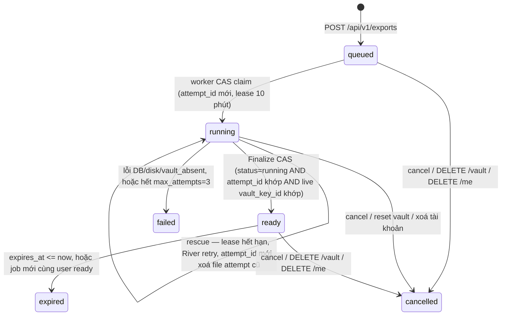

# P06 — Hoàn thiện và phát hành beta MVP · Kế hoạch triển khai

> Trạng thái: kế hoạch **r3** (sửa theo delta review r2 `reports/p06plan/review-be-r2.md` C01..C21 + R2-01..R2-04 và `reports/p06plan/review-fe-r2.md` FE-R1-01..19 + N-01..N-11, trên nền r1 `advisor-dec-P06-016`/`-019`; bảng sửa `reports/p06plan/fix-log-r3.md`), chưa triển khai.
> Nguồn: [P06](../phases/P06-beta.md), [SPEC](../SPEC.md) §3.11, §5, §7.6–§7.8, §8, §9.1–§9.2, §10, §11.1–§11.5, [ADR 0001](../adr/0001-auth-session-va-reauth-assurance.md), [ADR 0002](../adr/0002-vault-crypto-layout.md), [ADR 0003](../adr/0003-webauthn-prf-va-devkey.md), [ADR 0004](../adr/0004-embedding-provider-openai-compat.md), [ADR 0005](../adr/0005-content-lossless-va-concurrency.md), [ADR 0006](../adr/0006-account-password-reset.md), [threat model](../threat-model.md), [plan P05](2026-11-02-P05-search.md), mockups `settings/states/docs/legal/landing.html`; quyết định P06 `advisor-dec-P06-001..014` (đặc biệt `advisor-dec-P06-003` D1–D12 về export/delete UX, `advisor-dec-P06-011` về consent semantic/mail/reset-backup/dogfood-delete), `advisor-dec-P06-016` (BE r1 rulings), `advisor-dec-P06-018` (runner RUNNER READY), `advisor-dec-P06-019` (FE r1 rulings), `reports/p06plan/{baseline,draft-export,draft-ui,draft-ops}.md`, `reports/opsrecon/baseline-ops.md`, `reports/uxdesign/{decisions,privacy-truth}.md`, `reports/backupnow/`, `reports/cloudrun/T1-worker.md`, `reports/p06plan/review-fe-r1.md` (FE-R1-01..19).
> Quy ước: `§` chỉ mục SPEC; "mục" chỉ mục của plan này. Mọi đường dẫn code là đường dẫn trong repo tại `phase06/beta` @ `4168106` (= `9f9bafd` + merge `phase06/i18nsweep` `1fb201c` + merge `phase06/cloudrun` `4168106`); P05 đã squash vào `develop`; **chưa có** = không có trong code ở SHA này. **BE** = `apps/api/**`, `scripts/**`, SQL, migration, handler OpenAPI; **FE** = `apps/web/**`, `packages/shared-types/**`, `packages/crypto-vectors/**` (crypto-vectors chỉ đọc); **Ops** = `infra/**`, `docs/runbooks/**`, `.data/deploy/**`, systemd trên `bro`; **Runner** = `cursor-runner` = Cursor cloud runner (`.cursor/cloud/specs/*.txt` đã merge `4168106`), `ci` = GitHub Actions `ci.yml`, `bro-ops` = thao tác trực tiếp trên VPS `bro` (Ubuntu 24.04 ARM64), `visual-local` = `pi/tester_visual` + Orca browser + Jev `visual`. Lane trên `bro` = `lead-working` + Advisor-started sibling reviewers/testers (không nest worker).

**Mục tiêu:** Bản beta dùng được với dữ liệu thật trên `engram.zone17.click`, đủ toàn bộ MVP: auth, vault/passkey/RK/DevKey, Item/Tag/text/JSON, lexical+semantic, encrypted `.sabk.json` export và decrypted JSON export, xoá tài khoản có re-auth + xác nhận email, docs/privacy/help đúng với hành vi thật, vận hành có backup PITR/restore rehearsal và release/rollback runbook. Không bàn giao bản chỉ mô phỏng các nút Settings hoặc copy privacy chưa đúng với thực tế.

**Phạm vi:** 23 task (gồm carry-forward UI/BE/security từ P03–P05; Task 5b consent semantic và Task 22 production ops tách riêng ở r2) chia năm wave W0–W4 theo lane song song, giao theo 11 acceptance P06-A1..A11 của phase doc. Task 1 là contract duy nhất; mọi lệch SPEC/ADR/OpenAPI nằm trong đó.

| Mốc | Task | Điều kiện qua mốc |
|---|---|---|
| P06-A — Export & Delete (A1, A2, A3, A4, A11) | 1, 2, 3, 5b, 11, 12, 13 | Task 1 merge; `.sabk.json` offline restore đạt; decrypted JSON giữ raw string; delete/reset phân biệt đúng; rate limit 3/giờ đếm cả cancelled; consent semantic mặc định tắt |
| P06-B — UI & Docs (A5, A10) | 6, 7, 14, 15, 18 | `uipolish` + `docsprivacy` merge; U1–U20 có owner; visual/a11y/axe sạch; i18n en/vi đồng bộ |
| P06-C — Ops, Security & Release (A6, A7, A8, A9) | 4, 5, 8, 9, 10, 16, 17, 19, 20, 21, 22 | CSP/HSTS/metrics/backup/PITR/security tests đạt; NFR đo được; runbook + PROD-STEP hoàn tất |

Phase chỉ Done khi cả 3 mốc đạt + gate P01–P05 re-check pass. Thiếu deploy credentials, hardware PRF, crypto reviewer thứ hai hay restore evidence = **BLOCKER-* còn mở → phase/release acceptance vẫn `pending`**; chỉ báo phần đã xong, không đánh dấu P06 Done. Chỉ Advisor (có quyền) được ghi quyết định đổi scope/gate rõ ràng trước khi đổi checklist (R1-21).

**Kiểm tra nặng (R1-17/C17, team-rules §Tests + RUNNER READY):** mọi `go test` nhiều package / `-race` / integration (Docker Postgres), `pnpm` full web unit, Playwright, build Docker, rehearsal chạy qua Cursor cloud runner `node .cursor/cloud/cloud-runner.mjs test --spec reports/<lane>/cloud-spec-<seq>.txt --lane <lane> --out reports/<lane>/cloud-test-<seq>.md`. **Spec của lane là file riêng `reports/<lane>/cloud-spec-<seq>.txt`** chứa đúng lệnh targeted của hàng evidence, mỗi dòng dạng `(cd apps/api && go test -v -run '<Tên>' ./<pkg>); rc=$?; echo; echo NAME_EXIT=$rc` (cwd tường minh, rc giữ lại, marker); group `.cursor/cloud/specs/{go-unit,gen-nodiff,web-unit,go-race-integration,e2e,full}.txt` chỉ là **regression riêng**, không bao giờ được ghi như thể group chứa lệnh targeted. Host `local`/`bro` chỉ được: sửa file, git, **một** `go test ./<pkg> -run <Tên>` hoặc **một** file vitest. Mỗi hàng evidence ghi: cwd, package/project đúng, dòng spec thật, exit, raw log, tested SHA, và grep tên test trong log (`--- PASS: <Tên>` / `✓ <tên>`), không chấp nhận `no tests to run`. Trong các bảng dưới, "spec `<group>`" = dòng lệnh đó đặt trong cloud-spec của lane + group đó chạy làm regression. Mọi lệnh Go chạy với cwd `apps/api`; mọi lệnh web với cwd `apps/web`.

**Chia lane song song (r3, R1-14/C14/N-01..N-04).** Quy tắc: (a) **trong W1 mỗi file có đúng một lane chủ** (bảng mục 4.2 là bảng thực thi; file không có trong bảng = không lane nào sửa); (b) qua các wave, một file chỉ đổi chủ theo **chuỗi bàn giao tuần tự đã liệt kê** trong cột "seam" dưới đây (producer merge trước, consumer rebase sau), không có bàn giao ngầm; (c) file chung (OpenAPI, `api.d.ts`, `db/gen/models.go`, khoá i18n dành sẵn) sinh ở W0 bởi `contract`, các lane sau chỉ *đọc*.

| Wave | Lane → task | Bắt đầu khi | Ghi chú seam |
|---|---|---|---|
| W0 (1 lane) | `contract` → 1 | đã đủ (`uxdesign` `0484d6b`/`backupnow` `44ae700`/`vulnfix` `7807a2b`/`i18nsweep` `1fb201c`/`prodhygiene` `f0e1569`/`cloudrun` `4168106` đã merge `phase06/beta`) | `contract` sở hữu: config mới (`internal/config/{config,config_test}.go`), `internal/auth/mail.go`, migration `0010_p06`, **sqlc output chung** `internal/db/gen/{models.go,db.go}` (regen sau `0010`), OpenAPI + `api.d.ts`, error codes, secevent, `.env.example`, mockup copy fixes, và **mọi khoá i18n mới mà lane W1 cần ngoài `docs.*`/`legal.*`/`landing.*`** (mục 4.2 `contract`, gồm khoá `uipolish` N-04). |
| W1 (9 lane độc lập) | `exportbe` → 2; `accountdelbe` → 3; `ops-obs` → 4; `ops-config` → 5; `consentbe` → 5b-BE; `uipolish` → 6; `docsprivacy` → 7; `ops-edge` → 8; `ops-dr` → 9 → 10 | **Task 1 merge** (mọi lane W1; không lane W1 nào chờ lane W1 khác) | Mục 4.2 là bảng disjoint. sqlc: mỗi lane chỉ sở hữu file query của nó + đúng file `<query>.sql.go` sinh ra (`export*.sql.go` → `exportbe`; `auth.sql.go` → `consentbe`); không ai regen `models.go` sau W0 (đổi schema = PR contract nhỏ). `messages/{en,vi}.json` W1: chỉ `docsprivacy` (khoá `docs.*`/`legal.*`/`landing.*`); `uipolish` dùng khoá `contract` đã thêm sẵn, **không** sửa messages. `apps/web/middleware.ts`: chỉ `ops-edge` (gồm locale cookie F-02). |
| W2 (4 lane; `exportui` 12→13 tuần tự) | `exportapi` → 11; `exportui` → 12 → 13; `consentui` → 5b-FE; `nfr-bench` → 19 | 11: Task 2 + 4 merge. 12–13: Task 11 + 3 merge. `consentui`: Task 5b-BE + 6 + 8 merge + `exportui` merge (messages). 19: Task 1 merge | Bàn giao tuần tự: `router.go` `ops-obs` (W1) → `exportapi` (W2); `app/app/layout.tsx` `ops-edge` (W1, CSP nonce) → `consentui` (W2, mount banner); `messages/{en,vi}.json` `docsprivacy` (W1) → `exportui` (W2) → `consentui` (W2) → `copyfix` (W3). |
| Staging | `release` → 21a (staging ứng viên trên `cursor-runner`) | W1 + W2 merge (**không** chờ W3) | 21a chỉ cần SHA ứng viên W1–W2; Task 20 (W3) đo trên staging này. Không có vòng phụ thuộc (C19). |
| W3 (5 lane) | `copyfix` → 15; `sec-tests` → 16; `sec-review` → 17; `uiqa` → 14 → 18; `nfr-bench` → 20 | 15: 12, 13, 5b-FE, 6, 7 merge. 16: 3, 4, 8, 11, 12, 13 merge. 17: W1–W2 merge. 14: Task 6 merge; 18: 14 + 12 + 13 + 5b-FE + 6 + 7 merge. 20: 19 + 21a pass | `scripts/sanitize-e2e-artifacts.mjs` `exportui` (W2) → `uiqa` (W3). Evidence: mỗi lane ghi shard `docs/phases/evidence/P06/<lane>.md`; **chỉ `release` ghi `docs/phases/evidence/P06.md`** (tổng hợp). |
| W4 (1 lane) | `release` → 21b deploy → 21c post-deploy | W1–W3 merge + 21a pass + runner `full` xanh trên SHA cuối + `ops-prod` PROD-STEP-2..7 xong | 21c (PRF/OAuth/SMTP/consent/log-scrub trên production) chạy **sau** deploy dưới GO riêng; là điều kiện nghiệm thu phase, không phải điều kiện deploy. Task 22 (`ops-prod`) không chờ W4: mỗi PROD-STEP có GO riêng khi script review + rehearsal xong; Task 22 PROD-STEP-4/5 chờ Task 10 scratch pass. |

Không lane nào sửa `apps/web/lib/crypto/**`, `apps/api/internal/vault/{envelope,wrap,kdf}.go`, `apps/web/features/vault/vault-provider.tsx` hay envelope/wrap/KDF formats (crypto gate §11.4, gate mục 5). Export chỉ đọc và sao chép nguyên các wrap/key-id hiện có (R1-01). Khi thực hiện, đánh dấu checkbox theo kết quả thực tế.

## 1. Baseline và ranh giới

### 1.1. Hiện trạng code (`phase06/beta` @ `4168106`)

- **Migrations (`apps/api/migrations/`):** `0001`–`0009` (cuối = `0009_embedding`). Chưa có bảng `export_job`/`export_file_cleanup`, chưa có cột `app_user.semantic_consent_seen_at`, `settings.semantic_suggest` default `true` (`0004_auth.up.sql:11`). Migration tiếp theo = `0010_p06`.
- **OpenAPI (`apps/api/api/openapi.yaml`):** 70 `operationId` hiện có; chưa có `exportCreate`, `exportGetLatest`, `exportGet`, `exportDownload`, `exportCancel`, `exportDecryptedPages`, `exportDecryptedAudit`, `accountDelete`. `ReauthAction` enum đã có `export.decrypted` + `account.delete` (l.3144-3165). `ProblemCodes` catalog chưa có `export_not_ready`, `export_expired`, `account_delete_confirm_invalid`.
- **Handlers Export/Delete:** chưa có `apps/api/internal/export/**`, chưa có `DELETE /api/v1/me`. `POST /audit/export-decrypted` chưa có. `export.encrypted`/`export.decrypted`/`account.delete` chưa có trong `secevent/event.go` (có `entry.import` từ P04 nhưng chưa có trong FE `audit-catalog.ts`).
- **Rate limit (`apps/api/internal/httpx/userlimit.go`):** `MaxRateLimitWindow = 15 * time.Minute`; chưa có `ScopeExportCreate`. `rate_event_prune` dùng `MaxRateLimitWindow`.
- **Settings UI (`apps/web/app/app/settings/page.tsx`):** `#dulieu` chỉ là placeholder tĩnh (l.75-83); chưa có `features/settings/data/**`, `lib/api/export.ts`, `deleteAccount`. `audit-catalog.ts` thiếu `entry.import` + `export.*` + `account.delete`.
- **Docs/Privacy:** chưa có `/docs` route; `legal.deletion.exportDeleteBody` vẫn nói "đang được bổ sung (ở bản phát hành tiếp theo)". `LegalPageContent` chưa có `LocaleSwitch`.
- **CSP/Security headers (`apps/web/next.config.ts`):** `script-src` còn `'unsafe-inline'`; chưa có HSTS, `Permissions-Policy`, `poweredByHeader: false`, `/.well-known/build-manifest`. `/api/v1/metrics` mount công khai không guard.
- **Observability:** `worker`/`web` chưa có healthcheck; chưa có alert script; chưa có collector `export_jobs_total`/`account_deletions_total`.
- **Backup/DR:** `archive_mode=off`; lane `backupnow` (`advisor-dec-P06-005..010`, merged `44ae700`) đã cài nightly `pg_dump` GPG encrypted `engram-backup.timer` 03:17 UTC+7 + GPG public key `F2C47029...` + off-host pull; chưa có WAL archiving/PITR/base backup/restore rehearsal. Lane `vulnfix` (`advisor-dec-P06-013`, merged `7807a2b`) bump `klauspost/compress` v1.20.2 (GO-2026-6865).

### 1.2. Hiện trạng `bro` (`opsrecon/baseline-ops.md`)

- Ubuntu 24.04 ARM64, 23 GB RAM (~9 GB free), `/` 145 GB used 85% (23 GB free), Docker 29.6.1.
- `engram-api-1` healthy, `engram-worker-1`/`engram-web-1` no healthcheck, `engram-db-1` `pg_isready` healthy.
- `APP_ENV=development` trên production (HIGH); `archive_mode=off`, `data_checksums=off`; chưa có scheduled/encrypted/off-host backups (backupnow interim đã lắp đặt).
- `global_nginx` `engram.conf`: TLS Let's Encrypt (hết hạn 2027-01-29), `log_format engram_noquery` (không log query string — gate 8a P05), no `/api` location (proxy qua Next), `server_tokens on`, no HSTS.
- Docker `json-file` driver no rotation; 13 GB reclaimable images; volumes `engram_engram-db` (69 MB), `engram_engram-mail` (mail sink).
- Lane `prodhygiene` (advisor-dec-P06-014) đã hoàn tất opsrecon §6 bước 1 (image prune done), bước 2 (log rotation prep `infra/deploy/`), bước 8 (APP_ENV analysis) — các bước 3–7 còn lại là tasks của plan này.

### 1.3. Gate re-check P01–P05

| Phase | Evidence | Còn mở → đặt ở |
|---|---|---|
| P01 | `docs/phases/evidence/P01.md` | CSP `'unsafe-inline'` (advisor-dec-014) → Task 8 |
| P02 | `docs/phases/evidence/P02.md` | OAuth Google/GitHub + Turnstile credentials (`user-dec-017`) → smoke `sec-review`/`release`; `MAIL-CAP-P02` → Task 5 |
| P03 | `docs/phases/evidence/P03.md` | Crypto review 2 người §11.4 (`P03.md:112`) → Task 17; PRF hardware smoke → Task 21c (sau deploy, cần RP ID production); `dialog.tsx` focus return (advisor-dec-080) → Task 6, 12, 13; i18n sweep (advisor-dec-090/094) → **đã xong** ở `i18nsweep` `1fb201c` (Task 15 cũ bỏ theo `advisor-dec-P06-019`; khoá mới chỉ mở rộng `i18n.parity.test.ts`) |
| P04 | `docs/phases/evidence/P04.md` | `FU-ENTRYUX-VISDIFF` (advisor-dec-376) → Task 14; `FU-DEVKEY-VISUAL` (advisor-dec-378/379) → Task 14; `FU-T26-390-OVERFLOW` (advisor-dec-342) → Task 6; `FU-T22-SEMCHIP-HOVER` (advisor-dec-347) → Task 6; `FU-T22-429-STICKY` (advisor-dec-335) → Task 6; `FU-T22-MANUAL` (advisor-dec-323) → Task 18; `FU-T24-ABSCLAIMS` (advisor-dec-346) → Task 1 + 7; `FU-T13-OAS` (advisor-dec-300) → Task 1; `FU-OWNER-SEMDEFAULT` (advisor-dec-362) → **Task 5b** (default tắt trong DB, `advisor-dec-P06-016` R1-15); Trash UI Q9 (advisor-dec-107) → giữ nguyên, ghi docs Task 7; `A11Y-SAVING-LIVE`/`A11Y-UNDO-FOCUS-FLICKER` (advisor-dec-217) → Task 6/18 |
| P05 | `docs/phases/evidence/P05.md` | `FU-P06-SEM-OBSERVE`/`FU-T24-OBSERVE24H` → Task 20; `FU-T23-RUNNER` (advisor-dec-354) → Task 20; `FU-SL-3` (advisor-dec-351) → post-MVP note; `FU-T23-0010` (advisor-dec-350) → tuỳ chọn Task 21 nếu report chứng minh; `embedding_jobs_total` gap → runbook (ghi nhận); `FU-T20A-ERRCLASS`/`FU-T20A-LEADER`/`FU-T20B1-LOWS`/`FU-T17-FEC25` → post-MVP note; chip tag fuzzy `suggest?scope=tag` → post-MVP nếu không kịp |

## 2. Contract chuẩn cho mọi task

### 2.1. Schema `.sabk.json` v1 (Encrypted Backup) & Định danh phiên bản

File sao lưu mã hoá có phần mở rộng `.sabk.json`, tên tải về mặc định **`engram-backup-YYYY-MM-DD.sabk.json`** (UTC date theo `exported_at`), `Content-Type: application/json; charset=utf-8`.

Cấu trúc JSON chính xác (`.sabk.json` v1):

```json
{
  "format": "engram.sabk",
  "version": 1,
  "exported_at": "2026-11-07T08:30:00Z",
  "snapshot": {
    "consistency": "repeatable_read",
    "includes_active": true,
    "includes_soft_deleted_unpurged": true,
    "excludes_purged": true,
    "soft_delete_retention_days": 30,
    "counts": { "tags": 1, "items": 1, "item_tags": 1, "entries": 1 }
  },
  "vault": {
    "vault_key_id": "vk:AAECAwQFBgcICQoLDA0ODw",
    "version": 3,
    "kdf": { "alg": "argon2id13", "ops": 3, "mem": 67108864, "parallelism": 1, "salt": "<16B base64url>" },
    "vault_key_wrapped_by_kek": "<73B base64url wrapK>",
    "x25519_public": "<32B base64url>",
    "ed25519_public": "<32B base64url>",
    "private_keys_wrapped": "<105B base64url wrapP>",
    "recovery_keys": [
      { "slot": 1, "lookup_hash": "<32B base64url>", "wrap": "<73B base64url>" }
    ],
    "passkeys": [
      {
        "id": "<uuid>", "name": "MacBook Touch ID",
        "cred_id": "<base64url>", "prf_salt": "<32B base64url>",
        "vk_wrap": "<73B base64url>", "pubkey": "<base64url>",
        "aaguid": "adce0002-35bc-c60a-648b-0b25f1f05503",
        "created_at": "2026-10-29T10:00:00Z"
      }
    ]
  },
  "tags": [
    { "id": "<uuid>", "display": "wifi-khách", "normalized": "wifi-khách", "item_count": 1,
      "last_used_at": "2026-11-01T00:00:00Z", "created_at": "2026-10-01T00:00:00Z", "deleted_at": null }
  ],
  "items": [
    { "id": "<uuid>", "name": "wifi", "name_normalized": "wifi", "hint": "Tầng 2",
      "entry_count": 1, "version": 1, "last_used_at": "2026-11-05T12:00:00Z",
      "created_at": "2026-10-01T00:00:00Z", "updated_at": "2026-11-05T12:00:00Z",
      "deleted_at": null, "delete_batch": null }
  ],
  "item_tags": [
    { "item_id": "<uuid>", "tag_id": "<uuid>", "created_at": "2026-10-01T00:00:00Z" }
  ],
  "entries": [
    {
      "id": "<uuidv7>", "item_id": "<uuid>", "type": "text", "position": 0, "version": 1,
      "plaintext_len_bucket": 256,
      "envelope": {
        "v": 1, "alg": "xchacha20poly1305-ietf",
        "key_id": "vk:AAECAwQFBgcICQoLDA0ODw",
        "nonce": "<24B base64url>", "ct_enc": "utf8"
      },
      "ciphertext": "<base64url>",
      "created_at": "2026-10-01T00:05:00Z", "updated_at": "2026-10-01T00:05:00Z",
      "deleted_at": null, "deleted_via": null, "delete_batch": null
    }
  ]
}
```

Bất biến của `.sabk.json` v1 (`SPEC.md` §3.11, `P06-beta.md`, `P06-A2`):

- **`format` = `"engram.sabk"`, `version` = `1` cố định.** Khi có thay đổi phá vỡ tương thích ở các phase sau (P07+), tăng `version`.
- **Khối `vault` đầy đủ để mở lại độc lập không cần live server:** `vault_key_id` (**sao chép nguyên chuỗi `vk:<base64url 16 B>`** đúng regexp `^vk:[A-Za-z0-9_-]{22}$` của `vault/kdf.go:32-64`, **không phải UUID**), `version`, `kdf` (`alg`, `ops`, `mem`, `parallelism`, `salt` base64url 16 B), `vault_key_wrapped_by_kek` (wrapK base64url 73 B), `x25519_public` (32 B), `ed25519_public` (32 B), `private_keys_wrapped` (wrapP base64url **105 B** = `1+24+64+16`, `vault/wrap.go:19-21`, `js-v1.json:115-123`). `entries[].envelope.key_id` cũng sao chép nguyên `vk:...`. **Không đổi wrap/envelope/KDF để khớp fixture** (R1-01). `recovery_keys`: mảng các hàng còn sống trong `vault_recovery_key` sắp theo `slot ASC` (`1..10`), gồm `{slot, lookup_hash, wrap}` (`lookup_hash` 32 B, `wrap` 73 B — **tuyệt đối không có plaintext RK**). `passkeys`: mảng các hàng trong `vault_passkey` sắp theo `created_at ASC, id ASC`, gồm `{id, name, cred_id, prf_salt, vk_wrap, pubkey, aaguid, created_at}` (mọi trường bytea mã hoá base64url không padding). **Không bao giờ** chứa `user_id`, email, session token, hay bất kỳ secret chưa wrap nào.
- **Thứ tự sắp xếp xác định:** `tags` `(created_at, id)`; `items` `(created_at, id)`; `item_tags` `(item_id, tag_id)`; `entries` `(item_id, position, id)`. Mọi mảng rỗng serialize là `[]` (không `null`).
- **Fixture:** `apps/api/internal/export/testdata/sabk_v1_sample.sabk.json` **sinh từ `packages/crypto-vectors/vectors/js-v1.json` hiện có** (script `internal/export/testdata/gen_fixture_test.go` `-run TestGenSabkFixture -update`), phải qua validator **hiện có** `vault.ValidateVaultKeyID` (`vault/kdf.go:57-64`) và `vault.ValidateEnvelopeStruct` (`vault/envelope.go:54-71`) + kiểm độ dài wrapP 105 B, không tạo shim và không sửa file crypto gated (C01); bản sao `apps/web/features/settings/data/__fixtures__/sabk_v1_sample.sabk.json` (không đụng `packages/crypto-vectors/**`). Mọi ví dụ key-id trong plan dùng giá trị hợp lệ `vk:AAECAwQFBgcICQoLDA0ODw` (22 ký tự base64url = 16 B `0x00..0x0f`).
- **Test khôi phục độc lập (`P06-A2`):** `apps/web/features/settings/data/sabk-offline-restore.test.ts` + `apps/api/internal/export/sabk_restore_test.go` chứng minh chỉ dùng file `.sabk.json` + passphrase gốc (hoặc RK gốc / PRF output gốc) trên môi trường hoàn toàn không có mạng/session, kể cả sau khi live server đã đổi passphrase (`PUT /vault/kek`), consume RK (`POST /vault/recover/complete`), thu hồi passkey (`DELETE /vault/passkeys/{id}`) hoặc xoá tài khoản, vẫn giải mã lại được `VK` từ `vault_key_wrapped_by_kek`/`recovery_keys[].wrap`/`passkeys[].vk_wrap` và mở được toàn bộ `entries[].ciphertext`.

### 2.2. Định dạng Decrypted JSON (`engram-readable-YYYY-MM-DD.json`) (`P06-A3`)

File xuất đọc được do **client tự giải mã cục bộ trong trình duyệt** (sau khi kho đã mở `vault.state === 'unlocked'` và người dùng vừa xác thực lại với grant `export.decrypted`), tên tải về mặc định `engram-readable-YYYY-MM-DD.json` (`advisor-dec-P06-003` D11). **Server không bao giờ tạo hay nhận file này (`user-dec-016`).**

Định dạng **phẳng, có thể ghi tuần tự** (R1-07): thứ tự khoá cố định `format`, `version`, `exported_at`, `vault_key_id`, `warning`, `snapshot`, `tags`, `items`, `entries`; mỗi mảng được ghi phần tử-từng-phần tử vào sink, không cần giữ cấu trúc lồng trong RAM.

```json
{
  "format": "engram.readable",
  "version": 1,
  "exported_at": "2026-11-07T08:35:00Z",
  "vault_key_id": "vk:AAECAwQFBgcICQoLDA0ODw",
  "warning": "SENSITIVE PLAINTEXT EXPORT — Anyone with this file can read all entries.",
  "snapshot": {
    "source_export_id": "<uuid của job .sabk.json nguồn>",
    "includes_active": true,
    "includes_soft_deleted_unpurged": false,
    "excludes_purged": true,
    "counts": { "tags": 1, "items": 1, "entries": 1 }
  },
  "tags": [
    { "id": "<uuid>", "display": "wifi-khách", "item_count": 1, "last_used_at": "...", "created_at": "..." }
  ],
  "items": [
    { "id": "<uuid>", "name": "wifi", "hint": "Tầng 2", "tag_ids": ["<uuid>"],
      "version": 1, "last_used_at": "...", "created_at": "...", "updated_at": "..." }
  ],
  "entries": [
    { "id": "<uuidv7>", "item_id": "<uuid>", "type": "json", "position": 0, "version": 1,
      "body": "{\"big\":9007199254740993,\"dup\":1,\"dup\":2,\"negZero\":-0}",
      "created_at": "...", "updated_at": "..." }
  ]
}
```

- **Quy tắc bảo toàn chuỗi gốc (`P06-A3`, `ADR 0005`):** `entries[].body` **luôn là chuỗi JSON (`string`) chứa đúng các byte UTF-8 nguyên bản** sau khi `openEntry` giải mã, kèm `type: "text" | "json"`. Client **tuyệt đối không** `JSON.parse` rồi `JSON.stringify` (mất số nguyên > `Number.MAX_SAFE_INTEGER`, `-0`, khoá trùng, thứ tự khoá). Chuỗi UTF-8 nguyên bản chỉ được JSON-escape thành JSON string literal khi đóng gói.
- **Chính sách lỗi (`advisor-dec-P06-003` D12):** trước và trong khi giải mã từng trang, client kiểm tra `page.vault_key_id === currentVaultKeyId` và `entry.envelope.key_id === currentVaultKeyId`. Nếu bất kỳ entry nào có `key_id` lệch, giải mã lỗi, nguồn snapshot hết hạn/bị huỷ (`410`/`409`), hoặc kho bị khoá/reset giữa chừng → **huỷ ngay toàn bộ lần xuất, huỷ sink (`WritableStream.abort()` xoá file tạm của File System Access; fallback xoá mảng `BlobPart[]`), không tạo file tải về một phần**.

### 2.3. Snapshot Consistency & Tombstone/Purge

1. **Snapshot `REPEATABLE READ READ ONLY` chỉ để đọc dữ liệu (`P06-A2`, R1-04):** worker `export_encrypted` mở transaction `ISOLATION LEVEL REPEATABLE READ READ ONLY` (MVCC snapshot cố định, không khoá ghi, không chặn `DELETE /vault`/`content_purge`). Câu đầu đọc `vault` — không có hàng → `failed` `vault_absent`. Mọi truy vấn dữ liệu sau (`vault_recovery_key`, `vault_passkey`, `tag`, `item`, `item_tag`, `entry`) chạy trên cùng `tx`. **Trạng thái huỷ không đọc từ tx này** (RR sẽ luôn thấy `running` cũ): giữa các lô, worker đọc `export_job.status`/`attempt_id` bằng **kết nối READ COMMITTED riêng** từ pool. Publication theo mục 2.4 "Finalize CAS".
2. **Tombstone/Purge trong manifest:**
   - `.sabk.json`: gồm cả active (`deleted_at IS NULL`) và soft-deleted chưa purge (`deleted_at IS NOT NULL`, trong cửa sổ 30 ngày `content_purge`), giữ nguyên `deleted_at`, `deleted_via`, `delete_batch`. Purged (sau 30 ngày hoặc `DELETE /vault` xoá cứng) không có trong snapshot (`snapshot.excludes_purged = true`).
   - Decrypted JSON: chỉ `deleted_at IS NULL` (`includes_soft_deleted_unpurged = false`), ghi rõ trong `snapshot` và `<details>` UI.

### 2.4. Export Job State Machine

Bảng `export_job` quản lý vòng đời `.sabk.json` với 6 trạng thái; terminal = `failed`/`cancelled`/`expired` **không bao giờ quay lại** `running`/`ready`.



| Trạng thái | Ý nghĩa | File trên đĩa | Cancel? | Download? |
|---|---|---|---|---|
| `queued` | Đã insert `export_job` + River job cùng tx | Chưa có | Có → `cancelled` | `409 export_not_ready` |
| `running` | Worker giữ `attempt_id` + `lease_until` | `<job>.<attempt>.tmp` (xoá nếu lỗi/huỷ/rescue) | Có → `cancelled` | `409 export_not_ready` |
| `ready` | File publish xong, còn 24h | `<job>.<attempt>.sabk.enc` | Có → `cancelled`, xoá file | **`200`** |
| `failed` | Lỗi I/O, DB, `vault_absent`, hết attempt | Không | Idempotent `200` | `409 export_not_ready` |
| `cancelled` | User huỷ / reset vault / xoá account | Đã xoá (hoặc cleanup record đang chờ) | Idempotent `200` | `409 export_not_ready` |
| `expired` | Quá 24h, bị job mới thay, hoặc drain do xoay `EXPORT_AT_REST_SECRET` | Đã xoá (cleanup bền vững) | `410 export_expired` | `410 export_expired` |

- **Claim/lease/rescue (R1-04, C04):** `UPDATE export_job SET status='running', attempt_id=gen_random_uuid(), lease_until=now()+'10 min', started_at=coalesce(started_at, now()) WHERE id=$1 AND (status='queued' OR (status='running' AND lease_until < now())) RETURNING attempt_id`. **0 hàng thì phân nhánh** bằng một `SELECT status, lease_until` (READ COMMITTED): (a) status terminal (`ready`/`failed`/`cancelled`/`expired`) → River `JobCancel`; (b) `running` với lease còn sống → `river.JobSnooze(lease_until − now() + 5s)` (không kết thúc công việc rescue). **Lỗi trong attempt** (DB/disk/ctx) → trước khi trả lỗi cho River, worker CAS **nhả lease** `UPDATE export_job SET lease_until=now() WHERE id=$1 AND status='running' AND attempt_id=$2` + unlink `.tmp`, để lần retry kế tiếp claim được ngay. Attempt cuối (`attempt == MaxAttempts=3`) lỗi → CAS `status='failed', error_code` **chỉ khi** `status='running' AND attempt_id=$2` (không hồi sinh terminal, không đè attempt mới). Worker bị kill (không kịp nhả lease) → River rescue job kẹt, retry claim sau khi lease hết hạn. **Reconciler** trong `export_prune` (15 phút): job `running` có `lease_until < now() − 15 min` mà không còn River job `available`/`running`/`retryable`/`scheduled` cùng `job_id` → CAS `failed` `worker_lost` + cleanup record; nhờ vậy unique active index không giữ một job mồ côi. Renew lease mỗi lô = CAS theo `attempt_id` (0 hàng → attempt đã bị thay/huỷ → dừng, xoá `.tmp`). File attempt cũ bị xoá khi claim mới thành công hoặc bởi `export_prune`.
- **Finalize CAS (R1-04):** sau `fsync(tmp)` + `rename(tmp → <job>.<attempt>.sabk.enc)` + `fsync(dir)`, worker mở transaction READ COMMITTED riêng, lấy khoá cùng thứ tự với reset/delete (`app_user FOR SHARE` → `vault FOR SHARE` → `export_job FOR UPDATE`), kiểm `app_user` tồn tại + `vault.vault_key_id = snapshot_vault_key_id` + `status='running'` + `attempt_id` khớp, rồi `UPDATE ... SET status='ready', file_name, size_bytes, completed_at, expires_at=now()+24h` và `ready` cũ của user → `expired` (ghi cleanup record cho file cũ) trong **cùng tx** — job `ready` cũ chỉ hết hạn khi job thay thế thực sự `ready`. Nếu UPDATE không đúng 1 hàng → rollback, unlink file attempt, River job kết thúc `JobCancel`. `DELETE /vault` và `DELETE /me` lấy `app_user FOR UPDATE` → `vault FOR UPDATE` → `export_job FOR UPDATE` nên không xen giữa kiểm và CAS.
- **Coalescing + một job active (R1-05, R2-04):** tối đa 1 job `queued`/`running` mỗi `(user_id, kind)` — **unique partial index** `export_job_one_active_idx ON export_job (user_id, kind) WHERE status IN ('queued','running')`. Thứ tự `POST /exports`: (0) `EXPORT_CREATE_PAUSED=true` → `503 dependency_unavailable` + `Retry-After: 600` trước mọi ghi (mã catalog hiện có, R2-01); (1) idempotency replay cùng key → trả bản ghi cũ; (2) `pg_advisory_xact_lock(hashtext('export_create:'||user_id))`; (3) có job **`queued`/`running`** → `202` job đó, **không** tiêu quota; job `ready` **không** được coalesce: `POST` luôn tạo snapshot mới (bản `ready` cũ vẫn tải được tới khi bản mới `ready`); (4) chỉ khi tạo mới: kiểm + ghi `rate_event` `export_create` (3/60m) → `INSERT export_job` → River `InsertTx`, **cùng một transaction**. Vì vậy `export_create` **không** mount middleware `UserLimiter` (nó commit event trước handler, `userlimit.go:118-183`); handler gọi `UserLimiter.ConsumeTx(ctx, tx, ScopeExportCreate, userID)` (API mới ở Task 1). Trong bảng endpoint mục 3, `Q(export_create)` nghĩa đúng là `ConsumeTx` này.
- **Reload trang:** `GET /exports/latest` trả job gần nhất; nếu `expires_at <= now()` và `status == 'ready'` thì trả `status: "expired"` ngay khi đọc (cron `export_prune` chưa chạy). FE map trạng thái này khi mount (Task 12).
### 2.5. Storage, Mã hoá At-Rest, Expiry 24h, Cleanup & Owner Auth

1. **Storage (`infra/docker-compose.yml`, chủ `ops-obs`):** volume `engram-exports:/var/lib/engram-exports` mount vào `api` + `worker` (uid:gid `65532:65532`, mode `0700`, env `EXPORT_STORAGE_DIR`; dev/test `os.TempDir()/engram-exports`). **Không** mount vào `web`/`nginx`.
2. **Khoá at-rest (R1-03/C03, `advisor-dec-P06-016`):** secret độc lập `EXPORT_AT_REST_SECRET` (kiểu `config.Secret`, ≥ 32 B sau base64 decode), **luôn cùng một giá trị ở `api` và `worker` trong mọi môi trường**: production/staging lấy từ env chung `x-engram-app-env` (bắt buộc, thiếu → boot fail); compose dev/e2e (`infra/docker-compose.yml`, `ops-obs`) đặt **một** giá trị test trong `x-engram-app-env`; `APP_ENV=development` thiếu env → hằng cố định `config.DevExportAtRestSecret` (giống nhau ở mọi process, bị từ chối ở staging/prod). **Không có fallback sinh ngẫu nhiên theo từng process.** **Không** dùng `AUTH_JWT_SECRET`. `fileKey = HKDF-SHA256(ikm=EXPORT_AT_REST_SECRET, salt=job_id(16B) ‖ attempt_id(16B), info="engram/export-at-rest/v1")` → 32 B. **Xoay khoá = drain** (bước gated riêng **`PROD-STEP-EXPORT-KEY-ROTATE`**, chỉ chạy khi cần xoay; runbook `docs/runbooks/release-rollback.md` §"Xoay EXPORT_AT_REST_SECRET"; khác hẳn `PROD-STEP-RETENTION` ở Task 22): (a) chặn create (`EXPORT_CREATE_PAUSED=true`), (b) mọi `queued`/`running` → `cancelled`, mọi `ready` → `expired` + cleanup record, (c) chờ cleanup xong: `SELECT count(*) FROM export_job WHERE file_name IS NOT NULL AND status IN ('queued','running','ready')` = 0, `SELECT count(*) FROM export_file_cleanup WHERE done_at IS NULL` = 0 và thư mục rỗng, (d) đổi secret ở **cả** api+worker trong một `compose up -d`, (e) bỏ pause. Không bao giờ có job `ready` không đọc được; người dùng tạo lại bản mới. Evidence (Task 21a staging): tạo export bằng worker thật → tải bằng api process riêng → restart api → tải lại `200` → chạy drain → đổi secret → tạo/tải mới `200`.
3. **Định dạng file at-rest `ENGX1` (R1-02/C02, không thêm primitive):** header (49 B) `magic "ENGX" ‖ version 0x01 ‖ nonce_prefix 16 B (CSPRNG mới **mỗi lần ghi/attempt**) ‖ job_id 16 B ‖ attempt_id 16 B`; sau đó các khung **`uint32_be(ct_len) ‖ final_flag_byte ‖ ciphertext`**, với `ciphertext = XChaCha20-Poly1305.Seal(key=fileKey, nonce = nonce_prefix ‖ uint64_be(counter), plaintext, AAD = header ‖ uint64_be(counter) ‖ final_flag_byte)`. `final_flag_byte` nằm **ngoài** ciphertext (đọc được trước khi mở), chỉ nhận `0x00` (tiếp) hoặc `0x01` (cuối), và được ràng buộc bằng AAD nên đổi flag → mở thất bại. `plaintext` 0..65 536 B, nên `16 ≤ ct_len ≤ 65 552` (tag 16 B). Reader kiểm **trước** cấp phát: header đúng magic/version/job_id/attempt_id khớp hàng DB; `ct_len` trong `[16, 65552]`; flag ∈ {0,1}; khung không-final phải có plaintext > 0 B; counter tăng từ 0; sau khung `final=1` phải là EOF chính xác. Bất biến: cặp (fileKey, nonce) không bao giờ lặp vì `attempt_id` + `nonce_prefix` mới mỗi attempt. Từ chối: header sai, truncate (EOF trước khung final), reorder (counter nằm trong nonce + AAD), append (byte sau khung final), flag bị đổi, flag ngoài {0,1}, `ct_len` ngoài biên. File rỗng logic = đúng 1 khung final plaintext 0 B. Kiểm tra độc lập bởi `sec-review` (Task 17) gồm reader/writer viết độc lập tương tác được.
4. **24h + `export_prune` (River periodic 15 phút):** `ready` → `expires_at = completed_at + 24h`. `export_prune`: `ready` `expires_at <= now()` → `expired` + cleanup record; chạy mọi `export_file_cleanup` chưa xong (mục 2.9 bước c); reconciler lease (mục 2.4); file attempt `.tmp`/`.sabk.enc` không khớp `(job_id, attempt_id)` của job `running` (lease còn) hoặc `ready` → xoá **ngay** (tên file mang job+attempt nên so khớp được); metadata `export_job` terminal > 90 ngày → xoá hàng. **Tên file (R2-03):** cột `file_name` chỉ chứa tên an toàn dạng `<job_uuid>.<attempt_uuid>.(tmp|sabk.enc)` (CHECK regex trong `0010`), luôn ghép dưới thư mục gốc cố định `EXPORT_STORAGE_DIR`; không bao giờ lưu đường dẫn tuyệt đối, user id, email hay tên do người dùng đặt.
5. **Owner auth (`user-dec-016`, `P06-A7`):** UUID v4 job ID; **không** bearer URL/query token — mọi endpoint qua `RequireSession` (`sabk_session` cookie). Handler kiểm `job.user_id == principal.UserID`; không tồn tại hoặc user khác → `404 not_found`. Log Go chỉ ghi route pattern (`httpx/middleware.go:59-68`). **Nginx (R1-18):** `engram.conf` thêm `map $uri $engram_log_uri { ~^/api/v1/exports/[^/]+(/.*)?$ /api/v1/exports/{id}$1; default $uri; }` và `log_format engram_noquery` dùng `$engram_log_uri` thay `$uri` (vẫn không có query string); chỉ vhost engram. Canary check (Task 16 + `PROD-STEP-7` post-check) thu cả access/error log nginx.

### 2.6. Rate Limit Export: 3 lần / giờ / user (đếm cả Cancelled) (`P06-A11`)

- Tối đa **3 job tạo trong cửa sổ trượt 60 phút / `user_id`**. **Đếm cả `cancelled`/`failed`** — lượt tạo ghi nhận ngay, **không hoàn trả** khi cancel (chống lách).
- **Quy tắc duy nhất (N-06, R2-01):** quota `export_create` 3/60m **chỉ bị tiêu khi một hàng `export_job` mới được INSERT** (`POST /exports` không coalesce). Coalesce = user đang có job `queued`/`running` → `202` job đó, 0 lượt. **Bản đọc được (decrypted):** client `GET /exports/latest`; nếu có job `ready` chưa hết hạn và `completed_at` ≥ `now − 10 phút` thì dùng lại, **không** `POST`; ngược lại `POST /exports` (1 lượt, hoặc coalesce 0 lượt). `GET /exports/{id}/decrypted-pages`, `GET /exports/{id}`, `GET /exports/latest`, `GET /exports/{id}/download`, `POST /exports/{id}/cancel`, `POST /audit/export-decrypted` **không bao giờ** tiêu quota. Khi hết lượt chỉ `POST` thứ 4 bị `429 rate_limited` + `Retry-After` + `retry_after`; job thứ 3 `running`/`ready` vẫn chạy/tải bình thường. Copy công khai (mockup `#dulieu`/`#plainDlg`, `/docs#gioi-han`, privacy): "Mỗi lần tạo bản sao lưu mới hoặc bản đọc được mới tính 1 lượt; tối đa 3 lượt mỗi giờ, kể cả lượt đã huỷ." / "Each new backup or readable export counts as 1; up to 3 per hour, including cancelled ones."
- Cài (Task 1): `ScopeExportCreate Scope = "export_create"` `Limit: 3, Window: 60m` trong `userlimit.go` + `ConsumeTx(ctx, tx, scope, userID)` dùng chung bảng `rate_event` trong transaction của caller (mục 2.4 coalescing); nâng `MaxRateLimitWindow = 60 * time.Minute` (từ 15m) để `rate_event_prune` giữ đủ 60 phút; lượt `cancelled`/`failed` vẫn nằm trong `rate_event` đủ 60 phút. Test cũ ghim 15m (`httpx/contract_test.go:318-335`, `content_idempotency_test.go:35-46`) **sửa/xoá có chủ đích**, không thêm test mới chạy song song với test cũ đỏ. UI `formatRetryClock` hiển thị `Thử lại lúc 14:12`.

### 2.7. Streaming / Phân trang (Server & Client — không nạp toàn Vault vào RAM)

1. **Server `.sabk.json` (`internal/export/worker.go`):** trong snapshot RR, serialize **từng hàng** vào `EncryptedFrameWriter` (khung 64 KiB): `vault` + `vault_recovery_key` + `vault_passkey` + `counts` → `tag` keyset `(created_at,id)` → `item` `(created_at,id)` → `item_tag` `(item_id,tag_id)` → `entry` `(item_id,position,id)`. Lô theo **byte budget** (R1-07): `LIMIT 500` tag/item/item_tag, entry `LIMIT 16` (16 × 256 KiB ciphertext + base64 ≈ 5.5 MiB trần), dùng `pgx.Rows` đọc tuần tự, không gom slice. **Peak RAM đo thật** ghi trong evidence (`TestExportPeakMemory`: vault tổng hợp 2 000 entry × 256 KiB, `runtime.ReadMemStats` `HeapInuse` delta ≤ 16 MiB). Giữa mỗi lô: `ctx.Err()` + đọc status/attempt qua READ COMMITTED (mục 2.3) → dừng, xoá `.tmp`.
2. **Decrypted JSON đọc từ snapshot bất biến (R1-06, R2-02):** nguồn duy nhất là **file `.sabk.json` `ready` của job nguồn** (snapshot RR nhất quán, ciphertext-only, mã hoá at-rest). Luồng: chọn/tạo job nguồn theo mục 2.6 (dùng lại `ready` ≤ 10 phút, ngược lại `POST /exports`) → chờ `ready` → `GET /api/v1/exports/{id}/decrypted-pages?cursor=<opaque>` (`RequireSession` + `RequireReauth("export.decrypted")`; là GET nên **không** kiểm CSRF). Server (`internal/export/decrypted_pages.go`) mở `EncryptedFrameReader` của **đúng job đó**, giải mã at-rest, stream-parse JSON (`json.Decoder.Token`) và trả trang theo byte budget ≤ 1 MiB gồm phần tử kế tiếp theo thứ tự `vault_key_id` (trang đầu) → `tags` → `items` → `item_tags` → `entries` sống (`deleted_at IS NULL` lọc khi đọc). Cursor = HMAC(khoá dẫn xuất từ `EXPORT_AT_REST_SECRET` với info `engram/export-cursor/v1`, `user_id ‖ job_id ‖ attempt_id ‖ section ‖ ordinal`); trang sau tua lại file từ đầu tới `section/ordinal` (hoặc dùng chỉ mục offset trong RAM của service — vẫn chỉ đọc file đó). **Không có query SQL nào đọc bảng nội dung** (không `ExportStream`, không live-table, không cursor theo `position`); DB chỉ được đọc để kiểm `export_job` (owner, status, attempt, `expires_at`). Job nguồn `cancelled`/`failed`/chưa `ready` → `409 export_not_ready`; `expired` hoặc `expires_at <= now()` → `410 export_expired` → client huỷ toàn bộ. Không fetch toàn vault trong một request.
3. **Client (`decrypted-export-runner.ts`, R1-07/C07):** `vault.state === 'unlocked'` + `page.vault_key_id === currentVaultKeyId`; mỗi trang giải mã qua Worker `openEntry`, ghi từng phần tử ra **sink tuần tự**: (a) `window.showSaveFilePicker` → `FileSystemWritableFileStream` (Chromium/Edge desktop) — bộ nhớ ≈ một trang; (b) fallback (Firefox/Safari/mobile) = `BlobPart[]` với **giới hạn sản phẩm đo trên byte thực sự ghi ra**: runner cộng dồn số byte UTF-8 của chuỗi JSON **đã escape** sắp append (gồm metadata, dấu phẩy, ngoặc) và kiểm **trước** mỗi lần append; tổng vượt 64 MiB → abort, xoá `BlobPart[]`, không tạo object URL, hiện `pl-too-large` "Bản xuất đọc được quá lớn cho trình duyệt này — dùng Chrome/Edge trên máy tính, hoặc tải bản sao lưu mã hoá." Không dùng `size_bytes` của file mã hoá để suy ra kích thước plaintext (escape có thể phình ×6). `Huỷ`/`Escape` trong `pl-progress`/`vault.registerSecretFormReset` (khoá/logout/session hết) → `AbortController.abort()` + `writable.abort()` (file tạm bị xoá) hoặc xoá `BlobPart[]` + `URL.revokeObjectURL`; chỉ `close()`/tạo object URL khi file hoàn chỉnh. Tiến độ: `role="status"` `aria-live="polite"` cập nhật **tối đa 1 lần/giây** ("Đã giải mã x/total_entries"), `<progress>` cập nhật mỗi trang. Xong → `POST /api/v1/audit/export-decrypted` + `Idempotency-Key` + `X-Reauth-Token`.

### 2.8. Audit Events & Thông báo Bảo mật

| `event` | Nơi phát | `result` | `meta` | `user_notification` + mail? | U7 label |
|---|---|---|---|---|---|
| `export.encrypted` | Worker `export_encrypted` → `ready`/`failed` | `success`/`failure` | `{}` (không `job_id`/path/name) | Có (khi `success`) | `Đã tạo bản sao lưu mã hoá (.sabk.json)` |
| `export.decrypted` | `POST /audit/export-decrypted` (client gọi sau hoàn tất) | `success` | `{}` (không nội dung/metadata) | Có | `Đã xuất bản đọc được (không mã hoá)` |
| `account.delete` | `DELETE /api/v1/me` (trong tx xoá) | `success`/`failure` | `{}` (không email/PII) | Không `user_notification` (user xoá trong tx); email best-effort sau commit nếu `mail_delivery_available` | (user_id=NULL, 90d) |

- **Trung thực:** server không chứng minh client đã decrypt xong; `export.decrypted` phản ánh client đã xác thực lại grant `export.decrypted` + báo cáo hoàn tất.
- **`entry.import` còn thiếu ở FE:** Task 12 bổ sung `"entry.import"` (BE `secevent.EventEntryImport`) + `export.*` + `account.delete` vào `AUDIT_EVENTS` `apps/web/lib/auth/audit-catalog.ts` + `messages/{en,vi}.json`.

### 2.9. Hợp đồng Xoá tài khoản (`DELETE /api/v1/me`) & Phân biệt với Đặt lại Vault (`DELETE /api/v1/vault`)

1. **Bảo vệ HTTP (`S + C + A("account.delete") + R("vault_sensitive") + I`):** `RequireOrigin` + `RequireSession` + `RequireCSRF` + `RequireJSONContent` (chống CSRF `user-dec-016`). `RequireReauth("account.delete")`: grant HMAC 5 phút đúng `(user_id, session_id, "account.delete")` (password hoặc OAuth re-auth `ADR 0001` cho OAuth-only). `Idempotency-Key` bắt buộc.
2. **Xác nhận email (`advisor-dec-P06-003` D7):** body `{"confirm_email": "user@example.com"}`; `NormalizeEmail` (trim+lowercase) so `app_user.email` dưới `FOR UPDATE`; sai → `400 account_delete_confirm_invalid`.
3. **Transaction xoá cứng (retry 1 lần `40P01`/`55P03`):** (a) `pg_advisory_xact_lock_shared(GenerationSetLockKey)` → `app_user FOR UPDATE` → `vault FOR UPDATE` (nếu có) → `export_job FOR UPDATE` (mọi hàng của user) → advisory lock content user (cùng thứ tự với Finalize CAS mục 2.4). (b) `embedding/store.DeleteUserAllGenerations(ctx, tx, userID)` xoá vector trên mọi generation `state <> 'dropped'`. (c) **Durable cleanup (R1-08, R2-03):** `INSERT INTO export_file_cleanup (id, file_name, job_id, attempt_id, reason, created_at)` cho mọi file/attempt của user — bảng **không FK tới `app_user`/`export_job`**, không chứa `user_id`/email; `file_name` chỉ là tên an toàn `<job_uuid>.<attempt_uuid>.(tmp|sabk.enc)` (mục 2.5.4); mọi job `queued`/`running`/`ready` → `cancelled` (vô hiệu attempt và quyền tải **trước commit**: Finalize CAS sau đó trả 0 hàng, download trả `404` vì hàng đã cascade). (d) Huỷ `river_job` chưa chạy của user: chỉ các kind có `args.user_id` (`embed_*`, `export_encrypted`; liệt kê trong `internal/auth/account_delete.go` const `userScopedJobKinds`) `state IN ('available','scheduled','retryable')` → `DELETE`; payload lịch sử `completed`/`discarded` của kind đó cũng `DELETE` (chúng chứa `user_id`); `security_notice` (không có `args.user_id`, `notification/store.go:69-73`) giữ nguyên vì chỉ mang `notification_id` đã cascade — `notice_mail.go` (Task 5) gặp id không tồn tại → `JobCancel`. (e) `DELETE FROM app_user` → cascade `auth_identity`, `session`, `session_refresh_used`, `email_verification`, `oauth_transaction`, `oauth_reauth_receipt`, `user_notification`, `vault`, `vault_recovery_key`, `vault_passkey`, `webauthn_challenge`, `idempotency_key`, `rate_event`, `item`, `tag`, `item_tag`, `entry`, `item_embedding_g*`, `tag_embedding_g*`, `export_job`. **`export_file_cleanup` không bị xoá theo user** (không FK) — hàng chỉ bị `export_prune` xoá sau `done_at + 7 ngày`. (f) `audit_log.user_id` `ON DELETE SET NULL` → `user_id = NULL`; ghi `account.delete` `user_id = NULL`, `meta = "{}"`; `auth_prune` xoá sau 90 ngày. `user_id = NULL` là **bỏ liên kết**, không phải ẩn danh hoá: `session_id`/`ip_hash`/`user_agent` vẫn là dữ liệu cá nhân tới khi hết 90 ngày (copy không dùng chữ "ẩn danh"). (g) Sau `tx.Commit`: enqueue River `export_file_cleanup` (idempotent `unlink` + `ENOENT` = xong, đánh dấu `done_at`, retry backoff vô hạn tới khi xong, `export_prune` 15 phút quét lại hàng chưa xong); `ClearAuthCookies`; `204`. **Semantics công bố (một hợp đồng cho test và copy):** `204` nghĩa là tài khoản và mọi hàng DB của user đã xoá và **không ai tải/publish được file export nữa ngay lập tức**; byte file trên đĩa được xoá vật lý bởi cleanup bền vững, mục tiêu ≤ 15 phút (copy: "bản sao lưu tạm trên máy chủ bị xoá trong vài phút"); lỗi unlink kéo dài → alert `export_cleanup_pending_age_seconds > 3600` (Task 4). Cùng hợp đồng áp cho `DELETE /vault` và `cancel`.
4. **Bảng phân biệt:**

| Tiêu chí | Đặt lại Vault (`DELETE /vault`) | Xoá tài khoản (`DELETE /me`) |
|---|---|---|
| Mục đích | Quên passphrase + mất RK/passkey/DevKey, muốn giữ tài khoản | Rời dịch vụ, xoá toàn bộ |
| Điều kiện | Grant `vault.reset` + `If-Match` | Grant `account.delete` + `confirm_email` |
| `app_user`/`auth_identity` | Giữ | Xoá |
| `session` | Giữ **mọi** phiên hiện có (reset không thu hồi phiên) | Xoá tất cả, xoá cookie |
| `item`/`tag`/`item_tag`/vector | Giữ (`entry_count` → 0) | Xoá toàn bộ |
| `entry` | Xoá | Xoá |
| `vault`/RK/passkey | Xoá (tạo mới `vault_key_id`) | Xoá |
| `.sabk.json` server 24h | Không tải được ngay khi commit; byte trên đĩa xoá bởi cleanup bền vững ≤ 15 phút | Không tải được ngay khi commit; byte trên đĩa xoá bởi cleanup bền vững ≤ 15 phút |
| Backup nội bộ (nightly/PITR/off-host/thủ công) | Rời mọi bản sao lưu chậm nhất sau **8 ngày** | Rời mọi bản sao lưu chậm nhất sau **8 ngày** |
| `audit_log` | Giữ `user_id`, 90 ngày | `user_id = NULL`, 90 ngày |
| File user đã tải | Vẫn mở được bằng wrap cũ | Nằm ngoài server, không xoá được |

### 2.10. Consent tìm theo nghĩa (semantic) — DB-backed (`advisor-dec-P06-016` R1-15, `advisor-dec-P06-019` FE-R1-01, N-05)

1. **Mặc định tắt cho tài khoản mới:** `0010_p06` đổi default `app_user.settings` → `{"semantic_suggest": false}`; signup password (`auth/service.go:250-256`) và OAuth (`auth/oauth/service.go:564`) dùng cùng `InsertUser` nên nhận default DB, không cần sửa signup. Trước khi user bật: không enqueue `embed_*`, không gửi metadata tới provider.
2. **Ghi nhận đã xem (cross-device):** cột `app_user.semantic_consent_seen_at timestamptz NULL`. `PATCH /api/v1/me/settings` (`meSettingsPatch`) nhận thêm field **`semantic_consent_seen: true`** (boolean; chỉ nhận `true`, `false` → `400 invalid_request`); server ghi `semantic_consent_seen_at = coalesce(semantic_consent_seen_at, now())` **trong cùng tx** với thay đổi `semantic_suggest` (không nhận timestamp từ client). `GET /api/v1/auth/me` (`authMe`) trả `semantic_consent_seen_at`.
3. **Onboarding (user mới):** bước cuối có 1 dòng giải thích + 2 nút; **cả hai** gửi `semantic_consent_seen: true`: `Bật tìm theo nghĩa` → `{semantic_suggest: true, semantic_consent_seen: true}`; `Để sau` → `{semantic_suggest: false, semantic_consent_seen: true}`. Vì vậy user mới đã chọn không bao giờ thấy banner.
4. **Banner một lần (user cũ):** hiện khi `me.settings.semantic_suggest === true && me.semantic_consent_seen_at === null`; nút `Tắt` → `{semantic_suggest: false, semantic_consent_seen: true}`; `Đã hiểu` (dismiss) → `{semantic_consent_seen: true}`. Không backfill: user cũ đang bật thấy banner đúng một lần trên bất kỳ thiết bị nào.
5. **Copy công khai:** không còn câu nào nói "mặc định bật"; `/docs#tim-kiem` + privacy nói "Tắt mặc định; bạn bật khi muốn" (Task 7).

## 3. Endpoint và `operationId`

**Bảng canonical duy nhất (R2-01).** Mọi mục khác (SPEC, OpenAPI, Task 11/12/16, OQ) chép từ bảng này; lệch = sửa về bảng. Chú giải: `S` = `RequireSession`, `C` = `RequireOrigin` + `RequireCSRF` (`X-CSRF-Token`) — **chỉ cho mutation**, `A(action)` = `RequireReauth(action)` (`X-Reauth-Token`), `I` = `Idempotency-Key`, `R(scope)` = middleware `UserLimiter`, `Q(export_create)` = `ConsumeTx` trong transaction tạo job (mục 2.4, không phải middleware).

| Nhóm | Method & Path | `operationId` | Điều kiện | Quota | Request | Response | Lỗi chính |
|---|---|---|---|---|---|---|---|
| Export | `POST /api/v1/exports` | `exportCreate` | **S+C+I** | **Q(`export_create`)** chỉ khi INSERT job mới | `{"kind":"encrypted"}` (16 KiB) | `202` `ExportJob` (`queued`/`running`, `no-store`) | `400 invalid_request`, `401 session_invalid`, `403 csrf_invalid`/`origin_invalid`, `404 vault_absent`, `409 idempotency_conflict`/`in_progress`, `429 rate_limited` (3/h, `Retry-After` + `retry_after`), `503 dependency_unavailable` (`EXPORT_CREATE_PAUSED`, `Retry-After`) |
| Export | `GET /api/v1/exports/latest` | `exportGetLatest` | **S** | — | — | `200 {job: ExportJob or null}` (`status:"expired"` nếu `ready` và `expires_at <= now()`) | `401 session_invalid` |
| Export | `GET /api/v1/exports/{id}` | `exportGet` | **S** | — | Path `id` | `200 ExportJob` | `400`, `401`, `404 not_found` |
| Export | `GET /api/v1/exports/{id}/download` | `exportDownload` | **S** | — | Path `id` | `200` stream (`Content-Type: application/json`, `Content-Disposition: attachment; filename="engram-backup-YYYY-MM-DD.sabk.json"`, `no-store, no-transform`, từ `.sabk.enc`) | `400`, `401`, `404 not_found`, `409 export_not_ready` (`queued`/`running`/`failed`/`cancelled`), `410 export_expired` (`expired` hoặc `expires_at <= now()`) |
| Export | `POST /api/v1/exports/{id}/cancel` | `exportCancel` | **S+C+I** | — (không hoàn lượt) | `{}` (16 KiB) | `200 ExportJob` (`cancelled`; idempotent nếu đã `cancelled`) | `400`, `401`, `403 csrf_invalid`/`origin_invalid`, `404 not_found`, `409 export_not_ready` (`failed`), `410 export_expired` (`expired`) |
| Export | `GET /api/v1/exports/{id}/decrypted-pages` | `exportDecryptedPages` | **S+A(`export.decrypted`)** (GET: không CSRF) | — (không bao giờ) | Path `id` (job nguồn) + `?cursor=<opaque>` | `200 DecryptedExportPage` `{source_export_id,vault_key_id,total_entries,section,items:[...],next_cursor}` (≤ 1 MiB, `no-store`) | `400 invalid_request` (cursor sai/HMAC sai), `401 session_invalid`/`reauth_required`/`reauth_invalid`, `404 not_found`, `409 export_not_ready` (`queued`/`running`/`failed`/`cancelled`), `410 export_expired` |
| Export | `POST /api/v1/audit/export-decrypted` | `exportDecryptedAudit` | **S+C+A(`export.decrypted`)+I** | — | `{}` (16 KiB; field lạ → `400`) | `204` (audit `export.decrypted` + `user_notification` + mail notice) | `400`, `401 session_invalid`/`reauth_required`/`reauth_invalid`, `403 csrf_invalid`/`origin_invalid`, `409 idempotency_conflict` |
| Me | `DELETE /api/v1/me` | `accountDelete` | **S+C+A(`account.delete`)+R(`vault_sensitive`)+I** | — | `{"confirm_email":"<email>"}` (16 KiB) | `204` + `ClearAuthCookies` (cascade xoá + audit `account.delete` `user_id=NULL`) | `400 account_delete_confirm_invalid`/`invalid_request`, `401 session_invalid`/`reauth_required`/`reauth_invalid`, `403 csrf_invalid`/`origin_invalid`, `409 idempotency_conflict`, `429 rate_limited`, `503 dependency_unavailable` |
| Me (sửa) | `PATCH /api/v1/me/settings` | `meSettingsPatch` (hiện có) | giữ nguyên | — | thêm `semantic_consent_seen: true` (mục 2.10) | `200 Me` có `semantic_consent_seen_at` | như hiện có + `400 invalid_request` khi `semantic_consent_seen: false` |
| Me (sửa) | `GET /api/v1/auth/me` | `authMe` (hiện có) | giữ nguyên | — | — | `Me` thêm `semantic_consent_seen_at` (nullable) | như hiện có |

**Schema `ExportJob` (FE-R1-06):** `{id, kind, status, created_at, started_at?, completed_at?, expires_at?, size_bytes?, items_total?, items_processed?, error_code?}` — `items_total`/`items_processed` (int, nullable khi `queued`) do worker cập nhật mỗi lô; FE dùng cho thanh tiến độ.

**Re-auth (R1-16):** `reauth_required`/`reauth_invalid` giữ **HTTP 401** như `httpx/auth.go:206-209` + `authhttp/errors.go:61-62` + `contract_test.go:186-193` cho cả 3 operation mới; CSRF/Origin/forbidden giữ `403`. Không đổi global auth mapping. **Trạng thái nguồn (R2-01):** ở mọi endpoint, `queued`/`running`/`failed`/`cancelled` (không thao tác được) → `409 export_not_ready`; `expired` → `410 export_expired`. Pause tạo mới dùng mã hiện có `503 dependency_unavailable`, không thêm mã.

**3 mã lỗi mới** thêm vào **cuối** `ProblemCodes` sau `"reset_token_invalid"` (`codes.go:67`) theo quy tắc "thêm cuối catalog" (SPEC §9.1, `contract_test.go`):

1. **`export_not_ready`** (`409`): job không ở trạng thái cho phép thao tác (`queued`/`running`/`failed`/`cancelled` cho download/decrypted-pages; `failed` cho cancel).
2. **`export_expired`** (`410`): job `expired` hoặc `expires_at <= now()` (download, decrypted-pages, cancel).
3. **`account_delete_confirm_invalid`** (`400`): `confirm_email` không khớp `app_user.email`.

## 4. File và dependency

### 4.1. Migration `apps/api/migrations/`

| Số | File | Nội dung |
|---|---|---|
| `0010` | `0010_p06.{up,down}.sql` | (1) Bảng `export_job` (`id uuid PK`, `user_id uuid REFERENCES app_user ON DELETE CASCADE`, `kind text CHECK IN ('encrypted')`, `status text CHECK IN ('queued','running','ready','failed','cancelled','expired')`, `attempt_id uuid`, `lease_until timestamptz`, `snapshot_vault_key_id text CHECK (snapshot_vault_key_id ~ '^vk:[A-Za-z0-9_-]{22}$')`, `snapshot_vault_ver int`, **`file_name text CHECK (file_name ~ '^[0-9a-f-]{36}\.[0-9a-f-]{36}\.(tmp\|sabk\.enc)$')`**, `size_bytes bigint`, **`items_total int`, `items_processed int`** (FE-R1-06), `error_code text`, `created_at/started_at/completed_at/cancelled_at/expires_at timestamptz`, `CHECK ((status = 'ready') <= (expires_at IS NOT NULL AND size_bytes IS NOT NULL AND attempt_id IS NOT NULL AND file_name IS NOT NULL))`); index `export_job_user_created_idx (user_id, created_at DESC, id DESC)`; `export_job_prune_idx (expires_at) WHERE status = 'ready' OR file_name IS NOT NULL`; **unique** `export_job_one_active_idx (user_id, kind) WHERE status IN ('queued','running')`. (2) Bảng `export_file_cleanup` (`id uuid PK`, **`file_name text NOT NULL`** cùng CHECK regex, `job_id uuid NOT NULL`, `attempt_id uuid`, `reason text CHECK IN ('expired','replaced','cancelled','reset','account_delete','rescue','drain','worker_lost')`, `created_at`, `done_at timestamptz`, `attempts int`) — **không FK**, không `user_id`/email/đường dẫn tuyệt đối (R2-03). (3) Consent (mục 2.10): `ALTER TABLE app_user ALTER COLUMN settings SET DEFAULT '{"semantic_suggest": false}'::jsonb` + `ADD COLUMN semantic_consent_seen_at timestamptz NULL` (không backfill: user cũ `semantic_suggest=true` + `NULL` → thấy banner một lần). |

Forward-only trên production; `down.sql` chỉ cho DB test (drop 2 bảng, drop cột, khôi phục default `true`). Tương thích ngược: binary `:pre-p06` bỏ qua 2 bảng mới và cột nullable mới; default `false` chỉ ảnh hưởng tài khoản tạo mới (đúng ý ruling) — ghi trong rollback runbook.

### 4.2. File theo lane — bảng thực thi (C14, N-01..N-03)

Quy tắc đọc bảng: đường dẫn liệt kê = lane đó được sửa/tạo; `**` = mọi file con trừ phần "trừ"; mọi test do lane tự viết nằm cạnh file nó sở hữu. Bàn giao qua wave (đổi chủ tuần tự) **chỉ** những file có ký hiệu `→` dưới đây. File không có trong bảng: không lane nào sửa (cần sửa = hỏi lead plan, cập nhật bảng trước).

| Lane (Task, wave) | File sở hữu | Không được sửa (thường bị nhầm) |
|---|---|---|
| `contract` (1, W0) | `docs/SPEC.md`; `docs/threat-model.md` (→ `sec-review` W3 chỉ dòng status); `docs/phases/P06-beta.md`; `apps/api/api/openapi.yaml`; `packages/shared-types/src/{api.d.ts,problem.ts}`; `apps/api/internal/httpx/{codes,problem,contract_test,userlimit}.go` (+ `userlimit_test.go`); `apps/api/internal/secevent/event.go`; `apps/api/migrations/0010_p06.{up,down}.sql`; `apps/api/internal/db/migrate_test.go` (case `0010`); `apps/api/internal/db/gen/{models.go,db.go}` (regen sau `0010`); **`apps/api/internal/db/queries/export_cleanup.sql` + `apps/api/internal/db/gen/export_cleanup.sql.go`** (`CancelUserExportJobs`, `InsertExportFileCleanup`, `ListPendingCleanup`, `CompleteCleanup`, `PruneDoneCleanup` — dùng chung bởi `exportbe`/`accountdelbe`); **`apps/api/internal/jobs/exportcleanup/args.go`** (River `Args{CleanupID}`, `Kind()="export_file_cleanup"`); `apps/api/internal/config/{config,config_test}.go`; `apps/api/internal/auth/{mail,mail_test}.go`; `apps/api/internal/worker/worker.go` (W0 chỉ refactor dựng mailer sang `NewWorkerMailer`; → `exportbe` W1); `apps/api/internal/worker/mail.go` (W0 tạo `NewWorkerMailer(cfg)` giữ nguyên hành vi sink/nil hiện tại; → `ops-config` W1); `.env.example`; `mockups/{settings,docs,landing}.html` (copy fixes + state `pl-too-large`); `apps/web/messages/{en,vi}.json` (W0 → `docsprivacy`); `docs/phases/evidence/P06/contract.md` | `db/gen/*.sql.go` của lane khác |
| `exportbe` (2, W1) | `apps/api/internal/db/queries/export.sql` + `apps/api/internal/db/gen/export.sql.go`; `apps/api/internal/export/**` trừ `exporthttp/**`; `apps/api/internal/compose/export.go`; `apps/api/internal/worker/worker.go` (+ `worker_test.go`, sau `contract`); `apps/api/internal/vault/reset.go` (+ test); `docs/phases/evidence/P06/exportbe.md` | `config/**`, `auth/mail.go`, `compose/{auth,mail}.go`, `worker/{mail,notice_mail}.go`, `db/gen/models.go`, `db/queries/export_cleanup.sql`, `internal/jobs/exportcleanup/**` |
| `accountdelbe` (3, W1) | `apps/api/internal/auth/{account_delete,account_delete_test}.go`; `apps/api/internal/auth/authhttp/{account_delete_handler,account_delete_handler_test}.go`; `apps/api/internal/auth/authhttp/routes.go` (1 dòng mount); `apps/api/internal/embedding/store/{delete,delete_test}.go`; `apps/api/cmd/admin/{main.go,account_delete.go,account_delete_test.go}`; **`apps/api/Dockerfile`** (build + copy `/app/admin`, N-07); `docs/phases/evidence/P06/accountdelbe.md` | `auth/service.go`, `authhttp/handlers.go`, `worker.go` |
| `ops-obs` (4, W1) | `apps/api/internal/obs/**`; `apps/api/internal/httpx/{metrics_guard,metrics_guard_test}.go`; `apps/api/internal/httpx/router.go` (W1 → `exportapi` W2); `apps/api/cmd/worker/{main.go,healthcheck_test.go}`; `infra/docker-compose.yml`; `infra/ops/**`; `docs/phases/evidence/P06/ops-obs.md` | `infra/deploy/compose.prod.yml` |
| `ops-config` (5, W1) | `apps/api/internal/auth/{smtp_mail,smtp_mail_test,account}.go`; `apps/api/internal/compose/{auth.go,mail.go,mail_test.go}`; `apps/api/internal/worker/{mail.go,notice_mail.go,notice_mail_test.go}` (C13); `docs/phases/evidence/P06/ops-config.md` | `worker.go`, `config/**`, `auth/mail.go` |
| `consentbe` (5b-BE, W1) | `apps/api/internal/db/queries/auth.sql` + `apps/api/internal/db/gen/auth.sql.go`; **`apps/api/internal/auth/service.go`** (`SettingsPatch`, `PatchSettings`, `BuildMe`, C15); `apps/api/internal/auth/dto.go`; **`apps/api/internal/auth/authhttp/handlers.go`** (handler `PATCH /me/settings`, C15); `apps/api/internal/auth/settings_semantic_test.go`; `apps/api/internal/auth/authhttp/settings_contract_test.go`; `docs/phases/evidence/P06/consentbe.md` | `auth/account.go`, `authhttp/routes.go` |
| `uipolish` (6, W1) | `apps/web/styles/tokens.css`; `apps/web/tests/{tokens.parity,states,json-table,dialog,route-guard,app-shell,auth-forms,account-panel,account-panel-oauth}.test.ts(x)`; `apps/web/components/app-shell/**` **trừ** `semantic-consent-banner.tsx`; `apps/web/components/ui/dialog.tsx`; `apps/web/components/route-guard.tsx`; `apps/web/features/{entries,items,json-table,search,omnibox}/**`; `apps/web/features/vault/unlock/**`; `apps/web/features/vault/passkey/**`; `apps/web/features/settings/account/account-panel.tsx`; `apps/web/features/settings/search/{semantic-card,semantic-card.test}.tsx`; `apps/web/features/auth/forms/{forgot-password-form,signup-form,reauth-form}.tsx`; `apps/web/app/app/auth/reauth/**`; `docs/phases/evidence/P06/uipolish.md` | `messages/**`, `features/vault/onboarding/**`, `features/settings/security/**`, `features/settings/account/account-dialogs.tsx`, `app/app/settings/page.tsx` |
| `docsprivacy` (7, W1) | `apps/web/app/(marketing)/[locale]/{docs/**,page.tsx,privacy/**,terms/**}`; `apps/web/features/auth/legal-page-content.tsx`; `apps/web/components/landing/**`; `apps/web/components/locale-switch.tsx`; `apps/web/i18n/app-locale.ts`; `apps/web/tests/{docs-privacy-copy,locale-switch,app-locale}.test.ts(x)`; `apps/web/e2e/{smoke,a11y}.spec.ts`; `apps/web/messages/{en,vi}.json` (W1, khoá `docs.*`/`legal.*`/`landing.*`; → `exportui` W2); `docs/phases/evidence/P06/docsprivacy.md` | `middleware.ts`, `app/(marketing)/[locale]/layout.tsx` |
| `ops-edge` (8, W1) | `apps/web/next.config.ts`; `apps/web/middleware.ts` (CSP + locale cookie F-02); `apps/web/app/(marketing)/[locale]/layout.tsx`; `apps/web/app/app/layout.tsx` (W1 → `consentui` W2); `apps/web/scripts/{postbuild-csp-manifest.mjs,postbuild-csp-manifest.test.mjs}`; `apps/web/lib/csp/**` (mới); `apps/web/tests/{csp,middleware-locale}.test.ts`; `apps/web/e2e/transport.spec.ts`; `apps/web/package.json`; `infra/nginx/engram.conf`; `scripts/gen-release-artifacts.mjs`; `docs/phases/evidence/P06/ops-edge.md` | `components/locale-switch.tsx` |
| `ops-dr` (9–10, W1) | `infra/backup/{pitr,rehearsal}/**`; `infra/image-pins.env` (dòng image DB PITR); `docs/runbooks/backup-restore-pitr.md`; `docs/phases/evidence/P06/ops-dr.md` | `infra/backup/expire/**` |
| `exportapi` (11, W2) | `apps/api/internal/export/exporthttp/**` **trừ** `security_acceptance_test.go`; `apps/api/internal/httpx/router.go` (sau `ops-obs`); `apps/api/internal/compose/export_http.go` (mới); `apps/api/cmd/api/main.go` (wire export); `docs/phases/evidence/P06/exportapi.md` | `internal/export/*.go` ngoài `exporthttp` |
| `exportui` (12–13, W2) | `apps/web/lib/api/{export,export.test,account,account.test}.ts` (mới); `apps/web/features/settings/data/**` (gồm `danger-zone-section.tsx`, `delete-account-dialog.tsx`, `__fixtures__/*`); `apps/web/features/settings/security/vault/{reset-vault-dialog.tsx,vault-security.test.tsx}`; `apps/web/app/app/settings/page.tsx` (mount `#dulieu`/`#xoataikhoan`); `apps/web/features/auth/forms/login-form.tsx` (banner `?deleted=1`); `apps/web/features/vault/device-store.ts`; `apps/web/lib/auth/audit-catalog.ts` + `apps/web/tests/audit-catalog.test.ts`; `apps/web/tests/settings-data.test.tsx`; `apps/web/e2e/content-export-delete.spec.ts`; `scripts/sanitize-e2e-artifacts.mjs` (W2 → `uiqa` W3); `apps/web/messages/{en,vi}.json` (W2 sau `docsprivacy`; → `consentui`); `docs/phases/evidence/P06/exportui.md` | `lib/api/auth.ts`, `features/settings/account/**`, `features/settings/search/**` |
| `consentui` (5b-FE, W2) | `apps/web/features/vault/onboarding/**` (consent + F-18/F-19/F-21 phần onboarding); `apps/web/components/app-shell/semantic-consent-banner.tsx` (mới); `apps/web/app/app/layout.tsx` (mount banner, sau `ops-edge`); `apps/web/tests/semantic-consent.test.tsx`; `apps/web/e2e/content-semantic-consent.spec.ts` (mới); `apps/web/messages/{en,vi}.json` (W2 sau `exportui`; → `copyfix`); `docs/phases/evidence/P06/consentui.md` | `lib/api/**` (dùng `patchSettings` hiện có trong `lib/api/auth.ts`, type sinh từ `api.d.ts`) |
| `copyfix` (15, W3) | `apps/web/messages/{en,vi}.json` (W3, sau `consentui`); `apps/web/tests/i18n.parity.test.ts` (mở rộng); `apps/web/tests/copyfix-strings.test.ts` (mới); `apps/web/features/settings/security/vault/{vault-security-panel,recovery-keys-dialogs,change-passphrase-dialog}.tsx` (F-29/F-30); `docs/phases/evidence/P06/copyfix.md` | mọi `.tsx` khác, `vault-security.test.tsx` |
| `sec-tests` (16, W3) | `apps/api/internal/export/exporthttp/security_acceptance_test.go`; `apps/api/internal/auth/account_delete_security_test.go`; `apps/web/e2e/content-p06-canary-security.spec.ts`; `docs/phases/evidence/P06/sec-tests.md` | — |
| `sec-review` (17, W3) | `docs/reviews/2026-11-07-P06-security-and-crypto-review.md`; `docs/adr/{0002,0003}-*.md` (dòng status); `docs/threat-model.md` (dòng status, sau `contract`); `docs/phases/evidence/P06/sec-review.md` | code |
| `uiqa` (14 + 18, W3) | `apps/web/e2e/{content-entry-visual,vault-b-visual,vault-devkey-visual,content-a11y-export-docs}.spec.ts`; `apps/web/e2e/__screenshots__/**`; `scripts/sanitize-e2e-artifacts.mjs` (sau `exportui`); `scripts/e2e-infra.test.mjs`; `reports/uiqa/**`; `docs/phases/evidence/P06/uiqa.md` | `docs/phases/evidence/P06.md`, mọi file sản phẩm |
| `nfr-bench` (19–20, W2–W3) | `docs/benchmarks/P06-nfr/**`; `scripts/measure-nfr.mjs`; `docs/phases/evidence/P06/nfr-bench.md` | — |
| `ops-prod` (22, độc lập) | `infra/backup/expire/**`; `infra/deploy/compose.prod.yml` (PROD-STEP-2..7 **và** diff cấu hình PROD-STEP-8 do `release` áp dụng); `docs/runbooks/prod-steps.md`; `docs/phases/evidence/P06/ops-prod.md` | `infra/docker-compose.yml` |
| `release` (21, staging + W4) | `docs/runbooks/release-rollback.md`; `infra/deploy/compose.staging.yml` (mới, 21a); `infra/staging/**` (mới, Caddy `tls internal` cho 21a); `apps/web/e2e/content-p06-beta-journey.spec.ts`; `docs/phases/evidence/P06.md` (tổng hợp duy nhất); `docs/phases/evidence/P06/release.md`; ngoài repo trên `bro`: bản live `compose.prod.yml` + `~/global-infra/nginx/conf.d/engram.conf` (chỉ áp dụng file đã review) | `infra/deploy/compose.prod.yml` trong repo (chủ `ops-prod`) |

## 5. Gate

1. **Gate crypto (§11.4):** P06 không sửa `apps/web/lib/crypto/**`, `features/vault/vault-provider.tsx`, `internal/vault/{envelope,wrap,kdf}.go` hay envelope/wrap/KDF formats. Export chỉ đọc wrap hiện có. Phát hiện cần đổi → dừng, đi đúng gate P03 (ADR, reviewer khác model, chủ repo ký).
2. **Contract trước handler:** Task 2 trở đi chỉ bắt đầu khi PR Task 1 merge vào `phase06/beta` (SPEC/OpenAPI/threat-model khớp mục 2–3, `api.d.ts` sinh lại không diff, review BE + FE). Đổi contract sau W0 → PR contract nhỏ do lead mở, lane liên quan rebase.
3. **Mockup trước UI:** `phase06/uxdesign` đã merge (`0484d6b`). Task 5b-FE, 6, 12, 13 port màn nào thì neo mockup tương ứng (`settings.html#dulieu` l.1137-1212 `#plainDlg`, `#xoataikhoan`/`#deleteDlg` l.1215-1289, `states.html`, `docs.html`); copy mockup đã được `contract` sửa khớp contract (FE-R1-05) — lane UI dùng copy contract, không dùng copy mockup cũ.
4. **Copy pháp lý trước code public (`advisor-dec-362` Gate 8b analog):** copy legal/privacy/docs công khai của Task 7 phải live trước hoặc cùng PR với tính năng export/delete.
5. **Owner authorization trước file:** mọi endpoint export/delete kiểm `job.user_id == principal.UserID` trước khi đọc file; không bao giờ trả `403` lộ existence (luôn `404`). File `.sabk.json` chỉ owner tải qua session cookie, không bearer URL.
6. **Rate limit đếm cancelled (`P06-A11`, quy tắc duy nhất mục 2.6):** `export_create` 3/h tiêu **chỉ khi INSERT `export_job` mới**, đếm cả `cancelled`/`failed`; coalesce `queued`/`running` = 0 lượt; `decrypted-pages` không bao giờ tiêu lượt (bản đọc được tốn 1 lượt qua `POST /exports` nếu không có `ready` ≤ 10 phút để dùng lại); job `running`/`ready` không bị mất khi chạm hạn.
7. **Không plaintext lên server (`user-dec-016`):** decrypted JSON chỉ client-side; `POST /audit/export-decrypted` body `{}`; `decrypted-export-runner` không gửi body/name/ciphertext qua audit.
8. **Canary-secret (`user-dec-016`):** Task 16 canary test chứng minh không có passphrase/body/RK/export path/email thô vào network/log/telemetry; reviewer mọi PR chạy checklist mục 7.
9. **Migration forward-only:** production chỉ sau `pg_dump` (lane release). `0010_p06` thêm 2 bảng + 1 cột nullable + đổi default `settings.semantic_suggest` → binary `:pre-p06` tương thích ngược.
10. **Honest gate (`P06-beta.md:46,75`):** crypto review 2 người §11.4 và PRF hardware smoke — nếu thiếu người review thứ hai hoặc thiết bị thật, ghi `BLOCKER-*` trong `docs/phases/evidence/P06.md`, không đánh dấu pass, không dùng virtual authenticator.
11. **Không gate nào được thay bằng mock test hay tự review.**
12. **Evidence runner (R1-17/C17, RUNNER READY `advisor-dec-P06-018`):** đúng quy tắc "Kiểm tra nặng" đầu plan: spec targeted riêng của lane `reports/<lane>/cloud-spec-<seq>.txt` (cwd tường minh, `rc=$?`, marker `NAME_EXIT=$rc`) + group `.cursor/cloud/specs/<group>.txt` làm regression riêng; host `local`/`bro` chỉ: sửa file, git, **một** `go test ./<pkg> -run <Tên>` hoặc **một** file vitest. Mỗi hàng evidence ghi cwd + package/project + dòng spec + exit + raw log + tested SHA + tên test xuất hiện trong log (`--- PASS:`/`✓`), không chấp nhận `no tests to run`. `grep -rhoE '[A-Z][A-Z0-9_]*_EXIT=[1-9][0-9]*'` rỗng hoặc giải thích. **`PASS` và `BLOCKED` là hai trạng thái khác nhau:** hàng bắt buộc chỉ `BLOCKED` → task/acceptance tương ứng **chưa xong** (C21).
13. **Visual gate mỗi UI task (FE-R1-16, team-rules §UX):** mọi lane FE (`uipolish`, `docsprivacy`, `exportui`, `consentui`) trước `MERGE_READY` phải có `visual-local` (`pi/tester_visual`, Orca browser local): deterministic diff + UI-quality 390/768/1440 × light/dark × vi/en + Jev `visual` (exit 2 unavailable → ghi `jev/<lane>/` + manual structured review theo team-rules §Jev).

## Phần I — Contract và nền (W0–W1)

### Task 1: Contract — SPEC, OpenAPI, Problem Catalog, Migration `0010_p06`, Threat Model, Phase Doc, Mockup/i18n Copy (`contract`)

**Mốc:** A/B/C · **Owner:** BE + FE contract (`pi/worker_be`) · **Wave/lane:** W0 / `contract` · **Host:** `local` + `cursor-runner` · **Phụ thuộc:** đã đủ (`phase06/beta` `4168106`) · **Files:** đúng hàng `contract` mục 4.2.

- [ ] `docs/SPEC.md` (§3.11, §7.7–§7.8, §8, §9.1–§9.2, §10) và `docs/threat-model.md` khớp **mục 2.1–2.10 và bảng canonical mục 3** của plan: schema `export_job` (`file_name`, `items_total`/`items_processed`) + `export_file_cleanup`; state machine + claim/snooze/release/reconciler; quota một quy tắc (mục 2.6); `ENGX1` frame `ct_len ‖ flag ‖ ciphertext`; secret dùng chung không fallback; decrypted-pages chỉ đọc file; cleanup bền vững; consent mục 2.10; copy "rời mọi bản sao lưu chậm nhất sau 8 ngày" thay "≤ 7 ngày" ở §9.2/§10; `FU-T24-ABSCLAIMS` vế `L-8`; `docs/phases/P06-beta.md` ghi chú lệch.
- [ ] Migration `0010_p06.{up,down}.sql` đúng mục 4.1 + case `0010` trong `internal/db/migrate_test.go`; regen sqlc **một lần** → commit `internal/db/gen/{models.go,db.go}` (lane W1 chỉ sinh file `<query>.sql.go` của mình, không đổi `models.go`).
- [ ] Seam dùng chung để W1 độc lập (C14): (a) chuyển khối dựng mailer `worker.go:271-278` nguyên văn sang `worker/mail.go` `NewWorkerMailer(cfg) (auth.Mailer, error)`, `worker.go` gọi hàm này, không đổi hành vi; (b) `db/queries/export_cleanup.sql` + gen (`CancelUserExportJobs`, `InsertExportFileCleanup`, `ListPendingCleanup`, `CompleteCleanup`, `PruneDoneCleanup`) và `internal/jobs/exportcleanup/args.go`; `go test ./internal/worker` xanh. Sau W0: `worker.go` thuộc `exportbe`, `worker/mail.go` thuộc `ops-config`; cleanup query/args chỉ đọc.
- [ ] `openapi.yaml` theo bảng canonical mục 3 (8 operation mới `exportCreate`/`exportGetLatest`/`exportGet`/`exportDownload`/`exportCancel`/`exportDecryptedPages`/`exportDecryptedAudit`/`accountDelete`; `ExportJob` gồm `items_total`/`items_processed`; `DecryptedExportPage`; `AccountDeleteRequest`; `Me.semantic_consent_seen_at`; `MeSettingsPatch.semantic_consent_seen`; 3 mã lỗi; `exportCreate` có `503 dependency_unavailable`) + `httpx/{codes,problem,contract_test,userlimit}.go` (3 mã cuối catalog, `p06OperationIDs`, `ScopeExportCreate` 3/60m, `ConsumeTx`, `MaxRateLimitWindow = 60m`; sửa có chủ đích test ghim 15m `contract_test.go:318-335`, `content_idempotency_test.go:35-46`) + `secevent/event.go` (`export.encrypted`/`export.decrypted`/`account.delete`) + `pnpm --filter @engram/shared-types generate`.
- [ ] `config/{config,config_test}.go`: `ExportStorageDir`, `ExportAtRestSecret` (`Secret` ≥32 B; bắt buộc ở `staging`/`production`; ở `development` (giá trị `APP_ENV` hiện có: `development|staging|production`, `config.go:30`) thiếu env → dùng **hằng cố định** `config.DevExportAtRestSecret` — cùng giá trị ở mọi process, không random; giá trị đó bị từ chối ở `staging`/`production`; C03), `ExportCreatePaused`, `SMTPHost`/`SMTPPort`/`SMTPUsername`/`SMTPPassword`(`Secret`)/`SMTPFrom`/`SMTPTLSMode` (≠ `none` ở prod); `auth/mail.go`: `Mailer`, `MailDeliveryAvailable()`, `ErrMailDeliveryUnavailable`, `NoopMailer`; `.env.example` (một `EXPORT_AT_REST_SECRET` mẫu, ghi rõ api+worker cùng giá trị).
- [ ] Fix `FU-T13-OAS`: `PATCH /me/settings` 409 mô tả `semantic_unavailable` (`features.semantic_available=false` tĩnh hoặc breaker mở) thay "provider probe".
- [ ] Mockup copy (FE-R1-05, N-06): `mockups/settings.html` `#plainDlg` lead + `mockups/docs.html` `#du-lieu`/`#gioi-han` — decrypted export **không** gồm thùng rác; câu quota đúng mục 2.6 ("Mỗi lần tạo bản sao lưu mới hoặc bản đọc được mới tính 1 lượt; tối đa 3 lượt mỗi giờ, kể cả lượt đã huỷ"); thêm state `pl-too-large` vào `#plainDlg` (copy mục 2.7.3); `mockups/landing.html` F-09 (`Đăng nhập` hiện ở 390px).
- [ ] **Khoá i18n dành sẵn (en + vi, copy cuối từ `reports/uxdesign/ux-audit.md` "Fix" của từng F-id; N-04):** dùng chung `nav.help`, `settings.search.privacyLink`, `settings.data.docsLink`, `states.*`, `offline.*`; cho `uipolish`: `nav.skipToContent` (F-06), `auth.signup.mailResetUnavailable` (F-13), `auth.forgot.contactIssues` + `auth.forgot.contactHref` (F-13), `settings.account.oauthUnavailable` (F-17), `onboarding.settingUp` (F-19, `consentui` dùng), `passkey.add.timeout` (F-20), `unlock.deriving` (F-22), `search.similarMeaningLabel` + `search.similarMeaningTooltip` (F-23), `search.privacyHint1..3` (F-33), `home.examples.fillHint` (F-34), `reauth.pendingAction` (F-14), `states.vaultLocked*` (F-26); cho `consentui`: `onboarding.semanticConsent*`, `search.consentBanner*`. `tests/i18n.parity.test.ts` xanh với các khoá này (chỉ mở rộng, không sweep lại).

**Xong khi / Evidence:**

| Kiểm tra | Lệnh (dòng trong `reports/contract/cloud-spec-<n>.txt`) + regression group | Host | Artifact / Kỳ vọng |
|---|---|---|---|
| Parity OpenAPI ↔ Go ↔ TS | `(cd apps/api && go test -v -run 'TestOpenAPIProblemCodesMatchCatalog\|TestOpenAPIOperationIDs\|TestUserLimiter_ExportCreateScope60m\|TestConsumeTx_ExportCreateCoalesce' ./internal/httpx ./internal/secevent)` + `(cd packages/shared-types && pnpm test)`; regression `gen-nodiff` (sqlc/openapi generate không diff) | `cursor-runner` | log có từng `--- PASS:` + `CONTRACT_EXIT=0`; `gen-nodiff` `*_EXIT=0` |
| Migration `0010` up/down + consent default | `(cd apps/api && go test -v -run 'TestMigrations\|TestMigration0010_ConsentDefaultFalse\|TestMigration0010_FileNameCheck' ./internal/db)` (không `-short`; Docker Postgres); regression `go-race-integration` | `cursor-runner` | `0001..0010` up/down sạch; `semantic_suggest` default `false`, không backfill; `file_name` sai dạng bị CHECK từ chối |
| `FU-T13-OAS` closed | `grep -n "semantic_unavailable" apps/api/api/openapi.yaml` | `local` | OpenAPI `PATCH /me/settings` 409 không còn "provider probe" |
| Config mới | `(cd apps/api && go test -v -run 'TestConfig_ExportAtRestSecretRequired\|TestConfig_ExportAtRestSecretDevConstant\|TestConfig_SMTPTLSNoneRejectedInProd\|TestNoopMailer' ./internal/config ./internal/auth)` | `cursor-runner` | thiếu `EXPORT_AT_REST_SECRET` → lỗi ở `staging`/`production`; `development` dùng đúng hằng cố định (2 lần `Load` cho cùng giá trị) và hằng đó bị từ chối ở prod; `SMTP_TLS_MODE=none` ở prod → lỗi; `NoopMailer.MailDeliveryAvailable() == false` |
| Mockup/i18n copy | `grep -n "thùng rác\|trash\|first decrypted\|trang đầu" mockups/settings.html mockups/docs.html` (rỗng cho decrypted/quota cũ) + `(cd apps/web && pnpm exec vitest run tests/i18n.parity.test.ts)` | `local` + `cursor-runner` | copy khớp mục 2.6; parity xanh với mọi khoá dành sẵn |

### Task 2: Backend Export Service, River Worker `export_encrypted`, At-Rest AEAD (`exportbe`)

**Mốc:** A · **Owner:** BE (`pi/worker_be`) · **Wave/lane:** W1 / `exportbe` · **Host:** `local` (code) + `cursor-runner` (test) · **Phụ thuộc:** Task 1 merge (chỉ Task 1) · **Files:** đúng hàng `exportbe` mục 4.2. `worker.go` đã được `contract` (W0) chuyển phần dựng mailer sang `worker.NewWorkerMailer(cfg)` nên `exportbe` không đụng mail và không chờ `ops-config`.

- [ ] `internal/db/queries/export.sql` → `db/gen/export.sql.go`: `CreateExportJob`, `GetActiveExportJobForUpdate`, `GetLatestExportJob`, `GetExportJobForOwner`, `ClaimExportJob` (CAS lease), `GetExportJobClaimState` (phân nhánh 0 hàng), `ReleaseExportLease`, `RenewExportLease`, `FinalizeExportReady` (CAS + expire `ready` cũ), `FailExportAttempt` (CAS theo attempt), `CancelExportJob`, `UpdateExportProgress` (`items_total`/`items_processed`), `ListStaleRunningExports` (reconciler), `ExportTagsBatch`/`ExportItemsBatch`/`ExportItemTagsBatch`/`ExportEntriesBatch` (keyset, byte budget; **chỉ worker tạo file dùng**). Query cleanup dùng chung (`export_cleanup.sql`) và River args `exportcleanup.Args` do `contract` sinh ở W0; `exportbe` đăng ký worker `export_file_cleanup` (unlink idempotent, `ENOENT` = xong, `done_at`) + test `TestExportFileCleanupWorker` (hàng không có user/job vẫn xử lý được). **Không** có query `ExportStream` hay query nào phục vụ decrypted-pages (R2-02).
- [ ] `internal/export/service.go`: `Create(ctx, userID, idemKey)` đúng thứ tự mục 2.4 (pause → idempotency → advisory lock → coalesce `queued`/`running` → `ConsumeTx` → INSERT → River `InsertTx`), `Cancel`, `Latest` (map `ready` quá hạn → `expired`), `Get`, `OpenDownload`.
- [ ] `internal/export/atrest.go`: `ENGX1` writer/reader đúng mục 2.5.3 (frame `uint32_be(ct_len) ‖ final_flag ‖ ciphertext`, `hkdf.New(sha256.New, secret, job_id‖attempt_id, "engram/export-at-rest/v1")`, `chacha20poly1305.NewX`, nonce `prefix‖counter`, AAD `header‖counter‖flag`); `atrest_test.go`: round-trip, file rỗng logic (1 khung final 0 B), plaintext 65 536 B đúng biên, 65 537 B tách 2 khung, `ct_len` 15/65 553 bị từ chối trước cấp phát, truncate, reorder, append, flag đổi 0↔1, flag = 2, khung không-final rỗng, header/job_id/attempt_id sai, nonce không lặp giữa 2 attempt cùng job (R1-02/C02).
- [ ] `internal/export/worker.go`: claim CAS → nhánh 0 hàng (`JobCancel` terminal / `JobSnooze` lease sống) → snapshot RR → stream `ENGX1` → mỗi lô renew lease theo attempt + đọc status READ COMMITTED + cập nhật tiến độ → Finalize CAS → audit `export.encrypted` + `security_notice`; lỗi attempt → nhả lease (CAS) + xoá `.tmp` rồi trả lỗi; attempt cuối → `FailExportAttempt`; `prune_job.go` 15 phút (mục 2.5.4: expiry, cleanup, reconciler `worker_lost`, `PruneDoneCleanup` sau `done_at + 7 ngày`).
- [ ] `internal/export/testdata/sabk_v1_sample.sabk.json` **sinh từ `packages/crypto-vectors/vectors/js-v1.json`** + `sabk_restore_test.go`: mở lại `VK` + toàn bộ `entries` chỉ bằng file + passphrase/RK/PRF sau rotate KEK/consume RK/revoke passkey (`P06-A2`); `TestExportFinalizeCASKeepsAtomic` (cancel/reset/delete ngay trước publish → 0 hàng ready, file attempt bị xoá).
- [ ] `internal/export/decrypted_pages.go`: `DecryptedPages(ctx, userID, jobID, cursor, budget)` đọc **chỉ** file `.sabk.enc` của job qua `ENGX1` reader + `json.Decoder.Token`, trả trang ≤ 1 MiB + cursor HMAC (info `engram/export-cursor/v1`); test: sửa/xoá/đổi thứ tự entry trong DB giữa 2 trang → nội dung trang và byte file không đổi; cursor giả/HMAC sai → lỗi `invalid_request`; job `expired` → `export_expired`; job `cancelled`/`failed` → `export_not_ready`.
- [ ] `vault/reset.go`: `DELETE /vault` huỷ job + ghi cleanup record trong tx reset (cùng thứ tự khoá mục 2.4).

**Xong khi / Evidence:** (dòng trong `reports/exportbe/cloud-spec-<n>.txt`, cwd `apps/api`, Docker Postgres; regression `go-race-integration`)

| Kiểm tra | Lệnh | Host | Artifact / Kỳ vọng |
|---|---|---|---|
| Snapshot `.sabk.json` & Offline Restore (`P06-A2`) | `go test -v -race -run 'TestExportEncrypted\|TestSabkOfflineRestore\|TestExportFinalizeCASKeepsAtomic\|TestExportPeakMemory' ./internal/export` | `cursor-runner` | log có từng `--- PASS:`; đủ `kdf`/`wrapK`/`vk:`/`wrapP` 105B/RK/passkey; offline restore; concurrent cancel/reset/delete không snapshot lai; `HeapInuse` delta ≤ 16 MiB; `EXPORTBE_EXIT=0` |
| Lease/retry/rescue (C04) | `go test -v -race -run 'TestExportClaimSnoozeWhileLeaseLive\|TestExportAttemptErrorReleasesLease\|TestExportLateOldAttemptCannotOverwrite\|TestExportTerminalNeverRevived\|TestExportReconcilerWorkerLost' ./internal/export` | `cursor-runner` | retry sớm khi lease còn sống → snooze rồi hoàn tất (không `JobCancel`); lỗi attempt → lease nhả, retry claim ngay; attempt cũ thất bại muộn sau khi attempt mới claim → 0 hàng đổi; job terminal không quay lại `running`/`ready`; job mồ côi → `failed worker_lost`, unique index nhả |
| Quota + coalesce (`P06-A11`, R2-04) | `go test -v -race -run 'TestExportCreateRateLimit\|TestExportCreateCoalesceActiveOnly\|TestExportCreateReadyNotCoalesced\|TestExportCreatePaused' ./internal/export` | `cursor-runner` | 2 `Create` song song khác key → 1 job, 1 `rate_event`; job `queued`/`running` → trả job đó, 0 lượt (kể cả khi đã có 3 event trước đó); job `ready` → tạo job mới + 1 lượt, snapshot mới chứa sửa đổi sau bản cũ, bản cũ chỉ `expired` khi bản mới `ready`; 3 tạo → huỷ 1 → tạo thứ 4 lỗi quota; pause → lỗi `dependency_unavailable` trước mọi ghi |
| At-rest `ENGX1` (`P06-A7`) | `go test -v -run 'TestAtRestENGX1' ./internal/export` | `cursor-runner` | mọi case mục trên `--- PASS` (log có tên sub-test) |
| Decrypted pages snapshot (`P06-A3`, R2-02) | `go test -v -run 'TestExportDecryptedPages' ./internal/export` | `cursor-runner` | nội dung không đổi khi DB đổi giữa trang; `410`/`409` đúng trạng thái; không query bảng nội dung (test đếm query qua tracer pgx = chỉ `export_job`) |

### Task 3: Backend Xoá tài khoản (`DELETE /api/v1/me`) + Admin CLI (`accountdelbe`)

**Mốc:** A · **Owner:** BE (`pi/worker_be`) · **Wave/lane:** W1 / `accountdelbe` · **Host:** `local` (code) + `cursor-runner` (test) · **Phụ thuộc:** Task 1 merge (chỉ Task 1; query cleanup + River args `export_file_cleanup` do `contract` sinh ở W0) · **Files:** đúng hàng `accountdelbe` mục 4.2. **Không** sửa `service.go`, `handlers.go`, `config`, `mail`, `worker.go`, file của `internal/export/**`.

- [ ] `DeleteUserAllGenerations` trong `embedding/store/delete.go` (dưới `generation.LockGenerationSetShared`).
- [ ] `Service.DeleteAccount(ctx, principal, confirmEmail, ip, ua)` đúng mục 2.9: khoá theo thứ tự, `DeleteUserAllGenerations`, `CancelUserExportJobs` + `InsertExportFileCleanup` (query W0 trong `db/queries/export_cleanup.sql`), xoá `river_job` user-scoped, `DELETE FROM app_user`, audit `account.delete` `user_id=NULL` `meta="{}"`; sau commit `river.Insert(exportcleanup.Args{CleanupID})` (type W0 `internal/jobs/exportcleanup`; worker do `exportbe` đăng ký); `ClearAuthCookies` + `204`.
- [ ] `Service.DeleteAccountByEmail(ctx, email)` cho admin CLI: **cùng hàm transaction nội bộ** với `DeleteAccount` (không đường SQL thứ hai), bỏ re-auth/`confirm_email` HTTP; `cmd/admin/main.go` subcommand `account-delete --email <email> --confirm` (thiếu `--confirm` → exit 2, không làm gì; in `user_id` + `audit_id`, không in PII thừa).
- [ ] **`apps/api/Dockerfile` (N-07):** stage `build` thêm `&& CGO_ENABLED=0 go build -o /out/admin ./cmd/admin` → runtime stage (copy `/out/` → `/app/`) có `/app/admin`; không thêm stage hay image mới.
- [ ] `account_delete_handler.go`: `RequireOrigin` + `RequireSession` + `RequireCSRF` + `RequireJSONContent` + `RequireReauth("account.delete")` (401 `reauth_required`/`reauth_invalid`) + `UserLimiter(ScopeVaultSensitive)` + `Idempotency`; mount 1 dòng ở `routes.go`.
- [ ] Tests: đối chiếu `DELETE /vault` (giữ `app_user`/`session`/`item`/`tag`/`item_tag`) vs `DELETE /me`; thiếu CSRF → `403`, thiếu/sai re-auth → `401`, sai email → `400`; sau commit: hàng `export_file_cleanup` (không `user_id`) **còn** và River job `export_file_cleanup` đã insert, kể cả khi process chết ngay sau commit (test kill trước enqueue → `export_prune` sweep vẫn thấy hàng chưa `done_at`); admin CLI xoá user theo email + audit `user_id=NULL`. Unlink vật lý do worker của `exportbe` (`TestExportFileCleanupWorker`) và end-to-end do `sec-tests` (Task 16) chứng minh.

**Xong khi / Evidence:** (dòng trong `reports/accountdelbe/cloud-spec-<n>.txt`, cwd `apps/api`; regression `go-race-integration` + `full`)

| Kiểm tra | Lệnh | Host | Artifact / Kỳ vọng |
|---|---|---|---|
| Delete vs Reset (`P06-A4`) | `go test -v -race -run 'TestDeleteAccount\|TestDeleteAccountCleanupRecordSurvives\|TestDeleteAccountCancelsExportJobs' ./internal/auth` + `go test -v -race -run 'TestAdminDeleteAccountByEmail\|TestAdminRequiresConfirm' ./cmd/admin` | `cursor-runner` | `DELETE /me` xoá 100% hàng user; cleanup record + River job còn sau commit/crash; job `queued`/`running`/`ready` của user bị huỷ trong tx (CAS-sau-delete chứng minh ở `exportbe` `TestExportFinalizeCASKeepsAtomic`); CLI dùng cùng tx; `ACCOUNTDELBE_EXIT=0` |
| Security gates (`P06-A7`) | `go test -v -run 'TestDeleteAccount_SecurityGates' ./internal/auth/authhttp` | `cursor-runner` | thiếu `X-CSRF-Token` → `403`; thiếu/sai `X-Reauth-Token` → `401 reauth_required`/`reauth_invalid`; sai `confirm_email` → `400` |
| Admin trong image (N-07) | `docker build -f apps/api/Dockerfile -t engram-api:ci-admin .` (context = repo root vì Dockerfile `COPY apps/api/...`) rồi `docker run --rm --entrypoint /app/admin engram-api:ci-admin --help` | `cursor-runner` | build exit 0; `/app/admin --help` exit 0; image vẫn có `/app/api`, `/app/worker`, `/app/migrate`; image ARM64 cho bro build bởi pipeline release hiện có |

### Task 4: Observability, `/api/v1/metrics` Guard, Healthchecks, Log Rotation, Alerting (`ops-obs`)

**Mốc:** C · **Owner:** BE (`pi/worker_be`) · **Wave/lane:** W1 / `ops-obs` · **Host:** `local` (code) + `cursor-runner` (test); cài trên `bro` qua `ops-prod` · **Phụ thuộc:** Task 1 merge · **Files:** đúng hàng `ops-obs` mục 4.2. `infra/docker-compose.yml`: `healthcheck` `worker`/`web`, `logging` `json-file` (giữ cấu hình prodhygiene `4cbffff`), volume `engram-exports:/var/lib/engram-exports` `mode 0700`, env `EXPORT_STORAGE_DIR` + **một** `EXPORT_AT_REST_SECRET` test trong `x-engram-app-env` (api+worker cùng giá trị, C03) + `EXPORT_CREATE_PAUSED` + `SMTP_*` passthrough.

- [ ] `httpx/metrics_guard.go`: `RequireInternalOrLoopback` — chỉ loopback/`docker internal` không `X-Forwarded-For`/`X-Real-IP`; proxy biên → `404 not_found`.
- [ ] `obs/export_metrics.go`: `export_jobs_total{kind,outcome}`, `export_job_duration_seconds{kind,outcome}`, `export_decrypted_audit_total{outcome}`, `account_deletions_total{outcome}`, `export_cleanup_pending_age_seconds` (gauge); không nhãn `user_id`/`job_id`/email/path; cập nhật `TestMetricsHaveNoUserOrQueryLabels`.
- [ ] `cmd/worker/main.go` `-healthcheck` (`SELECT 1` 2s → exit `0`/`1`); `infra/docker-compose.yml` `healthcheck` `worker` (`/app/worker -healthcheck`) + `web` (`node -e "fetch('http://127.0.0.1:3000/api/v1/healthz').then(r=>process.exit(r.ok?0:1)).catch(()=>process.exit(1))"`) + `logging` + volume + env.
- [ ] `infra/ops/engram-monitor.sh` (systemd timer 5 phút; C20, C09): container health; `/healthz`+`/readyz` < 2s; disk `/` >88% WARN >92% CRIT; TLS <21d WARN <7d CRIT; 5xx rate; `export_cleanup_pending_age_seconds > 3600` CRIT; **WAL archive**: `pg_stat_archiver.failed_count` tăng, `now − last_archived_time > 15 phút` CRIT, `archive_status/*.ready` > 16 CRIT; **base/nightly**: `pitr/last-base.json` + `nightly/last.json` (`ok:true`) ≤ 26h; **retention**: tuổi **nguồn cũ nhất** (timestamp nguồn trong tên file, mục Task 9) trong mọi thư mục `~/backups/engram/**` > 7d23h → CRIT (bound 8d sắp vỡ) và `expire/last-sweep.json` (`ok:true`) cũ hơn 75 phút → CRIT; **off-host**: `offhost/last-pull.json` (do script pull của owner ghi ngược qua SSH sau mỗi lần pull thành công, `advisor-dec-P06-016` R1-09) cũ hơn 26h → CRIT; lệnh phụ thuộc (`gpg`, `docker`, `psql`, `curl`) thiếu → CRIT; → `ALERT_WEBHOOK_URL` (dedup state) + `alerts.log`. Không coi "file mới nhất còn tươi" hay `failed_count=0` là bằng chứng. `ALERT_WEBHOOK_URL` rỗng ở production → acceptance `P06-A9` **blocked**, không pass.
- [ ] `infra/ops/test-monitor.sh`: fixture thư mục giả với từng kịch bản và assert alert **được gửi** tới webhook giả (HTTP server cục bộ ghi nhận body): file mới + file nguồn 7d23h30m cùng thư mục (CRIT dù có file mới), sweep cũ 2h, off-host pull cũ 30h, archiver stall (`last_archived_time` cũ), backlog 17 file, `failed_count` tăng, `gpg` không có trong `PATH`, disk thấp; và một kịch bản sạch không alert.

**Xong khi / Evidence:** (dòng trong `reports/ops-obs/cloud-spec-<n>.txt`; regression `go-unit` + `e2e`)

| Kiểm tra | Lệnh | Host | Artifact / Kỳ vọng |
|---|---|---|---|
| `/metrics` guard | `(cd apps/api && go test -v -run 'TestMetricsGuard\|TestMetricsHaveNoUserOrQueryLabels' ./internal/httpx ./internal/obs)`; sau PROD-STEP-7: `curl -s -o /dev/null -w '%{http_code}' -H "X-Forwarded-For: 1.2.3.4" https://engram.zone17.click/api/v1/metrics` | `cursor-runner` + `bro` (curl nhẹ) | `--- PASS:` từng test; `404` qua proxy, `200` nội bộ |
| Worker healthcheck | `(cd apps/api && go test -v -run 'TestWorkerHealthcheck' ./cmd/worker)`; stack e2e runner `docker compose ps` | `cursor-runner` | `--- PASS`; `worker`/`web` `healthy` trong stack e2e; log rotation + healthy trên `bro` là evidence `PROD-STEP-2`/`6` (Task 22) |
| Alert script | `bash infra/ops/test-monitor.sh` | `cursor-runner` | mọi kịch bản C20 ở trên alert đúng, kịch bản sạch không alert; `OPSOBS_MONITOR_EXIT=0`; `TEST_ALERT` thật tới webhook owner là evidence `PROD-STEP-6` (Task 22) |

### Task 5: Production Config `APP_ENV=production`, Generic SMTP Mailer, `MAIL-CAP-P02` (`ops-config`)

**Mốc:** C · **Owner:** BE (`pi/worker_be`) · **Wave/lane:** W1 / `ops-config` · **Host:** `local` (code) + `cursor-runner` (test) · **Phụ thuộc:** Task 1 merge · **Files:** đúng hàng `ops-config` mục 4.2 (gồm `worker/notice_mail.go`, C13). **Không** sửa `config/**`, `auth/mail.go`, `service.go`, `worker.go`, `docker-compose.yml`.

- [ ] `SMTPMailer` (`smtp_mail.go`) qua `SMTP_HOST`/`SMTP_PORT`(587)/`SMTP_USERNAME`/`SMTP_PASSWORD`/`SMTP_FROM`/`SMTP_TLS_MODE` (`starttls`|`implicit`, từ chối `none` ở production — validate đã ở Task 1); `net/smtp` + `crypto/tls`, timeout 10s `ctx`, lỗi phân loại tạm thời/vĩnh viễn, không panic; log không lộ `SMTP_PASSWORD`/địa chỉ đầy đủ (chỉ domain).
- [ ] `compose/mail.go` `NewMailer(cfg)` (SMTP nếu `SMTP_HOST` có; sink nếu `AUTH_MAIL_SINK_DIR` có ở development; ngược lại `NoopMailer`) dùng chung cho `compose/auth.go` (`cmd/api`) và `worker/mail.go` `NewWorkerMailer` (seam W0) → **cùng một adapter ở API và worker** (R1-13).
- [ ] **`worker/notice_mail.go` (C13):** `Work`: `pgx.ErrNoRows` khi đọc notification (user đã xoá, cascade) → `river.JobCancel` có chủ đích (log info, không retry); mailer `MailDeliveryAvailable()==false` (Noop) → `JobCancel` (không gửi, không retry); lỗi SMTP tạm thời (timeout, 4xx) → trả lỗi để River retry theo backoff; lỗi 5xx vĩnh viễn → `JobCancel` + metric. `notice_mail_test.go` phủ cả 4 nhánh.
- [ ] `MAIL-CAP-P02` (`account.go`): `SendVerifyCurrent`/`SendEnroll`/`RequestEmailChange` `!MailDeliveryAvailable()` → `503 mail_delivery_unavailable` trước tạo token (đồng nhất `POST /auth/password/forgot` `advisor-dec-140`).

**Xong khi / Evidence:** (dòng trong `reports/ops-config/cloud-spec-<n>.txt`; regression `go-unit` + `go-race-integration`)

| Kiểm tra | Lệnh | Host | Artifact / Kỳ vọng |
|---|---|---|---|
| `APP_ENV=production` boot + mail | `(cd apps/api && go test -v -run 'TestNewMailer\|TestProductionBootNoSMTP\|TestSMTPMailerTLS' ./internal/compose ./internal/auth)`; boot api+worker thật trong stack e2e runner với `APP_ENV=production`, `AUTH_MAIL_SINK_DIR=''`, HTTPS origin test — vắng `SMTP_HOST` và có `SMTP_HOST` (SMTP sink Docker). Boot từ **compose production đã resolve** là evidence của Task 22 (cấu hình PROD-STEP-8, C12), không phải của lane này | `cursor-runner` | `--- PASS:` từng test; api+worker boot `0`; `/api/v1/auth/config` `mail_delivery_available: false` khi vắng SMTP, `true` + mail xác minh đến sink khi có; `Redacted()` không lộ `SMTP_PASSWORD` |
| `MAIL-CAP-P02` | `(cd apps/api && go test -v -run 'TestMailDeliveryUnavailable' ./internal/auth)` | `cursor-runner` | 3 route trả `503` trước tạo token |
| Notice worker terminal/retry (C13) | `(cd apps/api && go test -v -race -run 'TestNoticeMailMissingNotificationCancels\|TestNoticeMailNoopCancels\|TestNoticeMailTransientRetries\|TestWorkerSecurityNoticeSMTP' ./internal/worker)` | `cursor-runner` | notification đã xoá → `JobCancel` 1 lần, không retry; Noop → `JobCancel`; lỗi tạm → retry; SMTP sink nhận notice qua worker thật |

### Task 5b: Semantic Search Consent — BE (`consentbe`) + FE (`consentui`)

**Mốc:** A/B · **Owner:** BE (`pi/worker_be`) + FE (`pi/worker_fe`) · **Wave/lane:** W1 `consentbe` (BE) → W2 `consentui` (FE) · **Host:** `local` + `cursor-runner` + `visual-local` · **Phụ thuộc:** BE: Task 1 merge. FE: Task 5b-BE + Task 6 (`uipolish`, `components/app-shell/**`) + Task 8 (`ops-edge`, `app/app/layout.tsx`) + `exportui` merge (messages) · **Files:** đúng hàng `consentbe`/`consentui` mục 4.2. Hợp đồng: mục 2.10.

- [ ] **BE (`consentbe`, C15, N-05):** `auth/service.go`: `SettingsPatch` thêm `SemanticConsentSeen *bool`; `PatchSettings` ghi `semantic_suggest` và `semantic_consent_seen_at = coalesce(semantic_consent_seen_at, now())` **trong cùng tx** (query mới trong `db/queries/auth.sql`); `false` → `invalid_request`; `BuildMe` đọc `semantic_consent_seen_at`; `authhttp/handlers.go` decode field mới (handler `PATCH /me/settings` hiện có, `handlers.go:553-593`); `dto.go` `Me.SemanticConsentSeenAt`. Không tạo service/handler song song. Không sửa signup (DB default lo).
- [ ] **FE onboarding (`consentui`):** `onboarding-flow.tsx` bước cuối 1 dòng consent (câu giống privacy, ADR 0004) + primary `Bật tìm theo nghĩa` (`{semantic_suggest: true, semantic_consent_seen: true}`) / secondary `Để sau` (`{semantic_suggest: false, semantic_consent_seen: true}`); không enqueue/gửi metadata trước opt-in. Cùng file, ux-audit (N-02): **F-18** `Tải .txt` là nút chính ở bước RK, lưới RK 2 cột ở 390px, CTA dính đáy; **F-19** pill `Đang thiết lập` (`onboarding.settingUp`) tới khi vault tạo xong; **F-21** một lối ra duy nhất `Vào engram` ở cuối onboarding (phần trong `passkey-add-dialog` thuộc `uipolish`).
- [ ] **FE banner (`consentui`):** `components/app-shell/semantic-consent-banner.tsx` `role="region"` + `aria-labelledby`, hiện khi `me.settings.semantic_suggest === true && me.semantic_consent_seen_at === null`; `Tắt` → `{semantic_suggest: false, semantic_consent_seen: true}`; `Đã hiểu` → `{semantic_consent_seen: true}`; lỗi PATCH → banner giữ nguyên + `role="alert"` ngắn, thử lại được; mount trong `app/app/layout.tsx`. Gọi `patchSettings` có sẵn (`lib/api/auth.ts:92`), type từ `api.d.ts`.

**Xong khi / Evidence:** (cloud-spec `consentbe`/`consentui`; regression `go-race-integration` / `web-unit` / `e2e`)

| Kiểm tra | Lệnh | Host | Artifact / Kỳ vọng |
|---|---|---|---|
| Consent BE | `(cd apps/api && go test -v -race -run 'TestSemanticConsentDefaultOffPassword\|TestSemanticConsentDefaultOffOAuth\|TestPatchSettingsConsentSeenServerTime\|TestPatchSettingsConsentSeenFalseRejected\|TestSemanticConsentNoEmbedBeforeOptIn' ./internal/auth ./internal/auth/authhttp)` | `cursor-runner` | signup password **và** OAuth → `semantic_suggest=false`; `PATCH {semantic_consent_seen:true}` → `semantic_consent_seen_at` = giờ server, gọi lại không đổi giá trị; đọc lại qua `GET /auth/me` từ **session khác**; `false` → `400`; không có `embed_*` trước opt-in |
| Consent FE | `(cd apps/web && pnpm exec vitest run features/vault/onboarding/onboarding-flow.test.tsx tests/semantic-consent.test.tsx)` | `cursor-runner` | `Bật`/`Để sau` gửi đúng body có `semantic_consent_seen: true`; user mới đã chọn → banner **không** render; user cũ bật + `null` → banner; `Tắt` → off + ẩn; `Đã hiểu` → ẩn; F-18/F-19/F-21 assert |
| Consent E2E | `(cd apps/web && pnpm exec playwright test e2e/content-semantic-consent.spec.ts)` | `cursor-runner` | signup → onboarding opt-in → không banner; user cũ (seed `semantic_suggest=true`, `NULL`) → banner trên thiết bị A → `Đã hiểu` → thiết bị B (context mới) không banner |
| Visual local (FE-R1-16) | `pi/tester_visual` 390/768/1440 × light/dark × vi/en: onboarding bước RK + consent, banner | `local` | `reports/consentui/visual-r1.md` + Jev `visual` (exit 2 → manual structured review) |

### Task 6: `uipolish` — U18 states, tokens, `FU-T22`/`FU-T26`/`FU-ENTRYUX-N`, `dialog.tsx` focus, `ux-audit` P06 findings (`uipolish`)

**Mốc:** B · **Owner:** FE (`pi/worker_fe`) · **Wave/lane:** W1 / `uipolish` · **Host:** `local` + `cursor-runner` + `visual-local` · **Phụ thuộc:** **Task 1 merge** (khoá i18n dành sẵn, N-04); không chờ lane W1 nào · **Files:** đúng hàng `uipolish` mục 4.2. Không sửa `messages/**`: mọi chuỗi mới dùng khoá `contract` đã thêm (Task 1); thiếu khoá → PR contract nhỏ, không tự thêm.

- [ ] Đồng bộ `tokens.css` với `mockups/tokens.css`; đóng `FU-T22-SEMCHIP-HOVER` (`.omni-sem-btn[aria-pressed="true"]:hover` trong `components/app-shell/omnibox.tsx` + `styles/tokens.css`).
- [ ] **U18 states (FE-R1-15):** 5 nhóm: `#off` offline banner toàn cục (F-08, `navigator.onLine` + tự thử lại), `#auth-session-expired-midflow` (401 giữa chừng: banner/redirect + xoá secret), `#err-server-500`/`#err-not-found` có bản dịch, `#degr` (`#timkiem-server-off-note`/`#semantic-enable-409`/`#semantic-save-failed` inline `role="status"` trong `features/settings/search/semantic-card.tsx`, `FU-T22-429-STICKY`), `#vault-locked-broadcast` (F-26 banner khoá trung tính). `exportui` sở hữu `#data-p06-states`.
- [ ] **Liên kết `/docs` (FE-R1-03, `advisor-dec-P06-011` (4)):** nút `?` trong `components/app-shell/app-header.tsx` (`aria-label` `nav.help`, tới `/docs` hoặc `/vi/docs` theo locale, vùng chạm ≥ 44px, không đổi chiều cao header); link `settings.search.privacyLink` → `/docs#rieng-tu` trong `semantic-card.tsx` (`#timkiem`).
- [ ] **ux-audit P06 (FE-R1-02/04):** F-04 (`route-guard.tsx` `aria-hidden` `session-status`); F-05 (vùng chạm ≥ 44px ở `≤640px`: logo/theme/header/locale/segmented); F-06 (skip link `nav.skipToContent` ở shell app; shell marketing do `docsprivacy`); F-08 (offline banner); F-12 (signup 390px header/explainer fold); **F-13** (khi `mail_delivery_available=false`: `forgot-password-form.tsx` thay chỉ dẫn mơ hồ bằng link thật `auth.forgot.contactIssues` → `auth.forgot.contactHref` (GitHub issues); `signup-form.tsx` thêm ghi chú `auth.signup.mailResetUnavailable`; `account-panel.tsx` ẩn badge `Not verified`); F-14 (`app/app/auth/reauth/**` bỏ hành động chờ lặp, `reauth.pendingAction`); **F-17** (`account-panel.tsx`: ẩn hàng Google/GitHub `not linked` khi provider chưa cấu hình, hoặc nút `Liên kết` disabled + `settings.account.oauthUnavailable`; theo `auth/config` `oauth`); F-20 + phần F-21 trong `features/vault/passkey/passkey-add-dialog.tsx` (Cancel luôn bật, `Escape` huỷ, timeout 60s `passkey.add.timeout`, không bẫy bàn phím); F-22 (`features/vault/unlock/unlock-flow.tsx` trạng thái bận Argon2 `unlock.deriving`); F-23/F-33/F-35/F-37 (`omnibox.tsx` + `rail.tsx`: nhãn/tooltip `≈`, ẩn trạng thái nghĩa rỗng, gợi ý riêng tư một lần sau `i`, placeholder/`Ctrl K`/tag rail ở 390px); F-26; **F-34** (`components/app-shell/empty-state.tsx`: 3 ví dụ "Thử gõ" thành `<button>` điền vào ô nhập, `home.examples.fillHint`); F-41 phần giao diện (bỏ dòng `Save into` lặp ở dialog import trong `features/entries/**`; chữ nút do `copyfix`). F-18/F-19/F-21-onboarding → `consentui` (Task 5b-FE). F-24/F-25/F-29/F-30/F-01/F-03 → `copyfix`.
- [ ] Fix `FU-T26-390-OVERFLOW` + `FU-ENTRYUX-N1-5` + `A11Y-SAVING-LIVE`/`A11Y-UNDO-FOCUS-FLICKER` (`advisor-dec-217`).
- [ ] `dialog.tsx`: `returnFocusRef` tập trung (`advisor-dec-080`) — mọi dialog trả focus về nút mở; prop `initialFocusRef` (dùng bởi `exportui` cho `#plainDlg`/`#deleteDlg`, FE-R1-13); prop `dismissible={false}` chặn `Escape`/backdrop khi bận.

**Xong khi / Evidence:** (cloud-spec `uipolish`, cwd `apps/web`; regression `web-unit`)

| Kiểm tra | Lệnh | Host | Artifact / Kỳ vọng |
|---|---|---|---|
| Tokens + states + dialog | `pnpm exec vitest run tests/tokens.parity.test.ts tests/states.test.tsx tests/dialog.test.tsx tests/i18n.parity.test.ts` | `cursor-runner` | `✓` từng file; 5 nhóm states × en/vi; dialog trả focus, `initialFocusRef`, `dismissible={false}` chặn Escape |
| `FU-T26`/`FU-T22` | `pnpm exec vitest run tests/json-table.test.tsx components/app-shell/omnibox.test.tsx` | `cursor-runner` | không tràn ngang 390px; hover `.omni-sem-btn[aria-pressed="true"]` đúng |
| ux-audit + `/docs` links | `pnpm exec vitest run tests/route-guard.test.tsx tests/app-shell.test.tsx tests/auth-forms.test.tsx tests/account-panel.test.tsx tests/account-panel-oauth.test.tsx features/settings/search/semantic-card.test.tsx features/vault/unlock/unlock-flow.test.tsx features/vault/passkey/passkey-add-dialog.test.tsx` | `cursor-runner` | F-04/05/06/08/12/13/14/17/20/22/23/26/33/34/35/37 assert; header `?` → `/docs` (en) & `/vi/docs` (vi); `#timkiem` link `/docs#rieng-tu`; forgot-password có link thật khi mail tắt; badge `Not verified` ẩn khi mail tắt; pill OAuth ẩn/disabled khi provider chưa cấu hình; passkey dialog Cancel/Escape/timeout |
| Visual local | `pi/tester_visual` Orca browser 390/768/1440 × light/dark × vi/en | `local` | `reports/uipolish/visual-r1.md` + Jev `visual` (exit 2 → manual structured review) |

### Task 7: `docsprivacy` — U20 `/docs`, `/vi/docs`, Privacy/Legal truth, `FU-T24-ABSCLAIMS`, `ux-audit` P06 findings (`docsprivacy`)

**Mốc:** B · **Owner:** FE (`pi/worker_fe`) · **Wave/lane:** W1 / `docsprivacy` · **Host:** `local` + `cursor-runner` + `visual-local` · **Phụ thuộc:** Task 1 merge; nội dung từ `reports/uxdesign/privacy-truth.md` (`PT-01..PT-15`), `advisor-dec-P06-003`, `mockups/{docs,landing}.html` · **Files:** đúng hàng `docsprivacy` mục 4.2 (không `middleware.ts`, N-01).

- [ ] Route SSG `/docs` + `/vi/docs` (khớp `mockups/docs.html`); `docs-page-content.tsx` render `PT-01..PT-15` + **7 anchor IDs** `#batdau`/`#rieng-tu`/`#tim-kiem`/`#khoi-phuc`/`#du-lieu`/`#gioi-han`/`#lien-he` (FE-R1-18). **Không chép nguyên văn** các PT mâu thuẫn contract (FE-R1-05c): PT-13 render theo mục 2.2/2.3/2.6 — bản đọc được **không** gồm thùng rác, quota đúng câu mục 2.6; semantic "Tắt mặc định; bạn bật khi muốn" (mục 2.10); test assert nội dung đã sửa.
- [ ] `legal-page-content.tsx`: `LocaleSwitch`, link `/docs` theo locale, cập nhật `legal.deletion.exportDeleteBody` (bỏ "ở bản phát hành tiếp theo"; mô tả `.sabk.json` 24h chỉ chủ tài khoản tải + bản đọc được tạo trên máy + xoá tài khoản 2 bước + 30 ngày thùng rác / **8 ngày mọi bản sao lưu** / 90 ngày nhật ký + quota đúng câu mục 2.6).
- [ ] `landing.*` copy: `landing.plainBody` (name/tag/hint/type/size/`q` plaintext, không `body`), `landing.privacyBody2` (tìm theo nghĩa tắt mặc định; tắt → ngừng gửi + xoá vector server), `landing.recoveryKeysBody` (3 đường mở lại), `FU-T24-ABSCLAIMS` (vế `L-8` "mã JS không bị can thiệp" vào `auth.compactEncrypted`, `privacyNote`, recovery lead).
- [ ] **ux-audit P06 (FE-R1-04):** F-02 phần giao diện (`components/locale-switch.tsx` + `i18n/app-locale.ts` ghi `sabk_locale` và gọi `PATCH /me` locale khi có session; phần đọc cookie ở `/app/*` thuộc `ops-edge` Task 8, N-01); F-06 shell marketing (skip link trong `components/landing/site-header.tsx`); F-09 (`site-header.tsx` bỏ `hidden sm:inline-flex` để `Đăng nhập`/`Sign in` hiện ở 390px; mockup do `contract`); F-10 (footer Terms/Privacy/Docs/Contact + slug locale); F-15 (ẩn `Quay lại đăng nhập` trên trang legal khi đã có session); F-16 footer `/docs` (theo locale). Header `?` và link Settings thuộc `uipolish`/`exportui` (không test ở đây).
- [ ] `docs-privacy-copy.test.tsx`: render `/docs`, `/vi/docs`, `/privacy`, `/vi/privacy`, `/`, `/vi` → đủ `PT-01..PT-15` (PT-13 bản đã sửa) + 7 anchors + không "ở bản phát hành tiếp theo" + không "mặc định bật" + không lộ ngôn ngữ chéo + **footer/legal** link `/docs` đúng locale.

**Xong khi / Evidence:** (cloud-spec `docsprivacy`, cwd `apps/web`; regression `web-unit` + `e2e`)

| Kiểm tra | Lệnh | Host | Artifact / Kỳ vọng |
|---|---|---|---|
| `/docs` + copy truth | `pnpm exec vitest run tests/docs-privacy-copy.test.tsx tests/locale-switch.test.tsx tests/app-locale.test.ts tests/i18n.parity.test.ts` | `cursor-runner` | `✓` từng file: PT-01..15 (PT-13 đã sửa) + 7 anchors + "8 ngày" + quota đúng mục 2.6 + footer/legal links theo locale; `LocaleSwitch` ghi `sabk_locale` |
| E2E `/docs` | `pnpm exec playwright test e2e/smoke.spec.ts e2e/a11y.spec.ts --grep docs` | `cursor-runner` | `/docs`+`/vi/docs` 200, `LocaleSwitch`, axe 0 light/dark |
| Visual local | `pi/tester_visual` 390/768/1440 × light/dark × vi/en | `local` | `reports/docsprivacy/visual-r1.md` + Jev `visual` (exit 2 → manual structured review) |

### Task 8: `ops-edge` — CSP Nonce (đóng `'unsafe-inline'`), HSTS, `Permissions-Policy`, Nginx, Build Manifest/SBOM, locale cookie (`ops-edge`)

**Mốc:** C · **Owner:** FE + BE/infra (`pi/worker_fe` + `pi/worker_be`) · **Wave/lane:** W1 / `ops-edge` · **Host:** `local` (code) + `cursor-runner` (verify); `bro` chỉ `curl` nhẹ sau PROD-STEP-7/8 · **Phụ thuộc:** Task 1 merge · **Files:** đúng hàng `ops-edge` mục 4.2.

- [ ] **CSP đóng `'unsafe-inline'` (FE-R1-09, `OQ-P06-4`):** `next.config.ts` **xoá** `Content-Security-Policy` khỏi `headers()` (giữ `Referrer-Policy`/`X-Content-Type-Options`/`X-Frame-Options`/`Strict-Transport-Security`/`Permissions-Policy`/`Cache-Control`) — **một CSP emitter duy nhất** = `middleware.ts`. Matcher hiện tại `middleware.ts:27` loại `app`; đổi thành `['/((?!api|_next|_vercel|.*\\..*).*)']` (bao `/app/*`, **không** chạy `intlMiddleware` cho `/app/*`). `/app/*` → nonce CSP (`script-src 'self' 'nonce-<base64>' 'wasm-unsafe-eval'` + `https://challenges.cloudflare.com` cho `/app/auth/*` trừ `/app/auth/reset-password`; `style-src 'self' 'unsafe-inline'`; `worker-src 'self' blob:`); marketing/SSG → `script-src 'self' <sha256 của route>`.
- [ ] **Nạp manifest hash không qua mạng (N-10):** `middleware.ts` khai báo `export const config = { runtime: 'nodejs', matcher }` (Next `15.5.25`, Node middleware) và `lib/csp/manifest.ts` đọc `public/.well-known/csp-hashes.json` bằng `fs.readFileSync(path.join(process.cwd(), 'public/.well-known/csp-hashes.json'))` **một lần**, cache module-global; không `fetch` tới origin (tránh vòng qua `global_nginx` ở prod). Thiếu file/route không có → `script-src 'self'` (fail-closed) + `console.error` một lần. `apps/web/package.json` `build` = `next build --turbopack && node scripts/postbuild-csp-manifest.mjs` (tường minh, không dựa hook `postbuild` của pnpm); Dockerfile web giữ `pnpm --filter @engram/web build` nên image có manifest. `postbuild-csp-manifest.mjs` parse `.next/server/app/**/*.html`, sha256 mọi inline `<script>` theo route → manifest.
- [ ] **Locale `/app/*` (F-02, N-01):** nhánh `/app/*` của `middleware.ts` đọc cookie `sabk_locale` (`lib/preferences/cookies.ts:6`) và đặt header locale cho request, khớp hành vi `LocaleSwitch` (Task 7); không sửa `LocaleSwitch`.
- [ ] **Headers:** `poweredByHeader: false`; `Strict-Transport-Security: max-age=31536000; includeSubDomains`; `Permissions-Policy: camera=(), microphone=(), geolocation=(), payment=(), usb=(), publickey-credentials-get=(self), publickey-credentials-create=(self)`; `infra/nginx/engram.conf` (`server_tokens off`, HSTS, `location = /api/v1/metrics { return 404; }`, **`map $uri $engram_log_uri` + `log_format engram_noquery` dùng `$engram_log_uri`** cho `/api/v1/exports/{id}/...`, giữ không query string).
- [ ] **Manifest/SBOM:** `/.well-known/build-manifest.json` (SHA256 mọi chunk JS/WASM); `scripts/gen-release-artifacts.mjs` → CycloneDX `docs/phases/evidence/p06-sbom.json`.
- [ ] Tests: `tests/csp.test.ts` (không `'unsafe-inline'`/`'unsafe-eval'` trong `script-src` prod; matcher bao `/app`; manifest đọc từ đĩa, thiếu file → fail-closed); `scripts/postbuild-csp-manifest.test.mjs` (hash extraction); `tests/middleware-locale.test.ts` (`sabk_locale` trên `/`, `/vi`, `/app/*`).

**Xong khi / Evidence:** (cloud-spec `ops-edge`; regression `web-unit` + `e2e`)

| Kiểm tra | Lệnh | Host | Artifact / Kỳ vọng |
|---|---|---|---|
| Unit CSP + locale + manifest | `(cd apps/web && pnpm exec vitest run tests/csp.test.ts tests/middleware-locale.test.ts && node --test scripts/postbuild-csp-manifest.test.mjs)` | `cursor-runner` | `✓`/`ok` từng test; `OPSEDGE_UNIT_EXIT=0` |
| CSP thật trên production build | `(cd apps/web && pnpm exec playwright test e2e/transport.spec.ts)` trên stack e2e (`next build` + `next start` qua compose, `.cursor/cloud/specs/e2e.txt`): `/` + `/vi/docs` hash CSP, `/app/auth/login` Turnstile nonce, `/app/unlock` Worker+WASM, `/app/settings` dialogs; 2 request `/app` nonce khác nhau; header CSP có `sha256-` trên `/` (manifest được nạp, không fail-closed) | `cursor-runner` | 0 `securitypolicyviolation`, hydration OK, `OPSEDGE_E2E_EXIT=0` |
| Browser smoke (dec-019) | Trong `e2e/transport.spec.ts`: listener `page.on('console')` + `securitypolicyviolation` trên 5 route trên (production build) — 0 lỗi; sau deploy: `visual-local` Orca browser mở 5 route trên `https://engram.zone17.click` (Task 21c), đọc console | `cursor-runner` + `local` (sau deploy) | 0 lỗi CSP; `reports/release/browser-smoke-prod.md` |
| Production sau PROD-STEP-8b | `curl -sI https://engram.zone17.click/ \| grep -i content-security-policy` (có `sha256-`), `curl -sI https://engram.zone17.click/app/auth/login` (có `nonce-`), không `X-Powered-By`, có HSTS/Permissions-Policy | `bro` (curl nhẹ, Task 21b) | header đúng; nếu `/` chỉ có `script-src 'self'` → rollback theo Task 21 |
| Nginx hardening + log scrub | `docker exec global_nginx nginx -t`; `curl -s -o /dev/null -w '%{http_code}' https://engram.zone17.click/api/v1/metrics`; tạo export thật rồi `grep -F '<job-uuid>' /var/log/nginx/*engram*` | `bro` (sau PROD-STEP-7, Task 21c) | `server_tokens off`, metrics `404`, **UUID job không xuất hiện** trong nginx/api/worker/web log |

### Task 9: `ops-dr-scripts` — WAL Archiving, Base Backup, PITR, Retention 8 ngày, Runbook (`ops-dr`)

**Mốc:** C · **Owner:** BE/Ops (`pi/worker_be`) · **Wave/lane:** W1 / `ops-dr` · **Host:** `local` (viết) + `cursor-runner` (build/rehearsal scratch) · **Phụ thuộc:** Task 1 merge · **Files:** đúng hàng `ops-dr` mục 4.2. **Không** `infra/backup/expire/**` (`ops-prod`).

- [ ] **R1-10 execution boundary:** image DB ARM64 pin trong `infra/image-pins.env` **được build thêm** `infra/backup/pitr/Dockerfile.db` (`FROM <pin>`, `apt-get install -y --no-install-recommends gnupg gzip`, copy `engram-wal-archive.sh` vào `/etc/postgresql/`, `GNUPGHOME=/etc/postgresql/.gnupg` chỉ chứa **public key** `engram-backup-pub.asc`, `chown postgres:postgres`, `chmod 700`) → image `engram-db-pitr:<pin>-p06`. `postgresql-pitr.conf`: `wal_level=replica`, `archive_mode=on`, `archive_timeout=300s`, `archive_command='/etc/postgresql/engram-wal-archive.sh %p %f'` (chạy **bên trong** container user `postgres`; archive path **absolute trong container** `/var/lib/postgresql/wal-archive` mount host `~/backups/engram/pitr/wal`, owner `postgres`, `0700`). `engram-wal-archive.sh`: `set -euo pipefail`; `%p`/`%f`; `name.partial` → `gzip -c` → `gpg --batch --yes --trust-model always --encrypt --recipient F2C47029…` → `sha256` plaintext → `.sha256` → `sync -f` → `mv` (không overwrite: tồn tại + `sha256sum -c` khớp → bỏ qua, không khớp → exit 1); exit ≠ 0/`>125` → Postgres retry.
- [ ] **Hợp đồng retention 8 ngày (R1-09/C09, spec cho `ops-prod` + script pull của Advisor):** (a) **mọi** file backup (base, WAL, nightly `pg_dump`, bản thủ công, mọi bản copy off-host) mang **timestamp nguồn bất biến** trong tên: base `engram-base-<YYYYmmddTHHMMSSZ>.tar.gz.gpg` (giờ bắt đầu `pg_basebackup`), nightly `engram-<ts>.dump.gpg`, WAL `<ts-archive>--<walname>.gz.gpg` (giờ `archive_command` chạy, ≥ giờ ghi dữ liệu cuối trong segment); copy/pull giữ nguyên tên, **không bao giờ** dùng `mtime` để tính tuổi; (b) `engram-backup-expire.sh` chạy **mỗi giờ** (`Persistent=true`, độc lập với backup thành công) xoá mọi file có `now − source_ts ≥ 7d22h` (biên 2h = chu kỳ 1h + 1 lần lỡ) và ghi `expire/last-sweep.json`; (c) monitor (Task 4) CRIT khi sweep cũ > 75 phút hoặc nguồn cũ nhất > 7d23h → vẫn còn ≥ 1h trước khi vỡ bound 8 ngày; (d) **PITR ≥ 6 ngày:** base hằng ngày tuổi 6d..7d22h luôn tồn tại cùng toàn bộ WAL sau nó, nên target `now − 6d` khôi phục được; (e) bản pull trên PC owner do Advisor sửa script theo cùng quy tắc tên + ghi `offhost/last-pull.json` ngược về `bro`. Public: "dữ liệu đã xoá rời khỏi mọi bản sao lưu chậm nhất sau **8 ngày**"; không `-mtime +7`/"7 bản". Archive thủ công/plaintext cũ (`opsrecon baseline-ops.md:31`) inventory trong `ops-dr.md`, xoá ở `PROD-STEP-RETENTION` sau restore-verify.
- [ ] `run-pitr-rehearsal.sh --scratch` (mặc định, **test key** `mktemp -d`): image `engram-db-pitr` pin, `archive_command` thật → `pg_switch_wal()` → file `.gpg`+`.sha256` bền vững (`fsync`+`mv`) + `pg_stat_archiver` `archived_count`/`last_archived_wal` tiến → `pg_basebackup` → restore `$T_target` → `T2` 100%, `T3` absent, revoke `session`, `migrate up`, `/readyz` 200; RPO/RTO; `--from-prod-archive` **từ chối** trên bro (R1-11).
- [ ] `docs/runbooks/backup-restore-pitr.md`: (1) kiến trúc 2 lớp + retention 8d/6d; (2) restore `pg_dump`/PITR; (3) pre-open checklist; (4) PITR rollback crypto; (5) **R1-11**: restore archive production = owner giải mã trên PC → stream re-encrypt test key → scratch; private key production **không** lên bro/runner.

**Xong khi / Evidence:**

| Kiểm tra | Lệnh | Host | Artifact / Kỳ vọng |
|---|---|---|---|
| PITR scripts + image | `bash -n infra/backup/pitr/*.sh && shellcheck infra/backup/pitr/*.sh`; `docker build -f infra/backup/pitr/Dockerfile.db -t engram-db-pitr:ci .` (context repo root); chạy container, `SELECT pg_switch_wal()` → file `<ts>--<wal>.gz.gpg` + `.sha256` trên mount, `pg_stat_archiver.archived_count` tăng; `restore_command` bỏ tiền tố `<ts>--` để tìm đúng segment | `cursor-runner` | syntax/shellcheck sạch; image có `gpg`/`gzip`; segment thật được archive; `OPSDR_EXIT=0` |
| Runbook completeness | Review `docs/runbooks/backup-restore-pitr.md` | `local` | Đủ 5 mục; hợp đồng retention (a)–(e) chép nguyên; test biên retention là evidence Task 22 |

### Task 10: `ops-dr-rehearsal` — Diễn tập Restore đo RPO/RTO scratch (`ops-dr`)

**Mốc:** C · **Owner:** BE/Ops (`pi/worker_be`) · **Wave/lane:** W1 / `ops-dr` (scratch) + `release` (Task 21c, production archive trên máy owner) · **Host:** `cursor-runner` (scratch) · **Phụ thuộc:** Task 9 · **Files:** `infra/backup/rehearsal/run-pitr-rehearsal.sh` (execute `--scratch`), `docs/phases/evidence/P06/ops-dr.md` (RPO/RTO scratch), `docs/phases/evidence/P06/release.md` (RPO/RTO production archive — chỉ `release`).

- [ ] Chạy `bash infra/backup/rehearsal/run-pitr-rehearsal.sh --scratch` trên `cursor-runner` (Docker, image pin): seed → base → `$T_2$` + consume RK + `pg_switch_wal` → `$T_3$` → restore → verify → RPO/RTO. **Không** chạy trên `bro` với archive production (R1-11).

**Xong khi / Evidence:**

| Kiểm tra | Lệnh | Host | Artifact / Kỳ vọng |
|---|---|---|---|
| Rehearsal scratch RPO/RTO | spec `e2e`: `bash infra/backup/rehearsal/run-pitr-rehearsal.sh --scratch` | `cursor-runner` | `PASS`: exit `0`, RPO ≤ 15m, RTO ≤ 2h, `T2` 100%, `T3` absent, `session` revoked, `/readyz` `200`, log có `archived_count` trước/sau (`*_EXIT=0`) |
| Rehearsal production archive (off-host) | Advisor/owner trên PC (`advisor-dec-P06-016` R1-11): khi PITR production đã chạy ≥ 6 ngày + 1 base, giải mã `*.gpg` cục bộ → re-encrypt test key → `run-pitr-rehearsal.sh --from-decrypted-stream` scratch với **`recovery_target_time = now − 6d`** (base anchor + WAL liên tục còn giữ theo retention) và một target gần `now`; ghi fingerprint `F2C47029…`, số bảng, RPO/RTO thật; xoá plaintext | `local` (owner PC) → evidence `release` (Task 21c) | `PASS` thật cả 2 target, hoặc `BLOCKER-PITR-PROD-ARCHIVE` → `P06-A8` **pending**; **không** đánh dấu pass từ scratch |

## Phần II — Export API + UI + Docs (W1–W2)

### Task 11: `exportapi` — Export HTTP Handlers, Mount, Idempotency (`exportapi`)

**Mốc:** A · **Owner:** BE (`pi/worker_be`) · **Wave/lane:** W2 / `exportapi` · **Host:** `local` + `cursor-runner` · **Phụ thuộc:** Task 2 merge + Task 4 merge (rebase `router.go`) · **Files:** đúng hàng `exportapi` mục 4.2. Mọi điều kiện/mã lỗi/quota lấy **nguyên văn** từ bảng canonical mục 3.

- [ ] `POST /api/v1/exports`: `RequireSession` + `RequireOrigin` + `RequireCSRF` + `RequireJSONContent` + `Idempotency` → `export.Service.Create` (mục 2.4). **Không mount `UserLimiter(ScopeExportCreate)`** (C05): quota chỉ là `ConsumeTx` bên trong tx tạo job, sau bước tìm job active dưới advisory lock. Coalesce **chỉ** `queued`/`running` (R2-04). `EXPORT_CREATE_PAUSED=true` → `503 dependency_unavailable` + `Retry-After` (mã catalog hiện có, R2-01).
- [ ] `GET /api/v1/exports/latest`/`{id}`/`{id}/download` (`RequireSession`, owner check → `404` nếu khác; download stream `ENGX1` reader `no-store, no-transform`; `409`/`410` theo mục 3); `POST /{id}/cancel` (`RequireSession` + `RequireOrigin` + `RequireCSRF` + `RequireJSONContent` + `Idempotency`; `200 cancelled` idempotent, `failed` → `409`, `expired` → `410`; không hoàn lượt).
- [ ] `GET /api/v1/exports/{id}/decrypted-pages` (`operationId` **`exportDecryptedPages`**): `RequireSession` + `RequireReauth("export.decrypted")`, không CSRF (GET), **không tiêu quota**; gọi `export.Service.DecryptedPages` (chỉ đọc file job, R2-02); `409 export_not_ready` cho `queued`/`running`/`failed`/`cancelled`, `410 export_expired` cho `expired`/quá hạn, `404` cross-user, `400` cursor sai.
- [ ] `POST /api/v1/audit/export-decrypted` (`RequireSession` + `RequireOrigin` + `RequireCSRF` + `RequireJSONContent` + `RequireReauth("export.decrypted")` + `Idempotency`, body `{}` — field lạ → `400`; `204`; audit `export.decrypted` `meta="{}"` + `user_notification` + River `security_notice`).
- [ ] Wire: `compose/export_http.go` dựng `exporthttp.API` từ `export.Service`; `cmd/api/main.go` truyền vào router; `httpx/router.go` mount.

**Xong khi / Evidence:** (cloud-spec `exportapi`, cwd `apps/api`; regression `go-race-integration`)

| Kiểm tra | Lệnh | Host | Artifact / Kỳ vọng |
|---|---|---|---|
| Endpoint theo bảng canonical | `go test -v -race -run 'TestExportHTTP' ./internal/export/exporthttp` | `cursor-runner` | mỗi hàng mục 3 có sub-test: status/mã lỗi đúng; `404` cross-user; `409` vs `410` đúng trạng thái; pause → `503 dependency_unavailable` |
| Quota không qua middleware (C05) | `go test -v -race -run 'TestExportHTTPCreateCoalesceNotRateLimited\|TestExportHTTPCreateFourthIs429\|TestExportHTTPDecryptedPagesNoQuota' ./internal/export/exporthttp` | `cursor-runner` | 3 event sẵn có + job `running` → `POST` trả `202` job đó (không `429`); 2 POST song song khác key → 1 `rate_event`; POST thứ 4 (sau 3 job mới) → `429` + `Retry-After`; 20 lần gọi `decrypted-pages` không thêm `rate_event` |
| Idempotency + CSRF + Origin + Reauth | `go test -v -race -run 'TestExportHTTP.*Idempotency\|TestExportHTTP.*CSRF\|TestExportHTTP.*Origin\|TestExportHTTP.*Reauth' ./internal/export/exporthttp` | `cursor-runner` | replay key → cùng job; mutation thiếu `X-CSRF-Token`/`Origin` sai → `403`; `decrypted-pages`/audit thiếu/sai `X-Reauth-Token` → `401`; GET `decrypted-pages` **không** yêu cầu CSRF |

### Task 12: `exportui-data` — Settings `#dulieu` U17a: `.sabk.json` + Readable Export (`exportui`)

**Mốc:** A/B · **Owner:** FE (`pi/worker_fe`) · **Wave/lane:** W2 / `exportui` · **Host:** `local` + `cursor-runner` + `visual-local` · **Phụ thuộc:** Task 11 + Task 3 merge; mockup `settings.html#dulieu` + `#plainDlg` (l.1137-1212, đã sửa copy ở Task 1) · **Files:** đúng hàng `exportui` mục 4.2.

- [ ] `lib/api/export.ts`: `createExport` (`POST /exports`, `Idempotency-Key`), **`getLatestExport`** (`GET /exports/latest`, FE-R1-07), `getExport` (`GET /exports/{id}`), `cancelExport`, `downloadUrl(id)` (cookie `sabk_session`, không token query), `getDecryptedPage(id, cursor)`, `postDecryptedAudit` (`Idempotency-Key`); `429` → `normalizeRetryAfter`/`formatRetryClock` (`14:12`); `401 reauth_required`/`reauth_invalid` → re-auth dialog `ADR 0001`, xong retry đúng request; `503 dependency_unavailable` → trạng thái tạm dừng. Hằng số trạng thái lấy từ `api.d.ts`.
- [ ] `encrypted-backup-card.tsx` (mockup `settings.html:365-436`): **mount = gọi `getLatestExport()`** rồi map (FE-R1-07): `null` → `exp-idle`; `queued`/`running` → `exp-preparing` + poll `GET /{id}` 1.5s (`AbortController`, dừng khi unmount); `ready` và `expires_at > now` → `exp-ready`; `expired` hoặc `ready` có `expires_at <= now` → `exp-expired`; `failed` → `exp-failed`; `cancelled` → `exp-idle`. Một nút chính `Tải bản sao lưu` (`data-testid="export-encrypted-start-btn"`, hoạt động cả khi vault khoá). Tiến độ `items_processed/items_total` (`<progress>` + văn bản `role="status"` tối đa 1 lần/giây). **7 trạng thái `exp-*`** inline (không toast): `exp-idle`, `exp-preparing`, `exp-ready`, `exp-failed` + `Thử lại`, `exp-expired` + `Tạo bản mới`, `exp-limit` (giờ thử lại + nút `disabled` + `aria-describedby`), `exp-offline`. **Hạn tải (FE-R1-17):** `formatExpiryClock(expires_at, now, locale)` → "Tải được tới 14:12 hôm nay"/"… 09:05 ngày mai"/ngày-tháng nếu xa hơn; timer client chuyển `exp-ready` → `exp-expired` đúng lúc `expires_at`; bấm link tải khi server trả `410`/`404` (hết hạn/đã bị thay) → không mở tab lỗi mà chuyển `exp-expired` + gọi lại `getLatestExport()`. `<details>` "Chi tiết": `.sabk.json` gồm mục đang dùng + thùng rác < 30 ngày; quota đúng câu mục 2.6; 24h; bản đọc được **không** gồm thùng rác. Link phụ `settings.data.docsLink` → `/docs#du-lieu`.
- [ ] `readable-export-dialog.tsx` (`<dialog id="plainDlg">`, dùng `dialog.tsx` của `uipolish`), **9 trạng thái `pl-*`** (FE-R1-05): `pl-locked` (alert + nút `Mở vault`), `pl-confirm` (cảnh báo + re-auth `export.decrypted`), `pl-progress` (`Đã giải mã x/total_entries` + `Huỷ`), `pl-done` (`engram-readable-YYYY-MM-DD.json` + nhắc xoá file), `pl-failed`, `pl-reauth-expired`, **`pl-limit`** (`429` khi phải `POST` tạo nguồn mới: giờ thử lại), **`pl-offline`** (mất mạng giữa chừng → huỷ + xoá buffer), **`pl-too-large`** (vượt 64 MiB byte đã escape ở sink fallback, mục 2.7.3). **Focus (FE-R1-13):** mở → `pl-confirm` focus ô mật khẩu re-auth (OAuth-only: nút OAuth); `pl-locked` focus `Mở vault`; đổi trạng thái → focus tiêu đề trạng thái mới; `Escape` trong `pl-progress` = `Huỷ` (abort + xoá buffer, không đóng im lặng); đóng → trả focus nút mở. **OAuth re-auth (FE-R1-14, `advisor-dec-P06-019`):** `returnTo=/app/settings?reauth=export.decrypted#dulieu`; quay lại trang → tự mở `#plainDlg`; VK không được lưu nên vault đã khoá → `pl-locked` → user mở vault → dùng grant còn hạn (5 phút) vào thẳng `pl-progress`; grant hết hạn → `pl-reauth-expired`.
- [ ] `decrypted-export-runner.ts`: chọn nguồn theo mục 2.6 (`getLatestExport` `ready` ≤ 10 phút → dùng lại; ngược lại `createExport` + chờ `ready`); kiểm `vault.state === 'unlocked'` + `page.vault_key_id === currentVaultKeyId` + `entry.envelope.key_id`; sink `FileSystemWritableFileStream` ưu tiên, `BlobPart[]` fallback với ngân sách byte đã escape ≤ 64 MiB (mục 2.7.3); `AbortController.abort()` + `registerSecretFormReset` → xoá buffer + `revokeObjectURL`; xong mới `postDecryptedAudit`.
- [ ] `audit-catalog.ts` + messages: `entry.import`, `export.encrypted`, `export.decrypted`, `account.delete` + `settings.data.*`/`settings.audit.events.*`; cập nhật `tests/audit-catalog.test.ts`.
- [ ] `app/app/settings/page.tsx`: thay placeholder `#dulieu` (l.75-83) bằng `<DataSection/>` + `<DangerZoneSection/>`.
- [ ] `sabk-offline-restore.test.ts`: fixture `.sabk.json` + passphrase/RK/PRF → mở `VK` + entries sau rotate/consume/revoke (`P06-A2`).

**Xong khi / Evidence:** (cloud-spec `exportui`, cwd `apps/web`; regression `web-unit` + `e2e`)

| Kiểm tra | Lệnh | Host | Artifact / Kỳ vọng |
|---|---|---|---|
| Unit `.sabk.json` + readable (`P06-A2`/`A3`/`A11`) | `pnpm exec vitest run tests/settings-data.test.tsx features/settings/data/encrypted-backup-card.test.tsx features/settings/data/readable-export-dialog.test.tsx features/settings/data/decrypted-export-runner.test.ts features/settings/data/sabk-offline-restore.test.ts lib/api/export.test.ts tests/audit-catalog.test.ts tests/i18n.parity.test.ts` | `cursor-runner` | `✓` từng file: 7 `exp-*` + 9 `pl-*`; **reload mid-job**: mount với latest `running` → `exp-preparing` + poll; latest `ready` quá hạn → `exp-expired`; `formatExpiryClock` hôm nay/ngày mai; timer đổi trạng thái tại `expires_at`; click tải nhận `410` → `exp-expired`; ngân sách escape: nguồn nhỏ nhưng body toàn ký tự điều khiển → `pl-too-large`, không object URL; focus/Escape `pl-progress` = huỷ; live region ≤ 1 cập nhật/giây; raw string `9007199254740993`/dup key; offline restore |
| E2E export journey (`P06-A1`/`A2`/`A3`/`A11`) | `pnpm exec playwright test e2e/content-export-delete.spec.ts --grep export` | `cursor-runner` | `.sabk.json` + rotate/consume → offline restore; reload giữa chừng vẫn thấy tiến độ; decrypted raw string, network log không plaintext; 3 job (huỷ 1) → `POST` thứ 4 `429`; bản đọc được trong 10 phút sau bản sao lưu không tạo job mới; OAuth `returnTo` → unlock lại → hoàn tất |
| Visual local | `pi/tester_visual` 390/768/1440 × light/dark × vi/en | `local` | `reports/exportui/visual-r1.md` + Jev `visual` (exit 2 → manual structured review) |

### Task 13: `exportui-danger` — Settings `#xoataikhoan` U17b: Delete Account 2 Bước + Reset Backup (`exportui`)

**Mốc:** A/B · **Owner:** FE (`pi/worker_fe`) · **Wave/lane:** W2 / `exportui` (sau Task 12) · **Host:** `local` + `cursor-runner` + `visual-local` · **Phụ thuộc:** Task 12 + Task 3 merge; mockup `#xoataikhoan`/`#deleteDlg` (l.1215-1289); `advisor-dec-P06-011` (3) F-42/F-27 · **Files:** đúng hàng `exportui` mục 4.2.

- [ ] `features/settings/data/danger-zone-section.tsx` (`#xoataikhoan`, `.card.card-error`, mockup `settings.html:440-450`): `<section id="xoataikhoan" aria-labelledby="xoaTitle">` dưới `#dulieu`; mô tả "Xoá tài khoản và mọi dữ liệu. Không hoàn tác được. Khác với 'Đặt lại vault' (chỉ xoá nội dung entry, giữ tài khoản, mục và tag)."; nút `Xoá tài khoản…` (`btn-danger`, `data-testid="delete-account-open-btn"`) → `<dialog id="deleteDlg">`.
- [ ] `features/settings/data/delete-account-dialog.tsx` (6 trạng thái `del-*`): **`del-s1`** — hậu quả (xoá mục/tag/entry/RK/passkey; đăng xuất mọi thiết bị; rời mọi bản sao lưu chậm nhất sau 8 ngày; nhật ký không nội dung 90 ngày; không khôi phục) + thẻ `Tải bản sao lưu trước` (cuộn `#dulieu`) + link `Đặt lại vault` (`#baomat`) + `Giữ tài khoản`/`Tiếp tục`. **`del-s2`** — tài khoản password: ô mật khẩu `autocomplete="current-password"` lấy grant; OAuth-only: nút re-auth `ADR 0001` với `returnTo=/app/settings?reauth=account.delete#xoataikhoan` (quay lại tự mở `#deleteDlg` ở `del-s2`); ô `confirm_email` (`#delEmailErr`); `Xoá vĩnh viễn tài khoản` chỉ bật khi grant OK + email khớp. `del-busy` (`dismissible={false}`: `Escape`/backdrop bị chặn), `del-failed`, `del-reauth-expired`, `del-done`. **Focus (FE-R1-13):** mở → focus `Giữ tài khoản` (lựa chọn an toàn); `del-s1`→`del-s2` → focus ô mật khẩu (hoặc nút OAuth); lỗi → focus thông báo lỗi; đóng → trả focus nút mở.
- [ ] `lib/api/account.ts` `deleteAccount` (`DELETE /api/v1/me`) → `204` → `vault.lock()` + `purgeDeviceKeysOnRevoked(user.id)` + xoá TanStack cache + `window.location.href = '/app/auth/login?deleted=1'` → `login-form.tsx` hiện `#login-account-deleted-banner` `role="status"` + `replaceState`.
- [ ] `features/settings/security/vault/reset-vault-dialog.tsx` (bước 2): nút phụ `Tải bản sao lưu trước`/`Download backup first` → đóng dialog + cuộn `#dulieu` + focus nút `Tải bản sao lưu`.

**Xong khi / Evidence:** (cloud-spec `exportui`, cwd `apps/web`; regression `web-unit` + `e2e`)

| Kiểm tra | Lệnh | Host | Artifact / Kỳ vọng |
|---|---|---|---|
| Unit delete + reset (`P06-A4`/`A5`) | `pnpm exec vitest run features/settings/data/delete-account-dialog.test.tsx features/settings/security/vault/vault-security.test.tsx lib/api/account.test.ts tests/i18n.parity.test.ts` | `cursor-runner` | `✓` từng file: 6 `del-*`; focus mở/chuyển bước/đóng; `del-busy` chặn Escape; OAuth `returnTo` mở lại `del-s2`; `?deleted=1` banner; **reset dialog: nút `Tải bản sao lưu trước` đóng dialog và cuộn/focus `#dulieu`** |
| E2E delete + reset (`P06-A1`/`A4`) | `pnpm exec playwright test e2e/content-export-delete.spec.ts --grep 'delete\|reset'` | `cursor-runner` | reset giữ `item`/`tag`; delete `204` + session revoked + `?deleted=1`; OAuth-only delete re-auth `returnTo` resume đúng màn |
| Visual local | `pi/tester_visual` 390/768/1440 × light/dark × vi/en | `local` | `reports/exportui/visual-danger-r1.md` + Jev `visual` (exit 2 → manual structured review) |

## Phần III — Review, Security, NFR (W2–W3)

### Task 14: `uiqa-visual` — `FU-ENTRYUX-VISDIFF` + `FU-DEVKEY-VISUAL` Regression (`uiqa`)

**Mốc:** B · **Owner:** FE (`pi/worker_fe` + `pi/tester_cloud`) · **Wave/lane:** W3 / `uiqa` · **Host:** `local` + `cursor-runner` · **Phụ thuộc:** Task 6 (`tokens.css`/`json-tree-grid.tsx` stable) · **Files:** `apps/web/e2e/content-entry-visual.spec.ts`, `apps/web/e2e/vault-b-visual.spec.ts` (hoặc `vault-devkey-visual.spec.ts` khớp `vault` project regex `playwright.config.ts:73`), `apps/web/e2e/__screenshots__/**`, `scripts/sanitize-e2e-artifacts.mjs`, `scripts/e2e-infra.test.mjs`.

- [ ] **`FU-ENTRYUX-VISDIFF` (`advisor-dec-376`):** `content-entry-visual.spec.ts` — bổ sung `toHaveScreenshot` (`maxDiffPixelRatio: 0.01`, `animations: 'disabled'`, `caret: 'hide'`, mask timestamps) trong `$PLAYWRIGHT_IMAGE` Linux digest pinned (`process.platform === 'linux'`); 18 states × 390/768/1440 × light/dark (`empty-kv`, `filled-rows`, `validation-error`, `raw-json`, `array-root`, `multiline-value`, `import-dialog`, `saved-json-card`, `locked-state`).
- [ ] **`FU-DEVKEY-VISUAL` (`advisor-dec-378`/`advisor-dec-379`):** `vault-b-visual.spec.ts`/`vault-devkey-visual.spec.ts` — 3 trạng thái `remembered-device unlock`: (a) `/app/unlock` `DevKey` 1-tap + checkbox nhớ thiết bị, (b) `/app` vault-pill khoá + banner mở lại không passphrase, (c) `device_unlock_failed` fallback; tái sử dụng `vault-b-visual.spec.ts` context (mock API `js-v1` vectors như `vault-web-visual.spec.ts` < 3s thay Argon2id 40s, `finally` dọn `sabk.device`); `SAFE_SCREENSHOT_NAMES` thêm `vault-devkey-unlock-*-<theme>-<width>.png`; `e2e-browser` tổng tăng < 15s, `vault-b-*` giữ xanh.

**Xong khi / Evidence:**

| Kiểm tra | Lệnh | Host | Artifact / Kỳ vọng |
|---|---|---|---|
| `FU-ENTRYUX-VISDIFF` + `FU-DEVKEY-VISUAL` | cloud-spec `uiqa`: `(cd apps/web && pnpm exec playwright test e2e/content-entry-visual.spec.ts e2e/vault-b-visual.spec.ts e2e/vault-devkey-visual.spec.ts)`; regression `e2e` | `cursor-runner` | `toHaveScreenshot` `maxDiffPixelRatio 0.01` pass; `vault-devkey-unlock-*.png` trong artifact sanitized; `e2e-browser` attempt 1 xanh < 25 phút; `UIQA_VISUAL_EXIT=0` |

### Task 15: `copyfix` — Sửa copy theo ux-audit (`copyfix`, W3; **không** sweep i18n — đã xong ở `i18nsweep` `1fb201c`)

**Mốc:** B · **Owner:** FE (`pi/worker_fe`) · **Wave/lane:** W3 / `copyfix` · **Host:** `local` + `cursor-runner` · **Phụ thuộc:** Tasks 12, 13, 5b-FE, 6, 7 merge (`messages/{en,vi}.json` bàn giao cuối chuỗi) · **Files:** đúng hàng `copyfix` mục 4.2. Theo `advisor-dec-P06-019` FE-R1-08: Task 15 cũ (sweep toàn app) **đã bỏ**; lane này chỉ sửa các finding copy còn mở; khoá mới của mọi lane chỉ **mở rộng** `tests/i18n.parity.test.ts` hiện có (`1fb201c`), không viết lại quét tĩnh.

- [ ] Copy finding (đúng mô tả trong `reports/uxdesign/ux-audit.md`): **F-01** (xoá chuỗi dev lọt ra người dùng `omnibox.dupEyebrow` "Duplicate item name · U9 Picker (GET /items/lookup)" và "(returns item ID)" ở picker trùng tên, `messages/en.json:1628` + vi; thân: "Chọn mục để thêm vào, hoặc tạo mục mới cùng tên"); **F-03** (bảng thuật ngữ VI thống nhất: "Vault mở"/"Passphrase"/"Recovery key"/"entry"/"slot" → từ đã chốt trong glossary; dropdown/thẻ đếm cùng danh từ; câu EN của dialog reset không đòi gõ `ĐẶT LẠI`; cập nhật `allowedBilingualKeys` trong `i18n.parity.test.ts` cho đúng); **F-24** phần chữ (tên link phân biệt "Thử bằng passkey"/"Thử bằng khoá khôi phục"; gộp luồng 5 màn = post-MVP, lý do: đổi luồng re-auth/crypto ngoài phạm vi P06); **F-25** (lỗi khoá sai một dòng hành động được); **F-29** (bỏ "10 of 10 left" lặp, sửa ngữ pháp câu reset, nhãn audit cụ thể, bỏ "Step 1 - Account re-authentication" trên form 1 màn — sửa trong `vault-security-panel.tsx`/`recovery-keys-dialogs.tsx`/`change-passphrase-dialog.tsx`); **F-30** ("10 khoá mới" thay "(rk1…rk10)"); **F-41** phần chữ (nút "Lưu" thay "Encrypt and save"). F-11 → `OQ-UI-4` (giữ nguyên, có lý do). F-14 thuộc `uipolish`.
- [ ] Không thuật ngữ cấm trong copy chính (`snapshot`, `envelope`, `ciphertext`, `AEAD`, `BLAKE2b`, `wrapK`, `wrapP`, `Retry-After`, `P01`–`P08`) — chỉ thêm các khoá mới của P06 vào danh sách kiểm sẵn có của `i18n.parity.test.ts`.

**Xong khi / Evidence:** (cloud-spec `copyfix`, cwd `apps/web`; regression `web-unit`)

| Kiểm tra | Lệnh | Host | Artifact / Kỳ vọng |
|---|---|---|---|
| Copy findings + parity | `pnpm exec vitest run tests/i18n.parity.test.ts tests/copyfix-strings.test.ts` | `cursor-runner` | `✓`; `copyfix-strings.test.ts` (mới, chủ `copyfix`) assert từng chuỗi F-01/03/24/25/29/30/41 đã đổi (en + vi); không còn `GET /items/lookup` trong messages |
| E2E ngôn ngữ | `pnpm exec playwright test e2e/smoke.spec.ts e2e/a11y.spec.ts` | `cursor-runner` | `en`/`vi` các route chính đúng một ngôn ngữ; axe 0 |

### Task 16: `sec-tests` — Canary-Secret, Tenant/Export Isolation, CSP/CSRF, Admin CLI (`sec-tests`)

**Mốc:** C · **Owner:** BE + FE (`pi/worker_be` + `pi/worker_fe`) · **Wave/lane:** W3 / `sec-tests` · **Host:** `local` + `cursor-runner` · **Phụ thuộc:** Tasks 3, 4, 8, 11, 12, 13 merge · **Files:** đúng hàng `sec-tests` mục 4.2 (`content-p06-canary-security.spec.ts` khớp `content-[a-z0-9-]+\.spec\.ts` `playwright.config.ts:86`).

- [ ] **Canary-secret E2E (`content-p06-canary-security.spec.ts` + Go log capture):** `CANARY_PASSPHRASE_9f8a...`, `CANARY_TEXT_BODY_9f8a...`, `CANARY_JSON_BODY_9f8a...`, `CANARY_RK_SLOT1...`, `CANARY_SEARCH_AFTER_COLON...`; hành trình: signup → vault (10 RK) → quick-add text/JSON canary → search `:` canary → `.sabk.json` + download → decrypted JSON → delete account. Assert 0 rò rỉ 4 bề mặt: (1) network `/api/**` không `CANARY_PASSPHRASE`/`TEXT_BODY`/`JSON_BODY`/`RK`/sau `:`; `POST /audit/export-decrypted` body `{}`; (2) stdout/stderr `api`/`worker`/`web` + access log — 0 canary, 0 job UUID trong URL log, 0 email; (3) DB `entry`/`item`/`audit_log`/`river_job`/`export_job`/`export_file_cleanup` — 0 `TEXT_BODY`/`JSON_BODY`/`PASSPHRASE`/`RK`; (4) `localStorage`/`sessionStorage`/`IndexedDB`/URL history/artifacts sau `sanitize-e2e-artifacts.mjs` — 0 canary.
- [ ] **Tenant + export isolation (`security_acceptance_test.go`, theo bảng canonical mục 3):** user A `queued`/`running`/`ready`; user B (session + CSRF) `GET`/`download`/`cancel`/`decrypted-pages` → `404`; không session → `401`. **Mutation** (`POST /exports`, `cancel`, `audit/export-decrypted`, `DELETE /me`) thiếu `X-CSRF-Token`/sai `Origin` → `403`; **GET `decrypted-pages` không kiểm CSRF** (R2-01) — chỉ assert thiếu/sai `X-Reauth-Token` → `401`. Trạng thái: `cancelled`/`failed` → `409 export_not_ready`, `expired` → `410 export_expired` ở download/decrypted-pages.
- [ ] **Vòng đời file (R2-03, hợp đồng mục 2.9):** ngay sau commit cancel/expire/job mới `ready`/reset vault/delete account → mọi request tải/decrypted-pages bị từ chối (`404`/`409`/`410`) **ngay**; byte trên đĩa: chờ cleanup bền vững tối đa bound đã công bố (15 phút, test dùng clock/`export_prune` kích thủ công) → file không còn; kịch bản crash: chặn unlink lần đầu (quyền thư mục) → `done_at` NULL + alert metric > 0 → gỡ chặn → restart worker → file mất, `done_at` set; hàng `export_file_cleanup` **không** bị xoá khi user bị xoá. **Rate limit `P06-A11`:** job 1 → cancel → job 2 → job 3 → `POST` thứ 4 `429` + `Retry-After` + `retry_after`; job 3 vẫn hoàn tất + tải được.
- [ ] **`account_delete_security_test.go`:** `DELETE /me` header `Cache-Control: no-store`, `Set-Cookie` xoá session, `audit_log` `user_id IS NULL` không email/path; hàng `export_file_cleanup` chỉ có `file_name` khớp regex an toàn `<uuid>.<uuid>.(tmp|sabk.enc)` — không `user_id`, email, đường dẫn tuyệt đối (khớp schema `0010`, R2-03); `cmd/admin account-delete` xoá user theo email + audit `user_id=NULL` (không PII trong `meta`).

**Xong khi / Evidence:** (cloud-spec `sec-tests`; regression `go-race-integration` + `e2e`)

| Kiểm tra | Lệnh | Host | Artifact / Kỳ vọng |
|---|---|---|---|
| Canary-secret 4 surfaces | `(cd apps/web && pnpm exec playwright test e2e/content-p06-canary-security.spec.ts)` | `cursor-runner` | 0 canary trong network/log/DB/storage; artifacts sanitized; `SECTESTS_E2E_EXIT=0` |
| Tenant/export/CSRF isolation + lifecycle (`P06-A7`/`A11`) | `(cd apps/api && go test -v -race -run 'TestSecExportTenantIsolation\|TestSecExportCSRFMutationsOnly\|TestSecExportStateCodes\|TestSecExportFileLifecycle\|TestSecExportCleanupCrashRecovery\|TestSecExportRateLimit' ./internal/export/exporthttp)` + `(cd apps/api && go test -v -race -run 'TestSecDeleteAccount' ./internal/auth)` | `cursor-runner` | `--- PASS` từng test: cross-user `404`, CSRF chỉ mutation, `409`/`410` đúng, truy cập bị chặn ngay + unlink sau sweep/crash, 3/h đếm cancelled |

### Task 17: `sec-review` — Crypto Review §11.4, At-Rest/CSP/Delete Review (`sec-review`); PRF/OAuth/SMTP production ở Task 21c

**Mốc:** C · **Owner:** BE reviewer (`pi/reviewer_be` GPT-6.1 Sol) + FE reviewer (`pi/reviewer_fe` Claude Opus 5.5), khác model tác giả (`team-rules.md` §Gates) · **Wave/lane:** W3 / `sec-review` · **Host:** `local` + `cursor-runner` · **Phụ thuộc:** W1–W2 merge · **Files:** đúng hàng `sec-review` mục 4.2.

- [ ] **Review độc lập thay đổi P06:** (1) export owner/file isolation, (2) `DELETE /me` tx + vector/file cleanup, (3) `decrypted-export-runner.ts` vòng đời plaintext + ngân sách byte escape, (4) CSP nonce/hash (`middleware.ts` Node runtime đọc manifest từ đĩa, `next.config.ts`), (5) `obs`/`httpx` log/metric scrub, (6) **`ENGX1`** (frame `ct_len‖flag‖ct`, flag trong AAD, biên `ct_len`, HKDF info `engram/export-at-rest/v1`, nonce `prefix‖counter`, secret dùng chung không fallback, drain `PROD-STEP-EXPORT-KEY-ROTATE`) — reviewer viết **reader độc lập** (script trong `docs/reviews/`) đọc được file do writer tạo và từ chối file bị sửa flag/đảo khung/cắt, (7) `export_file_cleanup` (không FK, không PII, `file_name` an toàn, idempotent), (8) lease/snooze/reconciler không hồi sinh terminal, (9) `DeleteAccountByEmail` (cùng tx, `--confirm`, không PII log). `govulncheck ./...` + `pnpm audit --prod`. Không dùng từ "audited"/"đã kiểm toán bởi bên thứ ba"; ghi "internal multi-model independent review + automated security & isolation test suite".
- [ ] **Crypto review §11.4 (`P06-beta.md:46`):** chạy lại vectors Go ↔ TS (tên test thật, C17); xác nhận P06 không sửa `apps/web/lib/crypto/**`/`internal/vault/{envelope,wrap,kdf}.go`; tổng hợp P03 evidence (`review-crypto-1.md`, `review-crypto-2-delta.md`, `user-dec-001`/`003`/`010`/`013`, `P03.md:77,107`). Nếu owner chấp nhận (owner + independent model reviewer) là đủ §11.4 → `ADR 0002:3`/`ADR 0003:3` `"Đã chấp thuận"`; nếu cần người review thứ hai mà chưa có → `BLOCKER-CRYPTO-2ND-HUMAN` → **Task 17 chưa xong, P06-A7 pending** (C21).
- [ ] PRF hardware smoke + OAuth/SMTP production smoke **không** thuộc Task 17 nữa (cần RP ID/credentials production): chạy ở **Task 21c** sau deploy (C19).

**Xong khi / Evidence:** (cloud-spec `sec-review`)

| Kiểm tra | Lệnh | Host | Artifact / Kỳ vọng |
|---|---|---|---|
| Vuln + crypto vectors | `(cd apps/api && govulncheck ./... ; go test -v -run 'TestGenerateAndVerifyGoVectors\|TestCrossCheckJSVectors\|TestRecoveryKeyCrossCheckVectors' ./internal/vault)` + `(cd apps/web && pnpm audit --prod)` | `cursor-runner` | log có `--- PASS: TestGenerateAndVerifyGoVectors`, `--- PASS: TestCrossCheckJSVectors`, `--- PASS: TestRecoveryKeyCrossCheckVectors` (`vault/vectors_test.go:1037,1068`, `recovery_test.go:59`); govulncheck không vuln reachable chưa xử lý |
| Independent review | `docs/reviews/2026-11-07-P06-security-and-crypto-review.md` + reader `ENGX1` độc lập | `local` | **PASS** = Task xong. `BLOCKER-CRYPTO-2ND-HUMAN` = Task **chưa** xong (pending), ghi rõ blocker; không có trạng thái "xong kèm blocker" |

### Task 18: `uiqa-matrix` — Ma trận U1–U20 Visual & A11y (`uiqa`)

**Mốc:** B · **Owner:** tester (`pi/tester_visual` + `pi/tester_cloud`); spec e2e do `pi/worker_fe` của lane `uiqa` viết · **Wave/lane:** W3 / `uiqa` · **Host:** `local` (Orca browser + Jev `visual`) + `cursor-runner` · **Phụ thuộc:** Task 14 + Tasks 12, 13, 5b-FE, 6, 7 merge · **Files:** đúng hàng `uiqa` mục 4.2; evidence ghi `docs/phases/evidence/P06/uiqa.md` (**không** ghi `P06.md`, chỉ `release` tổng hợp — C14).

- [ ] `content-a11y-export-docs.spec.ts` (`Content a11y`): duyệt **7 `exp-*`** + **9 `pl-*`** + **6 `del-*`** (`#dulieu`/`#plainDlg`/`#deleteDlg`/`#xoataikhoan`) + `#login-account-deleted-banner` + U20 `/docs`, `/vi/docs` + U19 `/privacy`, `/vi/privacy` + consent onboarding/banner (5b-FE) tại 390/768/1440 × light/dark × en/vi; assert `scrollWidth <= innerWidth`, axe `wcag2a`+`wcag2aa` = 0, coarse ≥ 44px, keyboard (`Tab`/`Shift+Tab`/`Enter`/`Space`/`Escape` trả focus, `del-busy` chặn Escape, `pl-progress` Escape = huỷ), focus ban đầu đúng mục Task 12/13, screenshot đã sanitize.
- [ ] `visual-local` (Orca browser) + Jev `visual`: đối chiếu U1–U20 với `mockups/*.html` (phân cấp, spacing, app shell, tokens light/dark, states, 390/768/1440, copy en/vi, a11y cơ bản); `reports/uiqa/u1-u20-qa-report.md` + `docs/phases/evidence/P06/uiqa.md` (ma trận `P06-A5`). Jev `visual` exit 2 → ghi `jev/uiqa/` + manual structured review (FE-R1-16).
- [ ] Tiêu chuẩn ma trận U1–U20: không tràn ngang, axe 0, contrast ≥ 4.5:1, `focus-visible`, `prefers-reduced-motion`, coarse ≥ 44px, không toast giả, không thuật ngữ mật mã trong copy chính. **`uiqa` chỉ kiểm, không sửa sản phẩm** (FE-R1-04). Lỗi tìm thấy → lane sở hữu file theo mục 4.2 sửa trong PR fix W3 (danh sách U theo `reports/uxdesign/ux-audit.md` §screens): `docsprivacy` (U1 landing, U20 docs, phần Terms/Privacy của U19); `consentui` (U3 onboarding + banner consent); `uipolish` (U2 header/rail/pill, U4 unlock/recovery, U5 vault khoá, U6 account, U8 quick-add, U9 picker, U10 recent, U11 item detail, U12 text entry, U13 JSON table, U14 import, U15 search, U16 Settings · Search, U18 5 nhóm trạng thái, phần signup/forgot/reauth của U19); `exportui` (U7 phần reset vault + nhãn audit, U17 `#dulieu`/`#xoataikhoan`, U18 `#data-p06-states`, banner `?deleted=1` của U19); `copyfix` (U7 chuỗi passphrase/RK, mọi chuỗi trong messages).

**Xong khi / Evidence:** (cloud-spec `uiqa`; regression `e2e`)

| Kiểm tra | Lệnh | Host | Artifact / Kỳ vọng |
|---|---|---|---|
| U17/U20/consent a11y + visual | `(cd apps/web && pnpm exec playwright test e2e/content-a11y-export-docs.spec.ts)` | `cursor-runner` | axe 0, không tràn ngang, coarse ≥ 44px, keyboard/focus, 7+9+6 states + consent; `UIQA_A11Y_EXIT=0` |
| U1–U20 matrix | `reports/uiqa/u1-u20-qa-report.md` + Jev `visual` | `local` | PASS cả 20 màn (mọi lỗi đã được lane chủ sửa và kiểm lại); `docs/phases/evidence/P06/uiqa.md` đủ |
### Task 19: `nfr-protocol` — Phương pháp Đo NFR Cố định Trước (`nfr-bench`)

**Mốc:** C · **Owner:** BE + FE (`pi/worker_be` + `pi/worker_fe`) · **Wave/lane:** W2 / `nfr-bench` · **Host:** `local` (viết) · **Phụ thuộc:** Task 1 merge · **Files:** đúng hàng `nfr-bench` mục 4.2.

- [ ] `docs/benchmarks/P06-nfr/protocol.md` (commit **ancestor** trước run đầu, `P06-A6`): (1) Landing TTFB < 200ms — `GET /`+`/vi`; 5 warmup, 100 tuần tự `Cache-Control: no-cache`, `curl -w '%{time_starttransfer}'`; tiêu chí p95 < 200ms + header SSG + CSP + HSTS. (2) App Shell LCP < 2s §10.1 — `/app` (login + App Shell + Omnibox, `libsodium` chỉ `/app`); Playwright `$PLAYWRIGHT_IMAGE` CDP Fast 4G (`latency 40ms`, `download 9 Mbps`, `upload 3 Mbps`, CPU 1x, ghi CPU), `PerformanceObserver({type:'largest-contentful-paint',buffered:true})` × 15 (cold/warm tách); p75 + median < 2000ms + 0 `.wasm` request ở `/`. (3) Quick-add G1 ≤ 3s `P04-A10`/`P06-A6` — `name #tag: body` + `Enter` → seal Worker → `POST /items`+`/entries` `201` → clear; 15 mẫu; median ≤ 3000ms + server `p95 < 150ms` (`-tags perf`). (4) P05 `FU-P06-SEM-OBSERVE`/`FU-T23-RUNNER` — tham chiếu `docs/benchmarks/P05-search/results/2026-11-03-T23-full.md` + `2026-11-03-5bc77b3-full-arm64.md`; đo `openai_compat` latency miss thật + `embedding_jobs_total` trên `bro` bằng đọc metric nội bộ (nhẹ). **Phân host (N-09, RUNNER READY):** (1)–(3) bằng Playwright/`measure-nfr.mjs --target <URL>` **chạy trên `cursor-runner`** nhắm URL staging (21a) hoặc `https://engram.zone17.click` (21c); trên `bro` chỉ `curl` TTFB × 100 tới `127.0.0.1` sau nginx (đo phía máy chủ) và đọc metric — không Playwright, không build trên `bro`.
- [ ] `scripts/measure-nfr.mjs`: tự động 4 phép đo, xuất JSON → `docs/benchmarks/P06-nfr/results/`.

**Xong khi / Evidence:**

| Kiểm tra | Lệnh | Host | Artifact / Kỳ vọng |
|---|---|---|---|
| Protocol commit ancestor | `git log --oneline docs/benchmarks/P06-nfr/protocol.md` | `local` | `protocol.md` là tổ tiên của head SHA run đầu `measure-nfr.mjs` |

### Task 20: `nfr-measure` — Đo và Nghiệm thu NFR (`nfr-bench`)

**Mốc:** C · **Owner:** BE + FE (`pi/worker_be` + `pi/worker_fe`) · **Wave/lane:** W3 / `nfr-bench` · **Host:** `cursor-runner` (đo chính) + `bro` (chỉ probe nhẹ sau deploy) · **Phụ thuộc:** Task 19 + **Task 21a pass** (staging ứng viên W1–W2; C19) · **Files:** `docs/benchmarks/P06-nfr/results/2026-11-07-p06-nfr-report.md`.

- [ ] **Trước release (gate cho 21b):** `node scripts/measure-nfr.mjs --target <staging-url-21a>` trên `cursor-runner`; xuất report (URL run, SHA ứng viên, phần cứng runner, môi trường/phương pháp `P06-beta.md:69`).
- [ ] **Sau release (nghiệm thu `P06-A6`, chạy trong Task 21c):** `node scripts/measure-nfr.mjs --target https://engram.zone17.click` trên `cursor-runner` (LCP/G1/TTFB từ ngoài); trên `bro`: `for i in $(seq 100); do curl -s -o /dev/null --resolve engram.zone17.click:443:127.0.0.1 -w '%{time_starttransfer}\n' -H 'Cache-Control: no-cache' https://engram.zone17.click/; done` (qua `global_nginx` cục bộ = đo phía máy chủ) + đọc `embedding_jobs_total`; cập nhật cùng report.

**Xong khi / Evidence:**

| Kiểm tra | Lệnh | Host | Artifact / Kỳ vọng |
|---|---|---|---|
| NFR staging (gate) | cloud-spec `nfr-bench`: `node scripts/measure-nfr.mjs --target <staging-url>` | `cursor-runner` | landing TTFB p95 < 200ms, LCP p75/median < 2s, G1 median ≤ 3s, server p95 < 150ms; `NFR_EXIT=0` |
| NFR production (`P06-A6`) | như trên với `--target https://engram.zone17.click` + `curl` × 100 trên `bro` | `cursor-runner` + `bro` (curl) | cùng tiêu chí trên production; semantic latency/metrics `bro` ghi rõ; chưa chạy = `P06-A6` pending |

## Phần IV — Release và Rollout (W3–W4)

### Task 21: `release` — Staging (21a), Deploy (21b), Post-deploy (21c), Runbook, Dogfood (`release`)

**Mốc:** C · **Owner:** Lead release (`pi/lead` `working` + Advisor-started sibling `pi/reviewer_be`/`pi/reviewer_fe`/`pi/tester_cloud`) · **Host:** `cursor-runner` (21a, E2E) + `bro` (21b/21c, chỉ thao tác đã được GO) + `local` (owner PC cho restore thật) · **Files:** đúng hàng `release` mục 4.2. **Thứ tự (C19, không vòng):** `21a` chờ W1+W2 merge → `Task 20` (W3) đo trên 21a → `21b` chờ W3 merge + 21a pass + runner `full` xanh trên SHA cuối + PROD-STEP-2..7 (Task 22) xong + GO `PROD-STEP-8b` → `21c` chạy sau 21b dưới GO riêng; 21c là điều kiện **nghiệm thu phase**, không phải điều kiện deploy.

- [ ] **21a — Staging ứng viên (trước W3, trên `cursor-runner`, không đụng `bro`):** `infra/deploy/compose.staging.yml` (mới) = `infra/docker-compose.yml` + override `APP_ENV=staging`, project `engram-staging`, network/volume riêng (`engram-staging-db`, `engram-staging-exports`), `EXPORT_AT_REST_SECRET` test (một giá trị cho api+worker), `AUTH_MAIL_SINK_DIR: ''`, SMTP sink Docker; `infra/staging/Caddyfile` (`tls internal`) phục vụ `https://staging.localtest.me` (APP_ORIGIN + WebAuthn RP ID `staging.localtest.me`, vì staging bắt buộc HTTPS `config.go:306-309`). Lệnh: `docker compose -p engram-staging -f infra/docker-compose.yml -f infra/deploy/compose.staging.yml up -d --build` → `migrate up` (`0010`) → `curl -k https://staging.localtest.me/api/v1/readyz` `200` → smoke `POST /exports` (worker thật) → tải bằng api → **restart api** → tải lại `200` → chạy drain `PROD-STEP-EXPORT-KEY-ROTATE` thử trên staging → `DELETE /me` user staging → `compose down -v` (cleanup). Ghi SHA ứng viên + URL.
- [ ] `content-p06-beta-journey.spec.ts` (`P06-A1`, en + vi): signup → onboarding (passphrase + 10 RK + passkey ảo **chỉ cho E2E** + consent) → quick-add `name #tag: body` → JSON edit → máy mới unlock (DevKey) → search → `.sabk.json` → bản đọc được → reset vault (giữ item/tag) → delete account (`?deleted=1`); chạy với stack e2e và với staging 21a.
- [ ] `docs/runbooks/release-rollback.md`: pins (`infra/image-pins.env`), SBOM, `/.well-known/{build-manifest,csp-hashes}.json`, migration `0001..0010`, rollback `:pre-p06` ↔ schema `0010` (forward-compatible), tham chiếu `backup-restore-pitr.md`, **rollback = image + env + compose cùng nhau** (bản `compose.prod.yml.bak-<ts>` + `.env` bak), `PROD-STEP-EXPORT-KEY-ROTATE` (drain, mục 2.5.2).
- [ ] `docs/phases/evidence/P06.md` (**chỉ `release` ghi**, `P06-A10`): tổng hợp shard `docs/phases/evidence/P06/<lane>.md`; ma trận P06-A1..A11 + US1–US17 + gate P01–P05; dọn `[ ]` hình thức `P03.md`/`P04.md`/`P05.md`; mỗi `BLOCKER-*` để acceptance tương ứng `pending` (C21).
- [ ] **PROD-STEP-8 gated** (mỗi bước GO riêng của Advisor; cấu hình do `ops-prod` chuẩn bị trong `infra/deploy/compose.prod.yml`, `release` chỉ áp dụng bản đã review):

| Bước | Hạng mục `bro` | Thao tác & kiểm chứng | Rollback tức thì |
|---|---|---|---|
| **`PROD-STEP-8b`** | Production deploy | (1) `cp compose.prod.yml compose.prod.yml.bak-<ts>` + `.env.production.bak-<ts>`; retag `:pre-p06`; `engram-backup.sh` dump trước migrate; (2) `migrate up` `0010`; (3) áp `compose.prod.yml` mới: `APP_ENV: production`, image `:p06-<sha>`, `EXPORT_AT_REST_SECRET`/`SMTP_*` production, **`AUTH_MAIL_SINK_DIR: ''` tường minh cho cả `api` và `worker`**, bỏ mount/volume mail sink, fake OAuth tắt, `APP_ORIGIN` HTTPS (C12, `advisor-dec-P06-016`); kiểm `docker compose -f infra/docker-compose.yml -f compose.prod.yml config` (đã sanitize) có `AUTH_MAIL_SINK_DIR: ""` ở api+worker; (4) `readyz` `200`, `/api/v1/auth/config` `mail_delivery_available` đúng với có/không SMTP; (5) **rollback rehearsal**: khôi phục `compose.prod.yml.bak` + `.env` bak + image `:pre-p06` cùng lúc → `readyz` `200`, login/search OK → áp lại bản mới; (6) header CSP/HSTS/`X-Powered-By` (Task 8 hàng "Production sau PROD-STEP-8b") | khôi phục **env + compose + image** từ bak + `compose up -d` (schema `0010` forward-compatible) |
| **`PROD-STEP-8c`** | Dogfood delete (fresh account) | Tài khoản throwaway mới (password chỉ trong bộ nhớ test, không log) → signup → vault → quick-add → `.sabk.json` → bản đọc được → xoá tài khoản qua `#xoataikhoan` → `204` + session revoked + tải lại file bị từ chối ngay + `export_file_cleanup.done_at` set trong ≤ 15 phút. **Không** dùng `ux-audit-202611070555@example.test` | rollback 8b nếu fail |
| **`PROD-STEP-8d`** | Orphan `ux-audit-202611070555@example.test` | `docker exec engram-api-1 /app/admin account-delete --email ux-audit-202611070555@example.test --confirm` (binary trong image, Task 3/N-07; cùng service tx, không SQL tay) → `app_user` absent + `audit_log` `user_id=NULL` + cleanup | không (đã xoá) |

- [ ] **21c — Post-deploy acceptance (GO riêng; chuyển từ W3 sang đây, C19):** PRF hardware smoke trên `https://engram.zone17.click` (RP ID production) với authenticator thật (Windows Hello/YubiKey/Android): register PRF → lock → unlock PRF → decrypt entry; OAuth/SMTP production smoke nếu có credentials, nếu không → xác nhận fail-closed (`mail_delivery_available: false`, OAuth ẩn, badge `Not verified` ẩn, Contact link, ghi chú signup); consent: tài khoản mới mặc định tắt; log scrub nginx (Task 8); `TEST_ALERT`; NFR production (Task 20); browser smoke production (Task 8); restore archive production thật trên owner PC tại `now − 6d` (Task 10). Thiếu thiết bị/credentials/restore = `BLOCKED (...)` ghi rõ → acceptance tương ứng **pending**, không đánh dấu xong.

**Xong khi / Evidence:**

| Kiểm tra | Lệnh | Host | Artifact / Kỳ vọng |
|---|---|---|---|
| Staging 21a | cloud-spec `release`: chuỗi lệnh 21a ở trên, mỗi bước một dòng có `*_EXIT` | `cursor-runner` | `readyz` 200 qua HTTPS; tải sau restart api 200; drain + đổi secret OK; `compose down -v` xong; SHA ứng viên ghi rõ |
| Full E2E `P06-A1` | `(cd apps/web && pnpm exec playwright test e2e/content-p06-beta-journey.spec.ts)` + regression `full` trên SHA cuối | `cursor-runner` | en + vi xanh; `full` xanh = bằng chứng CI cho merge-ready |
| PROD-STEP-8 | lệnh + kiểm mỗi bước | `bro` | `docs/phases/evidence/P06/release.md`: config resolve có sink `''` ở api+worker, `readyz` 200, rollback (env+compose+image) 200, dogfood 204 + truy cập file bị chặn + cleanup done, orphan absent |
| 21c post-deploy | mỗi kiểm tra ở trên | `bro` + `local` + `cursor-runner` | PASS từng mục; mục nào `BLOCKED` → acceptance đó pending, phase chưa Done |
| `P06-A10` coverage | review `docs/phases/evidence/P06.md` | `local` | đủ A1..A11 + US1–US17 + gate P01–P05; blocker ghi trung thực, không "xong kèm blocker" |

### Task 22: `ops-prod` — PROD-STEP-2..7 + RETENTION, cấu hình `compose.prod.yml` (`ops-prod`)

**Mốc:** C · **Owner:** BE/Ops (`pi/worker_be`) · **Wave/lane:** độc lập (`ops-prod`, mỗi PROD-STEP GO riêng) · **Host:** `cursor-runner` (test) + `bro` (áp dụng sau GO) · **Phụ thuộc:** Tasks 4, 5, 8, 9 merge; **PROD-STEP-4/5 chờ thêm Task 10 scratch pass** (C19) · **Files:** đúng hàng `ops-prod` mục 4.2 (repo `infra/deploy/compose.prod.yml` là nguồn; bản live trên `bro` cập nhật bằng copy đã review).

- [ ] **`PROD-STEP-2` (ops-obs):** bak `compose.prod.yml.bak-<ts>`; giữ log rotation `json-file` của `prodhygiene` `4cbffff`; thêm `engram-exports:/var/lib/engram-exports` (`0700`, uid `65532`) + `EXPORT_STORAGE_DIR` + `EXPORT_AT_REST_SECRET` (một giá trị cho api+worker) + `EXPORT_CREATE_PAUSED=false` + `SMTP_*` trong `x-engram-app-env`; healthcheck worker/web; `docker inspect` `Health.Status == "healthy"` + `LogConfig` đúng.
- [ ] **`PROD-STEP-3` (backup):** `engram-backup.timer` 03:17 UTC+7 nightly `pg_dump` GPG (tên `engram-<ts>.dump.gpg`, timestamp nguồn); verify `engram-20261107T060150Z.dump.gpg` decrypt check (`advisor-dec-P06-006`); off-host pull theo hợp đồng retention Task 9 (Advisor sửa script, ghi `offhost/last-pull.json`).
- [ ] **`PROD-STEP-4` (WAL/PITR):** image `engram-db-pitr` + `engram-wal-archive.sh` + public key + mount `~/backups/engram/pitr/wal` → `archive_mode=on` (restart ~2-3s) → base đầu + `engram-pitr-base.timer` 03:45 UTC+7; `pg_stat_archiver.failed_count` không tăng, `archived_count` tăng, `last_archived_time` < 15 phút.
- [ ] **`PROD-STEP-5` (restore):** scratch đã pass ở Task 10; restore archive production thật trên owner PC sau ≥ 6 ngày PITR (Task 10 hàng 2) — evidence ở Task 21c.
- [ ] **`PROD-STEP-6` (monitor):** `~/.config/systemd/user/engram-monitor.{service,timer}` 5 phút; `ALERT_WEBHOOK_URL` có giá trị (rỗng → `P06-A9` blocked); `TEST_ALERT` tới owner; 4 container `healthy`.
- [ ] **`PROD-STEP-7` (nginx):** `engram.conf.bak-<ts>`; `server_tokens off` + `location = /api/v1/metrics { return 404; }` + HSTS (`max-age=300` → kiểm `curl -sI` + `/app` + metrics `404` → `max-age=31536000; includeSubDomains`) + `map $uri $engram_log_uri`; `nginx -t` + reload.
- [ ] **Cấu hình PROD-STEP-8 (chuẩn bị, `release` áp dụng):** diff `infra/deploy/compose.prod.yml` cho 8b: `APP_ENV: production`, image tag, **`AUTH_MAIL_SINK_DIR: ''` cho api và worker** (thay `/var/lib/engram-mail` ở `compose.prod.yml:41` và khối worker), bỏ volume/mount mail sink, HTTPS origin; giữ comment cảnh báo không xoá key (C12).
- [ ] **`PROD-STEP-RETENTION` (đổi tên từ `PROD-STEP-R`, C03):** `infra/backup/expire/engram-backup-expire.{sh,service,timer}` đúng hợp đồng Task 9 (a)–(d): tuổi theo timestamp nguồn trong tên, xoá khi ≥ 7d22h, chạy mỗi giờ `Persistent=true`, độc lập backup, ghi `expire/last-sweep.json` + `expire.log`; inventory + xoá archive thủ công/plaintext cũ (`opsrecon baseline-ops.md:31`) sau khi có bản mã hoá thay thế đã verify.

**Xong khi / Evidence:**

| Kiểm tra | Lệnh | Host | Artifact / Kỳ vọng |
|---|---|---|---|
| Retention biên 8 ngày (C09) | cloud-spec `ops-prod`: `bash infra/backup/expire/test-expire.sh` với `NOW` giả lập | `cursor-runner` | file nguồn 7d21h59m còn; 7d22h00m xoá; bản copy cùng tên có `mtime` mới vẫn bị xoá theo tên; sweep lỡ 1 lần → lần sau xoá trước 7d23h; backup lỗi vẫn xoá; mô phỏng 30 ngày chạy mỗi giờ: **không file nào tồn tại ≥ 8d** và luôn có base ≤ `now − 6d` + WAL liên tục sau nó; `OPSPROD_EXPIRE_EXIT=0` |
| Compose production resolve + boot (C12) | `docker compose -f infra/docker-compose.yml -f infra/deploy/compose.prod.yml config` (secret giả) → kiểm `AUTH_MAIL_SINK_DIR: ""` ở api+worker → `up` api+worker trên runner, có/không `SMTP_HOST` | `cursor-runner` | config resolve có sink rỗng ở cả 2; api+worker boot `0` (không lỗi `config.go:306-315`); `mail_delivery_available` đúng |
| PROD-STEP-2..7 + RETENTION | lệnh + kiểm mỗi bước | `bro` | `docs/phases/evidence/P06/ops-prod.md`: env/healthcheck/logging đúng, `pg_dump` GPG + off-host, archiver tiến, monitor `TEST_ALERT`, nginx metrics `404` + HSTS + log scrub, `last-sweep.json` mới, không còn plaintext cũ |

## 6. Ma trận bằng chứng

Cột "Test" là kịch bản bắt buộc; khi triển khai ghi tên test thật, run CI, job, head SHA trong `docs/phases/evidence/P06.md`.

| ID | Task | Test | Job CI / Runner |
|---|---|---|---|
| `P06-A1` Full E2E | 5b-FE, 12, 13, 21 | `content-export-delete.spec.ts`, `content-semantic-consent.spec.ts`, `content-p06-beta-journey.spec.ts` (signup→RK→passkey→consent→quick-add→JSON→unlock→search→export→reset→delete, en+vi; stack e2e + staging 21a) | `cursor-runner` cloud-spec lane + `e2e`/`full` |
| `P06-A2` Encrypted export | 1, 2, 12 | `TestExportEncrypted`, `TestSabkOfflineRestore`, `TestExportFinalizeCASKeepsAtomic`, lease/retry (`TestExportClaimSnoozeWhileLeaseLive`, `TestExportAttemptErrorReleasesLease`, `TestExportLateOldAttemptCannotOverwrite`, `TestExportTerminalNeverRevived`, `TestExportReconcilerWorkerLost`), `TestAtRestENGX1`, `sabk-offline-restore.test.ts`, `TestSecExportTenantIsolation` | `cursor-runner` `go-race-integration`/`web-unit` |
| `P06-A3` Decrypted export | 1, 2, 11, 12 | `TestExportDecryptedPages` (chỉ đọc file, DB đổi giữa trang không ảnh hưởng, `409`/`410`), `TestExportHTTPDecryptedPagesNoQuota`, `readable-export-dialog.test.tsx`/`decrypted-export-runner.test.ts` (raw `9007199254740993`/dup key, sink + ngân sách byte escape 64 MiB, abort/xoá buffer, 9 `pl-*`, focus/Escape, `returnTo` → unlock lại), `content-export-delete.spec.ts --grep export` (network không plaintext, audit body `{}`) | `cursor-runner` `go-race-integration`/`web-unit`/`e2e` |
| `P06-A4` Delete vs Reset | 3, 13, 16, 21 | `TestDeleteAccount`, `TestDeleteAccountCleanupRecordSurvives`, `TestDeleteAccountCancelsExportJobs`, `TestAdminDeleteAccountByEmail`, `TestExportFileCleanupWorker`, `TestSecExportCleanupCrashRecovery`, `delete-account-dialog.test.tsx` (6 `del-*`, focus, Escape khi bận, `returnTo`), `vault-security.test.tsx` (reset → `Tải bản sao lưu trước`), `content-export-delete.spec.ts --grep 'delete\|reset'`, PROD-STEP-8c/8d | `cursor-runner` `go-race-integration`/`web-unit`/`e2e`; `bro-ops` |
| `P06-A5` UI quality | 5b-FE, 6, 7, 12, 13, 14, 15, 18 | `tokens.parity.test.ts`, `states.test.tsx` (5 nhóm `uipolish`) + `#data-p06-states` (`exportui`), `dialog.test.tsx`, `app-shell.test.tsx` (header `?`), `semantic-card.test.tsx` (`#timkiem` link), `auth-forms.test.tsx`/`account-panel*.test.tsx` (F-13/F-17), `docs-privacy-copy.test.tsx` (7 anchors, PT-13 đã sửa), `encrypted-backup-card.test.tsx` (mount hydration, expiry clock), `semantic-consent.test.tsx`, `copyfix-strings.test.ts`, `i18n.parity.test.ts`, `content-entry-visual.spec.ts`, `vault-b-visual.spec.ts`/`vault-devkey-visual.spec.ts`, `content-a11y-export-docs.spec.ts` (7+9+6 states + consent), visual-local mỗi lane UI, `reports/uiqa/u1-u20-qa-report.md` | `cursor-runner` `web-unit`/`e2e`; `visual-local` |
| `P06-A11` Rate limit export | 1, 2, 11, 16 | `TestExportCreateRateLimit`, `TestExportCreateCoalesceActiveOnly`, `TestExportCreateReadyNotCoalesced`, `TestExportHTTPCreateCoalesceNotRateLimited`, `TestExportHTTPCreateFourthIs429`, `TestExportHTTPDecryptedPagesNoQuota`, `TestSecExportRateLimit`, `encrypted-backup-card.test.tsx` (`exp-limit`), `readable-export-dialog.test.tsx` (`pl-limit`) | `cursor-runner` `go-race-integration`/`web-unit` |
| `P06-A6` NFR | 8, 19, 20, 21c | `csp.test.ts`, `postbuild-csp-manifest.test.mjs`, `transport.spec.ts` (0 CSP errors, `sha256-` thật trên `/`, nonce khác mỗi request), `measure-nfr.mjs --target` staging (gate) + production (nghiệm thu), `curl` TTFB × 100 trên `bro` | `cursor-runner` `e2e`; `bro-ops` (curl) |
| `P06-A7` Security | 3, 4, 5, 8, 16, 17, 21c | `TestDeleteAccount_SecurityGates`, `TestSecExport*`, `TestSecDeleteAccount`, `TestAtRestENGX1` + reader độc lập của `sec-review`, `TestMetricsGuard`, `TestMailDeliveryUnavailable`, `TestNoticeMail*`, `csp.test.ts`, `content-p06-canary-security.spec.ts`, `govulncheck`, `pnpm audit --prod`, vectors (`TestGenerateAndVerifyGoVectors`/`TestCrossCheckJSVectors`/`TestRecoveryKeyCrossCheckVectors`), `docs/reviews/2026-11-07-P06-security-and-crypto-review.md`, PRF hardware + OAuth/SMTP production (21c) | `cursor-runner`; `bro-ops`; `local` |
| `P06-A8` DR | 9, 10, 21c, 22 | `run-pitr-rehearsal.sh --scratch`, `test-expire.sh` (biên 7d22h, mô phỏng 30 ngày: không file ≥ 8d, luôn khôi phục được `now − 6d`), restore archive production trên owner PC tại `now − 6d` + gần `now` | `cursor-runner`; `local` (owner PC); `bro-ops` (`PROD-STEP-4`/`5`/`RETENTION`) |
| `P06-A9` Release | 4, 5, 8, 21, 22 | `test-monitor.sh` (kịch bản C20), compose prod resolve + boot (sink `''` api+worker), `docker inspect` health + `LogConfig`, `nginx -t` + `curl -sI` + log scrub, timers backup/PITR/expire/monitor, rollback rehearsal env+compose+image, `release-rollback.md`, SBOM, `/.well-known/{build-manifest,csp-hashes}.json` | `bro-ops` (`PROD-STEP-1..8` + `RETENTION`); `cursor-runner` |
| `P06-A10` Coverage | 1, 7, 17, 18, 21 | `docs/phases/evidence/P06.md` (chỉ `release` ghi; tổng hợp shard; mỗi `BLOCKER-*` để acceptance pending) | `cursor-runner` `full` |

## 7. Ngoài phạm vi, carry-forward và rollout

**Carry-forward từ P03–P05:**

| Hạng mục | Nguồn | Đặt ở |
|---|---|---|
| CSP `'unsafe-inline'` + HSTS + `Permissions-Policy` + `poweredByHeader` + `/.well-known/build-manifest` + `/metrics` guard | `advisor-dec-014`, `advisor-dec-088/090/094`, `opsrecon` | Task 8 + 4 |
| `APP_ENV=development` prod + `MAIL-CAP-P02` + `NoopMailer` + `SMTPMailer` | `opsrecon` §3/§6, `advisor-dec-086/131/140`, `advisor-dec-P06-011` | Task 5 |
| OAuth Google/GitHub + Turnstile credentials | `user-dec-017`, `P02.md` | Task 21c (production smoke hoặc fail-closed + "Giới hạn chưa xác minh") |
| Crypto review 2 người §11.4 + PRF hardware smoke | `P03.md:112`, `P06-beta.md:46` | Task 17 (crypto review) + Task 21c (PRF thật); **gate bắt buộc**, thiếu = pending, không phải follow-up (C21) |
| i18n sweep `advisor-dec-090/094`/`V1-3` | `P03.md:93` | **Đã xong** ở `i18nsweep` `1fb201c`; Task 15 cũ bỏ (`advisor-dec-P06-019`); lane mới chỉ mở rộng `i18n.parity.test.ts`; `copyfix` chỉ sửa finding copy |
| `FU-ENTRYUX-VISDIFF` `advisor-dec-376` | `p04/DECISIONS` | Task 14 |
| `FU-DEVKEY-VISUAL` `advisor-dec-378/379` | `p04/DECISIONS` | Task 14 |
| `FU-T26-390-OVERFLOW` `advisor-dec-342` | `P05.md:84,136` | Task 6 |
| `FU-T22-SEMCHIP-HOVER` `advisor-dec-347` | `P05.md:83,141` | Task 6 |
| `FU-T22-429-STICKY` `advisor-dec-335` | `P05.md:135` | Task 6 |
| `FU-T22-MANUAL` `advisor-dec-323` | `P05.md:18,83,122` | Task 18 (manual checklist `search-semantic.md` §14) |
| `FU-T24-ABSCLAIMS` `advisor-dec-346` | `P05.md:126` | Task 1 (SPEC §10.4 `L-8`) + Task 7 (copy `auth.compactEncrypted`/`privacyNote`/recovery) |
| `FU-T13-OAS` `advisor-dec-300` | `P05.md:133` | Task 1 (OpenAPI `PATCH /me/settings` 409 `semantic_unavailable`) |
| `FU-OWNER-SEMDEFAULT` `advisor-dec-362` | `P05.md:121` | Task 5b (default **tắt** trong DB, mục 2.10) — câu "mặc định bật" đã bỏ khỏi mọi copy |
| `FU-P06-SEM-OBSERVE`/`FU-T24-OBSERVE24H` | `p04/DECISIONS` | Task 20 (semantic latency/metrics `bro`) |
| `FU-T23-RUNNER` `advisor-dec-354` | `P05.md:79,137` | Task 20 (nếu runner ≥ 8 vCPU đo lại C1-L/C1-H) |
| `FU-SL-3` `advisor-dec-351` | `P05.md:138` | Post-MVP note (prefix 1 char whale ~62-70ms, không ảnh hưởng ≥ 2 chars) |
| `FU-T23-0010` `advisor-dec-350` | `P05.md:128,139` | Tuỳ chọn Task 21 (drop `item_name_trgm`/`tag_norm_trgm` nếu report chứng minh) |
| `FU-T20A-ERRCLASS`/`FU-T20A-LEADER`/`FU-T20B1-LOWS`/`FU-T17-FEC25` | `P05.md:134` | Post-MVP note (low, không chặn) |
| `A11Y-SAVING-LIVE`/`A11Y-UNDO-FOCUS-FLICKER` `advisor-dec-217` | `P04.md:107,111` | Task 6/18 |
| Trash UI Q9 `advisor-dec-107` | `p04/DECISIONS` | Giữ nguyên (không thêm Trash ở P06, `user-dec-015` + `P06-beta.md`); Task 7 ghi docs 30d thùng rác |
| `entry.import` FE `audit-catalog.ts` thiếu | `baseline.md` §6 | Task 12 |
| `FU-ENTRYUX-N1-5` `advisor-dec-376` | `p04/DECISIONS` | Task 6 (5 low `entryux`) hoặc post-MVP |
| `FU-OWNER-SEMDEFAULT` consent `advisor-dec-P06-011` F-32 + `advisor-dec-P06-016` R1-15 + `advisor-dec-P06-019` FE-R1-01 | `DECISIONS.md` | **Đã quyết DB:** Task 1 `0010_p06` default `semantic_suggest=false` + `app_user.semantic_consent_seen_at`; Task 5b-BE `PATCH /me/settings`; Task 5b-FE onboarding + banner |
| Dogfood delete `ux-audit-202611070555@example.test` `advisor-dec-P06-011` ruling 5 + `advisor-dec-P06-019` FE-R1-10 | `DECISIONS.md` | Task 21 `PROD-STEP-8c` (fresh throwaway account) + `PROD-STEP-8d` (orphan qua `cmd/admin account-delete`, không SQL thủ công) |
| `prodhygiene` opsrecon §6 bước 1+2 prep + 8 analysis | `advisor-dec-P06-014` | Done/prepared; bước 3-7 → Tasks 4, 5, 8, 9, 22 (`ops-prod` PROD-STEP-2..7), 21 (PROD-STEP-8) |
| `i18nsweep` lane `phase06/i18nsweep` `apps/web` message files + parity test | `advisor-dec-P06-009` | **Đã merge `1fb201c`** — parity test là nền; `messages/{en,vi}.json` bàn giao `contract` → `docsprivacy` → `exportui` → `consentui` → `copyfix` |
| `cloudrun` `.cursor/cloud/specs/*.txt` `phase06/cloudrun` | `advisor-dec-P06-002/008/012/013` | **Đã merge `4168106`** — runner specs `go-unit`/`gen-nodiff`/`web-unit`/`go-race-integration`/`e2e`/`e2e-verify-true`/`full`/`go-embedding-lag` sẵn; `cursor-runner` RUNNER READY (`advisor-dec-P06-018`) |

**Phủ `reports/uxdesign/ux-audit.md` (42 finding, FE-R1-04, `advisor-dec-P06-019`):**

| Finding | Chủ / Task | Ghi chú |
|---|---|---|
| F-01, F-03, F-25, F-29, F-30 | `copyfix` / 15 | copy; F-29/F-30 gồm 3 file `security/vault/*` của `copyfix` |
| F-02 | `docsprivacy` / 7 (LocaleSwitch, `app-locale`) + `ops-edge` / 8 (`middleware.ts`) | switch trong header app: post-MVP (theo audit) |
| F-04, F-05, F-06 (app), F-08, F-12, F-13, F-14, F-17, F-20, F-22, F-26, F-33, F-34, F-35, F-37 | `uipolish` / 6 | F-13 theo `advisor-dec-P06-011` (2) |
| F-06 (marketing), F-09, F-10, F-15, F-16 (footer/legal) | `docsprivacy` / 7 | mockup F-09 do `contract` |
| F-16 (header `?`, `#timkiem`) | `uipolish` / 6 | `#dulieu` link do `exportui` / 12 |
| F-18, F-19, F-21 (onboarding) | `consentui` / 5b-FE | F-21 phần passkey dialog: `uipolish` |
| F-23 | `uipolish` / 6 (nhãn) | gom nhóm kết quả: post-MVP (theo audit) |
| F-24 | `copyfix` / 15 (tên link) | gộp luồng 5 màn: post-MVP — đổi luồng re-auth/recovery ngoài phạm vi P06 |
| F-27, F-28 (danger zone) | `exportui` / 13 | F-28 tách bước: post-MVP (theo audit) |
| F-32 | `consentbe` + `consentui` / 5b | DB-backed (`advisor-dec-P06-016` R1-15) |
| F-41 | `uipolish` / 6 (bỏ dòng lặp) + `copyfix` / 15 (chữ nút) | |
| F-42 | `exportui` / 12–13 | U17 |
| F-11 | — | `OQ-UI-4`: giữ confirm password (lý do ở mục 9) |
| F-07, F-31, F-36, F-38, F-39, F-40 | — | audit gắn post-MVP; giữ post-MVP |

**Ngoài phạm vi P06:** import backup UI (P07), rotate VK (P07), media, passkey login (P07), share/extension (P08), màn admin, endpoint HTTP vận hành, nhiều replica API, `halfvec`/quantization, tách role DB `SECURITY DEFINER`, tìm trong body entry (không bao giờ `user-dec-016`), pricing, private name, BIP39, Trash UI màn riêng (`advisor-dec-107`).

**Rollout (`release` Task 21 + `ops-prod` Task 22 + `advisor-dec-P06-003`/`011`/`014`/`016`/`019`):**
1. **Checklist trước release:** `pg_dump` (`engram-backup.sh`); `0010_p06` forward-only (chỉ thêm `export_job`/`export_file_cleanup`/cột nullable, đổi default `semantic_suggest`, binary `:pre-p06` tương thích); nginx không log query string `/api/` (gate 8a P05) + `map $uri $engram_log_uri` scrub export path; Postgres không log tham số role API (`log_parameter_max_length = 0`).
2. **`PROD-STEP-1..8` + `PROD-STEP-RETENTION` gated** (mỗi bước Advisor `"go"`; `prodhygiene` đã xong 1+2 prep + 8 analysis): image prune (`PROD-STEP-1` done) → `engram-exports` + `EXPORT_*`/`SMTP_*` + healthcheck (`PROD-STEP-2`) → backup nightly + off-host theo hợp đồng retention (`PROD-STEP-3`) → WAL archiving + PITR timer (`PROD-STEP-4`, sau Task 10 scratch) → restore (`PROD-STEP-5`: scratch + owner PC) → monitor (`PROD-STEP-6`) → nginx hardening + log scrub (`PROD-STEP-7`) → deploy 8b + dogfood 8c + orphan 8d (`release`) → retention 8 ngày + legacy plaintext cleanup (`PROD-STEP-RETENTION`, `ops-prod`). `PROD-STEP-EXPORT-KEY-ROTATE` không thuộc rollout; chỉ chạy khi cần xoay khoá.
3. **Post-deploy acceptance:** Task 21c (PRF, OAuth/SMTP, consent, log scrub, NFR production, browser smoke, restore thật `now − 6d`). Mỗi mục thiếu = acceptance tương ứng **pending**; P06 chưa Done.
4. **Post-release follow-up (không gồm gate bắt buộc nào, C21):** chip tag fuzzy `suggest?scope=tag`, `FU-SL-3`, `FU-T23-0010`, `FU-T20A-*`/`FU-T20B1-*`/`FU-T17-*`, `FU-ENTRYUX-N1-5` nếu không kịp, các finding ux-audit post-MVP ở bảng trên. Crypto review người thứ hai, PRF hardware, restore production và credentials OAuth/SMTP **không** nằm ở đây: chúng là blocker của acceptance, theo mục 8.

## 8. Điều kiện hoàn thành P06

- [ ] **P06-A:** Tasks 1, 2, 3, 5b-BE, 11, 12, 13, 5b-FE đạt; evidence `P06-A1`/`A2`/`A3`/`A4`/`A11`.
- [ ] **P06-B:** Tasks 5b-FE, 6, 7, 14, 15, 18 đạt; evidence `P06-A5`/`A10`.
- [ ] **P06-C:** Tasks 4, 5, 8, 9, 10, 16, 17, 19, 20, 21 (21a + 21b + **21c**), 22 đạt; evidence `P06-A6`/`A7`/`A8`/`A9`/`A10`.
- [ ] "Đạt" = mọi hàng evidence bắt buộc của task là `PASS` (C21). Hàng `BLOCKED (...)` (người review crypto thứ hai, thiết bị PRF, restore production, credentials) giữ task + acceptance tương ứng ở **pending**; chỉ một quyết định Advisor có thẩm quyền, ghi trong `decisions/DECISIONS.md`, mới được đổi gate/checklist.
- [ ] Bàn giao P07: `docs/phases/evidence/P06.md`, `docs/runbooks/{backup-restore-pitr,release-rollback,prod-steps}.md`, `docs/benchmarks/P06-nfr/results/*`, `docs/reviews/2026-11-07-P06-security-and-crypto-review.md`, danh sách follow-up post-MVP (mục 7.4).

## 9. Câu hỏi đã quyết

Mọi câu hỏi mở của lane đã được quyết theo đề xuất (`user-dec-P06-001` "các quyết định advisor tự đưa ra" + `user-dec-015` UX đơn giản + `user-dec-016` privacy) tại `advisor-dec-P06-001..014` + `reports/p06plan/open-questions.md` (OQ-P06-1..7) + `advisor-dec-P06-016` (BE r1) + `advisor-dec-P06-019` (FE r1); r3 áp delta review r2 (`reports/p06plan/fix-log-r3.md`). Khi bảng này lệch mục 2–3, mục 2–3 thắng.

| ID | Câu hỏi | Quyết định (đã áp dụng trong plan) | Dec |
|---|---|---|---|
| OQ-P06-1 | Storage `.sabk.json` | Volume `engram-exports` (api+worker, `0700`), AEAD at-rest **`ENGX1`** (mục 2.5.3: frame `ct_len ‖ final_flag ‖ ciphertext`, flag trong AAD) `HKDF-SHA256(ikm=EXPORT_AT_REST_SECRET, salt=job_id‖attempt_id, info="engram/export-at-rest/v1")` `chacha20poly1305.NewX` nonce `prefix‖counter`; 24h owner-only `sabk_session` (không bearer URL); bản cũ chỉ hết hạn khi bản mới `ready`; secret api=worker mọi môi trường; xoay = drain `PROD-STEP-EXPORT-KEY-ROTATE` | `advisor-dec-P06-003` D4 + `advisor-dec-P06-016` R1-02/03/09 + OQ-P06-1 |
| OQ-P06-2 | Decrypted export paging + quota | `GET /api/v1/exports/{id}/decrypted-pages` (`exportDecryptedPages`) chỉ đọc file `.sabk.json` của job qua `ENGX1` reader + `json.Decoder.Token`, cursor HMAC `user_id‖job_id‖attempt_id‖section‖ordinal`; `RequireReauth("export.decrypted")` 401, không CSRF (GET); **không tiêu quota** — bản đọc được tốn 1 lượt qua `POST /exports` trừ khi dùng lại `ready` ≤ 10 phút (mục 2.6); `cancelled`/`failed`/chưa ready → `409 export_not_ready`, `expired` → `410 export_expired` | `advisor-dec-P06-003` D11-D12 + `advisor-dec-P06-016` R1-05/06 + `advisor-dec-P06-019` FE-R1-05 + N-06/R2-01 |
| OQ-P06-3 | `APP_ENV=production` no SMTP | `NoopMailer` (`mail_delivery_available: false`) + `SMTPMailer` generic `SMTP_*` env (owner cung cấp, không repo); `MAIL-CAP-P02` `503` trước token; **cùng `compose.NewMailer(cfg)` cho api+worker**; notice worker: notification mất/Noop → `JobCancel`, lỗi tạm → retry; production đặt `AUTH_MAIL_SINK_DIR: ''` tường minh | `advisor-dec-P06-011` (2) + `advisor-dec-140` + `advisor-dec-P06-016` R1-12/13 + OQ-P06-3 |
| OQ-P06-4 | CSP `script-src` | **Một CSP emitter duy nhất `middleware.ts`** (Node runtime; xoá CSP khỏi `next.config.ts`): `/app/*` nonce mỗi request (`script-src 'self' 'nonce-*' 'wasm-unsafe-eval'` + Turnstile trừ `/app/auth/reset-password`), marketing/SSG hash `sha256-` từ `postbuild-csp-manifest.mjs` (chạy tường minh trong `build`) → manifest **đọc từ đĩa** + cache, thiếu → fail-closed `script-src 'self'`; giữ `worker-src 'self' blob:` + `style-src 'unsafe-inline'`; dev HMR `'unsafe-eval'`/`'unsafe-inline'` | `OQ-OPS-2`/`OQ-P06-4` + `advisor-dec-P06-019` FE-R1-09 + N-10 + `SPEC.md` §10.1/§10.2 |
| OQ-P06-5 | WAL archiving + PITR + retention | `archive_command` + `engram-wal-archive.sh` `gzip` + GPG `F2C47029...` → `~/backups/engram/pitr/wal` (absolute in-container path, `Dockerfile.db` image pin); `engram-pitr-base.timer` 03:45 UTC+7 `pg_basebackup -D -`; `archive_timeout=300s` → RPO ≤5-15m; **retention theo timestamp nguồn trong tên file, xoá ở 7d22h mỗi giờ** → không bản nào ≥ 8 ngày; PITR khôi phục được `now − 6d`; restore production thật trên owner PC; legacy plaintext xoá ở `PROD-STEP-RETENTION` | `advisor-dec-P06-005..010` + `advisor-dec-P06-016` R1-09/10/11 + C09 |
| OQ-P06-6 | Semantic consent `advisor-dec-P06-011` F-32 | **DB-backed (mục 2.10):** `0010_p06` default `semantic_suggest=false` + `app_user.semantic_consent_seen_at` (không backfill); onboarding 1 dòng 2 nút, **cả hai** gửi `semantic_consent_seen: true` (server ghi `now()`); user cũ `semantic_suggest=true` + `NULL` → banner một lần `Tắt`/`Đã hiểu` | `advisor-dec-P06-011` (1) + `advisor-dec-P06-016` R1-15 + `advisor-dec-P06-019` FE-R1-01 + N-05 |
| OQ-P06-7 | Alerting channel | `engram-monitor.timer` 5 phút → `status.json` + `alerts.log` + `ALERT_WEBHOOK_URL`; checks: container health, `/healthz`+`/readyz`, disk, TLS, 5xx, `export_cleanup_pending_age_seconds > 3600`, archiver failed/lag/backlog, base/nightly ≤ 26h, **nguồn cũ nhất > 7d23h**, sweep retention > 75 phút, off-host pull > 26h, lệnh phụ thuộc thiếu; webhook rỗng ở production → `P06-A9` blocked | `OQ-P06-7` + `opsrecon` §5 + `advisor-dec-P06-016` R1-20 + C20 |
| OQ-UI-3 | `/docs` navigation | Footer + legal (`docsprivacy`), nút `?` trong `AppHeader` (`uipolish`, không đổi chiều cao header, theo `advisor-dec-P06-011` (4)), link `#timkiem` (`uipolish`) + `#dulieu` (`exportui`) trong Settings, **7 anchor IDs** `#batdau`/`#rieng-tu`/`#tim-kiem`/`#khoi-phuc`/`#du-lieu`/`#gioi-han`/`#lien-he` | `OQ-UI-3` + `advisor-dec-P06-011` (4) F-16 + `advisor-dec-P06-019` FE-R1-03/18 |
| OQ-UI-1 | `ReauthAction` names | `export.decrypted` + `account.delete` enum `openapi.yaml` (đã có); `X-Reauth-Token` + `useReauth` `ADR 0001` cho password + OAuth-only; `reauth_required`/`reauth_invalid` = HTTP `401`, CSRF/Origin = `403` | `OQ-UI-1` + `ADR 0001` + `advisor-dec-P06-019` FE-R1-08 |
| OQ-UI-2 | Delete account vs reset vault | `confirm_email` `NormalizeEmail` + `account.delete` grant + 2 bước dialog; `DELETE /me` hard cascade vs `DELETE /vault` reset giữ item/tag; `audit_log` `user_id IS NULL` 90d | `advisor-dec-P06-003` D6-D10 + `OQ-UI-2` |
| `advisor-dec-P06-011` (3) `F-42`/`F-27` | Reset vault backup trước | `reset-vault-dialog.tsx` bước 2 nút `"Tải bản sao lưu trước"`/`"Download backup first"` → `#dulieu` | `advisor-dec-P06-011` (3) |
| `advisor-dec-P06-011` (4) `F-16` | `/docs` links | Footer, header `?`, settings `#timkiem`/`#dulieu` | `advisor-dec-P06-011` (4) |
| `advisor-dec-P06-011` (5) | Dogfood delete | `ux-audit-202611070555@example.test` xoá qua **`cmd/admin account-delete --email --confirm`** (cùng service tx, không SQL thủ công) `PROD-STEP-8d`; dogfood acceptance = **fresh throwaway account** `PROD-STEP-8c` | `advisor-dec-P06-011` (5) + `advisor-dec-P06-019` FE-R1-10 |
| `advisor-dec-P06-011` (2) `F-13` | Mail `MAIL-CAP-P02` | `SMTPMailer` generic + `NoopMailer` fail-closed; forgot-password Contact link (GitHub issues); signup mail note; ẩn `Not verified` badge | `advisor-dec-P06-011` (2) |
| OQ-UI-4 | Signup confirm-password `F-11` | **Khuyến nghị A (giữ confirm password):** `signup-form.tsx` đã có `confirmPassword` + `passwordsMismatch` validation; bỏ sẽ giảm friction nhưng tăng typo-account risk; **quyết định: giữ nguyên, ghi post-MVP nếu user feedback** | `advisor-dec-P06-019` FE-R1-04 (F-11 → OQ-UI-4) |

## 10. Rủi ro

| Rủi ro | Xác suất | Ảnh hưởng | Giảm thiểu |
|---|---|---|---|
| Concurrent `DELETE /vault`/`DELETE /me` giữa export tạo snapshot lai | Thấp | File hỏng | `REPEATABLE READ READ ONLY` snapshot + `FinalizeExportReady` CAS (status+attempt) + `vault_key_id` check trước `ready` + `TestExportFinalizeCASKeepsAtomic` |
| `.sabk.json` file trên đĩa `bro` lộ plaintext | Thấp | `user-dec-016` breach | AEAD at-rest **`ENGX1`** `EXPORT_AT_REST_SECRET` (không `AUTH_JWT_SECRET`) + `0700` volume + không mount `web`/`nginx` + drain `PROD-STEP-EXPORT-KEY-ROTATE` |
| `ENGX1` nonce reuse / truncate / reorder attack | Thấp | File hỏng/lộ | nonce `prefix‖counter` CSPRNG per attempt + `final_flag` AAD + reader bounds + `atrest_test.go` reject truncate/reorder/append/sai final |
| `export_file_cleanup` mất khi crash sau `DELETE /me` | Trung | File orphan trên đĩa | bảng `export_file_cleanup` không FK/không PII ghi trong delete tx + River `export_file_cleanup` idempotent + `export_prune` sweep + alert `export_cleanup_pending_age_seconds > 3600` |
| Decrypted-pages stream giữ plaintext lâu trong RAM | Trung | `user-dec-016` breach | stream `ENGX1` reader + `json.Decoder.Token` page ≤1MiB, client `FileSystemWritableFileStream`/`BlobPart[]` ≤64MiB, `AbortController` + `registerSecretFormReset` xoá buffer |
| Rate limit lách qua cancel/retry/coalesce | Thấp | Abuse | `export_create` 3/h tiêu khi INSERT job mới, đếm cả `cancelled`/`failed`, `MaxRateLimitWindow=60m`, `ConsumeTx` dưới advisory lock + unique partial index 1 active/user; ready không coalesce (mục 2.6) |
| Client `JSON.parse`/`stringify` mất số lớn/dup key `-0` | Trung | `P06-A3` fail | `FileSystemWritableFileStream`/`BlobPart[]` raw JSON string (không `JSON.parse`/`stringify`), test `9007199254740993`/`dup`/`-0`, `pl-too-large` >64MiB |
| `DELETE /me` cascade xoá thiếu embedding/vector | Thấp | Data leak | `DeleteUserAllGenerations` mọi generation `state <> 'dropped'` + `GenerationSetLockKey` |
| `audit_log`/`export_file_cleanup` PII sau delete | Thấp | `user-dec-016` breach | `audit_log` `user_id = NULL` `ON DELETE SET NULL`, `meta = "{}"`, `auth_prune` 90d; `export_file_cleanup` không FK/không `user_id`/email/path plaintext |
| CSP `unsafe-inline` removal phá SSG TTFB <200ms hoặc nonce thiếu | Trung | `P06-A6` fail | Một emitter `middleware.ts`: `/app/*` nonce per request + SSG hash `sha256-` từ manifest; e2e production build assert `sha256-` thật trên `/` + 0 lỗi console |
| CSP hash manifest thiếu / build-order / prod khác e2e | Trung | `P06-A6` fail | `build` chạy `postbuild-csp-manifest.mjs` tường minh; middleware Node runtime **đọc manifest từ đĩa** (không fetch qua nginx, N-10); thiếu → fail-closed; kiểm `curl -sI` production sau 8b, rollback nếu chỉ còn `'self'` |
| `APP_ENV=production` boot fail no SMTP | Trung | Release block | `NoopMailer` fail-closed + `mail_delivery_available: false` (`advisor-dec-P06-011`) |
| PITR restore rehearsal fail/timeout hoặc archive production không rehearsal được | Trung | `P06-A8` fail | `run-pitr-rehearsal.sh --scratch` trên `cursor-runner` (image pin, test key); production archive = owner giải mã trên PC → re-encrypt test key → scratch (`--from-prod-archive` từ chối trên bro); `BLOCKER-PITR-PROD-ARCHIVE` nếu thiếu |
| Crypto review/PRF hardware không có người/thiết bị | Trung | Gate `P06-A7` block | Honest gate `BLOCKER-CRYPTO-2ND-HUMAN`/`BLOCKED (cần phần cứng)` ghi `docs/phases/evidence/P06.md`, không dùng virtual |
| OAuth/Turnstile credentials chưa có | Cao | `P06-A7` partial | Fail-closed `advisor-dec-P06-011` + "Giới hạn chưa xác minh" `docs/phases/evidence/P06.md` |
| `uiqa-visual` `e2e-browser` timeout 30m | Trung | CI fail | Mock API `js-v1` vectors < 3s thay Argon2id 40s, `finally` dọn `sabk.device`, < 15s tăng |
| `engram-monitor.sh` false alerts | Trung | Alert fatigue | Dedup state file + `test-monitor.sh` giả lập + `ALERT_WEBHOOK_URL` rỗng → `alerts.log` |
| Lane seam conflict (`router.go`, `docker-compose.yml`, `messages/{en,vi}.json`, `settings/page.tsx`, `app/app/layout.tsx`, `sanitize-e2e-artifacts.mjs`) | Trung | Merge conflict | Chủ seam rõ wave table + 4.2; `router.go` `ops-obs`→`exportapi` tuần tự; `messages` `contract`→`docsprivacy`→`exportui`→`consentui`→`copyfix` tuần tự; `app/app/layout.tsx` `ops-edge`→`consentui` tuần tự; `uiqa` W3 `sanitize` |
| Cursor cloud runner spec thiếu/lỗi | Thấp | Test delay | `.cursor/cloud/specs/*.txt` đã merge `4168106` (RUNNER READY `advisor-dec-P06-018`); spec group `go-unit`/`gen-nodiff`/`web-unit`/`go-race-integration`/`e2e`/`full`/`go-embedding-lag` |
| `prodhygiene` bước 3-7 overlap `ops-obs`/`ops-dr`/`ops-edge`/`ops-prod`/`release` | Thấp | Conflict | `prodhygiene` chỉ prep (bước 1+2 prep + 8 analysis); bước 3-7 = `ops-prod` Task 22 (PROD-STEP-2..7 + RETENTION), `release` Task 21 (PROD-STEP-8) |
| `copyfix` W3 conflict messages | Thấp | Merge conflict | `messages/{en,vi}.json` chủ tuần tự `contract`→`docsprivacy`→`exportui`→`consentui`→`copyfix`; `copyfix` chỉ sửa finding copy, không sweep (`advisor-dec-P06-019`) |
| `backupnow` timer conflict `ops-dr` PITR | Thấp | Backup overlap | `backupnow` nightly `pg_dump` giữ; `ops-dr` WAL+PITR riêng; `engram-pitr-base.timer` 03:45 vs `engram-backup.timer` 03:17 |
