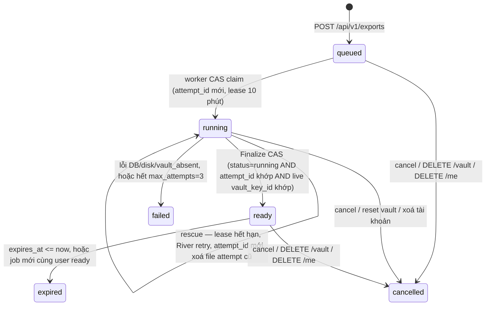

# P06 — Hoàn thiện và phát hành beta MVP · Kế hoạch triển khai

> Trạng thái: kế hoạch r2 (sửa theo review BE r1 `reports/p06plan/review-be-r1.md` R1-01..R1-21 + `advisor-dec-P06-016` và review FE r1 `reports/p06plan/review-fe-r1.md` FE-R1-01..FE-R1-19 + `advisor-dec-P06-019`; bảng sửa `reports/p06plan/fix-log-r2.md`), chưa triển khai.
> Nguồn: [P06](../phases/P06-beta.md), [SPEC](../SPEC.md) §3.11, §5, §7.6–§7.8, §8, §9.1–§9.2, §10, §11.1–§11.5, [ADR 0001](../adr/0001-auth-session-va-reauth-assurance.md), [ADR 0002](../adr/0002-vault-crypto-layout.md), [ADR 0003](../adr/0003-webauthn-prf-va-devkey.md), [ADR 0004](../adr/0004-embedding-provider-openai-compat.md), [ADR 0005](../adr/0005-content-lossless-va-concurrency.md), [ADR 0006](../adr/0006-account-password-reset.md), [threat model](../threat-model.md), [plan P05](2026-11-02-P05-search.md), mockups `settings/states/docs/legal/landing.html`; quyết định P06 `advisor-dec-P06-001..014` (đặc biệt `advisor-dec-P06-003` D1–D12 về export/delete UX, `advisor-dec-P06-011` về consent semantic/mail/reset-backup/dogfood-delete), `advisor-dec-P06-016` (BE r1 rulings), `advisor-dec-P06-018` (runner RUNNER READY), `advisor-dec-P06-019` (FE r1 rulings), `reports/p06plan/{baseline,draft-export,draft-ui,draft-ops}.md`, `reports/opsrecon/baseline-ops.md`, `reports/uxdesign/{decisions,privacy-truth}.md`, `reports/backupnow/`, `reports/cloudrun/T1-worker.md`, `reports/p06plan/review-fe-r1.md` (FE-R1-01..19).
> Quy ước: `§` chỉ mục SPEC; "mục" chỉ mục của plan này. Mọi đường dẫn code là đường dẫn trong repo tại `phase06/beta` @ `4168106` (= `9f9bafd` + merge `phase06/i18nsweep` `1fb201c` + merge `phase06/cloudrun` `4168106`); P05 đã squash vào `develop`; **chưa có** = không có trong code ở SHA này. **BE** = `apps/api/**`, `scripts/**`, SQL, migration, handler OpenAPI; **FE** = `apps/web/**`, `packages/shared-types/**`, `packages/crypto-vectors/**` (crypto-vectors chỉ đọc); **Ops** = `infra/**`, `docs/runbooks/**`, `.data/deploy/**`, systemd trên `bro`; **Runner** = `cursor-runner` = Cursor cloud runner (`.cursor/cloud/specs/*.txt` đã merge `4168106`), `ci` = GitHub Actions `ci.yml`, `bro-ops` = thao tác trực tiếp trên VPS `bro` (Ubuntu 24.04 ARM64), `visual-local` = `pi/tester_visual` + Orca browser + Jev `visual`. Lane trên `bro` = `lead-working` + Advisor-started sibling reviewers/testers (không nest worker).

**Mục tiêu:** Bản beta dùng được với dữ liệu thật trên `engram.zone17.click`, đủ toàn bộ MVP: auth, vault/passkey/RK/DevKey, Item/Tag/text/JSON, lexical+semantic, encrypted `.sabk.json` export và decrypted JSON export, xoá tài khoản có re-auth + xác nhận email, docs/privacy/help đúng với hành vi thật, vận hành có backup PITR/restore rehearsal và release/rollback runbook. Không bàn giao bản chỉ mô phỏng các nút Settings hoặc copy privacy chưa đúng với thực tế.

**Phạm vi:** 23 task (gồm carry-forward UI/BE/security từ P03–P05; Task 5b consent semantic và Task 22 production ops tách riêng ở r2) chia năm wave W0–W4 theo lane song song, giao theo 11 acceptance P06-A1..A11 của phase doc. Task 1 là contract duy nhất; mọi lệch SPEC/ADR/OpenAPI nằm trong đó.

| Mốc | Task | Điều kiện qua mốc |
|---|---|---|
| P06-A — Export & Delete (A1, A2, A3, A4, A11) | 1, 2, 3, 5b, 11, 12, 13 | Task 1 merge; `.sabk.json` offline restore đạt; decrypted JSON giữ raw string; delete/reset phân biệt đúng; rate limit 3/giờ đếm cả cancelled; consent semantic mặc định tắt |
| P06-B — UI & Docs (A5, A10) | 6, 7, 14, 15, 18 | `uipolish` + `docsprivacy` merge; U1–U20 có owner; visual/a11y/axe sạch; i18n en/vi đồng bộ |
| P06-C — Ops, Security & Release (A6, A7, A8, A9) | 4, 5, 8, 9, 10, 16, 17, 19, 20, 21, 22 | CSP/HSTS/metrics/backup/PITR/security tests đạt; NFR đo được; runbook + PROD-STEP hoàn tất |

Phase chỉ Done khi cả 3 mốc đạt + gate P01–P05 re-check pass. Thiếu deploy credentials, hardware PRF, crypto reviewer thứ hai hay restore evidence = **BLOCKER-* còn mở → phase/release acceptance vẫn `pending`**; chỉ báo phần đã xong, không đánh dấu P06 Done. Chỉ Advisor (có quyền) được ghi quyết định đổi scope/gate rõ ràng trước khi đổi checklist (R1-21).

**Kiểm tra nặng (R1-17, team-rules §Tests):** mọi `go test` nhiều package / `-race` / integration (Docker Postgres), `pnpm` full web unit, Playwright, rehearsal Docker chạy qua Cursor cloud runner (`node <RUNNER> test --spec reports/<lane>/cloud-spec-<seq>.txt`, profile spec `go-unit`/`gen-nodiff`/`web-unit`/`go-race-integration`/`e2e`/`full` của lane `cloudrun`); trước "RUNNER READY" thì qua draft PR CI-only. Host `local`/`bro` chỉ được: sửa file, git, **một** `go test ./<pkg> -run <Tên>` hoặc **một** file vitest. Mỗi hàng evidence ghi: cwd, package/project đúng, dòng spec runner thật, lệnh, exit, raw log, tested SHA, và grep tên test xuất hiện trong log (`--- PASS: <Tên>` / `✓ <tên>`), không chấp nhận `no tests to run`. Mọi lệnh Go dưới đây chạy với cwd `apps/api`; mọi lệnh web với cwd `apps/web`.

**Chia lane song song (r2, R1-14).** Quy tắc: **một file = một chủ trong cả phase W1** (không chỉ trong một wave); file chung được sinh ở W0 bởi `contract` rồi các lane chỉ *đọc*. Ma trận file → chủ đầy đủ ở mục 4.2; bảng dưới là tóm tắt.

| Wave | Lane → task | Bắt đầu khi | Ghi chú seam |
|---|---|---|---|
| W0 (1 lane) | `contract` → 1 | đã đủ (`uxdesign` `0484d6b`/`backupnow` `44ae700`/`vulnfix` `7807a2b`/`i18nsweep` `1fb201c`/`cloudrun` `4168106` đã merge `phase06/beta`) | `contract` sở hữu thêm **toàn bộ field config mới** (`internal/config/{config,config_test}.go`: `EXPORT_STORAGE_DIR`, `EXPORT_AT_REST_SECRET`, `EXPORT_CREATE_PAUSED`, `SMTP_*`), `internal/auth/mail.go` (`Mailer`/`MailDeliveryAvailable`/`NoopMailer`), migration `0010_p06` (gồm consent), OpenAPI, error codes, secevent, `.env.example`, **mockup copy fixes** (`mockups/{settings,docs}.html` — xoá "gồm thùng rác" khỏi `#plainDlg`/`/docs` cho khớp contract, sửa `3 lần xuất/giờ` cho đúng "chỉ `.sabk.json`"), **khoá i18n dùng chung** trong `messages/{en,vi}.json` (`nav.help`, `settings.search.privacyLink`, `states.*`, `offline.*` reserved keys). |
| W1 (10 lane độc lập) | `exportbe` → 2; `accountdelbe` → 3; `ops-obs` → 4; `ops-config` → 5; `consentbe` → 5b-BE; `uipolish` → 6; `docsprivacy` → 7; `ops-edge` → 8; `ops-dr` → 9 → 10 | Task 1 merge | Một file = một chủ (mục 4.2). `worker.go` chỉ `exportbe`; `ops-config` cung cấp `compose.NewMailer(cfg)` (`internal/compose/mail.go` mới) + `worker/mail.go`, `exportbe` gọi trong `worker.go`. `messages/{en,vi}.json`: W1 chỉ `docsprivacy` (khoá `docs.*`/`legal.*`/`landing.*`/`auth.*`/`forgotPassphrase.*` + reserved `states.*`/`offline.*`/`nav.help`/`settings.search.privacyLink` do `contract` thêm sẵn). `uipolish` **không** sửa messages — dùng khoá có sẵn/gửi patch cho `docsprivacy`. |
| W2 (4 lane, 1 tuần tự) | `exportapi` → 11; `exportui` → 12 → 13; `consentui` → 5b-FE; `nfr-bench` → 19 | 11: Task 2 + 4 merge. 12–13: Task 11 + 3 merge. `consentui`: sau `exportui` merge (messages seam) + `consentbe` merge. 19: Task 1 merge | `router.go`: `ops-obs` (W1) → `exportapi` (W2). `app/app/layout.tsx`: `ops-edge` (W1, CSP nonce) → `consentui` (W2, mount banner). `messages/{en,vi}.json`: W2 `exportui` (khoá `settings.data.*`/`settings.deleteAccount.*`/`settings.audit.*`/`auth.login.deletedBanner*`) → `consentui` (khoá `onboarding.semantic*`/`search.consentBanner*`) — tuần tự, không song song. |
| W3 (5 lane) | `copyfix` → 15; `sec-tests` → 16; `sec-review` → 17; `uiqa` → 14 → 18; `nfr-bench` → 20 (pre-release, candidate SHA trên staging) | 15: 12, 13, 5b-FE, 6, 7 merge. 16: 11, 12, 13, 4, 8 merge. 17: W1–W2 merge. 18: 14 + 12 + 13 + 6 + 7. 20: 8, 12, 13, 19 + staging (Task 21a) | `messages/{en,vi}.json` W3 = `copyfix` (sau `consentui`). Evidence shard `docs/phases/evidence/P06/<task>.md`; chỉ `release` tổng hợp `P06.md`. |
| W4 (1 lane) | `release` → 21 (21a staging pre-check → 21b deploy → 21c post-check) | W1–W3 merge + runner `full` xanh | Task 22 (`ops-prod`, PROD-STEP ops) **không** chờ W4: mỗi bước được GO độc lập khi script review + rehearsal xong (R1-19). |

Không lane nào sửa `apps/web/lib/crypto/**`, `apps/api/internal/vault/{envelope,wrap,kdf}.go`, `apps/web/features/vault/vault-provider.tsx` hay envelope/wrap/KDF formats (crypto gate §11.4, gate mục 5). Export chỉ đọc và sao chép nguyên các wrap/key-id hiện có (R1-01). Khi thực hiện, đánh dấu checkbox theo kết quả thực tế.

## 1. Baseline và ranh giới

### 1.1. Hiện trạng code (`phase06/beta` @ `9f9bafd`)

- **Migrations (`apps/api/migrations/`):** `0001`–`0009` (cuối = `0009_embedding`). Chưa có bảng `export_job`/`export_file_cleanup`, chưa có cột `app_user.semantic_consent_seen_at`, `settings.semantic_suggest` default `true` (`0004_auth.up.sql:11`). Migration tiếp theo = `0010_p06`.
- **OpenAPI (`apps/api/api/openapi.yaml`):** 70 `operationId` hiện có; chưa có `exportCreate`, `exportGetLatest`, `exportGet`, `exportDownload`, `exportCancel`, `exportDecryptedPage`, `exportDecryptedAudit`, `accountDelete`. `ReauthAction` enum đã có `export.decrypted` + `account.delete` (l.3144-3165). `ProblemCodes` catalog chưa có `export_not_ready`, `export_expired`, `account_delete_confirm_invalid`.
- **Handlers Export/Delete:** chưa có `apps/api/internal/export/**`, chưa có `DELETE /api/v1/me`. `POST /audit/export-decrypted` chưa có. `export.encrypted`/`export.decrypted`/`account.delete` chưa có trong `secevent/event.go` (có `entry.import` từ P04 nhưng chưa có trong FE `audit-catalog.ts`).
- **Rate limit (`apps/api/internal/httpx/userlimit.go`):** `MaxRateLimitWindow = 15 * time.Minute`; chưa có `ScopeExportCreate`. `rate_event_prune` dùng `MaxRateLimitWindow`.
- **Settings UI (`apps/web/app/app/settings/page.tsx`):** `#dulieu` chỉ là placeholder tĩnh (l.75-83); chưa có `features/settings/data/**`, `lib/api/export.ts`, `deleteAccount`. `audit-catalog.ts` thiếu `entry.import` + `export.*` + `account.delete`.
- **Docs/Privacy:** chưa có `/docs` route; `legal.deletion.exportDeleteBody` vẫn nói "đang được bổ sung (ở bản phát hành tiếp theo)". `LegalPageContent` chưa có `LocaleSwitch`.
- **CSP/Security headers (`apps/web/next.config.ts`):** `script-src` còn `'unsafe-inline'`; chưa có HSTS, `Permissions-Policy`, `poweredByHeader: false`, `/.well-known/build-manifest`. `/api/v1/metrics` mount công khai không guard.
- **Observability:** `worker`/`web` chưa có healthcheck; chưa có alert script; chưa có collector `export_jobs_total`/`account_deletions_total`.
- **Backup/DR:** `archive_mode=off`; lane `backupnow` (`advisor-dec-P06-005..010`, merged `44ae700`) đã cài nightly `pg_dump` GPG encrypted `engram-backup.timer` 03:17 UTC+7 + GPG public key `F2C47029...` + off-host pull; chưa có WAL archiving/PITR/base backup/restore rehearsal. Lane `vulnfix` (`advisor-dec-P06-013`, merged `7807a2b`) bump `klauspost/compress` v1.20.2 (GO-2026-6865).

### 1.2. Hiện trạng `bro` (`opsrecon/baseline-ops.md`)

- Ubuntu 24.04 ARM64, 23 GB RAM (~9 GB free), `/` 145 GB used 85% (23 GB free), Docker 29.6.1.
- `engram-api-1` healthy, `engram-worker-1`/`engram-web-1` no healthcheck, `engram-db-1` `pg_isready` healthy.
- `APP_ENV=development` trên production (HIGH); `archive_mode=off`, `data_checksums=off`; chưa có scheduled/encrypted/off-host backups (backupnow interim đã lắp đặt).
- `global_nginx` `engram.conf`: TLS Let's Encrypt (hết hạn 2027-01-29), `log_format engram_noquery` (không log query string — gate 8a P05), no `/api` location (proxy qua Next), `server_tokens on`, no HSTS.
- Docker `json-file` driver no rotation; 13 GB reclaimable images; volumes `engram_engram-db` (69 MB), `engram_engram-mail` (mail sink).
- Lane `prodhygiene` (advisor-dec-P06-014) đã hoàn tất opsrecon §6 bước 1 (image prune done), bước 2 (log rotation prep `infra/deploy/`), bước 8 (APP_ENV analysis) — các bước 3–7 còn lại là tasks của plan này.

### 1.3. Gate re-check P01–P05

| Phase | Evidence | Còn mở → đặt ở |
|---|---|---|
| P01 | `docs/phases/evidence/P01.md` | CSP `'unsafe-inline'` (advisor-dec-014) → Task 8 |
| P02 | `docs/phases/evidence/P02.md` | OAuth Google/GitHub + Turnstile credentials (`user-dec-017`) → smoke `sec-review`/`release`; `MAIL-CAP-P02` → Task 5 |
| P03 | `docs/phases/evidence/P03.md` | Crypto review 2 người §11.4 (`P03.md:112`) → Task 17; PRF hardware smoke → Task 17; `dialog.tsx` focus return (advisor-dec-080) → Task 6, 12, 13; i18n sweep (advisor-dec-090/094) → Task 15 |
| P04 | `docs/phases/evidence/P04.md` | `FU-ENTRYUX-VISDIFF` (advisor-dec-376) → Task 14; `FU-DEVKEY-VISUAL` (advisor-dec-378/379) → Task 14; `FU-T26-390-OVERFLOW` (advisor-dec-342) → Task 6; `FU-T22-SEMCHIP-HOVER` (advisor-dec-347) → Task 6; `FU-T22-429-STICKY` (advisor-dec-335) → Task 6; `FU-T22-MANUAL` (advisor-dec-323) → Task 18; `FU-T24-ABSCLAIMS` (advisor-dec-346) → Task 1 + 7; `FU-T13-OAS` (advisor-dec-300) → Task 1; `FU-OWNER-SEMDEFAULT` (advisor-dec-362) → Task 7 (copy); Trash UI Q9 (advisor-dec-107) → giữ nguyên, ghi docs Task 7; `A11Y-SAVING-LIVE`/`A11Y-UNDO-FOCUS-FLICKER` (advisor-dec-217) → Task 6/18 |
| P05 | `docs/phases/evidence/P05.md` | `FU-P06-SEM-OBSERVE`/`FU-T24-OBSERVE24H` → Task 20; `FU-T23-RUNNER` (advisor-dec-354) → Task 20; `FU-SL-3` (advisor-dec-351) → post-MVP note; `FU-T23-0010` (advisor-dec-350) → tuỳ chọn Task 21 nếu report chứng minh; `embedding_jobs_total` gap → runbook (ghi nhận); `FU-T20A-ERRCLASS`/`FU-T20A-LEADER`/`FU-T20B1-LOWS`/`FU-T17-FEC25` → post-MVP note; chip tag fuzzy `suggest?scope=tag` → post-MVP nếu không kịp |

## 2. Contract chuẩn cho mọi task

### 2.1. Schema `.sabk.json` v1 (Encrypted Backup) & Định danh phiên bản

File sao lưu mã hoá có phần mở rộng `.sabk.json`, tên tải về mặc định **`engram-backup-YYYY-MM-DD.sabk.json`** (UTC date theo `exported_at`), `Content-Type: application/json; charset=utf-8`.

Cấu trúc JSON chính xác (`.sabk.json` v1):

```json
{
  "format": "engram.sabk",
  "version": 1,
  "exported_at": "2026-11-07T08:30:00Z",
  "snapshot": {
    "consistency": "repeatable_read",
    "includes_active": true,
    "includes_soft_deleted_unpurged": true,
    "excludes_purged": true,
    "soft_delete_retention_days": 30,
    "counts": { "tags": 1, "items": 1, "item_tags": 1, "entries": 1 }
  },
  "vault": {
    "vault_key_id": "vk:Q2xhdWRlVmF1bHRLZXkx",
    "version": 3,
    "kdf": { "alg": "argon2id13", "ops": 3, "mem": 67108864, "parallelism": 1, "salt": "<16B base64url>" },
    "vault_key_wrapped_by_kek": "<73B base64url wrapK>",
    "x25519_public": "<32B base64url>",
    "ed25519_public": "<32B base64url>",
    "private_keys_wrapped": "<105B base64url wrapP>",
    "recovery_keys": [
      { "slot": 1, "lookup_hash": "<32B base64url>", "wrap": "<73B base64url>" }
    ],
    "passkeys": [
      {
        "id": "<uuid>", "name": "MacBook Touch ID",
        "cred_id": "<base64url>", "prf_salt": "<32B base64url>",
        "vk_wrap": "<73B base64url>", "pubkey": "<base64url>",
        "aaguid": "adce0002-35bc-c60a-648b-0b25f1f05503",
        "created_at": "2026-10-29T10:00:00Z"
      }
    ]
  },
  "tags": [
    { "id": "<uuid>", "display": "wifi-khách", "normalized": "wifi-khách", "item_count": 1,
      "last_used_at": "2026-11-01T00:00:00Z", "created_at": "2026-10-01T00:00:00Z", "deleted_at": null }
  ],
  "items": [
    { "id": "<uuid>", "name": "wifi", "name_normalized": "wifi", "hint": "Tầng 2",
      "entry_count": 1, "version": 1, "last_used_at": "2026-11-05T12:00:00Z",
      "created_at": "2026-10-01T00:00:00Z", "updated_at": "2026-11-05T12:00:00Z",
      "deleted_at": null, "delete_batch": null }
  ],
  "item_tags": [
    { "item_id": "<uuid>", "tag_id": "<uuid>", "created_at": "2026-10-01T00:00:00Z" }
  ],
  "entries": [
    {
      "id": "<uuidv7>", "item_id": "<uuid>", "type": "text", "position": 0, "version": 1,
      "plaintext_len_bucket": 256,
      "envelope": {
        "v": 1, "alg": "xchacha20poly1305-ietf",
        "key_id": "vk:Q2xhdWRlVmF1bHRLZXkx",
        "nonce": "<24B base64url>", "ct_enc": "utf8"
      },
      "ciphertext": "<base64url>",
      "created_at": "2026-10-01T00:05:00Z", "updated_at": "2026-10-01T00:05:00Z",
      "deleted_at": null, "deleted_via": null, "delete_batch": null
    }
  ]
}
```

Bất biến của `.sabk.json` v1 (`SPEC.md` §3.11, `P06-beta.md`, `P06-A2`):

- **`format` = `"engram.sabk"`, `version` = `1` cố định.** Khi có thay đổi phá vỡ tương thích ở các phase sau (P07+), tăng `version`.
- **Khối `vault` đầy đủ để mở lại độc lập không cần live server:** `vault_key_id` (**sao chép nguyên chuỗi `vk:<base64url 16 B>`** đúng regexp `^vk:[A-Za-z0-9_-]{22}$` của `vault/kdf.go:32-64`, **không phải UUID**), `version`, `kdf` (`alg`, `ops`, `mem`, `parallelism`, `salt` base64url 16 B), `vault_key_wrapped_by_kek` (wrapK base64url 73 B), `x25519_public` (32 B), `ed25519_public` (32 B), `private_keys_wrapped` (wrapP base64url **105 B** = `1+24+64+16`, `vault/wrap.go:19-21`, `js-v1.json:115-123`). `entries[].envelope.key_id` cũng sao chép nguyên `vk:...`. **Không đổi wrap/envelope/KDF để khớp fixture** (R1-01). `recovery_keys`: mảng các hàng còn sống trong `vault_recovery_key` sắp theo `slot ASC` (`1..10`), gồm `{slot, lookup_hash, wrap}` (`lookup_hash` 32 B, `wrap` 73 B — **tuyệt đối không có plaintext RK**). `passkeys`: mảng các hàng trong `vault_passkey` sắp theo `created_at ASC, id ASC`, gồm `{id, name, cred_id, prf_salt, vk_wrap, pubkey, aaguid, created_at}` (mọi trường bytea mã hoá base64url không padding). **Không bao giờ** chứa `user_id`, email, session token, hay bất kỳ secret chưa wrap nào.
- **Thứ tự sắp xếp xác định:** `tags` `(created_at, id)`; `items` `(created_at, id)`; `item_tags` `(item_id, tag_id)`; `entries` `(item_id, position, id)`. Mọi mảng rỗng serialize là `[]` (không `null`).
- **Fixture:** `apps/api/internal/export/testdata/sabk_v1_sample.sabk.json` **sinh từ `packages/crypto-vectors/vectors/js-v1.json` hiện có** (script `internal/export/testdata/gen_fixture_test.go` `-run TestGenSabkFixture -update`), phải qua validator hiện có (`vault.ParseVaultKeyID`, `vault.ParseEnvelope`, độ dài wrapP 105) không sửa file crypto gated; bản sao `apps/web/features/settings/data/__fixtures__/sabk_v1_sample.sabk.json` (không đụng `packages/crypto-vectors/**`).
- **Test khôi phục độc lập (`P06-A2`):** `apps/web/features/settings/data/sabk-offline-restore.test.ts` + `apps/api/internal/export/sabk_restore_test.go` chứng minh chỉ dùng file `.sabk.json` + passphrase gốc (hoặc RK gốc / PRF output gốc) trên môi trường hoàn toàn không có mạng/session, kể cả sau khi live server đã đổi passphrase (`PUT /vault/kek`), consume RK (`POST /vault/recover/complete`), thu hồi passkey (`DELETE /vault/passkeys/{id}`) hoặc xoá tài khoản, vẫn giải mã lại được `VK` từ `vault_key_wrapped_by_kek`/`recovery_keys[].wrap`/`passkeys[].vk_wrap` và mở được toàn bộ `entries[].ciphertext`.

### 2.2. Định dạng Decrypted JSON (`engram-readable-YYYY-MM-DD.json`) (`P06-A3`)

File xuất đọc được do **client tự giải mã cục bộ trong trình duyệt** (sau khi kho đã mở `vault.state === 'unlocked'` và người dùng vừa xác thực lại với grant `export.decrypted`), tên tải về mặc định `engram-readable-YYYY-MM-DD.json` (`advisor-dec-P06-003` D11). **Server không bao giờ tạo hay nhận file này (`user-dec-016`).**

Định dạng **phẳng, có thể ghi tuần tự** (R1-07): thứ tự khoá cố định `format`, `version`, `exported_at`, `vault_key_id`, `warning`, `snapshot`, `tags`, `items`, `entries`; mỗi mảng được ghi phần tử-từng-phần tử vào sink, không cần giữ cấu trúc lồng trong RAM.

```json
{
  "format": "engram.readable",
  "version": 1,
  "exported_at": "2026-11-07T08:35:00Z",
  "vault_key_id": "vk:Q2xhdWRlVmF1bHRLZXkx",
  "warning": "SENSITIVE PLAINTEXT EXPORT — Anyone with this file can read all entries.",
  "snapshot": {
    "source_export_id": "<uuid của job .sabk.json nguồn>",
    "includes_active": true,
    "includes_soft_deleted_unpurged": false,
    "excludes_purged": true,
    "counts": { "tags": 1, "items": 1, "entries": 1 }
  },
  "tags": [
    { "id": "<uuid>", "display": "wifi-khách", "item_count": 1, "last_used_at": "...", "created_at": "..." }
  ],
  "items": [
    { "id": "<uuid>", "name": "wifi", "hint": "Tầng 2", "tag_ids": ["<uuid>"],
      "version": 1, "last_used_at": "...", "created_at": "...", "updated_at": "..." }
  ],
  "entries": [
    { "id": "<uuidv7>", "item_id": "<uuid>", "type": "json", "position": 0, "version": 1,
      "body": "{\"big\":9007199254740993,\"dup\":1,\"dup\":2,\"negZero\":-0}",
      "created_at": "...", "updated_at": "..." }
  ]
}
```

- **Quy tắc bảo toàn chuỗi gốc (`P06-A3`, `ADR 0005`):** `entries[].body` **luôn là chuỗi JSON (`string`) chứa đúng các byte UTF-8 nguyên bản** sau khi `openEntry` giải mã, kèm `type: "text" | "json"`. Client **tuyệt đối không** `JSON.parse` rồi `JSON.stringify` (mất số nguyên > `Number.MAX_SAFE_INTEGER`, `-0`, khoá trùng, thứ tự khoá). Chuỗi UTF-8 nguyên bản chỉ được JSON-escape thành JSON string literal khi đóng gói.
- **Chính sách lỗi (`advisor-dec-P06-003` D12):** trước và trong khi giải mã từng trang, client kiểm tra `page.vault_key_id === currentVaultKeyId` và `entry.envelope.key_id === currentVaultKeyId`. Nếu bất kỳ entry nào có `key_id` lệch, giải mã lỗi, nguồn snapshot hết hạn/bị huỷ (`410`/`409`), hoặc kho bị khoá/reset giữa chừng → **huỷ ngay toàn bộ lần xuất, huỷ sink (`WritableStream.abort()` xoá file tạm của File System Access; fallback xoá mảng `BlobPart[]`), không tạo file tải về một phần**.

### 2.3. Snapshot Consistency & Tombstone/Purge

1. **Snapshot `REPEATABLE READ READ ONLY` chỉ để đọc dữ liệu (`P06-A2`, R1-04):** worker `export_encrypted` mở transaction `ISOLATION LEVEL REPEATABLE READ READ ONLY` (MVCC snapshot cố định, không khoá ghi, không chặn `DELETE /vault`/`content_purge`). Câu đầu đọc `vault` — không có hàng → `failed` `vault_absent`. Mọi truy vấn dữ liệu sau (`vault_recovery_key`, `vault_passkey`, `tag`, `item`, `item_tag`, `entry`) chạy trên cùng `tx`. **Trạng thái huỷ không đọc từ tx này** (RR sẽ luôn thấy `running` cũ): giữa các lô, worker đọc `export_job.status`/`attempt_id` bằng **kết nối READ COMMITTED riêng** từ pool. Publication theo mục 2.4 "Finalize CAS".
2. **Tombstone/Purge trong manifest:**
   - `.sabk.json`: gồm cả active (`deleted_at IS NULL`) và soft-deleted chưa purge (`deleted_at IS NOT NULL`, trong cửa sổ 30 ngày `content_purge`), giữ nguyên `deleted_at`, `deleted_via`, `delete_batch`. Purged (sau 30 ngày hoặc `DELETE /vault` xoá cứng) không có trong snapshot (`snapshot.excludes_purged = true`).
   - Decrypted JSON: chỉ `deleted_at IS NULL` (`includes_soft_deleted_unpurged = false`), ghi rõ trong `snapshot` và `<details>` UI.

### 2.4. Export Job State Machine

Bảng `export_job` quản lý vòng đời `.sabk.json` với 6 trạng thái; terminal = `failed`/`cancelled`/`expired` **không bao giờ quay lại** `running`/`ready`.



| Trạng thái | Ý nghĩa | File trên đĩa | Cancel? | Download? |
|---|---|---|---|---|
| `queued` | Đã insert `export_job` + River job cùng tx | Chưa có | Có → `cancelled` | `409 export_not_ready` |
| `running` | Worker giữ `attempt_id` + `lease_until` | `<job>.<attempt>.tmp` (xoá nếu lỗi/huỷ/rescue) | Có → `cancelled` | `409 export_not_ready` |
| `ready` | File publish xong, còn 24h | `<job>.<attempt>.sabk.enc` | Có → `cancelled`, xoá file | **`200`** |
| `failed` | Lỗi I/O, DB, `vault_absent`, hết attempt | Không | Idempotent `200` | `409 export_not_ready` |
| `cancelled` | User huỷ / reset vault / xoá account | Đã xoá (hoặc cleanup record đang chờ) | Idempotent `200` | `409 export_not_ready` |
| `expired` | Quá 24h, bị job mới thay, hoặc drain do xoay `EXPORT_AT_REST_SECRET` | Đã xoá | `409 export_not_ready` | `410 export_expired` |

- **Claim/lease/rescue (R1-04):** `UPDATE export_job SET status='running', attempt_id=gen_random_uuid(), lease_until=now()+'10 min' WHERE id=$1 AND (status='queued' OR (status='running' AND lease_until < now())) RETURNING attempt_id`; 0 hàng → job đã terminal/đang có attempt sống → River job kết thúc `JobCancel`. Worker gia hạn lease mỗi lô (kết nối READ COMMITTED). River `MaxAttempts=3`; attempt thất bại cuối → `failed`. File attempt cũ bị xoá khi claim mới thành công hoặc bởi `export_prune`.
- **Finalize CAS (R1-04):** sau `fsync(tmp)` + `rename(tmp → <job>.<attempt>.sabk.enc)` + `fsync(dir)`, worker mở transaction READ COMMITTED riêng, lấy khoá cùng thứ tự với reset/delete (`app_user FOR SHARE` → `vault FOR SHARE` → `export_job FOR UPDATE`), kiểm `app_user` tồn tại + `vault.vault_key_id = snapshot_vault_key_id` + `status='running'` + `attempt_id` khớp, rồi `UPDATE ... SET status='ready', storage_path, size_bytes, completed_at, expires_at=now()+24h` và `ready` cũ của user → `expired` (ghi cleanup record cho file cũ) trong **cùng tx**. Nếu UPDATE không đúng 1 hàng → rollback, unlink file attempt, River job kết thúc không retry. `DELETE /vault` và `DELETE /me` lấy `app_user FOR UPDATE` → `vault FOR UPDATE` → `export_job FOR UPDATE` nên không xen giữa kiểm và CAS.
- **Coalescing + một job active (R1-05):** tối đa 1 job `queued`/`running` mỗi `(user_id, kind)` — **unique partial index** `export_job_one_active_idx ON export_job (user_id, kind) WHERE status IN ('queued','running')`. Thứ tự `POST /exports`: (1) idempotency replay cùng key → trả bản ghi cũ; (2) `pg_advisory_xact_lock(hashtext('export_create:'||user_id))`; (3) có job active → `202` job đó, **không** tiêu quota; (4) chỉ khi tạo mới: kiểm + ghi `rate_event` `export_create` (3/60m) → `INSERT export_job` → River `InsertTx`, **cùng một transaction**. Vì vậy `export_create` **không** dùng middleware `UserLimiter` (nó commit event trước handler, `userlimit.go:103-183`); handler gọi `UserLimiter.ConsumeTx(ctx, tx, ScopeExportCreate, userID)` (API mới ở Task 1).
- **Reload trang:** `GET /exports/latest` trả job gần nhất; nếu `expires_at <= now()` và `status == 'ready'` thì hiển thị `expired` ngay khi đọc (cron `export_prune` chưa chạy).
### 2.5. Storage, Mã hoá At-Rest, Expiry 24h, Cleanup & Owner Auth

1. **Storage (`infra/docker-compose.yml`, chủ `ops-obs`):** volume `engram-exports:/var/lib/engram-exports` mount vào `api` + `worker` (uid:gid `65532:65532`, mode `0700`, env `EXPORT_STORAGE_DIR`; dev/test `os.TempDir()/engram-exports`). **Không** mount vào `web`/`nginx`.
2. **Khoá at-rest (R1-03, `advisor-dec-P06-016`):** secret độc lập `EXPORT_AT_REST_SECRET` (kiểu `config.Secret`, ≥ 32 B sau base64 decode, **cùng giá trị** ở `api` và `worker`, bắt buộc khi `APP_ENV` ∈ {`staging`,`production`}; dev/test sinh ngẫu nhiên mỗi process và ghi cảnh báo). **Không** dùng `AUTH_JWT_SECRET`. `fileKey = HKDF-SHA256(ikm=EXPORT_AT_REST_SECRET, salt=job_id(16B) ‖ attempt_id(16B), info="engram/export-at-rest/v1")` → 32 B. **Xoay khoá = drain** (gated `PROD-STEP-R`, runbook `docs/runbooks/release-rollback.md` §"Xoay EXPORT_AT_REST_SECRET"): (a) chặn create (`EXPORT_CREATE_PAUSED=true`), (b) mọi `queued`/`running` → `cancelled`, mọi `ready` → `expired` + xoá file, (c) xác nhận `SELECT count(*) FROM export_job WHERE storage_path IS NOT NULL` = 0 và thư mục rỗng, (d) đổi secret ở **cả** api+worker trong một `compose up -d`, (e) bỏ pause. Không bao giờ có job `ready` không đọc được; người dùng tạo lại bản mới. Rollout mixed-version: secret đọc từ env chung `x-engram-app-env` nên api/worker luôn cùng giá trị; boot fail nếu thiếu (staging/prod).
3. **Định dạng file at-rest `ENGX1` (R1-02, không thêm primitive):** header `magic "ENGX" ‖ version 0x01 ‖ nonce_prefix 16 B (CSPRNG mới **mỗi lần ghi/attempt**) ‖ job_id 16 B ‖ attempt_id 16 B`; sau đó các khung `uint32_be(ct_len) ‖ XChaCha20-Poly1305.Seal(nonce = nonce_prefix ‖ uint64_be(counter), plaintext ≤ 64 KiB, AAD = header ‖ uint64_be(counter) ‖ final_flag_byte)`; `final_flag` là 1 byte nằm **trong plaintext đầu khung** (0x00 tiếp, 0x01 cuối) và được ràng buộc AAD. Bất biến: cặp (fileKey, nonce) không bao giờ lặp vì `attempt_id` + `nonce_prefix` mới mỗi attempt; khung cuối bắt buộc có `final=1` và ngay sau nó là EOF; reader kiểm `ct_len ≤ 64 KiB + 17` **trước** cấp phát, từ chối header sai, truncate (thiếu khung final), reorder (counter là nonce+AAD), append (byte sau khung final), khung rỗng không-final. File rỗng logic vẫn có 1 khung final. Kiểm tra độc lập bởi `sec-review` (Task 17).
4. **24h + `export_prune` (River periodic 15 phút):** `ready` → `expires_at = completed_at + 24h`. `export_prune`: `ready` `expires_at <= now()` → `expired` + cleanup record; chạy mọi `export_file_cleanup` chưa xong (mục 2.9 bước c); file attempt `.tmp`/`.sabk.enc` không khớp `(job_id, attempt_id)` của job `running` (lease còn) hoặc `ready` → xoá **ngay** (không chờ 25h; tên file mang job+attempt nên so khớp được); metadata `export_job` terminal > 90 ngày → xoá hàng.
5. **Owner auth (`user-dec-016`, `P06-A7`):** UUID v4 job ID; **không** bearer URL/query token — mọi endpoint qua `RequireSession` (`sabk_session` cookie). Handler kiểm `job.user_id == principal.UserID`; không tồn tại hoặc user khác → `404 not_found`. Log Go chỉ ghi route pattern (`httpx/middleware.go:59-68`). **Nginx (R1-18):** `engram.conf` thêm `map $uri $engram_log_uri { ~^/api/v1/exports/[^/]+(/.*)?$ /api/v1/exports/{id}$1; default $uri; }` và `log_format engram_noquery` dùng `$engram_log_uri` thay `$uri` (vẫn không có query string); chỉ vhost engram. Canary check (Task 16 + `PROD-STEP-7` post-check) thu cả access/error log nginx.

### 2.6. Rate Limit Export: 3 lần / giờ / user (đếm cả Cancelled) (`P06-A11`)

- Tối đa **3 job tạo trong cửa sổ trượt 60 phút / `user_id`**. **Đếm cả `cancelled`/`failed`** — lượt tạo ghi nhận ngay, **không hoàn trả** khi cancel (chống lách).
- **`export_create` chỉ áp `POST /exports`**; `GET /exports/{id}`, `GET /exports/latest`, `GET /exports/{id}/download`, `POST /exports/{id}/cancel` **không** tiêu quota — job thứ 3 `running`/`ready` vẫn chạy/tải về bình thường khi chạm hạn; chỉ job thứ 4 bị `429 rate_limited` + `Retry-After` + `retry_after`.
- Cài (Task 1): `ScopeExportCreate Scope = "export_create"` `Limit: 3, Window: 60m` trong `userlimit.go` + `ConsumeTx(ctx, tx, scope, userID)` dùng chung bảng `rate_event` trong transaction của caller (mục 2.4 coalescing); nâng `MaxRateLimitWindow = 60 * time.Minute` (từ 15m) để `rate_event_prune` giữ đủ 60 phút; lượt `cancelled`/`failed` vẫn nằm trong `rate_event` đủ 60 phút. Test cũ ghim 15m (`httpx/contract_test.go:318-335`, `content_idempotency_test.go:35-46`) **sửa/xoá có chủ đích**, không thêm test mới chạy song song với test cũ đỏ. UI `formatRetryClock` hiển thị `Thử lại lúc 14:12`.

### 2.7. Streaming / Phân trang (Server & Client — không nạp toàn Vault vào RAM)

1. **Server `.sabk.json` (`internal/export/worker.go`):** trong snapshot RR, serialize **từng hàng** vào `EncryptedFrameWriter` (khung 64 KiB): `vault` + `vault_recovery_key` + `vault_passkey` + `counts` → `tag` keyset `(created_at,id)` → `item` `(created_at,id)` → `item_tag` `(item_id,tag_id)` → `entry` `(item_id,position,id)`. Lô theo **byte budget** (R1-07): `LIMIT 500` tag/item/item_tag, entry `LIMIT 16` (16 × 256 KiB ciphertext + base64 ≈ 5.5 MiB trần), dùng `pgx.Rows` đọc tuần tự, không gom slice. **Peak RAM đo thật** ghi trong evidence (`TestExportPeakMemory`: vault tổng hợp 2 000 entry × 256 KiB, `runtime.ReadMemStats` `HeapInuse` delta ≤ 16 MiB). Giữa mỗi lô: `ctx.Err()` + đọc status/attempt qua READ COMMITTED (mục 2.3) → dừng, xoá `.tmp`.
2. **Decrypted JSON đọc từ snapshot bất biến (R1-06):** nguồn duy nhất là **file `.sabk.json` `ready` mới nhất của user** (đã là snapshot RR nhất quán, ciphertext-only, mã hoá at-rest). Luồng: client gọi `POST /exports` (kind `encrypted`; coalesce/quota như mục 2.4 — nếu đã có `ready` còn hạn tạo trong ≤ 10 phút thì dùng lại, không tạo mới) → chờ `ready` → `GET /api/v1/exports/{id}/decrypted-pages?cursor=<opaque>` (`RequireSession` + `RequireReauth("export.decrypted")`). Server mở `EncryptedFrameReader` của **đúng job đó**, giải mã at-rest, stream-parse JSON (`json.Decoder.Token`) và trả trang theo byte budget ≤ 1 MiB gồm phần tử kế tiếp theo thứ tự `vault_key_id` (trang đầu) → `tags` → `items` → `item_tags` → `entries` sống (`deleted_at IS NULL` lọc khi đọc). Cursor = HMAC(`EXPORT_AT_REST_SECRET`-derived key, `user_id ‖ job_id ‖ attempt_id ‖ section ‖ ordinal`) — neo snapshot ID + thứ tự ổn định; job hết hạn/huỷ giữa chừng → `410 export_expired`/`409 export_not_ready` → client huỷ toàn bộ. Không có đọc live-table, không có cursor theo `position`. Không fetch toàn vault trong một request.
3. **Client (`decrypted-export-runner.ts`, R1-07):** `vault.state === 'unlocked'` + `page.vault_key_id === currentVaultKeyId`; mỗi trang giải mã qua Worker `openEntry`, `role="status"` `Đã giải mã x/total_entries`, ghi từng phần tử ra **sink tuần tự**: (a) `window.showSaveFilePicker` → `FileSystemWritableFileStream` (Chromium/Edge desktop) — bộ nhớ ≈ một trang; (b) fallback (Firefox/Safari/mobile) = `BlobPart[]` với **giới hạn sản phẩm rõ ràng**: chỉ cho phép khi `snapshot.size_bytes ≤ 64 MiB`; vượt → `pl-too-large` "Bản xuất đọc được quá lớn cho trình duyệt này — dùng Chrome/Edge trên máy tính, hoặc tải bản sao lưu mã hoá." (không tuyên bố bộ nhớ hằng). `Huỷ` / `vault.registerSecretFormReset` (khoá/logout/session hết) → `AbortController.abort()` + `writable.abort()` (file tạm bị xoá) hoặc xoá `BlobPart[]` + `URL.revokeObjectURL`; chỉ `close()`/tạo object URL khi file hoàn chỉnh. Xong → `POST /api/v1/audit/export-decrypted` + `Idempotency-Key` + `X-Reauth-Token`.

### 2.8. Audit Events & Thông báo Bảo mật

| `event` | Nơi phát | `result` | `meta` | `user_notification` + mail? | U7 label |
|---|---|---|---|---|---|
| `export.encrypted` | Worker `export_encrypted` → `ready`/`failed` | `success`/`failure` | `{}` (không `job_id`/path/name) | Có (khi `success`) | `Đã tạo bản sao lưu mã hoá (.sabk.json)` |
| `export.decrypted` | `POST /audit/export-decrypted` (client gọi sau hoàn tất) | `success` | `{}` (không nội dung/metadata) | Có | `Đã xuất bản đọc được (không mã hoá)` |
| `account.delete` | `DELETE /api/v1/me` (trong tx xoá) | `success`/`failure` | `{}` (không email/PII) | Không `user_notification` (user xoá trong tx); email best-effort sau commit nếu `mail_delivery_available` | (user_id=NULL, 90d) |

- **Trung thực:** server không chứng minh client đã decrypt xong; `export.decrypted` phản ánh client đã xác thực lại grant `export.decrypted` + báo cáo hoàn tất.
- **`entry.import` còn thiếu ở FE:** Task 12 bổ sung `"entry.import"` (BE `secevent.EventEntryImport`) + `export.*` + `account.delete` vào `AUDIT_EVENTS` `apps/web/lib/auth/audit-catalog.ts` + `messages/{en,vi}.json`.

### 2.9. Hợp đồng Xoá tài khoản (`DELETE /api/v1/me`) & Phân biệt với Đặt lại Vault (`DELETE /api/v1/vault`)

1. **Bảo vệ HTTP (`S + C + A("account.delete") + R("vault_sensitive") + I`):** `RequireOrigin` + `RequireSession` + `RequireCSRF` + `RequireJSONContent` (chống CSRF `user-dec-016`). `RequireReauth("account.delete")`: grant HMAC 5 phút đúng `(user_id, session_id, "account.delete")` (password hoặc OAuth re-auth `ADR 0001` cho OAuth-only). `Idempotency-Key` bắt buộc.
2. **Xác nhận email (`advisor-dec-P06-003` D7):** body `{"confirm_email": "user@example.com"}`; `NormalizeEmail` (trim+lowercase) so `app_user.email` dưới `FOR UPDATE`; sai → `400 account_delete_confirm_invalid`.
3. **Transaction xoá cứng (retry 1 lần `40P01`/`55P03`):** (a) `pg_advisory_xact_lock_shared(GenerationSetLockKey)` → `app_user FOR UPDATE` → `vault FOR UPDATE` (nếu có) → `export_job FOR UPDATE` (mọi hàng của user) → advisory lock content user (cùng thứ tự với Finalize CAS mục 2.4). (b) `embedding/store.DeleteUserAllGenerations(ctx, tx, userID)` xoá vector trên mọi generation `state <> 'dropped'`. (c) **Durable cleanup (R1-08):** `INSERT INTO export_file_cleanup (id, storage_path, job_id, attempt_id, reason, created_at)` cho mọi file/attempt của user — bảng **không FK tới `app_user`/`export_job`**, không chứa `user_id`/email (đường dẫn chỉ gồm UUID); mọi job `queued`/`running` → `cancelled` (vô hiệu attempt trước commit: Finalize CAS sau đó trả 0 hàng). (d) Huỷ `river_job` chưa chạy của user: chỉ các kind có `args.user_id` (`embed_*`, `export_encrypted`; liệt kê trong `internal/auth/account_delete.go` const `userScopedJobKinds`) `state IN ('available','scheduled','retryable')` → `DELETE`; payload lịch sử `completed`/`discarded` của kind đó cũng `DELETE` (chúng chứa `user_id`); `security_notice` (không có `args.user_id`, `notification/store.go:69-73`) giữ nguyên vì chỉ mang `notification_id` đã cascade — worker gặp id không tồn tại → `JobCancel`. (e) `DELETE FROM app_user` → cascade `auth_identity`, `session`, `session_refresh_used`, `email_verification`, `oauth_transaction`, `oauth_reauth_receipt`, `user_notification`, `vault`, `vault_recovery_key`, `vault_passkey`, `webauthn_challenge`, `idempotency_key`, `rate_event`, `item`, `tag`, `item_tag`, `entry`, `item_embedding_g*`, `tag_embedding_g*`, `export_job`. (f) `audit_log.user_id` `ON DELETE SET NULL` → `user_id = NULL`; ghi `account.delete` `user_id = NULL`, `meta = "{}"`; `auth_prune` xoá sau 90 ngày. `user_id = NULL` là **bỏ liên kết**, không phải ẩn danh hoá: `session_id`/`ip_hash`/`user_agent` vẫn là dữ liệu cá nhân tới khi hết 90 ngày (copy không dùng chữ "ẩn danh"). (g) Sau `tx.Commit`: enqueue River `export_file_cleanup` (idempotent `unlink` + `ENOENT` = xong, đánh dấu `done_at`, retry backoff vô hạn tới khi xong, `export_prune` 15 phút quét lại hàng chưa xong); `ClearAuthCookies`; `204`. **Semantics công bố:** `204` nghĩa là tài khoản và mọi hàng DB đã xoá; file export trên server được xoá bởi cleanup bền vững ≤ 15 phút (copy: "bản sao lưu tạm trên máy chủ bị xoá trong vài phút"); lỗi unlink kéo dài → alert `export_cleanup_pending_age > 1h` (Task 4).
4. **Bảng phân biệt:**

| Tiêu chí | Đặt lại Vault (`DELETE /vault`) | Xoá tài khoản (`DELETE /me`) |
|---|---|---|
| Mục đích | Quên passphrase + mất RK/passkey/DevKey, muốn giữ tài khoản | Rời dịch vụ, xoá toàn bộ |
| Điều kiện | Grant `vault.reset` + `If-Match` | Grant `account.delete` + `confirm_email` |
| `app_user`/`auth_identity` | Giữ | Xoá |
| `session` | Giữ **mọi** phiên hiện có (reset không thu hồi phiên) | Xoá tất cả, xoá cookie |
| `item`/`tag`/`item_tag`/vector | Giữ (`entry_count` → 0) | Xoá toàn bộ |
| `entry` | Xoá | Xoá |
| `vault`/RK/passkey | Xoá (tạo mới `vault_key_id`) | Xoá |
| `.sabk.json` server 24h | Xoá ngay (cleanup bền vững) | Xoá ngay (cleanup bền vững ≤ 15 phút) |
| Backup nội bộ (nightly/PITR/off-host/thủ công) | Rời mọi bản sao lưu chậm nhất sau **8 ngày** | Rời mọi bản sao lưu chậm nhất sau **8 ngày** |
| `audit_log` | Giữ `user_id`, 90 ngày | `user_id = NULL`, 90 ngày |
| File user đã tải | Vẫn mở được bằng wrap cũ | Nằm ngoài server, không xoá được |

## 3. Endpoint và `operationId`

Chú giải: `S` = `RequireSession`, `C` = `RequireOrigin` + `RequireCSRF` (`X-CSRF-Token`), `A(action)` = `RequireReauth(action)` (`X-Reauth-Token`), `I` = `Idempotency-Key`, `R(scope)` = `UserLimiter` theo `user_id`.

| Nhóm | Method & Path | `operationId` | Điều kiện | Request | Response | Lỗi chính |
|---|---|---|---|---|---|---|
| Export | `POST /api/v1/exports` | `exportCreate` | **S+C+I+R(`export_create`)** | `{"kind":"encrypted"}` (16 KiB) | `202` `ExportJob` (`queued`/`running`, `no-store`) | `400 invalid_request`, `401`, `403 csrf_invalid`, `404 vault_absent`, `409 idempotency_conflict`/`in_progress`, `429 rate_limited` (3/h, `Retry-After` + `retry_after`) |
| Export | `GET /api/v1/exports/latest` | `exportGetLatest` | **S** | — | `200 {job: ExportJob or null}` (`expired` nếu `expires_at <= now()`) | `401` |
| Export | `GET /api/v1/exports/{id}` | `exportGet` | **S** | Path `id` | `200 ExportJob` `{id,kind,status,created_at,completed_at?,expires_at?,size_bytes?,error_code?}` | `400`, `401`, `404 not_found` |
| Export | `GET /api/v1/exports/{id}/download` | `exportDownload` | **S** | Path `id` | `200` stream (`Content-Type: application/json`, `Content-Disposition: attachment; filename="engram-backup-YYYY-MM-DD.sabk.json"`, `no-store, no-transform`, từ `.enc`) | `400`, `401`, `404`, `409 export_not_ready` (`queued`/`running`/`failed`/`cancelled`), `410 export_expired` |
| Export | `POST /api/v1/exports/{id}/cancel` | `exportCancel` | **S+C+I** | `{}` (16 KiB) | `200 ExportJob` (`cancelled`, xoá file; không hoàn lượt) | `400`, `401`, `403 csrf_invalid`, `404`, `409 export_not_ready` (`failed`/`expired`) |
| Export | `GET /api/v1/exports/{id}/decrypted-pages` | `exportDecryptedPage` | **S+A(`export.decrypted`)** | Path `id` (job `ready` nguồn) + `?cursor=<opaque>` | `200 DecryptedExportPage` `{source_export_id,vault_key_id,total_entries,section,items:[...],next_cursor}` (≤ 1 MiB) | `400`, `401 reauth_required`/`reauth_invalid`, `404 not_found`, `409 export_not_ready`, `410 export_expired` |
| Export | `POST /api/v1/audit/export-decrypted` | `exportDecryptedAudit` | **S+C+A(`export.decrypted`)+I** | `{}` (16 KiB; field lạ → `400`) | `204` (audit `export.decrypted` + `user_notification` + mail notice) | `400`, `401`/`401 reauth_required`/`reauth_invalid`, `403 csrf_invalid`, `409 idempotency_conflict` |
| Me | `DELETE /api/v1/me` | `accountDelete` | **S+C+A(`account.delete`)+R(`vault_sensitive`)+I** | `{"confirm_email":"<email>"}` (16 KiB) | `204` + `ClearAuthCookies` (cascade xoá + audit `account.delete` `user_id=NULL`) | `400 account_delete_confirm_invalid`/`invalid_request`, `401 session_invalid`/`reauth_required`/`reauth_invalid`, `403 csrf_invalid`/`origin_invalid`, `409 idempotency_conflict`, `429 rate_limited`, `503 dependency_unavailable` |

**Re-auth (R1-16):** `reauth_required`/`reauth_invalid` giữ **HTTP 401** như `httpx/auth.go:206-209` + `authhttp/errors.go:61-62` + `contract_test.go:186-193` cho cả 3 operation mới; CSRF/Origin/forbidden giữ `403`. Không đổi global auth mapping.

**3 mã lỗi mới** thêm vào **cuối** `ProblemCodes` sau `"reset_token_invalid"` (`codes.go:67`) theo quy tắc "thêm cuối catalog" (SPEC §9.1, `contract_test.go`):

1. **`export_not_ready`** (`409`): `/download` khi `queued`/`running`/`failed`/`cancelled`; `/cancel` khi `failed`/`expired`.
2. **`export_expired`** (`410`): `/download` khi `expired` hoặc `expires_at <= now()`.
3. **`account_delete_confirm_invalid`** (`400`): `confirm_email` không khớp `app_user.email`.

## 4. File và dependency

### 4.1. Migration `apps/api/migrations/`

| Số | File | Nội dung |
|---|---|---|
| `0010` | `0010_p06.{up,down}.sql` | (1) Bảng `export_job` (`id uuid PK`, `user_id uuid REFERENCES app_user ON DELETE CASCADE`, `kind text CHECK IN ('encrypted')`, `status text CHECK IN ('queued','running','ready','failed','cancelled','expired')`, `attempt_id uuid`, `lease_until timestamptz`, `snapshot_vault_key_id text CHECK (snapshot_vault_key_id ~ '^vk:[A-Za-z0-9_-]{22}$')`, `snapshot_vault_ver int`, `storage_path text`, `size_bytes bigint`, `error_code text`, `created_at/started_at/completed_at/cancelled_at/expires_at timestamptz`, `CHECK ((status = 'ready') <= (expires_at IS NOT NULL AND size_bytes IS NOT NULL AND attempt_id IS NOT NULL))`); index `export_job_user_created_idx (user_id, created_at DESC, id DESC)`; `export_job_prune_idx (expires_at) WHERE status = 'ready' OR storage_path IS NOT NULL`; **unique** `export_job_one_active_idx (user_id, kind) WHERE status IN ('queued','running')`. (2) Bảng `export_file_cleanup` (`id uuid PK`, `storage_path text NOT NULL`, `job_id uuid NOT NULL`, `attempt_id uuid`, `reason text CHECK IN ('expired','replaced','cancelled','reset','account_delete','rescue','drain')`, `created_at`, `done_at timestamptz`, `attempts int`) — **không FK**. (3) Consent (R1-15): `ALTER TABLE app_user ALTER COLUMN settings SET DEFAULT '{"semantic_suggest": false}'::jsonb` + `ADD COLUMN semantic_consent_seen_at timestamptz NULL` (không backfill: user cũ `semantic_suggest=true` + `NULL` → thấy banner một lần). |

Forward-only trên production; `down.sql` chỉ cho DB test (drop 2 bảng, drop cột, khôi phục default `true`). Tương thích ngược: binary `:pre-p06` bỏ qua 2 bảng mới và cột nullable mới; default `false` chỉ ảnh hưởng tài khoản tạo mới (đúng ý ruling) — ghi trong rollback runbook.

### 4.2. File theo lane (một file = một chủ trong cả phase)

- **`contract` (Task 1):** `docs/SPEC.md`, `docs/threat-model.md`, `docs/phases/P06-beta.md`, `apps/api/api/openapi.yaml`, `packages/shared-types/src/{api.d.ts,problem.ts}`, `apps/api/internal/httpx/{codes,problem,contract_test,userlimit}.go`, `apps/api/internal/secevent/event.go`, `apps/api/migrations/0010_p06.{up,down}.sql`, `apps/api/internal/config/{config,config_test}.go`, `apps/api/internal/auth/mail.go` + `mail_test.go` (`Mailer`/`MailDeliveryAvailable`/`NoopMailer`), `.env.example`, `mockups/{settings,docs}.html` (copy fixes), `apps/web/messages/{en,vi}.json` (reserved keys W0), `docs/phases/evidence/P06/contract.md`
- **`exportbe` (Task 2):** `apps/api/internal/db/{queries,gen}/export.sql*` + `export_cleanup.sql*`, `apps/api/internal/export/**` (trừ `exporthttp/`), `apps/api/internal/compose/export.go`, `apps/api/internal/worker/worker.go`, `apps/api/internal/vault/reset.go`, `docs/phases/evidence/P06/exportbe.md`
- **`accountdelbe` (Task 3):** `apps/api/internal/auth/{account_delete,account_delete_test}.go`, `apps/api/internal/auth/authhttp/{account_delete_handler.go,routes.go}` (1 dòng mount), `apps/api/internal/embedding/store/{delete,delete_test}.go`, `apps/api/cmd/admin/{main.go,account_delete.go,account_delete_test.go}` (one-off CLI `account-delete --email`, cùng service tx — FE-R1-10), `docs/phases/evidence/P06/accountdelbe.md`
- **`ops-obs` (Task 4):** `apps/api/internal/obs/**`, `apps/api/internal/httpx/{metrics_guard,metrics_guard_test,router}.go`, `apps/api/cmd/worker/{main.go,healthcheck_test.go}`, `infra/docker-compose.yml`, `infra/ops/**`, `docs/phases/evidence/P06/ops-obs.md`
- **`ops-config` (Task 5):** `apps/api/internal/auth/{smtp_mail,smtp_mail_test,account}.go`, `apps/api/internal/compose/{auth.go,mail.go}` (`NewMailer(cfg)` chung api+worker), `apps/api/internal/worker/mail.go` (`NewWorkerMailer`), `docs/phases/evidence/P06/ops-config.md`
- **`consentbe` (Task 5b-BE):** `apps/api/internal/db/queries/{auth,settings}.sql` (query `UpdateUserSemanticSuggest`, `GetUserSettings`, `SetSemanticConsentSeenAt`), `apps/api/internal/auth/authhttp/settings_handler.go` (`PATCH /me/settings` mở rộng `semantic_consent_seen_at`), `apps/api/internal/auth/dto.go` (`Me.semantic_consent_seen_at`), `apps/api/internal/db/gen` (regen), `apps/api/internal/auth/settings_semantic_test.go`, `docs/phases/evidence/P06/consentbe.md`
- **`uipolish` (Task 6):** `apps/web/styles/tokens.css`, `apps/web/tests/tokens.parity.test.ts`, `apps/web/features/json-table/json-tree-grid.tsx`, `apps/web/components/app-shell/**`, `apps/web/components/ui/dialog.tsx`, `apps/web/components/route-guard.tsx`, `apps/web/features/{entries,items,json-table,search,omnibox}/**` (trừ file trong `ux-audit.md` thuộc lane khác), `apps/web/features/vault/{unlock,onboarding-passkey?}` — **không** `features/vault/onboarding/**` (→ `consentui`), `apps/web/features/settings/{account,security/vault/reset-vault-dialog?}` — **không** `reset-vault-dialog.tsx` (→ `exportui`), `apps/web/features/auth/forms/{forgot-password-form,signup-form,reauth-form}.tsx`, `apps/web/app/(auth)/[locale]/reauth/page.tsx` (F-14), `apps/web/tests/{states,json-tree-grid,omnibox,dialog,account-panel,password-reset-and-locale,auth-forms}.test.tsx`, `docs/phases/evidence/P06/uipolish.md`
- **`docsprivacy` (Task 7):** `apps/web/app/(marketing)/[locale]/{docs/**,page.tsx,privacy/**,terms/**}`, `apps/web/features/auth/legal-page-content.tsx`, `apps/web/components/{landing,marketing}/**`, `apps/web/messages/{en,vi}.json` (W1: `docs.*`/`legal.*`/`landing.*`/`auth.*`/`forgotPassphrase.*` + reserved), `apps/web/tests/docs-privacy-copy.test.tsx`, `apps/web/e2e/{smoke,a11y}.spec.ts` (route `/docs`), `docs/phases/evidence/P06/docsprivacy.md`
- **`ops-edge` (Task 8):** `apps/web/next.config.ts`, `apps/web/middleware.ts`, `apps/web/app/(marketing)/[locale]/layout.tsx`, `apps/web/app/app/layout.tsx` (CSP nonce wiring only), `apps/web/scripts/{postbuild-csp-manifest.mjs,postbuild-csp-manifest.test.mjs}`, `apps/web/tests/csp.test.ts`, `apps/web/e2e/transport.spec.ts`, `infra/nginx/engram.conf`, `scripts/gen-release-artifacts.mjs`, `apps/web/package.json`, `docs/phases/evidence/P06/ops-edge.md`
- **`ops-dr` (Tasks 9-10):** `infra/backup/{pitr,rehearsal}/**`, `docs/runbooks/backup-restore-pitr.md`, `docs/phases/evidence/P06/ops-dr.md`
- **`exportapi` (Task 11):** `apps/api/internal/export/exporthttp/**`, `apps/api/internal/httpx/router.go` (W2, sau `ops-obs`), `apps/api/internal/compose/http.go`, `docs/phases/evidence/P06/exportapi.md`
- **`exportui` (Tasks 12-13):** `apps/web/lib/api/{export,export.test,auth,me}.ts`, `apps/web/features/settings/{data/**,account/account-panel.tsx,account/account-dialogs.tsx,security/vault/reset-vault-dialog.tsx,page.tsx?}` — **không** `app/app/settings/page.tsx` (W2 → `exportui` sở hữu, gồm link `/docs#rieng-tu` trong `#timkiem` card), `apps/web/features/auth/forms/login-form.tsx`, `apps/web/lib/auth/audit-catalog.ts`, `apps/web/messages/{en,vi}.json` (W2: `settings.data.*`/`settings.deleteAccount.*`/`settings.audit.*`/`auth.login.deletedBanner*`/`settings.search.privacyLink` dùng), `apps/web/e2e/content-export-delete.spec.ts`, `apps/web/tests/{settings-data,account-panel}.test.tsx`, `apps/web/features/settings/data/__fixtures__/*`, `apps/web/features/vault/device-store.ts`, `scripts/sanitize-e2e-artifacts.mjs`, `docs/phases/evidence/P06/exportui.md`
- **`consentui` (Task 13b-FE, W2/W3):** `apps/web/features/vault/onboarding/**`, `apps/web/features/search/semantic-consent-banner.tsx` (mới) + `apps/web/components/app-shell/semantic-consent-banner.tsx` (mới), `apps/web/app/app/layout.tsx` (mount banner, sau `ops-edge`), `apps/web/lib/api/me.ts` (`PATCH /me/settings` `semantic_consent_seen_at`), `apps/web/messages/{en,vi}.json` (W2 sau `exportui`: `onboarding.semantic*`/`search.consentBanner*`), `apps/web/tests/semantic-consent.test.tsx`, `docs/phases/evidence/P06/consentui.md`
- **`copyfix` (Task 15, W3 — thay `i18nsweep` đã merge):** `apps/web/messages/{en,vi}.json` (W3 toàn file), `apps/web/tests/i18n.parity.test.ts` (banned-jargon + orphan keys), `docs/phases/evidence/P06/copyfix.md`
- **`sec-tests` (Task 16):** `apps/api/internal/export/exporthttp/security_acceptance_test.go`, `apps/api/internal/auth/account_delete_security_test.go`, `apps/web/e2e/content-p06-canary-security.spec.ts`, `docs/phases/evidence/P06/sec-tests.md`
- **`sec-review` (Task 17):** `docs/reviews/**`, `docs/adr/{0002,0003}.*` (status), `docs/threat-model.md` (status), `docs/phases/evidence/P06/sec-review.md`
- **`nfr-bench` (Tasks 19-20):** `docs/benchmarks/P06-nfr/**`, `scripts/measure-nfr.mjs`, `docs/phases/evidence/P06/nfr-bench.md`
- **`ops-prod` (Task 22, mới r2):** `infra/backup/expire/**`, `docs/runbooks/prod-steps.md`, `.data/deploy/compose.prod.yml` (PROD-STEP 2–7), `docs/phases/evidence/P06/ops-prod.md`
- **`release` (Task 21):** `docs/runbooks/release-rollback.md`, `apps/web/e2e/content-p06-beta-journey.spec.ts`, `docs/phases/evidence/P06.md` (tổng hợp), `.data/deploy/compose.prod.yml` (PROD-STEP-8), `~/global-infra/nginx/conf.d/engram.conf` (PROD-STEP-8), `docs/phases/evidence/P06/release.md`

## 5. Gate

1. **Gate crypto (§11.4):** P06 không sửa `apps/web/lib/crypto/**`, `features/vault/vault-provider.tsx`, `internal/vault/{envelope,wrap,kdf}.go` hay envelope/wrap/KDF formats. Export chỉ đọc wrap hiện có. Phát hiện cần đổi → dừng, đi đúng gate P03 (ADR, reviewer khác model, chủ repo ký).
2. **Contract trước handler:** Task 2 trở đi chỉ bắt đầu khi PR Task 1 merge vào `phase06/beta` (SPEC/OpenAPI/threat-model khớp mục 2–3, `api.d.ts` sinh lại không diff, review BE + FE). Đổi contract sau W0 → PR contract nhỏ do lead mở, lane liên quan rebase.
3. **Mockup trước UI:** `phase06/uxdesign` đã merge (`0484d6b`). Task 6, 12, 13, 13b port màn nào thì neo mockup tương ứng (`settings.html#dulieu` l.1137-1212 `#plainDlg`, `#xoataikhoan`/`#deleteDlg` l.1215-1289, `states.html`, `docs.html`); copy mockup đã được `contract` sửa khớp contract (FE-R1-05) — lane UI dùng copy contract, không dùng copy mockup cũ.
4. **Copy pháp lý trước code public (`advisor-dec-362` Gate 8b analog):** copy legal/privacy/docs công khai của Task 7 phải live trước hoặc cùng PR với tính năng export/delete.
5. **Owner authorization trước file:** mọi endpoint export/delete kiểm `job.user_id == principal.UserID` trước khi đọc file; không bao giờ trả `403` lộ existence (luôn `404`). File `.sabk.json` chỉ owner tải qua session cookie, không bearer URL.
6. **Rate limit đếm cancelled (`P06-A11`):** `export_create` 3/h đếm cả `cancelled`/`failed`; job `running`/`ready` không bị mất khi chạm hạn. **Decrypted export:** request đầu (`cursor` rỗng) của `GET /exports/{id}/decrypted-pages` tiêu 1 lượt `export_create` (cùng job `.sabk.json` nguồn); các trang sau với cursor HMAC hợp lệ không tiêu thêm (FE-R1-05).
7. **Không plaintext lên server (`user-dec-016`):** decrypted JSON chỉ client-side; `POST /audit/export-decrypted` body `{}`; `decrypted-export-runner` không gửi body/name/ciphertext qua audit.
8. **Canary-secret (`user-dec-016`):** Task 16 canary test chứng minh không có passphrase/body/RK/export path/email thô vào network/log/telemetry; reviewer mọi PR chạy checklist mục 7.
9. **Migration forward-only:** production chỉ sau `pg_dump` (lane release). `0010_p06` thêm 2 bảng + 1 cột nullable + đổi default `settings.semantic_suggest` → binary `:pre-p06` tương thích ngược.
10. **Honest gate (`P06-beta.md:46,75`):** crypto review 2 người §11.4 và PRF hardware smoke — nếu thiếu người review thứ hai hoặc thiết bị thật, ghi `BLOCKER-*` trong `docs/phases/evidence/P06.md`, không đánh dấu pass, không dùng virtual authenticator.
11. **Không gate nào được thay bằng mock test hay tự review.**
12. **Evidence runner (R1-17, RUNNER READY `advisor-dec-P06-018`):** mọi check nặng chạy qua Cursor cloud runner `node <RUNNER> test --spec reports/<lane>/cloud-spec-<seq>.txt` với spec group `.cursor/cloud/specs/{go-unit,gen-nodiff,web-unit,go-race-integration,e2e,full}.txt`; host `local`/`bro` chỉ: sửa file, git, **một** `go test ./<pkg> -run <Tên>` hoặc **một** file vitest. Mỗi hàng evidence ghi cwd + package/project + spec line + lệnh + exit + raw log + tested SHA + tên test xuất hiện trong log (`--- PASS:`/`✓`), không chấp nhận `no tests to run`. Marker `*_EXIT=<n>` phải có; `grep -rhoE '[A-Z][A-Z0-9_]*_EXIT=[1-9][0-9]*'` rỗng hoặc giải thích. Mọi lệnh Go cwd `apps/api`; web cwd `apps/web`.
13. **Visual gate mỗi UI task (FE-R1-16, team-rules §UX):** mọi lane FE (`uipolish`, `docsprivacy`, `exportui`, `consentui`) trước `MERGE_READY` phải có `visual-local` (`pi/tester_visual`, Orca browser local): deterministic diff + UI-quality 390/768/1440 × light/dark × vi/en + Jev `visual` (exit 2 unavailable → ghi `jev/<lane>/` + manual structured review theo team-rules §Jev).

## Phần I — Contract và nền (W0–W1)

### Task 1: Contract — SPEC, OpenAPI, Problem Catalog, Migration `0010_p06`, Threat Model, Phase Doc, Mockup/i18n Copy (`contract`)

**Mốc:** A/B/C · **Owner:** BE + FE contract (`pi/worker_be`) · **Wave/lane:** W0 / `contract` · **Host:** `local` · **Phụ thuộc:** đã đủ (`phase06/beta` `4168106`) · **Files:** `docs/SPEC.md` (§3.11, §7.7–§7.8, §8, §9.1–§9.2, §10: schema `export_job`+`export_file_cleanup`, `GET /exports/{id}/decrypted-pages`, 8 operations, `DELETE /me`, `export_create` 3/h đếm cả cancelled + coalesce + decrypted-first-page, 3 mã lỗi, consent semantic mặc định tắt + `semantic_consent_seen_at`, copy "rời mọi bản sao lưu chậm nhất sau 8 ngày" thay "≤ 7 ngày" ở §9.2/§10, `FU-T13-OAS` fix `PATCH /me/settings` 409 `semantic_unavailable` tĩnh + breaker mở, `FU-T24-ABSCLAIMS` vế `L-8`), `docs/threat-model.md` (kiểm soát `.sabk.json` at-rest `ENGX1` + `EXPORT_AT_REST_SECRET` drain, owner-only download, decrypted local-only, delete chống CSRF + re-auth, consent trước opt-in), `docs/phases/P06-beta.md` (ghi chú lệch), `apps/api/api/openapi.yaml` (8 operations `exportCreate`/`exportGetLatest`/`exportGet`/`exportDownload`/`exportCancel`/`exportDecryptedPages`/`exportDecryptedAudit`/`accountDelete`, schemas `ExportJob`/`ExportCreateRequest`/`DecryptedExportPage`/`AccountDeleteRequest`, `Me.semantic_consent_seen_at`, `MeSettingsPatch.semantic_consent_seen_at`, 3 mã lỗi), `packages/shared-types/src/{api.d.ts,problem.ts}` (`pnpm --filter @engram/shared-types generate`), `apps/api/internal/httpx/{codes,problem,contract_test,userlimit}.go` (3 mã lỗi cuối catalog + `p06OperationIDs` + `ScopeExportCreate` 3/60m + `ConsumeTx` + `MaxRateLimitWindow = 60m`; sửa test ghim 15m `contract_test.go:318-335`, `content_idempotency_test.go:35-46`), `apps/api/internal/secevent/event.go` (`export.encrypted`/`export.decrypted`/`account.delete`), `apps/api/migrations/0010_p06.{up,down}.sql`, `apps/api/internal/config/{config,config_test}.go` (`ExportStorageDir`, `ExportAtRestSecret` `Secret` ≥32B bắt buộc staging/prod, `ExportCreatePaused`, `SMTPHost`/`SMTPPort`/`SMTPUsername`/`SMTPPassword`(`Secret`)/`SMTPFrom`/`SMTPTLSMode` ≠ `none` ở prod), `apps/api/internal/auth/mail.go` + `mail_test.go` (`Mailer`, `MailDeliveryAvailable()`, `ErrMailDeliveryUnavailable`, `NoopMailer`), `.env.example`, `mockups/{settings,docs}.html` (copy fixes FE-R1-05: `#plainDlg` lead + `/docs` bỏ "gồm thùng rác chưa xoá hẳn", sửa "tính vào giới hạn 3 lần xuất/giờ" → chỉ `.sabk.json` + decrypted-first-page), `apps/web/messages/{en,vi}.json` (reserved keys: `nav.help`, `settings.search.privacyLink`, `states.*`, `offline.*`, `onboarding.semanticConsent*`, `search.consentBanner*` — skeleton keys cho mọi lane sau), `docs/phases/evidence/P06/contract.md`.

- [ ] Cập nhật `docs/SPEC.md` và `docs/threat-model.md` khớp mục 2–3 (gồm §2.7 decrypted-pages từ file `.sabk.json`, §2.5 `ENGX1`, §2.4 CAS/coalesce, §2.9 cleanup bền vững, §2.10 consent — mục mới).
- [ ] Migration `0010_p06.{up,down}.sql` tạo `export_job` (+`attempt_id`/`lease_until`/`items_total`/`items_processed`/unique active) + `export_file_cleanup` (không FK) + `app_user.semantic_consent_seen_at` + default `semantic_suggest=false`.
- [ ] `openapi.yaml` + `httpx/{codes,problem,contract_test,userlimit}.go` + `secevent/event.go` + `pnpm generate`.
- [ ] Fix `FU-T13-OAS`: `PATCH /me/settings` 409 mô tả `semantic_unavailable` (`features.semantic_available=false` tĩnh hoặc breaker mở) thay "provider probe".
- [ ] Mockup/i18n copy fixes: `mockups/settings.html` `#plainDlg` lead + `mockups/docs.html` `#du-lieu` — decrypted export **không** gồm thùng rác, rate limit chỉ `.sabk.json` + first decrypted page; `messages/{en,vi}.json` reserved keys.

**Xong khi / Evidence:**

| Kiểm tra | Lệnh / Spec line | Host | Artifact / Kỳ vọng |
|---|---|---|---|
| Parity OpenAPI ↔ Go ↔ TS | spec `gen-nodiff`: `go test -v ./internal/httpx ./internal/secevent` (cwd `apps/api`) + `pnpm --filter @engram/shared-types test` | `cursor-runner` | `PASS`: log có `--- PASS: TestOpenAPIProblemCodesMatchCatalog`, `--- PASS: TestOpenAPIOperationIDs`, `--- PASS: TestUserLimiter_ExportCreateScope60m`, `--- PASS: TestConsumeTx_ExportCreateCoalesce` (`*_EXIT=0`) |
| Migration `0010` up/down | spec `go-race-integration`: `go test -v ./internal/db/...` (cwd `apps/api`) | `cursor-runner` | `PASS`: `0001..0010` up/down sạch; `TestMigration0010_ConsentDefaultFalse` (`semantic_suggest` default `false`, không backfill) (`*_EXIT=0`) |
| `FU-T13-OAS` closed | `grep -n "semantic_unavailable" apps/api/api/openapi.yaml` | `local` | OpenAPI `PATCH /me/settings` 409 không còn "provider probe" |
| Config mới | spec `go-unit`: `go test -v ./internal/config ./internal/auth -run 'TestConfig|TestNoopMailer|TestMailDelivery'` | `cursor-runner` | `PASS`: `EXPORT_AT_REST_SECRET` thiếu ở production → boot fail; `SMTP_TLS_MODE=none` ở prod → fail; `NoopMailer.MailDeliveryAvailable() == false` |
| Mockup/i18n copy | `grep -n "thùng rác\|trash" mockups/settings.html mockups/docs.html` + `pnpm --filter @engram/web test -- tests/i18n.parity.test.ts` | `local` + `cursor-runner` | `#plainDlg`/`/docs` không còn "gồm thùng rác" cho decrypted; parity test xanh với reserved keys |

### Task 2: Backend Export Service, River Worker `export_encrypted`, At-Rest AEAD (`exportbe`)

**Mốc:** A · **Owner:** BE (`pi/worker_be`) · **Wave/lane:** W1 / `exportbe` · **Host:** `local` (code) + `cursor-runner` (test) · **Phụ thuộc:** Task 1 · **Files:** `apps/api/internal/db/{queries,gen}/export.sql*` + `export_cleanup.sql*`, `apps/api/internal/export/**` (trừ `exporthttp/`), `apps/api/internal/compose/export.go`, `apps/api/internal/worker/worker.go` (đăng ký `export_encrypted`, `export_file_cleanup`, periodic `export_prune`; gọi `compose.NewMailer(cfg)` từ `ops-config` — nếu chưa merge dùng `auth.NoopMailer` tạm, không merge trước `ops-config`), `apps/api/internal/vault/reset.go` (huỷ job + ghi cleanup khi `DELETE /vault`), `docs/phases/evidence/P06/exportbe.md`. **Không** sửa `internal/config/**`, `internal/auth/mail.go`, `internal/compose/auth.go`.

- [ ] `internal/db/queries/export.sql`: `ClaimExportJob` (CAS lease), `RenewExportLease`, `FinalizeExportReady` (CAS + expire old), `CancelExportJob`, `ListExportCleanupPending`, `CompleteExportCleanup`, `ExportStream` (server-side cursor cho `.sabk.json`: `section` + `ordinal` + `row jsonb` — cho decrypted-pages), `ExportTagsBatch`/`ExportItemsBatch`/`ExportItemTagsBatch`/`ExportEntriesBatch` theo **byte budget** (worker dừng khi buffer > 4 MiB), keyset `(created_at,id)`; `export_cleanup.sql`: `InsertExportFileCleanup`, `ListPendingCleanup`, `CompleteCleanup`.
- [ ] `internal/export/atrest.go`: `ENGX1` writer/reader đúng mục 2.5.3 (`hkdf.New(sha256.New, EXPORT_AT_REST_SECRET, job_id‖attempt_id, "engram/export-at-rest/v1")`, `chacha20poly1305.NewX`, nonce `prefix‖counter`, AAD header‖counter‖final_flag); `atrest_test.go`: round-trip, file rỗng, 64 KiB đúng biên, 64 KiB+1, truncate, reorder, append, sai final, header sai, nonce không lặp giữa 2 attempt cùng job (R1-02).
- [ ] `internal/export/worker.go`: claim CAS → snapshot RR → stream `ENGX1` → đọc status/attempt READ COMMITTED mỗi lô → Finalize CAS (mục 2.4) → audit `export.encrypted` + `security_notice`; `rescue` xoá file attempt cũ; cập nhật `items_total`/`items_processed` mỗi lô; `prune_job.go` 15 phút (mục 2.5.4) + dọn `export_file_cleanup`.
- [ ] `internal/export/testdata/sabk_v1_sample.sabk.json` **sinh từ `packages/crypto-vectors/vectors/js-v1.json`** (không sửa crypto gated) + `sabk_restore_test.go`: mở lại `VK` + toàn bộ `entries` chỉ bằng file + passphrase/RK/PRF sau rotate KEK/consume RK/revoke passkey (`P06-A2`); `TestExportFinalizeCASKeepsAtomic` (cancel/reset/delete ngay trước publish → 0 hàng ready, file attempt bị xoá).
- [ ] `internal/export/decrypted_pages.go`: `DecryptedPages(ctx, jobID, cursor, budget)` stream-parse file `.sabk.json` `ready` qua `ENGX1` reader + `json.Decoder.Token`, trả trang ≤ 1 MiB + cursor HMAC; test: reorder/edit/delete entry giữa 2 trang → vẫn cùng snapshot (file bất biến), job hết hạn → `410`.

**Xong khi / Evidence:**

| Kiểm tra | Lệnh | Host | Artifact / Kỳ vọng |
|---|---|---|---|
| Snapshot `.sabk.json` & Offline Restore (`P06-A2`) | spec `go-race-integration`: `go test -v -race -run 'TestExportEncrypted|TestSabkOfflineRestore|TestExportFinalizeCASKeepsAtomic|TestExportPeakMemory|TestAtRestENGX1' ./internal/export/...` (cwd `apps/api`) | `cursor-runner` | `PASS`: log có từng `--- PASS:`; đủ `kdf`/`wrapK`/`vk:`/`wrapP` 105B/RK/passkey; offline restore; concurrent cancel/reset/delete không snapshot lai; `HeapInuse` delta ≤ 16 MiB (`*_EXIT=0`) |
| Rate limit 3/h đếm cancelled + coalesce (`P06-A11`) | spec `go-race-integration`: `go test -v -race -run 'TestExportRateLimit|TestExportCoalesce|TestExportOneActive' ./internal/export/... ./internal/httpx` | `cursor-runner` | `PASS`: 2 POST song song khác idempotency key → 1 job, 1 `rate_event`; job active → `202` không trừ quota; 3 tạo → huỷ 1-2 → tạo thứ 4 `429` + `Retry-After`; job `ready` vẫn `200` (`*_EXIT=0`) |
| At-rest `ENGX1` + owner isolation (`P06-A7`) | spec `go-race-integration`: `go test -v -run 'TestAtRestENGX1|TestExportTenantIsolation|TestExportLogScrub' ./internal/export/...` | `cursor-runner` | `PASS`: nonce không lặp, reject truncate/reorder/append; user B `404`; log chỉ route pattern (`*_EXIT=0`) |
| Decrypted pages snapshot (`P06-A3`) | spec `go-race-integration`: `go test -v -run 'TestExportDecryptedPages' ./internal/export/...` | `cursor-runner` | `PASS`: reorder/edit/delete giữa trang không đổi nội dung; `410` khi job expired; first page tiêu 1 `export_create` (`*_EXIT=0`) |

### Task 3: Backend Xoá tài khoản (`DELETE /api/v1/me`) + Admin CLI (`accountdelbe`)

**Mốc:** A · **Owner:** BE (`pi/worker_be`) · **Wave/lane:** W1 / `accountdelbe` · **Host:** `local` (code) + `cursor-runner` (test) · **Phụ thuộc:** Task 1 · **Files:** `apps/api/internal/auth/{account_delete,account_delete_test}.go`, `apps/api/internal/auth/authhttp/{account_delete_handler.go,routes.go}` (1 dòng mount), `apps/api/internal/embedding/store/{delete,delete_test}.go`, `apps/api/cmd/admin/{main.go,account_delete.go,account_delete_test.go}` (one-off CLI `account-delete --email`, cùng service tx — FE-R1-10), `docs/phases/evidence/P06/accountdelbe.md`. **Không** sửa `service.go`, `handlers.go`, `config`, `mail`, `worker.go`.

- [ ] `DeleteUserAllGenerations` trong `embedding/store/delete.go` (dưới `generation.LockGenerationSetShared`).
- [ ] `Service.DeleteAccount(ctx, principal, confirmEmail, ip, ua)` đúng mục 2.9: khoá theo thứ tự, `DeleteUserAllGenerations`, ghi `export_file_cleanup` + `export_job → cancelled`, xoá `river_job` user-scoped, `DELETE FROM app_user`, audit `account.delete` `user_id=NULL` `meta="{}"`; sau commit enqueue `export_file_cleanup` River job (kind do `exportbe` đăng ký — `accountdelbe` chỉ `river.Insert` kind string, không sửa `worker.go`); `ClearAuthCookies` + `204`. Test mô phỏng crash sau commit trước unlink → restart → cleanup chạy không cần `app_user`/`export_job`.
- [ ] `Service.DeleteAccountByEmail(ctx, email, confirm)` cho admin CLI: cùng transaction, bỏ `RequireReauth`/`confirm_email` HTTP (CLI `--confirm` bắt buộc), trả `user_id`/`audit_id`; `cmd/admin/main.go` subcommand `account-delete --email <email> --confirm` (in `user_id` + `audit_id`, không in PII thừa).
- [ ] `account_delete_handler.go`: `RequireOrigin` + `RequireSession` + `RequireCSRF` + `RequireJSONContent` + `RequireReauth("account.delete")` (401 `reauth_required`/`reauth_invalid`) + `UserLimiter(ScopeVaultSensitive)` + `Idempotency`; mount ở `routes.go`.
- [ ] `account_delete_test.go` đối chiếu `DELETE /vault` (giữ `app_user`/`session`/`item`/`tag`/`item_tag`) vs `DELETE /me`; thiếu CSRF → `403`, thiếu/sai re-auth → `401`, sai email → `400`; `cmd/admin` test xoá user theo email + audit `user_id=NULL`.

**Xong khi / Evidence:**

| Kiểm tra | Lệnh | Host | Artifact / Kỳ vọng |
|---|---|---|---|
| Delete vs Reset (`P06-A4`) | spec `go-race-integration`: `go test -v -race -run 'TestDeleteAccount|TestResetVaultKeepsItemsTags|TestDeleteAccountCleanupSurvivesCrash|TestDeleteAccountConcurrentExport|TestAdminDeleteAccountByEmail' ./internal/auth/... ./internal/vault/... ./cmd/admin/...` (cwd `apps/api`) | `cursor-runner` | `PASS`: `DELETE /me` xoá 100% hàng user + file qua cleanup sau restart; `DELETE /vault` giữ `item`+`tag`; export `running` đồng thời → `cancelled`, Finalize CAS 0 hàng; admin CLI xoá `ux-audit-…@example.test` qua cùng tx (`*_EXIT=0`) |
| Security gates (`P06-A7`) | spec `go-race-integration`: `go test -v -run 'TestDeleteAccount_SecurityGates' ./internal/auth/...` | `cursor-runner` | `PASS`: thiếu `X-CSRF-Token` → `403`; thiếu/sai `X-Reauth-Token` (`account.delete`) → `401 reauth_required`/`reauth_invalid`; sai `confirm_email` → `400`; OpenAPI/Go/TS parity cho 3 operation re-auth (`*_EXIT=0`) |

### Task 4: Observability, `/api/v1/metrics` Guard, Healthchecks, Log Rotation, Alerting (`ops-obs`)

**Mốc:** C · **Owner:** BE (`pi/worker_be`) · **Wave/lane:** W1 / `ops-obs` · **Host:** `local` (code) + `bro` (PROD-STEP timer, qua `ops-prod`) · **Phụ thuộc:** Task 1 · **Files:** `apps/api/internal/obs/{metrics,export_metrics,export_metrics_test}.go`, `apps/api/internal/httpx/{metrics_guard,metrics_guard_test,router}.go` (guard `/metrics`; `exportapi` mount export W2), `apps/api/cmd/worker/{main.go,healthcheck_test.go}`, `infra/docker-compose.yml` (`healthcheck` `worker`/`web`, `logging` `json-file` `max-size=10m` `max-file=5` mọi service, volume `engram-exports:/var/lib/engram-exports` `mode 0700`, env `EXPORT_STORAGE_DIR` + `EXPORT_AT_REST_SECRET` + `EXPORT_CREATE_PAUSED` trong `x-engram-app-env`, `SMTP_*` passthrough), `infra/ops/{engram-monitor.sh,engram-monitor.service,engram-monitor.timer,test-monitor.sh,README.md}`, `docs/phases/evidence/P06/ops-obs.md`.

- [ ] `httpx/metrics_guard.go`: `RequireInternalOrLoopback` — chỉ loopback/`docker internal` không `X-Forwarded-For`/`X-Real-IP`; proxy biên → `404 not_found`.
- [ ] `obs/export_metrics.go`: `export_jobs_total{kind,outcome}`, `export_job_duration_seconds{kind,outcome}`, `export_decrypted_audit_total{outcome}`, `account_deletions_total{outcome}`, `export_cleanup_pending_age_seconds` (gauge); không nhãn `user_id`/`job_id`/email/path; cập nhật `TestMetricsHaveNoUserOrQueryLabels`.
- [ ] `cmd/worker/main.go` `-healthcheck` (`SELECT 1` 2s → exit `0`/`1`); `infra/docker-compose.yml` `healthcheck` `worker` (`/app/worker -healthcheck`) + `web` (`node -e "fetch('http://127.0.0.1:3000/api/v1/healthz').then(r=>process.exit(r.ok?0:1)).catch(()=>process.exit(1))"`) + `logging` + volume + env.
- [ ] `infra/ops/engram-monitor.sh` (systemd timer 5 phút): container health, `/healthz`+`/readyz` < 2s, disk `/` >88% WARN >92% CRIT, TLS <21d WARN <7d CRIT, 5xx rate, `export_cleanup_pending_age_seconds > 3600` CRIT, `pg_stat_archiver` `failed_count` tăng + `last_archived_time`/`last_archived_wal` lag + `archive_status` backlog > 16 file (R1-20), backup `nightly/last.json` + `pitr/last-base.json` ≤ 26h **và** tuổi file mới nhất trong `~/backups/engram/**` ≤ 8 ngày + 2h (R1-09) → `ALERT_WEBHOOK_URL` (dedup state) + `alerts.log`; `test-monitor.sh` giả lập từng lỗi (missing gpg, archiver stall, duplicate segment, low disk) và assert alert thật sự được gửi.

**Xong khi / Evidence:**

| Kiểm tra | Lệnh | Host | Artifact / Kỳ vọng |
|---|---|---|---|
| `/metrics` guard | spec `go-unit`: `go test -v ./internal/httpx -run 'TestMetricsGuard'`; `curl -s -o /dev/null -w '%{http_code}' -H "X-Forwarded-For: 1.2.3.4" https://engram.zone17.click/api/v1/metrics` (sau PROD-STEP-7) | `cursor-runner` + `bro` | `404` qua proxy, `200` nội bộ; log có `--- PASS: TestMetricsGuard` |
| Healthcheck + log rotation | `docker inspect engram-worker-1 engram-web-1 --format '{{.State.Health.Status}}'`; `docker inspect -f '{{json .HostConfig.LogConfig}}'` | `bro` (sau `ops-prod`) | `healthy`, `json-file` `max-size=10m` `max-file=5` |
| Alert script | `bash infra/ops/test-monitor.sh` (spec `e2e` nếu cần Docker) | `cursor-runner` | PASS mọi kịch bản; `TEST_ALERT` tới webhook owner (`PROD-STEP-6` evidence) |

### Task 5: Production Config `APP_ENV=production`, Generic SMTP Mailer, `MAIL-CAP-P02` (`ops-config`)

**Mốc:** C · **Owner:** BE (`pi/worker_be`) · **Wave/lane:** W1 / `ops-config` · **Host:** `local` (code) + `cursor-runner` (test) · **Phụ thuộc:** Task 1 · **Files:** `apps/api/internal/auth/{smtp_mail,smtp_mail_test,account}.go`, `apps/api/internal/compose/{auth.go,mail.go}` (`NewMailer(cfg)` chung api+worker), `apps/api/internal/worker/mail.go` (`NewWorkerMailer`), `docs/phases/evidence/P06/ops-config.md`. **Không** sửa `config/**` (Task 1), `mail.go` (chỉ `contract`), `service.go`, `worker.go` (Task 2 gọi `compose.NewMailer`), `docker-compose.yml` (Task 4).

- [ ] `SMTPMailer` (`smtp_mail.go`) qua `SMTP_HOST`/`SMTP_PORT`(587)/`SMTP_USERNAME`/`SMTP_PASSWORD`/`SMTP_FROM`/`SMTP_TLS_MODE` (`starttls`|`implicit`, từ chối `none` ở production — validate đã ở Task 1); `net/smtp` + `crypto/tls`, timeout 10s `ctx`, `RCPT`/`DATA` lỗi → `ErrMailDeliveryUnavailable` cho `MailDeliveryAvailable`, không panic; log không lộ `SMTP_PASSWORD`/địa chỉ đầy đủ (chỉ domain).
- [ ] `compose/mail.go` `NewMailer(cfg)` dùng chung cho `compose/auth.go` (`cmd/api`) và `worker/mail.go` (`cmd/worker`) → **cùng một adapter ở API và worker** (R1-13); `SecurityNoticeWorker` đăng ký khi mail non-nil; `NoopMailer` → worker bỏ qua notice có chủ đích (`JobCancel`, không retry vô hạn).
- [ ] `MAIL-CAP-P02` (`account.go`): `SendVerifyCurrent`/`SendEnroll`/`RequestEmailChange` `!MailDeliveryAvailable()` → `503 mail_delivery_unavailable` trước tạo token (đồng nhất `POST /auth/password/forgot` `advisor-dec-140`).

**Xong khi / Evidence:**

| Kiểm tra | Lệnh | Host | Artifact / Kỳ vọng |
|---|---|---|---|
| `APP_ENV=production` boot + mail | spec `go-unit`: `go test -v ./internal/compose ./internal/auth -run 'TestNewMailer|TestMailDeliveryUnavailable|TestProductionBootNoSMTP|TestSMTPMailerTLS'` (cwd `apps/api`) + boot `APP_ENV=production AUTH_MAIL_SINK_DIR=''` không `SMTP_HOST` | `cursor-runner` | Boot `0`; `/api/v1/auth/config` `mail_delivery_available: false`; `SMTP_HOST` test (SMTP sink Docker) → `true` + mail xác minh đến; `Redacted()` không lộ `SMTP_PASSWORD`; worker `security_notice` → `JobCancel` khi Noop (`*_EXIT=0`) |
| `MAIL-CAP-P02` | spec `go-unit`: `go test -v ./internal/auth/... -run 'TestMailDeliveryUnavailable'` | `cursor-runner` | `PASS`: 3 route trả `503` trước tạo token; log có `--- PASS:` |
| SMTP worker notice | spec `go-race-integration`: `go test -v -run 'TestWorkerSecurityNoticeSMTP' ./internal/worker/...` | `cursor-runner` | `PASS`: notice export/decrypted gửi qua SMTP test sink, không retry vô hạn khi Noop |

### Task 5b: Semantic Search Consent — BE (`consentbe`) + FE (`consentui`)

**Mốc:** A/B · **Owner:** BE (`pi/worker_be`) + FE (`pi/worker_fe`) · **Wave/lane:** W1 `consentbe` (BE) → W2 `consentui` (FE, sau `exportui` merge) · **Host:** `local` + `cursor-runner` · **Phụ thuộc:** Task 1 (`0010_p06` consent column/default) · **Files BE:** `apps/api/internal/db/queries/{auth,settings}.sql`, `apps/api/internal/auth/authhttp/settings_handler.go`, `apps/api/internal/auth/dto.go`, `apps/api/internal/db/gen`, `apps/api/internal/auth/settings_semantic_test.go`. **Files FE:** `apps/web/features/vault/onboarding/**`, `apps/web/components/app-shell/semantic-consent-banner.tsx` (mới), `apps/web/app/app/layout.tsx` (mount, sau `ops-edge`), `apps/web/lib/api/me.ts`, `apps/web/messages/{en,vi}.json` (`onboarding.semantic*`/`search.consentBanner*`, sau `exportui`), `apps/web/tests/semantic-consent.test.tsx`.

- [ ] **BE:** `PATCH /me/settings` mở rộng `semantic_consent_seen_at` (nullable timestamp, ghi khi user dismiss banner); `GET /me` trả `semantic_consent_seen_at`; `MeSettingsPatch` thêm field; default `semantic_suggest=false` từ migration (signup password `auth/service.go:255-256` + OAuth `auth/oauth/service.go:564` không cần sửa — DB default lo); test `TestSemanticConsentDefaultOff` (signup mới → `semantic_suggest=false`, không enqueue embedding trước opt-in).
- [ ] **FE onboarding:** `onboarding-flow.tsx` bước cuối thêm 1 dòng consent (câu giống privacy page ADR 0004) + 2 nút: primary `Bật tìm theo nghĩa` (`PATCH /me/settings {semantic_suggest: true}`) / secondary `Để sau` (`{semantic_suggest: false}`); không enqueue/gửi metadata trước opt-in.
- [ ] **FE banner:** `semantic-consent-banner.tsx` `role="region"` dismissible khi `me.settings.semantic_suggest === true && me.semantic_consent_seen_at === null` (user cũ); cùng câu + nút `Tắt` (`{semantic_suggest: false, semantic_consent_seen_at: now}`) + dismiss (`{semantic_consent_seen_at: now}`); cross-device qua `semantic_consent_seen_at`.

**Xong khi / Evidence:**

| Kiểm tra | Lệnh | Host | Artifact / Kỳ vọng |
|---|---|---|---|
| Consent BE | spec `go-race-integration`: `go test -v -race -run 'TestSemanticConsent|TestPatchSettings' ./internal/auth/...` | `cursor-runner` | `PASS`: signup mới `semantic_suggest=false`; `PATCH` `semantic_consent_seen_at` persist; không embedding job trước opt-in (`*_EXIT=0`) |
| Consent FE | spec `web-unit`: `pnpm --filter @engram/web test -- features/vault/onboarding/onboarding-flow.test.tsx tests/semantic-consent.test.tsx` | `cursor-runner` | `PASS`: `Bật` → `semantic_suggest=true`; `Để sau` → `false`; banner hiện 1 lần, `Tắt` → off, dismiss → không hiện lại (`*_EXIT=0`) |
| Consent E2E | spec `e2e`: `pnpm exec playwright test e2e/content-export-delete.spec.ts --grep consent` | `cursor-runner` | `PASS`: signup → onboarding consent → `semantic_suggest` đúng; existing user banner dismiss (`*_EXIT=0`) |

### Task 6: `uipolish` — U18 states, tokens, `FU-T22`/`FU-T26`/`FU-ENTRYUX-N`, `dialog.tsx` focus, `ux-audit` P06 findings (`uipolish`)

**Mốc:** B · **Owner:** FE (`pi/worker_fe`) · **Wave/lane:** W1 / `uipolish` · **Host:** `local` + `cursor-runner` + `visual-local` · **Phụ thuộc:** `phase06/uxdesign` merge + `docsprivacy` merge (reserved `states.*`/`offline.*` keys) · **Files:** đúng 4.2 `uipolish`.

- [ ] Đồng bộ `tokens.css` với `mockups/tokens.css`; đóng `FU-T22-SEMCHIP-HOVER` (`.omni-sem-btn[aria-pressed="true"]:hover` — file chứa class đó, `grep -rl omni-sem-btn apps/web` = `components/app-shell/omnibox.tsx` + `styles/tokens.css`).
- [ ] **U18 states (FE-R1-15):** `uipolish` owns 5 nhóm: `#off` global offline banner (`F-08`, `navigator.onLine` + auto-retry), `#auth-session-expired-midflow` (mid-flow 401 banner/redirect clear secrets), `#err-server-500`/`#err-not-found` localized, `#degr` (`#timkiem-server-off-note`/`#semantic-enable-409`/`#semantic-save-failed` inline `role="status"` trên Settings `#timkiem`, `FU-T22-429-STICKY`), `#vault-locked-broadcast` (`F-26` neutral locked banner). `exportui` owns `#data-p06-states` (13 cards). `tests/states.test.tsx` test 5 nhóm × en/vi.
- [ ] **`ux-audit.md` P06 findings (FE-R1-04):** `F-04` (`route-guard.tsx` `aria-hidden` `session-status`), `F-05` (44px min touch targets `<=640px`: logo/theme/header/locale/segmented), `F-06` (skip-to-content link app+marketing shells), `F-08` (offline banner), `F-12` (signup 390px header/explainer fold), `F-14` (`reauth` pending-action duplicate → `reauth/page.tsx`), `F-18`/`F-19`/`F-20`/`F-21` (`onboarding-flow.tsx` + `passkey-add-dialog.tsx`: Download `.txt` primary, 2-col RK grid 390px, sticky CTA, `"Setting up"` pill, passkey Cancel always enabled + 60s timeout, single exit `"Go to engram"`), `F-22` (`unlock-flow.tsx` Argon2 busy), `F-23`/`F-33`/`F-35`/`F-37` (`omnibox.tsx` + `rail.tsx`: `≈` label/tooltip, hide empty meaning status, search privacy hint once behind `i`, 390px placeholder/`Ctrl K`/tag rail), `F-26` (locked banner neutral), `F-29`/`F-30`/`F-41` copy → `copyfix` W3.
- [ ] Fix `FU-T26-390-OVERFLOW` + `FU-ENTRYUX-N1-5` + `A11Y-SAVING-LIVE`/`A11Y-UNDO-FOCUS-FLICKER` (`advisor-dec-217`).
- [ ] Centralize `dialog.tsx` `returnFocusRef` (`advisor-dec-080`): mọi dialog trả focus về nút mở.

**Xong khi / Evidence:**

| Kiểm tra | Lệnh | Host | Artifact / Kỳ vọng |
|---|---|---|---|
| `tokens.css` + `states` port | spec `web-unit`: `pnpm --filter @engram/web test -- tests/tokens.parity.test.ts tests/states.test.tsx tests/omnibox.test.tsx tests/dialog.test.tsx tests/i18n.parity.test.ts` | `cursor-runner` | `PASS`: log có `✓` từng file; tokens parity, 5 nhóm states × en/vi, `i18n.parity` xanh (`*_EXIT=0`) |
| `FU-T26`/`FU-T22` closed | spec `web-unit`: `pnpm --filter @engram/web test -- tests/json-tree-grid.test.tsx` | `cursor-runner` | `PASS`: không tràn ngang 390px, hover `.omni-sem-btn[aria-pressed="true"]` đúng (`*_EXIT=0`) |
| `dialog.tsx` focus | spec `web-unit`: `pnpm --filter @engram/web test -- tests/dialog.test.tsx` | `cursor-runner` | `PASS`: mọi dialog trả focus về nút mở (`*_EXIT=0`) |
| `ux-audit` P06 findings | spec `web-unit`: `pnpm --filter @engram/web test -- tests/route-guard.test.tsx tests/app-shell.test.tsx tests/onboarding-flow.test.tsx tests/unlock-flow.test.tsx` | `cursor-runner` | `PASS`: `F-04`/`F-05`/`F-06`/`F-08`/`F-12`/`F-14`/`F-18..F-22`/`F-23`/`F-33`/`F-35`/`F-37`/`F-26` đóng (`*_EXIT=0`) |
| Visual local | `pi/tester_visual` Orca browser 390/768/1440 × light/dark × vi/en | `local` | `reports/uipolish/visual-r1.md` + Jev `visual` (hoặc manual fallback) |

### Task 7: `docsprivacy` — U20 `/docs`, `/vi/docs`, Privacy/Legal truth, `FU-T24-ABSCLAIMS`, `ux-audit` P06 findings (`docsprivacy`)

**Mốc:** B · **Owner:** FE (`pi/worker_fe`) · **Wave/lane:** W1 / `docsprivacy` · **Host:** `local` + `cursor-runner` + `visual-local` · **Phụ thuộc:** `reports/uxdesign/privacy-truth.md` (`PT-01..PT-15`), `advisor-dec-P06-003`, `mockups/{docs,landing}.html` · **Files:** đúng 4.2 `docsprivacy`.

- [ ] Route SSG `/docs` + `/vi/docs` (khớp `mockups/docs.html`); `docs-page-content.tsx` render `PT-01..PT-15` + **7 anchor IDs** `#batdau`/`#rieng-tu`/`#tim-kiem`/`#khoi-phuc`/`#du-lieu`/`#gioi-han`/`#lien-he` (FE-R1-18).
- [ ] `legal-page-content.tsx`: `LocaleSwitch`, `/docs` link (locale-aware `/docs`/`/vi/docs`), cập nhật `legal.deletion.exportDeleteBody` (bỏ "ở bản phát hành tiếp theo", mô tả `.sabk.json` 24h owner-only + decrypted client-side + delete 2 bước + 30d/**8 ngày mọi bản sao lưu**/90d audit + 3/h chỉ `.sabk.json` + first decrypted page).
- [ ] `landing.*` copy: `landing.plainBody` (name/tag/hint/type/size/`q` plaintext, không `body`), `landing.privacyBody2` (tắt `≈` → ngừng gửi + xoá vector server), `landing.recoveryKeysBody` (3 đường mở lại), `FU-T24-ABSCLAIMS` (vế `L-8` "mã JS không bị can thiệp" vào `auth.compactEncrypted`, `privacyNote`, recovery lead).
- [ ] **`ux-audit` P06 findings (FE-R1-04):** `F-02` (locale cookie `sabk_locale` ↔ account sync across landing/auth/app/legal — `middleware.ts`/`i18n/app-locale.ts`/`LocaleSwitch`), `F-09` (landing header `"Sign in"`/`"Đăng nhập"` hiện ở 390px — bỏ `hidden sm:inline-flex` trong `site-header.tsx` + `mockups/landing.html`), `F-10` (footer links Terms/Privacy/Docs/Contact + locale slugs), `F-15` (hide `"Back to sign in"` khi session tồn tại), `F-16` footer `/docs` link (locale-aware).
- [ ] `docs-privacy-copy.test.tsx`: render `/docs`, `/vi/docs`, `/privacy`, `/vi/privacy`, `/`, `/vi` → đủ `PT-01..PT-15` + 7 anchors + không "ở bản phát hành tiếp theo" + không lộ ngôn ngữ chéo + footer/header `?`/settings link `/docs` đúng locale.

**Xong khi / Evidence:**

| Kiểm tra | Lệnh | Host | Artifact / Kỳ vọng |
|---|---|---|---|
| `/docs` + copy truth | spec `web-unit`: `pnpm --filter @engram/web test -- tests/docs-privacy-copy.test.tsx tests/i18n.parity.test.ts` | `cursor-runner` | `PASS`: `PT-01..PT-15` + 7 anchors + "8 ngày" + không "ở bản phát hành tiếp theo" + locale links (`*_EXIT=0`) |
| E2E `/docs` | spec `e2e`: `pnpm exec playwright test e2e/smoke.spec.ts e2e/a11y.spec.ts --grep docs` | `cursor-runner` | `PASS`: `/docs`+`/vi/docs` 200, `LocaleSwitch`, axe 0 light/dark (`*_EXIT=0`) |
| Visual local | `pi/tester_visual` 390/768/1440 × light/dark × vi/en | `local` | `reports/docsprivacy/visual-r1.md` + Jev `visual` |

### Task 8: `ops-edge` — CSP Nonce (đóng `'unsafe-inline'`), HSTS, `Permissions-Policy`, Nginx, Build Manifest/SBOM (`ops-edge`)

**Mốc:** C · **Owner:** FE + BE/infra (`pi/worker_fe` + `pi/worker_be`) · **Wave/lane:** W1 / `ops-edge` · **Host:** `local` (code) + `cursor-runner`/`bro` (verify) · **Phụ thuộc:** Task 1 · **Files:** đúng 4.2 `ops-edge`.

- [ ] **CSP đóng `'unsafe-inline'` (FE-R1-09, `OQ-P06-4`):** `next.config.ts` **xoá** `Content-Security-Policy` khỏi `headers()` (giữ `Referrer-Policy`/`X-Content-Type-Options`/`X-Frame-Options`/`Strict-Transport-Security`/`Permissions-Policy`/`Cache-Control`) — **một CSP emitter duy nhất** = `middleware.ts`. `middleware.ts` matcher mở rộng `['/((?!api|_next|_vercel|.*\\..*).*)']` (bỏ `app` khỏi exclusion, **không** qua `intlMiddleware` cho `/app/*`): `/app/*` → nonce CSP (`script-src 'self' 'nonce-<base64>' 'wasm-unsafe-eval'` + `https://challenges.cloudflare.com` cho `/app/auth/*` trừ `/app/auth/reset-password`; `style-src 'self' 'unsafe-inline'`; `worker-src 'self' blob:`); marketing/SSG → hash CSP từ manifest. `postbuild-csp-manifest.mjs` (postbuild) parse `.next/server/app/**/*.html`, extract sha256 mọi inline `<script>` per route → `public/.well-known/csp-hashes.json`; middleware fetch manifest same-origin + cache module-global, lookup `pathname` → `script-src 'self' <hashes>`; miss/fail → `script-src 'self'` (fail-closed, không `'unsafe-inline'`). Dev `NODE_ENV=development` → `'unsafe-eval'`/`'unsafe-inline'` cho HMR.
- [ ] **Headers:** `poweredByHeader: false`; `Strict-Transport-Security: max-age=31536000; includeSubDomains`; `Permissions-Policy: camera=(), microphone=(), geolocation=(), payment=(), usb=(), publickey-credentials-get=(self), publickey-credentials-create=(self)`; `infra/nginx/engram.conf` (`server_tokens off`, HSTS, `location = /api/v1/metrics { return 404; }`, **`map $uri $engram_log_uri` + `log_format engram_noquery` dùng `$engram_log_uri`** cho `/api/v1/exports/{id}/...`, giữ không query string).
- [ ] **Manifest/SBOM:** `postbuild-csp-manifest.mjs` → `public/.well-known/csp-hashes.json` + `/.well-known/build-manifest.json` (SHA256 mọi chunk JS/WASM); `scripts/gen-release-artifacts.mjs` → CycloneDX `docs/phases/evidence/p06-sbom.json`.
- [ ] `csp.test.ts`: cấm `'unsafe-inline'`/`'unsafe-eval'` `script-src` trong `next.config.ts` (đã xoá) + middleware CSP đúng; `middleware.ts` matcher bao `/app`; `postbuild-csp-manifest.test.mjs` unit test hash extraction; `GET /.well-known/csp-hashes.json` `200`.

**Xong khi / Evidence:**

| Kiểm tra | Lệnh | Host | Artifact / Kỳ vọng |
|---|---|---|---|
| CSP 0 `'unsafe-inline'` + nonce động | spec `web-unit` + `e2e`: `pnpm --filter @engram/web test -- tests/csp.test.ts tests/postbuild-csp-manifest.test.mjs` ; `pnpm exec playwright test e2e/transport.spec.ts` (production build `next build && next start`: `/` SSG hash CSP, `/vi/docs` SSG, `/app/auth/login` Turnstile nonce, `/app/unlock` Worker+WASM, `/app/settings` dialogs — 0 `securitypolicyviolation`, hydration OK, 2 request `/app` nonce khác nhau) | `cursor-runner` | `PASS`: log có test names; `curl -sI https://engram.zone17.click` (sau PROD-STEP-7) có HSTS/Permissions-Policy, không `X-Powered-By` (`*_EXIT=0`) |
| `/docs` SSG + CSP | spec `e2e`: `pnpm exec playwright test e2e/transport.spec.ts --grep 'docs|ttfb'` + `curl -w '%{time_starttransfer}' -o /dev/null https://engram.zone17.click/docs` | `cursor-runner` + `bro` | `/docs` TTFB p95 < 200ms trên staging, `/.well-known/csp-hashes.json` + `build-manifest` `200` (`*_EXIT=0`) |
| Nginx hardening + log scrub | `docker exec global_nginx nginx -t`; `curl -s -o /dev/null -w '%{http_code}' https://engram.zone17.click/api/v1/metrics`; tạo export thật rồi `grep -F '<job-uuid>' /var/log/nginx/*engram*` trên `bro` | `bro` (sau PROD-STEP-7) | `server_tokens off`, metrics `404`, **UUID job không xuất hiện** trong nginx/api/worker/web log |

### Task 9: `ops-dr-scripts` — WAL Archiving, Base Backup, PITR, Retention 8 ngày, Runbook (`ops-dr`)

**Mốc:** C · **Owner:** BE/Ops (`pi/worker_be`) · **Wave/lane:** W1 / `ops-dr` · **Host:** `local` (viết) + `cursor-runner` (rehearsal scratch) · **Phụ thuộc:** Task 1 · **Files:** `infra/backup/pitr/{engram-wal-archive.sh,engram-pitr-base.sh,engram-pitr-base.service,engram-pitr-base.timer,postgresql-pitr.conf,Dockerfile.db,README.md}`, `infra/backup/rehearsal/{docker-compose.rehearsal.yml,run-pitr-rehearsal.sh}`, `docs/runbooks/backup-restore-pitr.md`, `docs/phases/evidence/P06/ops-dr.md`. **Không** `infra/backup/expire/**` (`ops-prod`).

- [ ] **R1-10 execution boundary:** image DB ARM64 pin trong `infra/image-pins.env` **được build thêm** `infra/backup/pitr/Dockerfile.db` (`FROM <pin>`, `apt-get install -y --no-install-recommends gnupg gzip`, copy `engram-wal-archive.sh` vào `/etc/postgresql/`, `GNUPGHOME=/etc/postgresql/.gnupg` chỉ chứa **public key** `engram-backup-pub.asc`, `chown postgres:postgres`, `chmod 700`) → image `engram-db-pitr:<pin>-p06`. `postgresql-pitr.conf`: `wal_level=replica`, `archive_mode=on`, `archive_timeout=300s`, `archive_command='/etc/postgresql/engram-wal-archive.sh %p %f'` (chạy **bên trong** container user `postgres`; archive path **absolute trong container** `/var/lib/postgresql/wal-archive` mount host `~/backups/engram/pitr/wal`, owner `postgres`, `0700`). `engram-wal-archive.sh`: `set -euo pipefail`; `%p`/`%f`; `name.partial` → `gzip -c` → `gpg --batch --yes --trust-model always --encrypt --recipient F2C47029…` → `sha256` plaintext → `.sha256` → `sync -f` → `mv` (không overwrite: tồn tại + `sha256sum -c` khớp → bỏ qua, không khớp → exit 1); exit ≠ 0/`>125` → Postgres retry.
- [ ] `engram-pitr-base.sh` + timer 03:45 UTC+7: `docker exec engram-db-1 pg_basebackup -D - -Ft -Xf -z -U engram -d "host=/var/run/postgresql dbname=postgres"` stream → `gpg --encrypt` → `~/backups/engram/pitr/base/engram-base-<ts>.tar.gz.gpg.partial` → `sha256` → `mv`; replication user `engram` `REPLICATION` + `pg_hba.conf` `host replication engram 127.0.0.1/32 scram-sha-256`; `wal_keep_size` đủ `-Xfetch`; `last-base.json` (`ts`/`bytes`/`sha256`/`ok`/`wal_segment`).
- [ ] **R1-09 retention truth:** spec cho `ops-prod` `engram-backup-expire.sh` hourly (timer độc lập): hard-expiry = mọi file `~/backups/engram/**` `mtime < now - 8 ngày` → `rm` + `expire.log`; public "dữ liệu đã xoá rời khỏi mọi bản sao lưu chậm nhất sau **8 ngày**"; PITR recoverable ≥ **6 ngày**; archive thủ công/plaintext cũ (`opsrecon baseline-ops.md:31`) inventory trong `ops-dr.md`, xoá `PROD-STEP-R` sau restore-verify; **không** `-mtime +7`/"7 bản".
- [ ] `run-pitr-rehearsal.sh --scratch` (mặc định, **test key** `mktemp -d`): image `engram-db-pitr` pin, `archive_command` thật → `pg_switch_wal()` → file `.gpg`+`.sha256` bền vững (`fsync`+`mv`) + `pg_stat_archiver` `archived_count`/`last_archived_wal` tiến → `pg_basebackup` → restore `$T_target` → `T2` 100%, `T3` absent, revoke `session`, `migrate up`, `/readyz` 200; RPO/RTO; `--from-prod-archive` **từ chối** trên bro (R1-11).
- [ ] `docs/runbooks/backup-restore-pitr.md`: (1) kiến trúc 2 lớp + retention 8d/6d; (2) restore `pg_dump`/PITR; (3) pre-open checklist; (4) PITR rollback crypto; (5) **R1-11**: restore archive production = owner giải mã trên PC → stream re-encrypt test key → scratch; private key production **không** lên bro/runner.

**Xong khi / Evidence:**

| Kiểm tra | Lệnh | Host | Artifact / Kỳ vọng |
|---|---|---|---|
| PITR scripts + config | `bash -n infra/backup/pitr/*.sh` + `shellcheck`; `docker build -f infra/backup/pitr/Dockerfile.db` (spec `e2e`) | `cursor-runner` | `PASS`: syntax; image có `gpg`/`gzip`; archive 1 segment thật → `.gpg`+`.sha256` trên mount, `archived_count` tăng (`*_EXIT=0`) |
| Retention 8 ngày | `infra/backup/expire/test-expire.sh` (spec `e2e`): file 7d23h còn, 8d1h mất; backup fail giả lập vẫn xoá | `cursor-runner` | `PASS`: hard-expiry theo timestamp, độc lập success |
| Runbook completeness | Review `docs/runbooks/backup-restore-pitr.md` | `local` | Đủ 5 mục kể trên |

### Task 10: `ops-dr-rehearsal` — Diễn tập Restore đo RPO/RTO scratch (`ops-dr`)

**Mốc:** C · **Owner:** BE/Ops (`pi/worker_be`) · **Wave/lane:** W1 / `ops-dr` (scratch) + `release` (Task 21c, production archive trên máy owner) · **Host:** `cursor-runner` (scratch) · **Phụ thuộc:** Task 9 · **Files:** `infra/backup/rehearsal/run-pitr-rehearsal.sh` (execute `--scratch`), `docs/phases/evidence/P06/ops-dr.md` (RPO/RTO scratch), `docs/phases/evidence/P06/release.md` (RPO/RTO production archive — chỉ `release`).

- [ ] Chạy `bash infra/backup/rehearsal/run-pitr-rehearsal.sh --scratch` trên `cursor-runner` (Docker, image pin): seed → base → `$T_2$` + consume RK + `pg_switch_wal` → `$T_3$` → restore → verify → RPO/RTO. **Không** chạy trên `bro` với archive production (R1-11).

**Xong khi / Evidence:**

| Kiểm tra | Lệnh | Host | Artifact / Kỳ vọng |
|---|---|---|---|
| Rehearsal scratch RPO/RTO | spec `e2e`: `bash infra/backup/rehearsal/run-pitr-rehearsal.sh --scratch` | `cursor-runner` | `PASS`: exit `0`, RPO ≤ 15m, RTO ≤ 2h, `T2` 100%, `T3` absent, `session` revoked, `/readyz` `200`, log có `archived_count` trước/sau (`*_EXIT=0`) |
| Rehearsal production archive (off-host) | Advisor/owner trên PC: giải mã `*.gpg` → re-encrypt test key → `run-pitr-rehearsal.sh --from-decrypted-stream` scratch; ghi fingerprint `F2C47029…`, số bảng, RPO/RTO thật | `local` (owner PC) → evidence `release` | `PASS` thật hoặc `BLOCKER-PITR-PROD-ARCHIVE` — **không** đánh dấu `P06-A8` pass từ scratch |
## Phần II — Export API + UI + Docs (W1–W2)

### Task 11: `exportapi` — Export HTTP Handlers, Mount, Idempotency (`exportapi`)

**Mốc:** A · **Owner:** BE (`pi/worker_be`) · **Wave/lane:** W2 / `exportapi` · **Host:** `local` + `cursor-runner` · **Phụ thuộc:** Task 2 merge + `ops-obs` merge (rebase `router.go`) · **Files:** `apps/api/internal/export/exporthttp/{handlers,routes,security_acceptance_test}.go` (không — security file → `sec-tests`), `apps/api/internal/httpx/router.go` (mount `exporthttp`), `apps/api/internal/compose/http.go` (wire `export.Service` → `exporthttp`), `docs/phases/evidence/P06/exportapi.md`.

- [ ] `POST /api/v1/exports` (`RequireSession` + `RequireOrigin` + `RequireCSRF` + `RequireJSONContent` + `Idempotency` + `UserLimiter(ScopeExportCreate)` 3/h đếm cancelled + coalesce `ConsumeTx`; trả `202` job hiện có nếu `queued`/`running`/`ready`, không trừ lượt; `EXPORT_CREATE_PAUSED=true` → `503 export_create_paused` trước tx).
- [ ] `GET /api/v1/exports/latest`/`{id}`/`{id}/download` (`RequireSession`, `job.user_id == principal.UserID` → `404` nếu khác; download stream `ENGX1` reader `no-store, no-transform`); `POST /{id}/cancel` (`RequireSession` + `RequireOrigin` + `RequireCSRF` + `RequireJSONContent` + `Idempotency`, `200` `cancelled`, xoá file, không hoàn lượt).
- [ ] `GET /api/v1/exports/{id}/decrypted-pages` (`RequireSession` + `RequireReauth("export.decrypted")`, **first request `cursor` rỗng tiêu 1 `export_create` quota**, cursor HMAC `user_id‖job_id‖attempt_id‖section‖ordinal` + HMAC signature, stream `ExportStream` → `DecryptedPages` ≤1MiB; `410` khi job `expired`/`cancelled`/`failed`, `404` cross-user, `409` khi `vault_key_id` job khác current).
- [ ] `POST /api/v1/audit/export-decrypted` (`RequireSession` + `RequireOrigin` + `RequireCSRF` + `RequireJSONContent` + `RequireReauth("export.decrypted")` + `Idempotency`, body `{}` — không name/ciphertext, `204`, audit `export.decrypted` `meta="{}"` + `user_notification` + mail notice `compose.NewMailer`).

**Xong khi / Evidence:**

| Kiểm tra | Lệnh | Host | Artifact / Kỳ vọng |
|---|---|---|---|
| Export endpoints | spec `go-race-integration`: `go test -v -race -run 'TestExport' ./internal/export/exporthttp/...` (cwd `apps/api`) | `cursor-runner` | `PASS`: `exportCreate`/`exportGetLatest`/`exportGet`/`exportDownload`/`exportCancel`/`exportDecryptedPages`/`exportDecryptedAudit` đúng contract; `404` cross-user; `429` 3/h + coalesce; `409`/`410`/`503` state (`*_EXIT=0`) |
| Idempotency + CSRF + Origin | spec `go-race-integration`: `go test -v -race -run 'TestExport.*Idempotency|TestExport.*CSRF|TestExport.*Origin|TestExport.*Reauth' ./internal/export/...` | `cursor-runner` | `PASS`: replay `Idempotency-Key` trả cùng job; thiếu `X-CSRF-Token`/`Origin` sai → `403`; thiếu/sai `X-Reauth-Token` → `401` (`*_EXIT=0`) |

### Task 12: `exportui-data` — Settings `#dulieu` U17a: `.sabk.json` + Readable Export (`exportui`)

**Mốc:** A/B · **Owner:** FE (`pi/worker_fe`) · **Wave/lane:** W2 / `exportui` · **Host:** `local` + `cursor-runner` + `visual-local` · **Phụ thuộc:** Task 1 + `exportapi`/`accountdelbe` contract + `uxdesign` merge (`mockups/settings.html#dulieu` `#plainDlg` 1137-1212) · **Files:** đúng 4.2 `exportui`.

- [ ] `lib/api/export.ts`: `POST /exports` (`Idempotency-Key`), `GET /exports/{id}`, `POST /{id}/cancel`, `GET /{id}/download` (cookie `sabk_session`, không token query), `GET /exports/{id}/decrypted-pages` (cursor), `POST /audit/export-decrypted` (`Idempotency-Key`); `429` → `normalizeRetryAfter`/`formatRetryClock` (`14:12`); `401 reauth_required`/`reauth_invalid` → mở re-auth dialog `ADR 0001` (password/OAuth), sau re-auth retry cùng request (FE-R1-08).
- [ ] `encrypted-backup-card.tsx` (mockup `settings.html:365-436`): 1 nút `Tải bản sao lưu` (`data-testid="export-encrypted-start-btn"`, hoạt động `locked`/`unlocked`); poll `GET /{id}` 1.5s `AbortController`; **`items_total`/`items_processed` progress** (`role="progressbar"`, FE-R1-06); 8 trạng thái inline `role="status"`/`role="alert"` (không toast): `exp-idle`, `exp-preparing`, `exp-ready` (giờ hết hạn 24h + tải nhiều lần), `exp-failed` + `Thử lại`, `exp-expired` + `Tạo bản mới`, `exp-limit` `429` (giờ thử lại + `disabled` + `aria-describedby`), `exp-offline`, `pl-too-large` (>64MiB sink fail → thông báo + gợi ý chia nhỏ/`getLatestExport`); `<details>` giải thích `.sabk.json` (mục đang dùng + thùng rác < 30 ngày, 3/h cancelled, 24h, **không** gồm thùng rác cho decrypted).
- [ ] `readable-export-dialog.tsx` (`<dialog id="plainDlg">`): `pl-locked` (alert + unlock), `pl-confirm` (cảnh báo cam + re-auth `export.decrypted`), `pl-progress` (`GET /exports/{id}/decrypted-pages` → decrypt → `role="status"` `x/total_entries` + `Huỷ`; `key_id` lệch/lỗi → `D12` huỷ + xoá buffer + `pl-failed`; **`FileSystemWritableFileStream` cho export lớn, `BlobPart[]` fallback cap 64MiB** — FE-R1-07), `pl-done` (`engram-readable-YYYY-MM-DD.json` + `revokeObjectURL` + `POST /audit/export-decrypted` + nhắc xoá file), `pl-failed`/`pl-reauth-expired`.
- [ ] `decrypted-export-runner.ts`: `vault.state === 'unlocked'` + `page.vault_key_id === currentVaultKeyId`; `getLatestExport` hydrate `GET /exports/latest` khi `job.status === 'ready'` (FE-R1-03); `FileSystemWritableFileStream` ưu tiên, `BlobPart[]` fallback `≤64MiB`; `AbortController.abort()` + `registerSecretFormReset` → xoá buffer + `revokeObjectURL`.
- [ ] `audit-catalog.ts` + `messages/{en,vi}.json`: `entry.import` + `export.encrypted` + `export.decrypted` + `account.delete` labels + `settings.data.*`/`settings.audit.events.*`.
- [ ] `sabk-offline-restore.test.ts`: fixture `.sabk.json` + passphrase/RK/PRF → mở `VK` + entries sau rotate/consume/revoke (`P06-A2`).

**Xong khi / Evidence:**

| Kiểm tra | Lệnh | Host | Artifact / Kỳ vọng |
|---|---|---|---|
| Unit `.sabk.json` + readable (`P06-A2`/`A3`/`A11`) | spec `web-unit`: `pnpm --filter @engram/web test -- tests/settings-data.test.tsx features/settings/data/data-section.test.tsx features/settings/data/sabk-offline-restore.test.ts tests/i18n.parity.test.ts` | `cursor-runner` | `PASS`: 7 `exp-*` + 8 `pl-*` states, `items_total`/`items_processed` progress, raw string `9007199254740993`/dup key, abort, xoá buffer, offline restore, `i18n.parity` xanh (`*_EXIT=0`) |
| E2E export journey (`P06-A1`/`A2`/`A3`/`A11`) | spec `e2e`: `pnpm exec playwright test e2e/content-export-delete.spec.ts` | `cursor-runner` | `PASS`: `.sabk.json` + rotate/consume → offline restore; decrypted raw string, network log không plaintext; 3 job (huỷ 1) → job 4 `429`; OAuth `returnTo` resume; `getLatestExport` hydrate (`*_EXIT=0`) |
| Visual local | `pi/tester_visual` 390/768/1440 × light/dark × vi/en | `local` | `reports/exportui/visual-r1.md` + Jev `visual` |

### Task 13: `exportui-danger` — Settings `#xoataikhoan` U17b: Delete Account 2 Bước + Reset Backup (`exportui`)

**Mốc:** A/B · **Owner:** FE (`pi/worker_fe`) · **Wave/lane:** W2 / `exportui` (cùng `exportui` Task 12) · **Host:** `local` + `cursor-runner` + `visual-local` · **Phụ thuộc:** Task 12 + `accountdelbe` contract + `uxdesign` merge (`#xoataikhoan`, `#deleteDlg` 1215-1289) + `advisor-dec-P06-011` ruling (3) `F-42`/`F-27` · **Files:** đúng 4.2 `exportui`.

- [ ] `danger-zone-section.tsx` (`#xoataikhoan`, `.card.card-error`, mockup `settings.html:440-450`): `<section id="xoataikhoan" aria-labelledby="xoaTitle">` riêng dưới `#dulieu`; mô tả "Xoá tài khoản và mọi dữ liệu. Không hoàn tác được. Khác với 'Đặt lại vault' (chỉ xoá nội dung entry, giữ tài khoản, mục và tag)."; nút `Xoá tài khoản…` (`btn-danger`, `data-testid="delete-account-open-btn"`) → `<dialog id="deleteDlg">`.
- [ ] `delete-account-dialog.tsx` (`<dialog id="deleteDlg">`, 6 states `del-*`): **Bước 1 `del-s1`** — 4 hậu quả (xoá mục/tag/entry/RK/passkey; đăng xuất mọi thiết bị; **PITR ≤ 8 ngày** mọi bản sao lưu; audit không nội dung 90 ngày; không khôi phục) + thẻ `"Tải bản sao lưu trước"` (cuộn `#dulieu`) + liên kết `"Đặt lại vault"` (`#baomat`) + `Giữ tài khoản`/`Tiếp tục`. **Bước 2 `del-s2`** — password account: `autocomplete="current-password"` lấy grant re-auth; OAuth-only: nút OAuth re-auth `ADR 0001` **với `returnTo=/app/settings?reauth=account.delete#xoataikhoan`** (FE-R1-11); ô `confirm_email` (`NormalizeEmail`, `#delEmailErr`); nút `Xoá vĩnh viễn tài khoản` (`btn-danger`) chỉ bật khi re-auth OK + email khớp. **States:** `del-busy` (**`Escape` disabled khi busy**, FE-R1-12), `del-failed`, `del-reauth-expired`, `del-done`.
- [ ] `deleteAccount` `DELETE /api/v1/me` → `204` → `vault.lock()` + `purgeDeviceKeysOnRevoked(user.id)` + xoá TanStack cache + `window.location.href = '/app/auth/login?deleted=1'` → `#login-account-deleted-banner` `role="status"` + `replaceState`.
- [ ] `reset-vault-dialog.tsx` (bước 2): nút phụ `"Tải bản sao lưu trước"`/`"Download backup first"` → đóng dialog + cuộn `#dulieu`.

**Xong khi / Evidence:**

| Kiểm tra | Lệnh | Host | Artifact / Kỳ vọng |
|---|---|---|---|
| Unit delete dialog (`P06-A4`/`A5`) | spec `web-unit`: `pnpm --filter @engram/web test -- features/settings/data/delete-account-dialog.test.tsx tests/account-panel.test.tsx tests/vault-security.test.tsx tests/i18n.parity.test.ts` | `cursor-runner` | `PASS`: 6 `del-*` states, `confirm_email`, `del-busy` Escape disabled, OAuth `returnTo` đúng, `?deleted=1` banner, `i18n.parity` (`*_EXIT=0`) |
| E2E delete + reset (`P06-A1`/`A4`) | spec `e2e`: `pnpm exec playwright test e2e/content-export-delete.spec.ts` | `cursor-runner` | `PASS`: reset giữ `item`/`tag`; delete `204` + session revoked + `?deleted=1`; OAuth-only delete re-auth `returnTo` resume đúng màn (`*_EXIT=0`) |
| Visual local | `pi/tester_visual` 390/768/1440 × light/dark × vi/en | `local` | `reports/exportui/visual-danger-r1.md` + Jev `visual` |

## Phần III — Review, Security, NFR (W2–W3)

### Task 14: `uiqa-visual` — `FU-ENTRYUX-VISDIFF` + `FU-DEVKEY-VISUAL` Regression (`uiqa`)

**Mốc:** B · **Owner:** FE (`pi/worker_fe` + `pi/tester_cloud`) · **Wave/lane:** W3 / `uiqa` · **Host:** `local` + `cursor-runner` · **Phụ thuộc:** Task 6 (`tokens.css`/`json-tree-grid.tsx` stable) · **Files:** `apps/web/e2e/content-entry-visual.spec.ts`, `apps/web/e2e/vault-b-visual.spec.ts` (hoặc `vault-devkey-visual.spec.ts` khớp `vault` project regex `playwright.config.ts:73`), `apps/web/e2e/__screenshots__/**`, `scripts/sanitize-e2e-artifacts.mjs`, `scripts/e2e-infra.test.mjs`.

- [ ] **`FU-ENTRYUX-VISDIFF` (`advisor-dec-376`):** `content-entry-visual.spec.ts` — bổ sung `toHaveScreenshot` (`maxDiffPixelRatio: 0.01`, `animations: 'disabled'`, `caret: 'hide'`, mask timestamps) trong `$PLAYWRIGHT_IMAGE` Linux digest pinned (`process.platform === 'linux'`); 18 states × 390/768/1440 × light/dark (`empty-kv`, `filled-rows`, `validation-error`, `raw-json`, `array-root`, `multiline-value`, `import-dialog`, `saved-json-card`, `locked-state`).
- [ ] **`FU-DEVKEY-VISUAL` (`advisor-dec-378`/`advisor-dec-379`):** `vault-b-visual.spec.ts`/`vault-devkey-visual.spec.ts` — 3 trạng thái `remembered-device unlock`: (a) `/app/unlock` `DevKey` 1-tap + checkbox nhớ thiết bị, (b) `/app` vault-pill khoá + banner mở lại không passphrase, (c) `device_unlock_failed` fallback; tái sử dụng `vault-b-visual.spec.ts` context (mock API `js-v1` vectors như `vault-web-visual.spec.ts` < 3s thay Argon2id 40s, `finally` dọn `sabk.device`); `SAFE_SCREENSHOT_NAMES` thêm `vault-devkey-unlock-*-<theme>-<width>.png`; `e2e-browser` tổng tăng < 15s, `vault-b-*` giữ xanh.

**Xong khi / Evidence:**

| Kiểm tra | Lệnh | Host | Artifact / Kỳ vọng |
|---|---|---|---|
| `FU-ENTRYUX-VISDIFF` + `FU-DEVKEY-VISUAL` | spec `e2e`: `pnpm exec playwright test e2e/content-entry-visual.spec.ts e2e/vault-b-visual.spec.ts` (`cursor-runner` `e2e.txt` / `full.txt`) | `cursor-runner` | `PASS`: `toHaveScreenshot` `maxDiffPixelRatio 0.01` pass; `vault-devkey-unlock-*.png` trong artifact sanitized; `e2e-browser` attempt 1 xanh < 25 phút (`*_EXIT=0`) |

### Task 15: `copyfix` — Copy + i18n sweep toàn app (`copyfix`, W3 — thay `i18nsweep` đã merge `1fb201c`)

**Mốc:** B · **Owner:** FE (`pi/worker_fe`) · **Wave/lane:** W3 / `copyfix` · **Host:** `local` + `cursor-runner` · **Phụ thuộc:** Tasks 12, 13, 5b-FE, 6, 7 merge (`messages/{en,vi}.json` W3 toàn file) · **Files:** `apps/web/messages/{en,vi}.json` (chủ W3), `apps/web/tests/i18n.parity.test.ts` (banned-jargon + orphan keys), `docs/phases/evidence/P06/copyfix.md`.

- [ ] **`ux-audit.md` copy findings (FE-R1-04):** `F-01` (`forgot-password-form` copy, `P05` M-11), `F-03` (`signup-form` explainer copy), `F-14` (`reauth` pending-action copy), `F-24`/`F-25`/`F-29`/`F-30`/`F-41` (jargon/banned terms trong `messages/{en,vi}.json` + hardcoded strings trong `app-shell`/`landing`/`settings`/`auth`/`onboarding`/`unlock`), `F-11` → `OQ-UI-4` (không sửa, ghi quyết định).
- [ ] Quét tĩnh `apps/web/{app,components,features}/**/*.{ts,tsx}`: `useTranslations('ns')` + `t('key')`/`getTranslations('ns')` → key tồn tại `en.json` + `vi.json`; `AUDIT_EVENTS` → `settings.audit.events.*` cả 2 ngôn ngữ; không chuỗi tiếng Việt có dấu hardcoded (ngoại trừ `ĐẶT LẠI` `isResetConfirmationWordValid`); không thuật ngữ cấm (`snapshot`, `envelope`, `ciphertext`, `AEAD`, `BLAKE2b`, `wrapK`, `wrapP`, `Retry-After`, `P01`–`P08`) trong copy chính; xoá key mồ côi (`settings.security.vaultPlaceholder` nếu không dùng).
- [ ] Kiểm chuyển `en` ↔ `vi` U1–U20: `user.locale`/`sabk_locale` `en` → 100% English (kể cả `#plainDlg`, `#deleteDlg`, `/docs`, `/privacy`, `/terms`, API errors); `vi` → 100% Vietnamese.

**Xong khi / Evidence:**

| Kiểm tra | Lệnh | Host | Artifact / Kỳ vọng |
|---|---|---|---|
| i18n parity + sweep | spec `web-unit`: `pnpm --filter @engram/web test -- tests/i18n.parity.test.ts tests/audit-catalog.test.ts tests/app-locale.test.ts tests/locale-switch.test.tsx` | `cursor-runner` | `PASS`: parity, audit events, no hardcoded strings, no banned terms, `F-01`/`F-03`/`F-14`/`F-24`/`F-25`/`F-29`/`F-30`/`F-41` đóng (`*_EXIT=0`) |
| E2E locale switch | spec `e2e`: `pnpm exec playwright test e2e/smoke.spec.ts e2e/a11y.spec.ts` | `cursor-runner` | `PASS`: `en`/`vi` U1–U20 100% correct language (`*_EXIT=0`) |

### Task 16: `sec-tests` — Canary-Secret, Tenant/Export Isolation, CSP/CSRF, Admin CLI (`sec-tests`)

**Mốc:** C · **Owner:** BE + FE (`pi/worker_be` + `pi/worker_fe`) · **Wave/lane:** W3 / `sec-tests` · **Host:** `local` + `cursor-runner` · **Phụ thuộc:** Tasks 11, 12, 13, 4, 8, 3 merge · **Files:** `apps/api/internal/export/exporthttp/security_acceptance_test.go`, `apps/api/internal/auth/account_delete_security_test.go`, `apps/web/e2e/content-p06-canary-security.spec.ts` (khớp `content-[a-z0-9-]+\.spec\.ts` `playwright.config.ts:86`).

- [ ] **Canary-secret E2E (`content-p06-canary-security.spec.ts` + Go log capture):** `CANARY_PASSPHRASE_9f8a...`, `CANARY_TEXT_BODY_9f8a...`, `CANARY_JSON_BODY_9f8a...`, `CANARY_RK_SLOT1...`, `CANARY_SEARCH_AFTER_COLON...`, `CANARY_EXPORT_DOWNLOAD_PATH...`; hành trình: signup → vault (10 RK) → quick-add text/JSON canary → search `:` canary → `.sabk.json` + download → decrypted JSON → delete account. Assert 0 rò rỉ 4 bề mặt: (1) network requests `/api/**` không `CANARY_PASSPHRASE`/`TEXT_BODY`/`JSON_BODY`/`RK`/sau `:`; `POST /audit/export-decrypted` không body; (2) stdout/stderr `api`/`worker`/`web`/`AccessLog` buffer — 0 canary, 0 export path/token, 0 email; (3) DB `entry`/`item`/`audit_log`/`river_job`/`export_job`/`export_file_cleanup` — 0 `TEXT_BODY`/`JSON_BODY`/`PASSPHRASE`/`RK`; (4) `localStorage`/`sessionStorage`/`IndexedDB`/URL history/artifacts sau `sanitize-e2e-artifacts.mjs` — 0 canary.
- [ ] **Tenant + export isolation (`security_acceptance_test.go`):** user A `queued`/`running`/`ready`; user B (session + CSRF) `GET`/`download`/`cancel`/`decrypted-pages` → `404` (không lộ existence); no session → `401`. **File lifecycle (`advisor-dec-P06-003` D4):** 24h tải lại nhiều lần `200`; cancel/expire/new job/delete account/reset vault → file xoá ngay + `404`/`410`. **Rate limit `P06-A11`:** job 1 → cancel → job 2 → job 3 → job 4 `429` + `Retry-After` + `retry_after`; job 3 `running`/`ready` hoàn tất + download. **CSRF/Origin/Re-auth:** `POST /exports`/`cancel`/`audit`/`DELETE /me`/`decrypted-pages` thiếu `X-CSRF-Token`/sai `Origin`/cookie phiên khác → `403`; `decrypted-pages`/`DELETE /me` thiếu/sai `X-Reauth-Token` → `401`.
- [ ] **`account_delete_security_test.go` (R1-03):** `DELETE /me` response header `Cache-Control: no-store`, `Set-Cookie` session cleared, `audit_log` `user_id IS NULL` không email/path, `export_file_cleanup` row không `user_id`/`email`/`storage_path` plaintext (chỉ hash hoặc id opaque), `cmd/admin account-delete` xoá user theo email + audit `user_id=NULL` (không PII trong `meta`).

**Xong khi / Evidence:**

| Kiểm tra | Lệnh | Host | Artifact / Kỳ vọng |
|---|---|---|---|
| Canary-secret 4 surfaces | spec `e2e`: `pnpm exec playwright test e2e/content-p06-canary-security.spec.ts` | `cursor-runner` | `PASS`: 0 canary trong network/log/DB/storage; artifacts sanitized (`*_EXIT=0`) |
| Tenant/export/CSRF isolation (`P06-A7`/`A11`) | spec `go-race-integration`: `go test -v -race -run 'TestExportTenantIsolation|TestExportLogScrub|TestDeleteAccount_SecurityGates|TestExportFileLifecycle' ./internal/export/exporthttp/... ./internal/auth/...` | `cursor-runner` | `PASS`: cross-user `404`, lifecycle file, rate limit 3/h cancelled, CSRF/Origin `403`, re-auth `401` (`*_EXIT=0`) |

### Task 17: `sec-review` — Crypto Review §11.4, PRF Hardware Smoke, OAuth/SMTP, At-Rest/CSP/Delete Review (`sec-review`)

**Mốc:** C · **Owner:** BE reviewer (`pi/reviewer_be` GPT-6.1 Sol + `pi/reviewer_fe` Claude Opus 5.5, khác model tác giả `team-rules.md` §Gates) + Lead · **Wave/lane:** W3 / `sec-review` · **Host:** `local` + `bro` · **Phụ thuộc:** code W1–W2 merge · **Files:** `docs/reviews/2026-11-07-P06-security-and-crypto-review.md`, `docs/adr/{0002,0003}.*` (status), `docs/threat-model.md` (status).

- [ ] **Independent review P06 changes:** (1) export owner/file isolation, (2) `DELETE /me` tx + vector/file cleanup, (3) `decrypted-export-runner.ts` plaintext lifecycle, (4) CSP nonce/hash (`middleware.ts`/`next.config.ts`), (5) `obs`/`httpx` log/metric scrub, (6) **`ENGX1` at-rest** (`hkdf` info `engram/export-at-rest/v1`, nonce `prefix‖counter`, `final_flag` AAD, `EXPORT_AT_REST_SECRET` drain rotation `PROD-STEP-R`), (7) **`export_file_cleanup` durability** (không FK, không PII, River `export_file_cleanup` idempotent), (8) **CSP hash manifest** `postbuild-csp-manifest.mjs` + middleware fetch+cache fail-closed, (9) **`DeleteAccountByEmail` admin CLI** (cùng tx, `--confirm`, không PII log). `govulncheck ./...` (`apps/api`) + `pnpm audit --prod`. **Trung thực:** không từ `"audited"`/`"đã kiểm toán bảo mật bởi bên thứ ba"` — ghi "internal multi-model independent review + automated security & isolation test suite".
- [ ] **Crypto review §11.4 (`P06-beta.md:46`):** verify crypto vectors Go ↔ TS (`packages/crypto-vectors/vectors/*.json`, `TestGenerateAndVerifyGoVectors`, `TestCrossCheckJSVectors`, `TestRecoveryKeyCrossCheckVectors`); confirm P06 không sửa `apps/web/lib/crypto/**`/`internal/vault/{envelope,wrap,kdf}.go`. Tổng hợp P03 evidence (`review-crypto-1.md`, `review-crypto-2-delta.md` GPT-6.1 Sol, `user-dec-001`/`003`/`010`/`013` — `P03.md:77,107`). **Honest gate:** nếu chủ repo chấp nhận (owner + independent model reviewer) là đủ §11.4 → cập nhật `ADR 0002:3`/`ADR 0003:3` `"Đã chấp thuận"`; nếu cần second human crypto reviewer mà chưa có → `BLOCKER-CRYPTO-2ND-HUMAN` trong `docs/phases/evidence/P06.md`, không đánh dấu pass.
- [ ] **PRF hardware smoke (`P06-beta.md:46`, `P03.md:112`):** `https://engram.zone17.click` (RP ID `engram.zone17.click`) + authenticator `hmac-secret`/PRF thật (Windows Hello/YubiKey/Android): register passkey PRF → lock → unlock PRF → decrypt entry. **Honest gate:** chưa chạm thiết bị thật → `BLOCKED (cần thiết bị/tương tác phần cứng PRF thật)` trong `docs/phases/evidence/P06.md`, không dùng virtual authenticator đánh dấu pass.
- [ ] **OAuth/SMTP production checks:** nếu credentials `.env.production` có → smoke mail/OAuth thật + evidence; nếu không → xác nhận fail-closed `advisor-dec-P06-011` (`mail_delivery_available: false`, ẩn OAuth nút, ẩn `Not verified` badge, Contact link forgot-password, signup thông báo) + ghi "Giới hạn chưa xác minh" `docs/phases/evidence/P06.md` (`P06-beta.md:75`).

**Xong khi / Evidence:**

| Kiểm tra | Lệnh | Host | Artifact / Kỳ vọng |
|---|---|---|---|
| Independent review + crypto §11.4 | spec `go-unit`: `govulncheck ./...` + `pnpm audit --prod` + `go test ./packages/crypto-vectors/...` | `cursor-runner` | `docs/reviews/2026-11-07-P06-security-and-crypto-review.md` PASS hoặc `BLOCKER-CRYPTO-2ND-HUMAN` ghi rõ; vectors xanh |
| PRF hardware smoke | Manual `https://engram.zone17.click` passkey PRF unlock | `bro` / `local` | `docs/phases/evidence/P06.md` PASS (thiết bị thật) hoặc `BLOCKED (cần phần cứng)` ghi rõ |
| OAuth/SMTP production | `curl https://engram.zone17.click/api/v1/auth/config` + smoke mail/OAuth nếu credentials | `bro` | `mail_delivery_available`/`oauth` đúng; smoke evidence hoặc "Giới hạn chưa xác minh" ghi rõ |

### Task 18: `uiqa-matrix` — Ma trận U1–U20 Visual & A11y (`uiqa`)

**Mốc:** B · **Owner:** FE (`pi/tester_visual` + `pi/worker_fe` + `pi/tester_cloud`) · **Wave/lane:** W3 / `uiqa` · **Host:** `local` (Orca browser + Jev `visual`) + `cursor-runner` · **Phụ thuộc:** Task 14 + Tasks 12, 13, 5b-FE, 6, 7 merge · **Files:** `apps/web/e2e/content-a11y-export-docs.spec.ts`, `docs/phases/evidence/P06.md` (U1–U20 matrix), `reports/uiqa/u1-u20-qa-report.md` + Jev `visual`.

- [ ] `content-a11y-export-docs.spec.ts` (`Content a11y` / `cursor-runner`): duyệt **7 `exp-*`** + **8 `pl-*`** + **6 `del-*`** states (`#dulieu`/`#plainDlg`/`#deleteDlg`/`#xoataikhoan`) + `#login-account-deleted-banner` + U20 `/docs`, `/vi/docs` + U19 `/privacy`, `/vi/privacy` + **consent onboarding/banner** (`5b-FE`) tại `390`/`768`/`1440` × `light`/`dark` × `en`/`vi`; assert `scrollWidth <= innerWidth`, axe `wcag2a`+`wcag2aa` = 0, coarse ≥ 44px, keyboard (`Tab`/`Shift+Tab`/`Enter`/`Space`/`Escape` trả focus, `del-busy` Escape disabled), sanitized screenshots.
- [ ] `visual-local` `pi/tester_visual` (Orca browser) + Jev `visual`: đối chiếu U1–U20 vs `mockups/*.html` (team-rules UI quality: phân cấp, spacing, app shell consistency, tokens light/dark, states, responsive 390/768/1440, en/vi copy, a11y basic); `reports/uiqa/u1-u20-qa-report.md` + `docs/phases/evidence/P06.md` `P06-A5` matrix. **Jev `visual` exit 2 unavailable → ghi `jev/<lane>/` + manual structured review** (FE-R1-16).
- [ ] U1–U20 matrix (390/768/1440 × light/dark × VI/EN × keyboard × axe WCAG 2A/2AA): tiêu chuẩn — không tràn ngang, axe 0, contrast ≥ 4.5:1, `focus-visible`, `prefers-reduced-motion`, coarse ≥ 44px, không toast giả, không thuật ngữ mật mã. Owners: `docsprivacy` (U1 copy, U19, U20), `uipolish` (U2, U8, U13, U15), `uiqa` (U3, U4, U5, U6, U9, U10, U11, U12, U14, U16), `exportui` (U7 audit labels, U17, U18 `#dulieu`/`#plainDlg`/`#xoataikhoan`), `consentui` (U-consent), `copyfix` (U-copy), `uiqa` (U18 states).

**Xong khi / Evidence:**

| Kiểm tra | Lệnh | Host | Artifact / Kỳ vọng |
|---|---|---|---|
| U17/U20/consent a11y + visual | spec `e2e`: `pnpm exec playwright test e2e/content-a11y-export-docs.spec.ts` | `cursor-runner` | `PASS`: axe 0 `wcag2a`+`wcag2aa`, không tràn ngang, coarse ≥ 44px, keyboard focus, 7+8+6 states + consent (`*_EXIT=0`) |
| U1–U20 matrix | `reports/uiqa/u1-u20-qa-report.md` + Jev `visual` | `local` | `PASS` cả 20 màn; `docs/phases/evidence/P06.md` `P06-A5` đủ |

### Task 19: `nfr-protocol` — Phương pháp Đo NFR Cố định Trước (`nfr-bench`)

**Mốc:** C · **Owner:** BE + FE (`pi/worker_be` + `pi/worker_fe`) · **Wave/lane:** W2 / `nfr-bench` · **Host:** `local` · **Phụ thuộc:** Task 1 · **Files:** `docs/benchmarks/P06-nfr/protocol.md` (commit ancestor trước đo), `scripts/measure-nfr.mjs`.

- [ ] `docs/benchmarks/P06-nfr/protocol.md` (commit **ancestor** trước run đầu, `P06-A6`): (1) Landing TTFB < 200ms — `GET /`+`/vi` production build + `engram.zone17.click`; 5 warmup, 100 sequential `Cache-Control: no-cache`, `perf_hooks`/`curl -w '%{time_starttransfer}'`; tiêu chí p95 < 200ms + header SSG + CSP + HSTS. (2) App Shell LCP < 2s §10.1 — `/app` (login + App Shell + Omnibox, `libsodium` chỉ `/app` không `/`/`/app/auth/login`); Playwright `$PLAYWRIGHT_IMAGE` CDP Fast 4G §10.1 (`latency 40ms`, `download 9 Mbps`, `upload 3 Mbps`, CPU 1x, ghi CPU config), `PerformanceObserver({type:'largest-contentful-paint',buffered:true})` × 15 (cold/warm tách); tiêu chí p75 + median < 2000ms + 0 `.wasm` request `/`. (3) Quick-add G1 ≤ 3s `P04-A10`/`P06-A6` — `content-omnibox-quick-add.spec.ts`/`measure-nfr.mjs`: `name #tag: body` + `Enter` → seal Worker → `POST /items`+`/entries` `201` → clear; 15 mẫu; median ≤ 3000ms + server `p95 < 150ms` (`-tags perf`). (4) P05 report `FU-P06-SEM-OBSERVE`/`FU-T23-RUNNER` — `docs/benchmarks/P05-search/results/2026-11-03-T23-full.md` + `2026-11-03-5bc77b3-full-arm64.md` (C1-M p95 133.13ms PASS; C2-R=1.0000, C2-Q=100%, C2-U=0%, C2-B≤46.34ms, C2-T=0 PASS; `advisor-dec-354` C1-L/C1-H c=8 vs c=1 21.75ms/43.15ms); đo `openai_compat` latency miss thật + `embedding_jobs_total` metrics trên `bro`.
- [ ] `scripts/measure-nfr.mjs`: tự động 4 phép đo, xuất JSON → `docs/benchmarks/P06-nfr/results/`.

**Xong khi / Evidence:**

| Kiểm tra | Lệnh | Host | Artifact / Kỳ vọng |
|---|---|---|---|
| Protocol commit ancestor | `git log --oneline docs/benchmarks/P06-nfr/protocol.md` | `local` | `protocol.md` là tổ tiên của head SHA run đầu `measure-nfr.mjs` |

### Task 20: `nfr-measure` — Đo và Nghiệm thu NFR (`nfr-bench`)

**Mốc:** C · **Owner:** BE + FE (`pi/worker_be` + `pi/worker_fe`) · **Wave/lane:** W3 / `nfr-bench` · **Host:** `local` + `cursor-runner` + `bro` · **Phụ thuộc:** Tasks 8, 12, 13, 5b-FE, 19 merge + staging (Task 21a) · **Files:** `docs/benchmarks/P06-nfr/results/2026-11-07-p06-nfr-report.md`.

- [ ] Chạy `node scripts/measure-nfr.mjs` trên `cursor-runner` (production build) + `bro` (`engram.zone17.click`); xuất `docs/benchmarks/P06-nfr/results/2026-11-07-p06-nfr-report.md` (run URL + conclusion + head SHA + hardware note + môi trường/phương pháp `P06-beta.md:69`).

**Xong khi / Evidence:**

| Kiểm tra | Lệnh | Host | Artifact / Kỳ vọng |
|---|---|---|---|
| NFR report (`P06-A6`) | spec `e2e`: `node scripts/measure-nfr.mjs` | `cursor-runner` + `bro` | `PASS`: landing TTFB p95 < 200ms, app LCP p75/median < 2s, quick-add G1 median ≤ 3s, server p95 < 150ms; P05 semantic latency/metrics trên `bro` ghi rõ (`*_EXIT=0`) |

## Phần IV — Release và Rollout (W3–W4)

### Task 21: `release` — Runbook Release/Rollback, Staging Smoke, PROD-STEP-8, Dogfood (`release`)

**Mốc:** C · **Owner:** Lead release (`pi/lead` `working` + Advisor-started sibling `pi/reviewer_be`/`pi/reviewer_fe`/`pi/tester_cloud`) · **Wave/lane:** W4 / `release` · **Host:** `bro` + `local` · **Phụ thuộc:** W1–W3 merge + `cursor-runner` `full.txt` xanh + `ops-prod` PROD-STEP-2..7 merge · **Files:** `docs/runbooks/release-rollback.md`, `apps/web/e2e/content-p06-beta-journey.spec.ts` (full E2E `P06-A1` en/vi), `docs/phases/evidence/P06.md` (P06-A1..A11 + US1–US17 + gate P01–P05), `.data/deploy/compose.prod.yml` (PROD-STEP-8), `~/global-infra/nginx/conf.d/engram.conf` (PROD-STEP-8), `docs/phases/evidence/P06/release.md`.

- [ ] `content-p06-beta-journey.spec.ts` (`P06-A1`, en + vi): Signup → onboarding (passphrase + 10 RK + optional passkey + **consent semantic**) → quick-add `name #tag: body` → JSON edit → máy mới unlock (DevKey) → search → `.sabk.json` export → decrypted export → reset vault (giữ item/tag) → delete account (`?deleted=1`).
- [ ] `docs/runbooks/release-rollback.md`: image/runtime pins (`infra/image-pins.env`), SBOM `p06-sbom.json`, `/.well-known/build-manifest.json` + `csp-hashes.json`, migration sequence `0001..0010`, rollback `binary :pre-p06` ↔ schema `0010` (forward-compatible), restore runbook `backup-restore-pitr.md` reference, rollback plan, `EXPORT_AT_REST_SECRET` drain rotation `PROD-STEP-R`.
- [ ] `docs/phases/evidence/P06.md` (`P06-A10`): ma trận P06-A1..A11 + US1–US17 + gate P01–P05 evidence; đồng bộ dọn `[ ]` hình thức `P03.md`/`P04.md`/`P05.md`; ghi giới hạn (`BLOCKER-*`, "chưa xác minh", optional post-MVP) trung thực.
- [ ] **PROD-STEP-8 gated (mỗi bước `Production gate` riêng, chỉ chạy khi Advisor `"go PROD-STEP-8"`; `prodhygiene` đã xong bước 1+2 prep + 8 analysis `advisor-dec-P06-014`; PROD-STEP-2..7 do `ops-prod` Task 22):**

| `PROD-STEP-8` | Hạng mục `bro` | Thao tác & kiểm chứng | Rollback tức thì |
|---|---|---|---|
| **`PROD-STEP-8a`** | Staging pre-check | Deploy candidate SHA lên staging (`engram-staging`): `0010` up, `APP_ENV=staging`, `EXPORT_AT_REST_SECRET`/`SMTP_*` test, `curl /api/v1/readyz` `200`, smoke `POST /exports` + `DELETE /me` trên staging user | `compose down` staging |
| **`PROD-STEP-8b`** | Production deploy | (1) retag `:pre-p06` + `engram-backup.sh` dump trước migrate; (2) `0010` (chỉ thêm bảng, binary `:pre-p06` tương thích ngược); (3) `APP_ENV: production` `compose.prod.yml` + image `:p06-<sha>` + `EXPORT_AT_REST_SECRET`/`SMTP_*` production; (4) **rollback rehearsal trên `bro`:** `api`/`worker`/`web` → `:pre-p06`, `/api/v1/readyz` `200`, login/search OK → `:p06-<sha>` lại; (5) verify `/api/v1/metrics` `404`, HSTS, CSP nonce/hash `curl -sI` | `:pre-p06` + `compose up -d` (schema `0010` forward-compatible) |
| **`PROD-STEP-8c`** | Dogfood delete (fresh account) | Tạo tài khoản throwaway mới (password chỉ trong memory test, không log) → signup → vault → quick-add → `.sabk.json` export → decrypted export → delete account qua `#xoataikhoan`/`DELETE /api/v1/me` → verify `204` + session revoked + file `.sabk.json` biến mất + `export_file_cleanup` xử lý. **Không** dùng `ux-audit-202611070555@example.test` (orphan) cho dogfood — orphan xoá riêng bằng admin CLI | `:pre-p06` rollback nếu dogfood fail |
| **`PROD-STEP-8d`** | Orphan `ux-audit-202611070555@example.test` cleanup | Chạy `cmd/admin account-delete --email ux-audit-202611070555@example.test --confirm` trên `bro` (cùng service tx, không SQL thủ công) → verify `app_user` absent + `audit_log` `user_id=NULL` + file cleanup | Không rollback (đã xoá) |

**Xong khi / Evidence:**

| Kiểm tra | Lệnh | Host | Artifact / Kỳ vọng |
|---|---|---|---|
| Full E2E `P06-A1` | spec `e2e`: `pnpm exec playwright test e2e/content-p06-beta-journey.spec.ts` (`cursor-runner` `e2e.txt`/`full.txt`) | `cursor-runner` | `PASS`: signup → RK → passkey → consent → quick-add → JSON → unlock → search → `.sabk.json` → decrypted → reset → delete; en + vi (`*_EXIT=0`) |
| `P06-A10` coverage | `docs/phases/evidence/P06.md` review | `local` | P06-A1..A11 + US1–US17 + gate P01–P05 evidence đủ; giới hạn `BLOCKER-*`/"chưa xác minh" ghi trung thực |
| PROD-STEP-8 | Lệnh + check mỗi bước | `bro` | `docs/phases/evidence/P06.md` `P06-A9` đủ: staging `readyz` `200`, rollback rehearsal `readyz` `200`, dogfood fresh account `204` + file biến mất, orphan admin CLI `app_user` absent |

### Task 22: `ops-prod` — PROD-STEP-2..7 Execution, Retention 8 ngày, Legacy Plaintext Cleanup (`ops-prod`)

**Mốc:** C · **Owner:** BE/Ops (`pi/worker_be`) · **Wave/lane:** W4 / `ops-prod` (độc lập `release`, mỗi PROD-STEP GO riêng) · **Host:** `bro` · **Phụ thuộc:** Tasks 4, 5, 8, 9 merge (script/config sẵn) · **Files:** `infra/backup/expire/{engram-backup-expire.sh,engram-backup-expire.service,engram-backup-expire.timer,test-expire.sh,README.md}`, `docs/runbooks/prod-steps.md`, `.data/deploy/compose.prod.yml` (PROD-STEP-2/3/4/6/7 env + healthcheck), `docs/phases/evidence/P06/ops-prod.md`.

- [ ] **`PROD-STEP-2` (ops-obs):** backup `compose.prod.yml.bak-<ts>`; thêm `logging` `json-file` `10m/5` + `engram-exports:/var/lib/engram-exports` `mode 0700` `uid 65532` + `EXPORT_STORAGE_DIR` + `EXPORT_AT_REST_SECRET` + `EXPORT_CREATE_PAUSED=false` + `SMTP_*` trong `x-engram-app-env`; recreate cùng deploy; `docker inspect` `Health.Status == "healthy"` + `LogConfig` đúng.
- [ ] **`PROD-STEP-3` (ops-config):** `engram-backup.timer` 03:17 UTC+7 nightly `pg_dump` GPG + off-host pull (đã prep `prodhygiene`); verify `engram-20261107T060150Z.dump.gpg` decrypt check `advisor-dec-P06-006`; cập nhật off-host pull + retention **8 ngày** (không 7).
- [ ] **`PROD-STEP-4` (ops-dr):** `engram-wal-archive.sh` + GPG public key + `~/backups/engram/pitr/wal` vào `engram-db-1` → `archive_mode=on` (restart ~2-3s) → `engram-pitr-base.sh` base đầu + `engram-pitr-base.timer` 03:45 UTC+7; `pg_stat_archiver` `failed_count = 0`, `archived_count` tăng, `last_archived_wal` tiến.
- [ ] **`PROD-STEP-5` (ops-dr):** `run-pitr-rehearsal.sh --scratch` trên `cursor-runner` (đã Task 10); production archive rehearsal trên owner PC (giải mã → re-encrypt test key → scratch) — `release` Task 21c evidence.
- [ ] **`PROD-STEP-6` (ops-obs):** `~/.config/systemd/user/engram-monitor.{service,timer}` 5 phút; `TEST_ALERT` tới owner; `docker inspect` 4 container `Health.Status == "healthy"`.
- [ ] **`PROD-STEP-7` (ops-edge):** `engram.conf.bak-<ts>`; `server_tokens off` + `location = /api/v1/metrics { return 404; }` + `Strict-Transport-Security` (`max-age=300` → kiểm `curl -sI` + `/app` + `/api/v1/metrics` = `404` → `max-age=31536000; includeSubDomains`) + `map $uri $engram_log_uri` log scrub; `nginx -t` + `nginx -s reload`.
- [ ] **`PROD-STEP-R` (retention + legacy cleanup):** `engram-backup-expire.sh` hourly (timer độc lập): hard-expiry mọi file `~/backups/engram/**` `mtime < now - 8 ngày` → `rm` + `expire.log`; **inventory + xoá archive thủ công/plaintext cũ** (`opsrecon baseline-ops.md:31`) sau khi restore-verify `PROD-STEP-5` pass; `test-expire.sh` chứng minh 7d23h còn / 8d1h mất.

**Xong khi / Evidence:**

| Kiểm tra | Lệnh | Host | Artifact / Kỳ vọng |
|---|---|---|---|
| PROD-STEP-2..7 | Lệnh + check mỗi bước | `bro` | `docs/phases/evidence/P06/ops-prod.md` đủ: `compose.prod.yml` env/healthcheck/logging đúng, `pg_dump` GPG off-host, WAL archiver `failed_count=0`, monitor `TEST_ALERT`, nginx `404` metrics + HSTS + log scrub |
| Retention 8 ngày + legacy cleanup | `bash infra/backup/expire/test-expire.sh` + `ls ~/backups/engram/**` sau `PROD-STEP-R` | `cursor-runner` + `bro` | `PASS`: file >8d mất, <8d còn; không còn plaintext/manual archive cũ; `expire.log` ghi mỗi lần xoá |

## 6. Ma trận bằng chứng

Cột "Test" là kịch bản bắt buộc; khi triển khai ghi tên test thật, run CI, job, head SHA trong `docs/phases/evidence/P06.md`.

| ID | Task | Test | Job CI / Runner |
|---|---|---|---|
| `P06-A1` Full E2E | 5b-FE, 12, 13, 21 | `content-export-delete.spec.ts` (export journey + consent), `content-p06-beta-journey.spec.ts` (signup→RK→passkey→consent→quick-add→JSON→unlock→search→export→reset→delete, en+vi) | `cursor-runner` `e2e.txt` / `full.txt`; `Browser smoke and accessibility` |
| `P06-A2` Encrypted export | 1, 2, 12 | `TestExportEncrypted`, `TestSabkOfflineRestore` (`.sabk.json` đủ `kdf`/`wrapK`/`vk:`/`wrapP` 105B/RK/passkey; offline restore sau rotate/consume/revoke; concurrent `DELETE /vault`/`DELETE /me` không lai), `TestExportFinalizeCASKeepsAtomic`, `TestAtRestENGX1`, `sabk-offline-restore.test.ts`, `TestExportTenantIsolation` (`404` cross-user) | `cursor-runner` `go-race-integration.txt`/`web-unit.txt`; `Go checks`; `Web checks` |
| `P06-A3` Decrypted export | 1, 2, 11, 12 | `TestExportDecryptedPages` (stream `.sabk.json` `ready`, cursor HMAC, `410` expired), `data-section.test.tsx`/`decrypted-export-runner` (raw string `9007199254740993`/dup key, `FileSystemWritableFileStream`/`BlobPart[]` ≤64MiB, abort khi lỗi, xoá buffer lock/cancel, `getLatestExport` hydrate), `content-export-delete.spec.ts` (network log không plaintext, `POST /audit/export-decrypted` `{}`, first page tiêu 1 `export_create`) | `cursor-runner` `go-race-integration.txt`/`web-unit.txt`/`e2e.txt`; `Go checks`; `Web checks`; `Content e2e` |
| `P06-A4` Delete vs Reset | 3, 13, 16, 21 | `TestDeleteAccount` (xoá `app_user`/cascade/`export_job`/`export_file_cleanup`, `audit_log` `user_id IS NULL` 90d, session `401`, file cleanup sau crash), `TestResetVaultKeepsItemsTags`, `TestAdminDeleteAccountByEmail`, `delete-account-dialog.test.tsx` (6 `del-*`, `confirm_email`, `del-busy` Escape disabled, OAuth `returnTo`), `content-export-delete.spec.ts` (reset giữ item/tag, delete `?deleted=1`, OAuth-only re-auth resume) | `cursor-runner` `go-race-integration.txt`/`web-unit.txt`/`e2e.txt`; `Go checks`; `Web checks`; `Content e2e` |
| `P06-A5` UI quality | 5b-FE, 6, 7, 12, 13, 14, 15, 18 | `tokens.parity.test.ts`, `states.test.tsx` (5 nhóm `uipolish` + 13 `exportui`), `json-tree-grid.test.tsx`, `dialog.test.tsx`, `docs-privacy-copy.test.tsx` (7 anchors), `settings-data.test.tsx`, `delete-account-dialog.test.tsx`, `semantic-consent.test.tsx`, `i18n.parity.test.ts` (banned jargon + orphan keys), `content-entry-visual.spec.ts` (`toHaveScreenshot`), `vault-b-visual.spec.ts`, `content-a11y-export-docs.spec.ts` (axe 0, không tràn, coarse ≥44px, keyboard, 7+8+6 states + consent), `reports/uiqa/u1-u20-qa-report.md` | `Web checks`; `Content e2e`; `Content a11y`; `Browser smoke and accessibility`; `visual-local` |
| `P06-A11` Rate limit export | 1, 2, 11, 16 | `TestExportRateLimit` (3 job huỷ 1-2 → job 4 `429` + `Retry-After`; job 3 `ready` tải `200`), `TestExportCoalesce` (2 POST song song → 1 job), `TestExportLifecycle` (cancel/expire/new/delete → file xoá + `404`/`410`), `TestExport.*Idempotency`, `TestExportDecryptedPagesFirstPageQuota` (first page tiêu 1 `export_create`), `data-section.test.tsx` (`exp-limit` giờ thử lại + `disabled`) | `cursor-runner` `go-race-integration.txt`/`web-unit.txt`; `Go checks`; `Web checks` |
| `P06-A6` NFR | 8, 19, 20 | `csp.test.ts` (0 `'unsafe-inline'` `script-src`, nonce `/app`, hash SSG, HSTS, `Permissions-Policy`, no `X-Powered-By`), `postbuild-csp-manifest.test.mjs`, `transport.spec.ts` (`/docs` SSG TTFB <200ms, 0 CSP errors, nonce khác nhau mỗi request), `measure-nfr.mjs` (TTFB p95 <200ms, LCP p75/median <2s, G1 ≤3s, server p95 <150ms), `docs/benchmarks/P05-search/results/*` (C1-M p95 133.13ms, C2 PASS, `advisor-dec-354`), `docs/benchmarks/P06-nfr/results/*` | `Web checks`; `Browser smoke and accessibility`; `cursor-runner` `e2e.txt`; `bro-ops` |
| `P06-A7` Security | 3, 4, 5, 8, 16, 17 | `TestDeleteAccount_SecurityGates` (CSRF/Origin/re-auth `401`/`confirm_email`), `TestExportTenantIsolation`/`TestExportLogScrub`/`TestAtRestENGX1`/`TestExportFileCleanupDurable`, `metrics_guard_test.go` (`404` proxy), `TestMailDeliveryUnavailable`, `TestWorkerSecurityNoticeSMTP`, `csp.test.ts`, `content-p06-canary-security.spec.ts` (0 canary 4 surfaces incl `export_file_cleanup`), `security_acceptance_test.go` (CSRF/Origin `403`, re-auth `401`), `account_delete_security_test.go` (`no-store`, session cleared, cleanup row no PII), `govulncheck`, `pnpm audit --prod`, crypto vectors Go↔TS, `docs/reviews/2026-11-07-P06-security-and-crypto-review.md` | `Go checks`; `Web checks`; `cursor-runner` `go-race-integration.txt`/`web-unit.txt`/`e2e.txt`; `bro-ops` |
| `P06-A8` DR | 9, 10, 21, 22 | `run-pitr-rehearsal.sh --scratch` (RPO ≤15m, RTO ≤2h, `T2` 100%, `T3` absent, session revoked, `/readyz` `200`, `archived_count` tăng), `test-expire.sh` (8 ngày hard-expiry, độc lập success), `docs/runbooks/backup-restore-pitr.md` (5 mục incl off-host production archive), `docs/phases/evidence/P06.md` (RPO/RTO table scratch + production archive off-host) | `cursor-runner`; `bro-ops` (`PROD-STEP-4`/`5`/`R`) |
| `P06-A9` Release | 4, 5, 8, 21, 22 | `test-monitor.sh` (7 checks + archiver lag/backlog + 8-day file age + `export_cleanup_pending_age_seconds` + `TEST_ALERT`), `docker inspect` healthchecks + `LogConfig`, `nginx -t` + `curl -sI` (HSTS/`404` metrics/log scrub `grep -F <job-uuid>` rỗng), `compose.prod.yml` (log rotation + `engram-exports` + `EXPORT_*`/`SMTP_*`), `engram-backup.timer` + `engram-pitr-base.timer` + `engram-backup-expire.timer`, rollback rehearsal (`:pre-p06` `readyz` `200`), `docs/runbooks/release-rollback.md` (+ `EXPORT_AT_REST_SECRET` drain), `docs/phases/evidence/p06-sbom.json`, `/.well-known/{build-manifest,csp-hashes}.json` | `bro-ops` (`PROD-STEP-1..8` + `R`); `cursor-runner` |
| `P06-A10` Coverage | 1, 7, 17, 18, 21 | `docs/phases/evidence/P06.md` (P06-A1..A11 + US1–US17 + gate P01–P05 evidence; `[ ]` `P03`/`P04`/`P05` dọn; `BLOCKER-*`/"chưa xác minh"/optional post-MVP ghi trung thực) | `ci`; `cursor-runner` |

## 7. Ngoài phạm vi, carry-forward và rollout

**Carry-forward từ P03–P05:**

| Hạng mục | Nguồn | Đặt ở |
|---|---|---|
| CSP `'unsafe-inline'` + HSTS + `Permissions-Policy` + `poweredByHeader` + `/.well-known/build-manifest` + `/metrics` guard | `advisor-dec-014`, `advisor-dec-088/090/094`, `opsrecon` | Task 8 + 4 |
| `APP_ENV=development` prod + `MAIL-CAP-P02` + `NoopMailer` + `SMTPMailer` | `opsrecon` §3/§6, `advisor-dec-086/131/140`, `advisor-dec-P06-011` | Task 5 |
| OAuth Google/GitHub + Turnstile credentials | `user-dec-017`, `P02.md` | `sec-review`/`release` smoke + evidence |
| Crypto review 2 người §11.4 + PRF hardware smoke | `P03.md:112`, `P06-beta.md:46` | Task 17 (honest gate `BLOCKER-*`) |
| i18n sweep `advisor-dec-090/094`/`V1-3` | `P03.md:93` | Task 15 (`copyfix`, W3 — `i18nsweep` đã merge `1fb201c`, lane này sweep phần còn lại + copy findings) |
| `FU-ENTRYUX-VISDIFF` `advisor-dec-376` | `p04/DECISIONS` | Task 14 |
| `FU-DEVKEY-VISUAL` `advisor-dec-378/379` | `p04/DECISIONS` | Task 14 |
| `FU-T26-390-OVERFLOW` `advisor-dec-342` | `P05.md:84,136` | Task 6 |
| `FU-T22-SEMCHIP-HOVER` `advisor-dec-347` | `P05.md:83,141` | Task 6 |
| `FU-T22-429-STICKY` `advisor-dec-335` | `P05.md:135` | Task 6 |
| `FU-T22-MANUAL` `advisor-dec-323` | `P05.md:18,83,122` | Task 18 (manual checklist `search-semantic.md` §14) |
| `FU-T24-ABSCLAIMS` `advisor-dec-346` | `P05.md:126` | Task 1 (SPEC §10.4 `L-8`) + Task 7 (copy `auth.compactEncrypted`/`privacyNote`/recovery) |
| `FU-T13-OAS` `advisor-dec-300` | `P05.md:133` | Task 1 (OpenAPI `PATCH /me/settings` 409 `semantic_unavailable`) |
| `FU-OWNER-SEMDEFAULT` `advisor-dec-362` | `P05.md:121` | Task 7 (copy `≈` mặc định `true` + disclosure) |
| `FU-P06-SEM-OBSERVE`/`FU-T24-OBSERVE24H` | `p04/DECISIONS` | Task 20 (semantic latency/metrics `bro`) |
| `FU-T23-RUNNER` `advisor-dec-354` | `P05.md:79,137` | Task 20 (nếu runner ≥ 8 vCPU đo lại C1-L/C1-H) |
| `FU-SL-3` `advisor-dec-351` | `P05.md:138` | Post-MVP note (prefix 1 char whale ~62-70ms, không ảnh hưởng ≥ 2 chars) |
| `FU-T23-0010` `advisor-dec-350` | `P05.md:128,139` | Tuỳ chọn Task 21 (drop `item_name_trgm`/`tag_norm_trgm` nếu report chứng minh) |
| `FU-T20A-ERRCLASS`/`FU-T20A-LEADER`/`FU-T20B1-LOWS`/`FU-T17-FEC25` | `P05.md:134` | Post-MVP note (low, không chặn) |
| `A11Y-SAVING-LIVE`/`A11Y-UNDO-FOCUS-FLICKER` `advisor-dec-217` | `P04.md:107,111` | Task 6/18 |
| Trash UI Q9 `advisor-dec-107` | `p04/DECISIONS` | Giữ nguyên (không thêm Trash ở P06, `user-dec-015` + `P06-beta.md`); Task 7 ghi docs 30d thùng rác |
| `entry.import` FE `audit-catalog.ts` thiếu | `baseline.md` §6 | Task 12 |
| `FU-ENTRYUX-N1-5` `advisor-dec-376` | `p04/DECISIONS` | Task 6 (5 low `entryux`) hoặc post-MVP |
| `FU-OWNER-SEMDEFAULT` consent `advisor-dec-P06-011` F-32 + `advisor-dec-P06-016` R1-15 + `advisor-dec-P06-019` FE-R1-01 | `DECISIONS.md` | **Đã quyết DB:** Task 1 `0010_p06` default `semantic_suggest=false` + `app_user.semantic_consent_seen_at`; Task 5b-BE `PATCH /me/settings`; Task 5b-FE onboarding + banner |
| Dogfood delete `ux-audit-202611070555@example.test` `advisor-dec-P06-011` ruling 5 + `advisor-dec-P06-019` FE-R1-10 | `DECISIONS.md` | Task 21 `PROD-STEP-8c` (fresh throwaway account) + `PROD-STEP-8d` (orphan qua `cmd/admin account-delete`, không SQL thủ công) |
| `prodhygiene` opsrecon §6 bước 1+2 prep + 8 analysis | `advisor-dec-P06-014` | Done/prepared; bước 3-7 → Tasks 4, 5, 8, 9, 22 (`ops-prod` PROD-STEP-2..7), 21 (PROD-STEP-8) |
| `i18nsweep` lane `phase06/i18nsweep` `apps/web` message files + parity test | `advisor-dec-P06-009` | **Đã merge `1fb201c`** — `copyfix` (Task 15) kế thừa `messages/{en,vi}.json` W3 + parity test |
| `cloudrun` `.cursor/cloud/specs/*.txt` `phase06/cloudrun` | `advisor-dec-P06-002/008/012/013` | **Đã merge `4168106`** — runner specs `go-unit`/`gen-nodiff`/`web-unit`/`go-race-integration`/`e2e`/`e2e-verify-true`/`full`/`go-embedding-lag` sẵn; `cursor-runner` RUNNER READY (`advisor-dec-P06-018`) |

**Ngoài phạm vi P06:** import backup UI (P07), rotate VK (P07), media, passkey login (P07), share/extension (P08), màn admin, endpoint HTTP vận hành, nhiều replica API, `halfvec`/quantization, tách role DB `SECURITY DEFINER`, tìm trong body entry (không bao giờ `user-dec-016`), pricing, private name, BIP39, Trash UI màn riêng (`advisor-dec-107`).

**Rollout (`release` Task 21 + `ops-prod` Task 22 + `advisor-dec-P06-003`/`011`/`014`/`016`/`019`):**
1. **Checklist trước release:** `pg_dump` (`engram-backup.sh`); `0010_p06` forward-only (chỉ thêm `export_job`/`export_file_cleanup`/cột nullable, đổi default `semantic_suggest`, binary `:pre-p06` tương thích); nginx không log query string `/api/` (gate 8a P05) + `map $uri $engram_log_uri` scrub export path; Postgres không log tham số role API (`log_parameter_max_length = 0`).
2. **`PROD-STEP-1..8` + `PROD-STEP-R` gated** (mỗi bước Advisor `"go"`; `prodhygiene` đã xong 1+2 prep + 8 analysis): image prune (`PROD-STEP-1` done) → log rotation + `engram-exports` + `EXPORT_*`/`SMTP_*` (`PROD-STEP-2`, `ops-prod`) → backupnow off-host 8 ngày (`PROD-STEP-3`) → WAL archiving + PITR timer (`PROD-STEP-4`) → restore rehearsal (`PROD-STEP-5`) → monitor timer + healthchecks + archiver/8-day checks (`PROD-STEP-6`) → nginx hardening + log scrub (`PROD-STEP-7`) → beta release staging→prod + rollback rehearsal + dogfood fresh account + orphan admin CLI (`PROD-STEP-8`, `release`) → retention 8 ngày + legacy plaintext cleanup (`PROD-STEP-R`, `ops-prod`).
4. **Post-release:** `docs/phases/evidence/P06.md` đủ; danh sách follow-up post-MVP (chip tag fuzzy `suggest?scope=tag`, `FU-SL-3`, `FU-T23-0010`, `FU-T20A-*`/`FU-T20B1-*`/`FU-T17-*`, `FU-ENTRYUX-N1-5` nếu không kịp, second human crypto reviewer nếu `BLOCKER-CRYPTO-2ND-HUMAN`, PRF hardware nếu `BLOCKED`, OAuth/Turnstile credentials nếu "chưa xác minh").

## 8. Điều kiện hoàn thành P06

- [ ] **P06-A:** Tasks 1, 2, 3, 5b-BE, 11, 12, 13, 5b-FE đạt; evidence `P06-A1`/`A2`/`A3`/`A4`/`A11`.
- [ ] **P06-B:** Tasks 5b-FE, 6, 7, 14, 15, 18 đạt; evidence `P06-A5`/`A10`.
- [ ] **P06-C:** Tasks 4, 5, 8, 9, 10, 16, 17, 19, 20, 21, 22 đạt; evidence `P06-A6`/`A7`/`A8`/`A9`/`A10`.
- [ ] Bàn giao P07: `docs/phases/evidence/P06.md`, `docs/runbooks/{backup-restore-pitr,release-rollback}.md`, `docs/benchmarks/P06-nfr/results/*`, `docs/reviews/2026-11-07-P06-security-and-crypto-review.md`, danh sách follow-up post-MVP.

## 9. Câu hỏi đã quyết

Mọi câu hỏi mở của lane đã được quyết theo đề xuất (`user-dec-P06-001` "các quyết định advisor tự đưa ra" + `user-dec-015` UX đơn giản + `user-dec-016` privacy) tại `advisor-dec-P06-001..014` + `reports/p06plan/open-questions.md` (OQ-P06-1..7) + `advisor-dec-P06-016` (BE r1 rulings R1-01..R1-21) + `advisor-dec-P06-019` (FE r1 rulings FE-R1-01..19). Chi tiết phương án: `reports/p06plan/open-questions.md` + `reports/p06plan/fix-log-r2.md`.
| ID | Câu hỏi | Quyết định (đã áp dụng trong plan) | Dec |
|---|---|---|---|
| OQ-P06-1 | Storage `.sabk.json` | Volume `engram-exports` (api+worker, `0700`), AEAD at-rest **`ENGX1`** `HKDF-SHA256(ikm=EXPORT_AT_REST_SECRET, salt=job_id‖attempt_id, info="engram/export-at-rest/v1")` `chacha20poly1305.NewX` nonce `prefix‖counter` + `final_flag` AAD; 24h owner-only `sabk_session` (không bearer URL); thay bản cũ khi job mới `ready`; xoay `EXPORT_AT_REST_SECRET` = drain `PROD-STEP-R` | `advisor-dec-P06-003` D4 + `advisor-dec-P06-016` R1-02/03/09 + OQ-P06-1 |
| OQ-P06-2 | Decrypted export paging | `GET /api/v1/exports/{id}/decrypted-pages` stream file `.sabk.json` `ready` qua `ENGX1` reader + `json.Decoder.Token`, cursor HMAC `user_id‖job_id‖attempt_id‖section‖ordinal`; first request tiêu 1 `export_create` quota, trang sau không; `RequireReauth("export.decrypted")` 401; `410` khi job `expired`/`cancelled`/`failed` | `advisor-dec-P06-003` D11-D12 + `advisor-dec-P06-016` R1-05/06 + `advisor-dec-P06-019` FE-R1-05 + OQ-P06-2 |
| OQ-P06-3 | `APP_ENV=production` no SMTP | `NoopMailer` (`mail_delivery_available: false`) + `SMTPMailer` generic `SMTP_*` env (owner cung cấp, không repo); `MAIL-CAP-P02` `503` trước token; **cùng `compose.NewMailer(cfg)` cho api+worker** | `advisor-dec-P06-011` (2) + `advisor-dec-140` + `advisor-dec-P06-016` R1-13 + OQ-P06-3 |
| OQ-P06-4 | CSP `script-src` | **Một CSP emitter duy nhất `middleware.ts`** (xoá CSP khỏi `next.config.ts`): `/app/*` nonce `<base64>` mỗi request (`script-src 'self' 'nonce-*' 'wasm-unsafe-eval'` + Turnstile `challenges.cloudflare.com` trừ `/app/auth/reset-password`), marketing/SSG hash `sha256-` từ `postbuild-csp-manifest.mjs` → `/.well-known/csp-hashes.json` middleware fetch+cache fail-closed `script-src 'self'`; giữ `worker-src 'self' blob:` + `style-src 'unsafe-inline'`; dev HMR `'unsafe-eval'`/`'unsafe-inline'` | `OQ-OPS-2`/`OQ-P06-4` + `advisor-dec-P06-019` FE-R1-09 + `SPEC.md` §10.1/§10.2 |
| OQ-P06-5 | WAL archiving + PITR + retention | `archive_command` + `engram-wal-archive.sh` `gzip` + GPG `F2C47029...` → `~/backups/engram/pitr/wal` (absolute in-container path, `Dockerfile.db` image pin); `engram-pitr-base.timer` 03:45 UTC+7 `pg_basebackup -D -`; `archive_timeout=300s` → RPO ≤5-15m; **retention 8 ngày hard-expiry mọi bản sao lưu** (`engram-backup-expire.sh` hourly `ops-prod`), PITR recoverable ≥6 ngày; production archive rehearsal off-host owner PC; legacy plaintext xoá `PROD-STEP-R` | `advisor-dec-P06-005..010` + `advisor-dec-P06-016` R1-09/10/11 + `OQ-OPS-1`/`OQ-P06-5` |
| OQ-P06-6 | Semantic consent `advisor-dec-P06-011` F-32 | **DB-backed (dec-016 R1-15 + dec-019 FE-R1-01):** `0010_p06` default `semantic_suggest=false` + `app_user.semantic_consent_seen_at` (không backfill); onboarding 1 line 2 buttons; existing `semantic_suggest=true` `semantic_consent_seen_at IS NULL` → 1-time banner `'Tắt'`/dismiss; `PATCH /me/settings` mở rộng | `advisor-dec-P06-011` (1) + `advisor-dec-P06-016` R1-15 + `advisor-dec-P06-019` FE-R1-01 + OQ-P06-6 |
| OQ-P06-7 | Alerting channel | `engram-monitor.timer` 5 phút → `status.json` + `alerts.log` + `ALERT_WEBHOOK_URL` (Telegram/Discord/Slack/generic `.env.production`); checks: container health, `/healthz`+`/readyz`, disk, TLS, 5xx, `export_cleanup_pending_age_seconds > 3600`, `pg_stat_archiver` failed/lag/backlog, backup ≤26h + file age ≤8d+2h; rỗng → `alerts.log` + exit 0 + config warning | `OQ-P06-7` + `opsrecon` §5 + `advisor-dec-P06-016` R1-20 |
| OQ-UI-1 | `ReauthAction` names | `export.decrypted` + `account.delete` enum `openapi.yaml` (đã có); `X-Reauth-Token` + `useReauth` `ADR 0001` cho password + OAuth-only; `reauth_required`/`reauth_invalid` = HTTP `401`, CSRF/Origin = `403` | `OQ-UI-1` + `ADR 0001` + `advisor-dec-P06-019` FE-R1-08 |
| OQ-UI-2 | Delete account vs reset vault | `confirm_email` `NormalizeEmail` + `account.delete` grant + 2 bước dialog; `DELETE /me` hard cascade vs `DELETE /vault` reset giữ item/tag; `audit_log` `user_id IS NULL` 90d | `advisor-dec-P06-003` D6-D10 + `OQ-UI-2` |
| OQ-UI-3 | `/docs` navigation | Footer + header `?` + `/privacy`/`/terms` link + `#timkiem`/`#dulieu` phụ link trong settings (không nút `AppHeader` 68px `advisor-dec-186`) + **7 anchor IDs** `#batdau`/`#rieng-tu`/`#tim-kiem`/`#khoi-phuc`/`#du-lieu`/`#gioi-han`/`#lien-he` | `OQ-UI-3` + `advisor-dec-P06-011` (4) F-16 + `advisor-dec-P06-019` FE-R1-18 |
| `advisor-dec-P06-011` (3) `F-42`/`F-27` | Reset vault backup trước | `reset-vault-dialog.tsx` bước 2 nút `"Tải bản sao lưu trước"`/`"Download backup first"` → `#dulieu` | `advisor-dec-P06-011` (3) |
| `advisor-dec-P06-011` (4) `F-16` | `/docs` links | Footer, header `?`, settings `#timkiem`/`#dulieu` | `advisor-dec-P06-011` (4) |
| `advisor-dec-P06-011` (5) | Dogfood delete | `ux-audit-202611070555@example.test` xoá qua **`cmd/admin account-delete --email --confirm`** (cùng service tx, không SQL thủ công) `PROD-STEP-8d`; dogfood acceptance = **fresh throwaway account** `PROD-STEP-8c` | `advisor-dec-P06-011` (5) + `advisor-dec-P06-019` FE-R1-10 |
| `advisor-dec-P06-011` (2) `F-13` | Mail `MAIL-CAP-P02` | `SMTPMailer` generic + `NoopMailer` fail-closed; forgot-password Contact link (GitHub issues); signup mail note; ẩn `Not verified` badge | `advisor-dec-P06-011` (2) |
| OQ-UI-4 | Signup confirm-password `F-11` | **Khuyến nghị A (giữ confirm password):** `signup-form.tsx` đã có `confirmPassword` + `passwordsMismatch` validation; bỏ sẽ giảm friction nhưng tăng typo-account risk; **quyết định: giữ nguyên, ghi post-MVP nếu user feedback** | `advisor-dec-P06-019` FE-R1-04 (F-11 → OQ-UI-4) |

## 10. Rủi ro

| Rủi ro | Xác suất | Ảnh hưởng | Giảm thiểu |
|---|---|---|---|
| Concurrent `DELETE /vault`/`DELETE /me` giữa export tạo snapshot lai | Thấp | File hỏng | `REPEATABLE READ READ ONLY` snapshot + `FinalizeExportReady` CAS (status+attempt) + `vault_key_id` check trước `ready` + `TestExportFinalizeCASKeepsAtomic` |
| `.sabk.json` file trên đĩa `bro` lộ plaintext | Thấp | `user-dec-016` breach | AEAD at-rest **`ENGX1`** `EXPORT_AT_REST_SECRET` (không `AUTH_JWT_SECRET`) + `0700` volume + không mount `web`/`nginx` + `EXPORT_AT_REST_SECRET` drain rotation `PROD-STEP-R` |
| `ENGX1` nonce reuse / truncate / reorder attack | Thấp | File hỏng/lộ | nonce `prefix‖counter` CSPRNG per attempt + `final_flag` AAD + reader bounds + `atrest_test.go` reject truncate/reorder/append/sai final |
| `export_file_cleanup` mất khi crash sau `DELETE /me` | Trung | File orphan trên đĩa | bảng `export_file_cleanup` không FK/không PII ghi trong delete tx + River `export_file_cleanup` idempotent + `export_prune` sweep + alert `export_cleanup_pending_age_seconds > 3600` |
| Decrypted-pages stream giữ plaintext lâu trong RAM | Trung | `user-dec-016` breach | stream `ENGX1` reader + `json.Decoder.Token` page ≤1MiB, client `FileSystemWritableFileStream`/`BlobPart[]` ≤64MiB, `AbortController` + `registerSecretFormReset` xoá buffer |
| Rate limit lách qua cancel/retry/coalesce | Thấp | Abuse | `export_create` 3/h đếm cả `cancelled`/`failed`, `MaxRateLimitWindow=60m`, `ConsumeTx` coalesce unique partial index 1 active/user, first decrypted page tiêu 1 quota |
| Client `JSON.parse`/`stringify` mất số lớn/dup key `-0` | Trung | `P06-A3` fail | `FileSystemWritableFileStream`/`BlobPart[]` raw JSON string (không `JSON.parse`/`stringify`), test `9007199254740993`/`dup`/`-0`, `pl-too-large` >64MiB |
| `DELETE /me` cascade xoá thiếu embedding/vector | Thấp | Data leak | `DeleteUserAllGenerations` mọi generation `state <> 'dropped'` + `GenerationSetLockKey` |
| `audit_log`/`export_file_cleanup` PII sau delete | Thấp | `user-dec-016` breach | `audit_log` `user_id = NULL` `ON DELETE SET NULL`, `meta = "{}"`, `auth_prune` 90d; `export_file_cleanup` không FK/không `user_id`/email/path plaintext |
| CSP `unsafe-inline` removal phá SSG TTFB <200ms hoặc nonce thiếu | Trung | `P06-A6` fail | Một emitter `middleware.ts`: `/app/*` nonce per request + SSG hash `sha256-` từ `postbuild-csp-manifest.mjs` → `/.well-known/csp-hashes.json` fetch+cache fail-closed `script-src 'self'` |
| CSP hash manifest fetch fail / build-order | Trung | `P06-A6` fail | middleware fetch same-origin + module-global cache + fail-closed; `postbuild` chạy sau `next build`, manifest đọc `.next/server/app/**/*.html` |
| `APP_ENV=production` boot fail no SMTP | Trung | Release block | `NoopMailer` fail-closed + `mail_delivery_available: false` (`advisor-dec-P06-011`) |
| PITR restore rehearsal fail/timeout hoặc archive production không rehearsal được | Trung | `P06-A8` fail | `run-pitr-rehearsal.sh --scratch` trên `cursor-runner` (image pin, test key); production archive = owner giải mã trên PC → re-encrypt test key → scratch (`--from-prod-archive` từ chối trên bro); `BLOCKER-PITR-PROD-ARCHIVE` nếu thiếu |
| Crypto review/PRF hardware không có người/thiết bị | Trung | Gate `P06-A7` block | Honest gate `BLOCKER-CRYPTO-2ND-HUMAN`/`BLOCKED (cần phần cứng)` ghi `docs/phases/evidence/P06.md`, không dùng virtual |
| OAuth/Turnstile credentials chưa có | Cao | `P06-A7` partial | Fail-closed `advisor-dec-P06-011` + "Giới hạn chưa xác minh" `docs/phases/evidence/P06.md` |
| `uiqa-visual` `e2e-browser` timeout 30m | Trung | CI fail | Mock API `js-v1` vectors < 3s thay Argon2id 40s, `finally` dọn `sabk.device`, < 15s tăng |
| `engram-monitor.sh` false alerts | Trung | Alert fatigue | Dedup state file + `test-monitor.sh` giả lập + `ALERT_WEBHOOK_URL` rỗng → `alerts.log` |
| Lane seam conflict (`router.go`, `docker-compose.yml`, `messages/{en,vi}.json`, `settings/page.tsx`, `app/app/layout.tsx`, `sanitize-e2e-artifacts.mjs`) | Trung | Merge conflict | Chủ seam rõ wave table + 4.2; `router.go` `ops-obs`→`exportapi` tuần tự; `messages` `contract`→`docsprivacy`→`exportui`→`consentui`→`copyfix` tuần tự; `app/app/layout.tsx` `ops-edge`→`consentui` tuần tự; `uiqa` W3 `sanitize` |
| Cursor cloud runner spec thiếu/lỗi | Thấp | Test delay | `.cursor/cloud/specs/*.txt` đã merge `4168106` (RUNNER READY `advisor-dec-P06-018`); spec group `go-unit`/`gen-nodiff`/`web-unit`/`go-race-integration`/`e2e`/`full`/`go-embedding-lag` |
| `prodhygiene` bước 3-7 overlap `ops-obs`/`ops-dr`/`ops-edge`/`ops-prod`/`release` | Thấp | Conflict | `prodhygiene` chỉ prep (bước 1+2 prep + 8 analysis); bước 3-7 = `ops-prod` Task 22 (PROD-STEP-2..7+R), `release` Task 21 (PROD-STEP-8) |
| `copyfix` W3 conflict `exportui`/`consentui`/`docsprivacy` messages | Trung | Merge conflict | `messages/{en,vi}.json` chủ tuần tự `contract`(reserved)→`docsprivacy`→`exportui`→`consentui`→`copyfix`; `copyfix` chỉ sweep + banned jargon + orphan keys |
| `backupnow` timer conflict `ops-dr` PITR | Thấp | Backup overlap | `backupnow` nightly `pg_dump` giữ; `ops-dr` WAL+PITR riêng; `engram-pitr-base.timer` 03:45 vs `engram-backup.timer` 03:17 |
