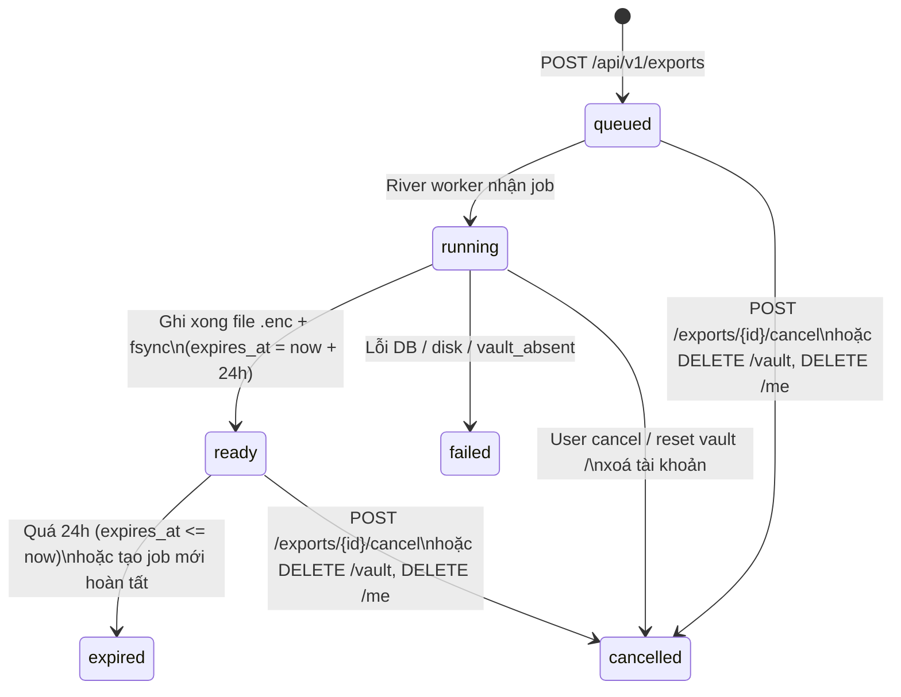

# P06 — Hoàn thiện và phát hành beta MVP · Kế hoạch triển khai

> Trạng thái: kế hoạch, chưa triển khai.
> Nguồn: [P06](../phases/P06-beta.md), [SPEC](../SPEC.md) §3.11, §5, §7.6–§7.8, §8, §9.1–§9.2, §10, §11.1–§11.5, [ADR 0001](../adr/0001-auth-session-va-reauth-assurance.md), [ADR 0002](../adr/0002-vault-crypto-layout.md), [ADR 0003](../adr/0003-webauthn-prf-va-devkey.md), [ADR 0004](../adr/0004-embedding-provider-openai-compat.md), [ADR 0005](../adr/0005-content-lossless-va-concurrency.md), [ADR 0006](../adr/0006-account-password-reset.md), [threat model](../threat-model.md), [plan P05](2026-11-02-P05-search.md), mockups `settings/states/docs/legal/landing.html`; quyết định P06 `advisor-dec-P06-001..014` (đặc biệt `advisor-dec-P06-003` D1–D12 về export/delete UX, `advisor-dec-P06-011` về consent semantic/mail/reset-backup/dogfood-delete), `reports/p06plan/{baseline,draft-export,draft-ui,draft-ops}.md`, `reports/opsrecon/baseline-ops.md`, `reports/uxdesign/{decisions,privacy-truth}.md`, `reports/backupnow/`, `reports/cloudrun/T1-worker.md`.
> Quy ước: `§` chỉ mục SPEC; "mục" chỉ mục của plan này. Mọi đường dẫn code là đường dẫn trong repo tại `phase06/beta` @ `9f9bafd` (= `468cc3b` + merge `phase06/backupnow` `44ae700` + merge `phase06/vulnfix` `7807a2b`); P05 đã squash vào `develop`; **chưa có** = không có trong code ở SHA này. **BE** = `apps/api/**`, `scripts/**`, SQL, migration, handler OpenAPI; **FE** = `apps/web/**`, `packages/shared-types/**`, `packages/crypto-vectors/**` (crypto-vectors chỉ đọc); **Ops** = `infra/**`, `docs/runbooks/**`, `.data/deploy/**`, systemd trên `bro`; **Runner** = `cursor-runner` = Cursor cloud runner (`.cursor/cloud/specs/*.txt` trên `phase06/cloudrun`), `ci` = GitHub Actions `ci.yml`, `bro-ops` = thao tác trực tiếp trên VPS `bro` (Ubuntu 24.04 ARM64), `visual-local` = `pi/tester_visual` + Orca browser + Jev `visual`. Lane trên `bro` = `lead-working` + Advisor-started sibling reviewers/testers (không nest worker).

**Mục tiêu:** Bản beta dùng được với dữ liệu thật trên `engram.zone17.click`, đủ toàn bộ MVP: auth, vault/passkey/RK/DevKey, Item/Tag/text/JSON, lexical+semantic, encrypted `.sabk.json` export và decrypted JSON export, xoá tài khoản có re-auth + xác nhận email, docs/privacy/help đúng với hành vi thật, vận hành có backup PITR/restore rehearsal và release/rollback runbook. Không bàn giao bản chỉ mô phỏng các nút Settings hoặc copy privacy chưa đúng với thực tế.

**Phạm vi:** 21 task (gồm carry-forward UI/BE/security từ P03–P05) chia bốn wave W0–W4 theo lane song song, giao theo 11 acceptance P06-A1..A11 của phase doc. Task 1 là contract duy nhất; mọi lệch SPEC/ADR/OpenAPI nằm trong đó.

| Mốc | Task | Điều kiện qua mốc |
|---|---|---|
| P06-A — Export & Delete (A1, A2, A3, A4, A11) | 1, 2, 3, 11, 12, 13 | Task 1 merge; `.sabk.json` offline restore đạt; decrypted JSON giữ raw string; delete/reset phân biệt đúng; rate limit 3/giờ đếm cả cancelled |
| P06-B — UI & Docs (A5, A10) | 6, 7, 14, 15, 18 | `uipolish` + `docsprivacy` merge; U1–U20 có owner; visual/a11y/axe sạch; i18n en/vi đồng bộ |
| P06-C — Ops, Security & Release (A6, A7, A8, A9) | 4, 5, 8, 9, 10, 16, 17, 19, 20, 21 | CSP/HSTS/metrics/backup/PITR/security tests đạt; NFR đo được; runbook + 8 PROD-STEP hoàn tất |

Phase chỉ Done khi cả 3 mốc đạt + gate P01–P05 re-check pass. Thiếu deploy credentials, hardware PRF, crypto reviewer thứ hai hay restore evidence phải nêu là giới hạn chưa hoàn tất, không tự bỏ gate.

**Chia lane song song** (mỗi file seam có đúng một chủ trong một wave; Advisor giới hạn số lane chạy đồng thời theo RAM host theo team rules):

| Wave | Lane → task | Bắt đầu khi | Seam chung và chủ |
|---|---|---|---|
| W0 (1 lane) | `contract` → 1 | `phase06/uxdesign` + `phase06/backupnow` + `phase06/vulnfix` merge vào `phase06/beta` | `docs/SPEC.md` (§3.11, §9.1–9.2, §10), `docs/threat-model.md`, `docs/phases/P06-beta.md` (ghi chú lệch), `apps/api/api/openapi.yaml`, `packages/shared-types/src/{api.d.ts,problem.ts}`, `apps/api/internal/httpx/{codes,problem,contract_test,userlimit}.go`, `apps/api/internal/secevent/event.go`, `apps/api/migrations/0010_export.{up,down}.sql`: chủ `contract`. |
| W1 (8 lane) | `exportbe` (BE) → 2; `accountdelbe` (BE) → 3; `ops-obs` (BE) → 4; `ops-config` (BE) → 5; `uipolish` (FE) → 6; `docsprivacy` (FE) → 7; `ops-edge` (FE+BE/infra) → 8; `ops-dr` (BE/Ops) → 9 → 10 | Task 1 merge; `uipolish`/`docsprivacy` thêm `phase06/uxdesign` mockups merge | `apps/api/internal/export/**` (trừ `exporthttp/`), `apps/api/internal/db/{queries,gen}/export.sql*`, `apps/api/internal/compose/export.go`, `apps/api/internal/worker/worker.go`, `apps/api/internal/vault/reset.go` (cancel export), `apps/api/internal/config/config.go` (`ExportStorageDir`): `exportbe`. `apps/api/internal/auth/account_delete.go`, `apps/api/internal/auth/authhttp/{handlers,routes}.go`, `apps/api/internal/embedding/store/delete.go`: `accountdelbe`. `apps/api/internal/obs/**`, `apps/api/internal/httpx/{metrics_guard,router}.go`, `apps/api/cmd/worker/main.go`, `infra/docker-compose.yml`, `infra/ops/**`: `ops-obs`. `apps/api/internal/auth/{smtp_mail,mail,service,account}.go`, `apps/api/internal/config/config.go`, `apps/api/internal/compose/auth.go`, `.env.example`: `ops-config`. `apps/web/styles/tokens.css`, `apps/web/tests/tokens.parity.test.ts`, `apps/web/features/json-table/json-tree-grid.tsx`, `apps/web/components/app-shell/**`, `apps/web/features/**` (states): `uipolish`. `apps/web/app/(marketing)/[locale]/**`, `apps/web/features/auth/legal-page-content.tsx`, `apps/web/components/{landing,marketing}/**`, `apps/web/messages/{en,vi}.json` (W1), `apps/web/tests/docs-privacy-copy.test.tsx`: `docsprivacy`. `apps/web/next.config.ts`, `apps/web/middleware.ts`, `apps/web/tests/csp.test.ts`, `apps/web/scripts/postbuild-csp-manifest.mjs`, `scripts/gen-release-artifacts.mjs`, `infra/nginx/**`, `apps/web/package.json`: `ops-edge`. `infra/backup/**`, `docs/runbooks/backup-restore-pitr.md`: `ops-dr`. |
| W2 (3 lane) | `exportapi` (BE) → 11; `exportui` (FE) → 12 → 13; `nfr-bench` (BE+FE) → 19 | 11: Task 2 merge + `ops-obs` merge (rebase `router.go`). 12–13: Task 1 merge + `exportapi`/`accountdelbe` contract + `uxdesign` merge. 19: Task 1 merge | `apps/api/internal/export/exporthttp/**`, `apps/api/internal/httpx/router.go` (mount export), `apps/api/internal/compose/http.go`: `exportapi`. `apps/web/lib/api/{export,auth}.ts`, `apps/web/features/settings/{data,security/vault/reset-vault-dialog}.tsx`, `apps/web/features/auth/forms/login-form.tsx`, `apps/web/app/app/settings/page.tsx`, `apps/web/lib/auth/audit-catalog.ts`, `apps/web/messages/{en,vi}.json` (W2), `apps/web/e2e/content-export-delete.spec.ts`, `scripts/sanitize-e2e-artifacts.mjs` (W2): `exportui`. `docs/benchmarks/P06-nfr/protocol.md`, `scripts/measure-nfr.mjs`: `nfr-bench`. |
| W3 (5 lane) | `i18nsweep` (FE) → 15; `sec-tests` (BE+FE) → 16; `sec-review` (BE reviewer) → 17; `uiqa` (FE tester) → 14 → 18; `nfr-bench` → 20 | 15: Task 12, 13, 6, 7 merge. 16: Task 11, 12, 13, 4, 8 merge. 17: code W1–W2 merge. 14: Task 6 merge; 18: Task 14 + 12 + 13 + 6 + 7 merge. 20: Task 8, 12, 13, 19 merge | `apps/web/messages/{en,vi}.json` (W3), `apps/web/tests/i18n.parity.test.ts`: `i18nsweep`. `apps/api/internal/export/exporthttp/security_acceptance_test.go`, `apps/web/e2e/content-p06-canary-security.spec.ts`: `sec-tests`. `docs/reviews/**`, `docs/adr/{0002,0003}.*` (status), `docs/threat-model.md` (status): `sec-review`. `apps/web/e2e/{content-entry-visual,vault-b-visual,content-a11y-export-docs}.spec.ts`, `scripts/sanitize-e2e-artifacts.mjs` (W3), `reports/uiqa/u1-u20-qa-report.md`: `uiqa`. `docs/benchmarks/P06-nfr/results/**`: `nfr-bench`. |
| W4 (1 lane) | `release` (lead-working + sibling) → 21 | W1–W3 merge; `ci.yml`/`cursor-runner` `full.txt` xanh | `docs/runbooks/release-rollback.md`, `apps/web/e2e/content-p06-beta-journey.spec.ts`, `docs/phases/evidence/P06.md`, `.data/deploy/compose.prod.yml`, `~/global-infra/nginx/conf.d/engram.conf` (PROD-STEP): `release`. |

Không lane nào sửa `apps/web/lib/crypto/**`, `apps/api/internal/vault/{envelope,wrap,kdf}.go`, `apps/web/features/vault/vault-provider.tsx` hay envelope/wrap formats (crypto gate §11.4, gate mục 5). Export chỉ đọc các wrap hiện có, không thay đổi cấu trúc. Khi thực hiện, đánh dấu checkbox theo kết quả thực tế.

## 1. Baseline và ranh giới

### 1.1. Hiện trạng code (`phase06/beta` @ `9f9bafd`)

- **Migrations (`apps/api/migrations/`):** `0001`–`0009` (cuối = `0009_embedding`). Chưa có bảng `export_job`. Migration tiếp theo = `0010_export`.
- **OpenAPI (`apps/api/api/openapi.yaml`):** 70 `operationId` hiện có; chưa có `exportCreate`, `exportGetLatest`, `exportGet`, `exportDownload`, `exportCancel`, `exportDecryptedPage`, `exportDecryptedAudit`, `accountDelete`. `ReauthAction` enum đã có `export.decrypted` + `account.delete` (l.3144-3165). `ProblemCodes` catalog chưa có `export_not_ready`, `export_expired`, `account_delete_confirm_invalid`.
- **Handlers Export/Delete:** chưa có `apps/api/internal/export/**`, chưa có `DELETE /api/v1/me`. `POST /audit/export-decrypted` chưa có. `export.encrypted`/`export.decrypted`/`account.delete` chưa có trong `secevent/event.go` (có `entry.import` từ P04 nhưng chưa có trong FE `audit-catalog.ts`).
- **Rate limit (`apps/api/internal/httpx/userlimit.go`):** `MaxRateLimitWindow = 15 * time.Minute`; chưa có `ScopeExportCreate`. `rate_event_prune` dùng `MaxRateLimitWindow`.
- **Settings UI (`apps/web/app/app/settings/page.tsx`):** `#dulieu` chỉ là placeholder tĩnh (l.75-83); chưa có `features/settings/data/**`, `lib/api/export.ts`, `deleteAccount`. `audit-catalog.ts` thiếu `entry.import` + `export.*` + `account.delete`.
- **Docs/Privacy:** chưa có `/docs` route; `legal.deletion.exportDeleteBody` vẫn nói "đang được bổ sung (ở bản phát hành tiếp theo)". `LegalPageContent` chưa có `LocaleSwitch`.
- **CSP/Security headers (`apps/web/next.config.ts`):** `script-src` còn `'unsafe-inline'`; chưa có HSTS, `Permissions-Policy`, `poweredByHeader: false`, `/.well-known/build-manifest`. `/api/v1/metrics` mount công khai không guard.
- **Observability:** `worker`/`web` chưa có healthcheck; chưa có alert script; chưa có collector `export_jobs_total`/`account_deletions_total`.
- **Backup/DR:** `archive_mode=off`; lane `backupnow` (advisor-dec-P06-005..010, merged `44ae700`) đã cài nightly `pg_dump` GPG encrypted `engram-backup.timer` 03:17 UTC+7 + GPG public key `F2C47029...` + off-host pull; chưa có WAL archiving/PITR/base backup/restore rehearsal.

### 1.2. Hiện trạng `bro` (`opsrecon/baseline-ops.md`)

- Ubuntu 24.04 ARM64, 23 GB RAM (~9 GB free), `/` 145 GB used 85% (23 GB free), Docker 29.6.1.
- `engram-api-1` healthy, `engram-worker-1`/`engram-web-1` no healthcheck, `engram-db-1` `pg_isready` healthy.
- `APP_ENV=development` trên production (HIGH); `archive_mode=off`, `data_checksums=off`; chưa có scheduled/encrypted/off-host backups (backupnow interim đã lắp đặt).
- `global_nginx` `engram.conf`: TLS Let's Encrypt (hết hạn 2027-01-29), `log_format engram_noquery` (không log query string — gate 8a P05), no `/api` location (proxy qua Next), `server_tokens on`, no HSTS.
- Docker `json-file` driver no rotation; 13 GB reclaimable images; volumes `engram_engram-db` (69 MB), `engram_engram-mail` (mail sink).
- Lane `prodhygiene` (advisor-dec-P06-014) đã hoàn tất opsrecon §6 bước 1 (image prune done), bước 2 (log rotation prep `infra/deploy/`), bước 8 (APP_ENV analysis) — các bước 3–7 còn lại là tasks của plan này.

### 1.3. Gate re-check P01–P05

| Phase | Evidence | Còn mở → đặt ở |
|---|---|---|
| P01 | `docs/phases/evidence/P01.md` | CSP `'unsafe-inline'` (advisor-dec-014) → Task 8 |
| P02 | `docs/phases/evidence/P02.md` | OAuth Google/GitHub + Turnstile credentials (`user-dec-017`) → smoke `sec-review`/`release`; `MAIL-CAP-P02` → Task 5 |
| P03 | `docs/phases/evidence/P03.md` | Crypto review 2 người §11.4 (`P03.md:112`) → Task 17; PRF hardware smoke → Task 17; `dialog.tsx` focus return (advisor-dec-080) → Task 6, 12, 13; i18n sweep (advisor-dec-090/094) → Task 15 |
| P04 | `docs/phases/evidence/P04.md` | `FU-ENTRYUX-VISDIFF` (advisor-dec-376) → Task 14; `FU-DEVKEY-VISUAL` (advisor-dec-378/379) → Task 14; `FU-T26-390-OVERFLOW` (advisor-dec-342) → Task 6; `FU-T22-SEMCHIP-HOVER` (advisor-dec-347) → Task 6; `FU-T22-429-STICKY` (advisor-dec-335) → Task 6; `FU-T22-MANUAL` (advisor-dec-323) → Task 18; `FU-T24-ABSCLAIMS` (advisor-dec-346) → Task 1 + 7; `FU-T13-OAS` (advisor-dec-300) → Task 1; `FU-OWNER-SEMDEFAULT` (advisor-dec-362) → Task 7 (copy); Trash UI Q9 (advisor-dec-107) → giữ nguyên, ghi docs Task 7; `A11Y-SAVING-LIVE`/`A11Y-UNDO-FOCUS-FLICKER` (advisor-dec-217) → Task 6/18 |
| P05 | `docs/phases/evidence/P05.md` | `FU-P06-SEM-OBSERVE`/`FU-T24-OBSERVE24H` → Task 20; `FU-T23-RUNNER` (advisor-dec-354) → Task 20; `FU-SL-3` (advisor-dec-351) → post-MVP note; `FU-T23-0010` (advisor-dec-350) → tuỳ chọn Task 21 nếu report chứng minh; `embedding_jobs_total` gap → runbook (ghi nhận); `FU-T20A-ERRCLASS`/`FU-T20A-LEADER`/`FU-T20B1-LOWS`/`FU-T17-FEC25` → post-MVP note; chip tag fuzzy `suggest?scope=tag` → post-MVP nếu không kịp |

## 2. Contract chuẩn cho mọi task

### 2.1. Schema `.sabk.json` v1 (Encrypted Backup) & Định danh phiên bản

File sao lưu mã hoá có phần mở rộng `.sabk.json`, tên tải về mặc định **`engram-backup-YYYY-MM-DD.sabk.json`** (UTC date theo `exported_at`), `Content-Type: application/json; charset=utf-8`.

Cấu trúc JSON chính xác (`.sabk.json` v1):

```json
{
  "format": "engram.sabk",
  "version": 1,
  "exported_at": "2026-11-07T08:30:00Z",
  "snapshot": {
    "consistency": "repeatable_read",
    "includes_active": true,
    "includes_soft_deleted_unpurged": true,
    "excludes_purged": true,
    "soft_delete_retention_days": 30,
    "counts": { "tags": 1, "items": 1, "item_tags": 1, "entries": 1 }
  },
  "vault": {
    "vault_key_id": "9f8e7d6c-5b4a-4321-8765-1029384756ab",
    "version": 3,
    "kdf": { "alg": "argon2id13", "ops": 3, "mem": 67108864, "parallelism": 1, "salt": "<16B base64url>" },
    "vault_key_wrapped_by_kek": "<73B base64url wrapK>",
    "x25519_public": "<32B base64url>",
    "ed25519_public": "<32B base64url>",
    "private_keys_wrapped": "<169B base64url wrapP>",
    "recovery_keys": [
      { "slot": 1, "lookup_hash": "<32B base64url>", "wrap": "<73B base64url>" }
    ],
    "passkeys": [
      {
        "id": "<uuid>", "name": "MacBook Touch ID",
        "cred_id": "<base64url>", "prf_salt": "<32B base64url>",
        "vk_wrap": "<73B base64url>", "pubkey": "<base64url>",
        "aaguid": "adce0002-35bc-c60a-648b-0b25f1f05503",
        "created_at": "2026-10-29T10:00:00Z"
      }
    ]
  },
  "tags": [
    { "id": "<uuid>", "display": "wifi-khách", "normalized": "wifi-khách", "item_count": 1,
      "last_used_at": "2026-11-01T00:00:00Z", "created_at": "2026-10-01T00:00:00Z", "deleted_at": null }
  ],
  "items": [
    { "id": "<uuid>", "name": "wifi", "name_normalized": "wifi", "hint": "Tầng 2",
      "entry_count": 1, "version": 1, "last_used_at": "2026-11-05T12:00:00Z",
      "created_at": "2026-10-01T00:00:00Z", "updated_at": "2026-11-05T12:00:00Z",
      "deleted_at": null, "delete_batch": null }
  ],
  "item_tags": [
    { "item_id": "<uuid>", "tag_id": "<uuid>", "created_at": "2026-10-01T00:00:00Z" }
  ],
  "entries": [
    {
      "id": "<uuidv7>", "item_id": "<uuid>", "type": "text", "position": 0, "version": 1,
      "plaintext_len_bucket": 256,
      "envelope": {
        "v": 1, "alg": "xchacha20poly1305-ietf",
        "key_id": "9f8e7d6c-5b4a-4321-8765-1029384756ab",
        "nonce": "<24B base64url>", "ct_enc": "utf8"
      },
      "ciphertext": "<base64url>",
      "created_at": "2026-10-01T00:05:00Z", "updated_at": "2026-10-01T00:05:00Z",
      "deleted_at": null, "deleted_via": null, "delete_batch": null
    }
  ]
}
```

Bất biến của `.sabk.json` v1 (`SPEC.md` §3.11, `P06-beta.md`, `P06-A2`):

- **`format` = `"engram.sabk"`, `version` = `1` cố định.** Khi có thay đổi phá vỡ tương thích ở các phase sau (P07+), tăng `version`.
- **Khối `vault` đầy đủ để mở lại độc lập không cần live server:** `vault_key_id`, `version`, `kdf` (`alg`, `ops`, `mem`, `parallelism`, `salt` base64url 16 B), `vault_key_wrapped_by_kek` (wrapK base64url 73 B), `x25519_public` (32 B), `ed25519_public` (32 B), `private_keys_wrapped` (wrapP base64url 169 B). `recovery_keys`: mảng các hàng còn sống trong `vault_recovery_key` sắp theo `slot ASC` (`1..10`), gồm `{slot, lookup_hash, wrap}` (`lookup_hash` 32 B, `wrap` 73 B — **tuyệt đối không có plaintext RK**). `passkeys`: mảng các hàng trong `vault_passkey` sắp theo `created_at ASC, id ASC`, gồm `{id, name, cred_id, prf_salt, vk_wrap, pubkey, aaguid, created_at}` (mọi trường bytea mã hoá base64url không padding). **Không bao giờ** chứa `user_id`, email, session token, hay bất kỳ secret chưa wrap nào.
- **Thứ tự sắp xếp xác định:** `tags` `(created_at, id)`; `items` `(created_at, id)`; `item_tags` `(item_id, tag_id)`; `entries` `(item_id, position, id)`. Mọi mảng rỗng serialize là `[]` (không `null`).
- **Fixture:** `apps/api/internal/export/testdata/sabk_v1_sample.sabk.json` + đồng bộ `apps/web/features/settings/data/__fixtures__/sabk_v1_sample.sabk.json` (không đụng `packages/crypto-vectors/**`).
- **Test khôi phục độc lập (`P06-A2`):** `apps/web/features/settings/data/sabk-offline-restore.test.ts` + `apps/api/internal/export/sabk_restore_test.go` chứng minh chỉ dùng file `.sabk.json` + passphrase gốc (hoặc RK gốc / PRF output gốc) trên môi trường hoàn toàn không có mạng/session, kể cả sau khi live server đã đổi passphrase (`PUT /vault/kek`), consume RK (`POST /vault/recover/complete`), thu hồi passkey (`DELETE /vault/passkeys/{id}`) hoặc xoá tài khoản, vẫn giải mã lại được `VK` từ `vault_key_wrapped_by_kek`/`recovery_keys[].wrap`/`passkeys[].vk_wrap` và mở được toàn bộ `entries[].ciphertext`.

### 2.2. Định dạng Decrypted JSON (`engram-readable-YYYY-MM-DD.json`) (`P06-A3`)

File xuất đọc được do **client tự giải mã cục bộ trong trình duyệt** (sau khi kho đã mở `vault.state === 'unlocked'` và người dùng vừa xác thực lại với grant `export.decrypted`), tên tải về mặc định `engram-readable-YYYY-MM-DD.json` (`advisor-dec-P06-003` D11). **Server không bao giờ tạo hay nhận file này (`user-dec-016`).**

```json
{
  "format": "engram.readable",
  "version": 1,
  "exported_at": "2026-11-07T08:35:00Z",
  "vault_key_id": "9f8e7d6c-5b4a-4321-8765-1029384756ab",
  "warning": "SENSITIVE PLAINTEXT EXPORT — Anyone with this file can read all entries.",
  "snapshot": {
    "includes_active": true,
    "includes_soft_deleted_unpurged": false,
    "excludes_purged": true,
    "counts": { "tags": 1, "items": 1, "entries": 1 }
  },
  "tags": [
    { "id": "<uuid>", "display": "wifi-khách", "item_count": 1, "last_used_at": "...", "created_at": "..." }
  ],
  "items": [
    {
      "id": "<uuid>", "name": "wifi", "hint": "Tầng 2", "tag_ids": ["<uuid>"],
      "version": 1, "last_used_at": "...", "created_at": "...", "updated_at": "...",
      "entries": [
        { "id": "<uuidv7>", "type": "json", "position": 0, "version": 1,
          "body": "{\"big\":9007199254740993,\"dup\":1,\"dup\":2,\"negZero\":-0}",
          "created_at": "...", "updated_at": "..." }
      ]
    }
  ]
}
```

- **Quy tắc bảo toàn chuỗi gốc (`P06-A3`, `ADR 0005`):** `entries[].body` **luôn là chuỗi JSON (`string`) chứa đúng các byte UTF-8 nguyên bản** sau khi `openEntry` giải mã, kèm `type: "text" | "json"`. Client **tuyệt đối không** `JSON.parse` rồi `JSON.stringify` (mất số nguyên > `Number.MAX_SAFE_INTEGER`, `-0`, khoá trùng, thứ tự khoá). Chuỗi UTF-8 nguyên bản chỉ được JSON-escape thành JSON string literal khi đóng gói.
- **Chính sách lỗi (`advisor-dec-P06-003` D12):** trước và trong khi giải mã từng trang, client kiểm tra `page.vault_key_id === currentVaultKeyId` và `entry.envelope.key_id === currentVaultKeyId`. Nếu bất kỳ entry nào có `key_id` lệch, giải mã lỗi, hoặc kho bị khoá/reset giữa chừng → **huỷ ngay toàn bộ lần xuất, xoá sạch mảng/buffer tạm, không tạo file tải về một phần**.

### 2.3. Snapshot Consistency & Tombstone/Purge

1. **Snapshot `REPEATABLE READ READ ONLY` cho `.sabk.json` (`P06-A2`):** worker `export_encrypted` mở một transaction chỉ đọc `ISOLATION LEVEL REPEATABLE READ READ ONLY` (MVCC snapshot cố định, không giữ khoá ghi, không chặn `DELETE /vault`/`content_purge`). Câu đầu tiên đọc `vault` — không có hàng → `failed` `vault_absent`. Mọi truy vấn sau (`vault_recovery_key`, `vault_passkey`, `tag`, `item`, `item_tag`, `entry`) chạy trên cùng `tx`. Sau khi đọc xong và trước khi `ready`, kiểm tra ngoài snapshot `app_user` còn tồn tại và `vault.vault_key_id` khớp `snapshot_vault_key_id` — nếu user đã xoá tài khoản hoặc reset vault thì `cancelled`/`failed`, xoá file tạm.
2. **Tombstone/Purge trong manifest:**
   - `.sabk.json`: gồm cả active (`deleted_at IS NULL`) và soft-deleted chưa purge (`deleted_at IS NOT NULL`, trong cửa sổ 30 ngày `content_purge`), giữ nguyên `deleted_at`, `deleted_via`, `delete_batch`. Purged (sau 30 ngày hoặc `DELETE /vault` xoá cứng) không có trong snapshot (`snapshot.excludes_purged = true`).
   - Decrypted JSON: chỉ `deleted_at IS NULL` (`includes_soft_deleted_unpurged = false`), ghi rõ trong `snapshot` và `<details>` UI.

### 2.4. Export Job State Machine

Bảng `export_job` quản lý vòng đời `.sabk.json` với 6 trạng thái:



| Trạng thái | Ý nghĩa | File trên đĩa | Cancel? | Download? |
|---|---|---|---|---|
| `queued` | Enqueue River job, chờ worker | Chưa có | Có → `cancelled` | `409 export_not_ready` |
| `running` | Worker quét snapshot, ghi `.tmp` | `.tmp` (xoá nếu lỗi/huỷ) | Có → `cancelled` | `409 export_not_ready` |
| `ready` | File ghi xong, còn 24h | `.sabk.json.enc` | Có → `cancelled`, xoá file | **`200`** |
| `failed` | Lỗi I/O, DB timeout, `vault_absent` | Không | Idempotent `200` | `409 export_not_ready` |
| `cancelled` | User huỷ / reset vault / xoá account | Đã xoá | Idempotent `200` | `409 export_not_ready` |
| `expired` | Quá 24h hoặc bị job mới thay | Đã xoá | `409 export_not_ready` | `410 export_expired` |

- **Thay thế bản cũ (`advisor-dec-P06-003` D4):** tối đa 1 job `queued`/`running` + 1 file `ready` mỗi user. `POST /exports` khi đang có job `queued`/`running` → trả `202` cùng `ExportJob` đó (không tạo mới, không trừ rate limit). Job mới `ready` → mọi `ready` cũ → `expired` + xoá file.
- **Reload trang:** `GET /exports/latest` trả job gần nhất; nếu `expires_at <= now()` và `status == 'ready'` thì hiển thị `expired` ngay khi đọc (cron `export_prune` chưa chạy).

### 2.5. Storage, Mã hoá At-Rest, Expiry 24h, Cleanup & Owner Auth

1. **Storage (`infra/docker-compose.yml`, chủ `ops-obs`):** volume `engram-exports:/var/lib/engram-exports` mount vào `api` + `worker` (uid:gid `65532:65532`, mode `0700`, env `EXPORT_STORAGE_DIR`; dev/test `os.TempDir()/engram-exports`). **Không** mount vào `web`/`nginx`.
2. **At-Rest AEAD (không thêm primitive):** file `.sabk.json` ghi qua `EncryptedFrameWriter` chunked 64 KiB dùng `chacha20poly1305.NewX(fileKey)` (`golang.org/x/crypto/chacha20poly1305` đã có trong `go.mod`), `fileKey = HKDF-SHA256(ikm=AUTH_JWT_SECRET, salt=job.ID[:], info="engram/export-file-at-rest/v1:frame")` → 32 B riêng mỗi job. Mỗi khung ghi `uint32_be(plain_len) ‖ nonce_24B(frame_seq) ‖ seal(chunk, AAD = job_id ‖ frame_seq_uint64_be ‖ is_final_byte)`. `GET /exports/{id}/download` đọc từng khung, `Open`, stream ra `http.ResponseWriter` — RAM < 256 KiB/kết nối.
3. **24h + `export_prune` (River periodic 15 phút):** `ready` → `expires_at = completed_at + 24h`. `export_prune` xoá file `ready` `expires_at <= now()` → `expired`, file `cancelled`/`failed`/`expired` `storage_path IS NOT NULL`, file mồ côi `.tmp`/`.enc` > 25h không ứng job `ready`/`running`, và metadata `export_job` > 90 ngày.
4. **Owner auth (`user-dec-016`, `P06-A7`):** UUID v4 job ID; **không** bearer URL/query token — mọi endpoint qua `RequireSession` (`sabk_session` cookie). Handler kiểm `job.user_id == principal.UserID`; không tồn tại hoặc user khác → `404 not_found`. Access log chỉ ghi route pattern `/api/v1/exports/{id}/download`, không raw URL/UUID.

### 2.6. Rate Limit Export: 3 lần / giờ / user (đếm cả Cancelled) (`P06-A11`)

- Tối đa **3 job tạo trong cửa sổ trượt 60 phút / `user_id`**. **Đếm cả `cancelled`/`failed`** — lượt tạo ghi nhận ngay, **không hoàn trả** khi cancel (chống lách).
- **`export_create` chỉ áp `POST /exports`**; `GET /exports/{id}`, `GET /exports/latest`, `GET /exports/{id}/download`, `POST /exports/{id}/cancel` **không** tiêu quota — job thứ 3 `running`/`ready` vẫn chạy/tải về bình thường khi chạm hạn; chỉ job thứ 4 bị `429 rate_limited` + `Retry-After` + `retry_after`.
- Cài: `ScopeExportCreate Scope = "export_create"` `Limit: 3, Window: 60m` trong `userlimit.go`; nâng `MaxRateLimitWindow = 60 * time.Minute` (từ 15m) để `rate_event_prune` giữ đủ 60 phút. UI `formatRetryClock` hiển thị `Thử lại lúc 14:12`.

### 2.7. Streaming / Phân trang (Server & Client — không nạp toàn Vault vào RAM)

1. **Server `.sabk.json` (`internal/export/worker.go`):** trong `REPEATABLE READ READ ONLY`, ghi tuần tự vào `EncryptedFrameWriter` (buffer 64 KiB): `vault` + `vault_recovery_key` + `vault_passkey` + `counts` → `tag` keyset `(created_at,id)` 500/lô (`ExportTagsBatch`) → `item` `(created_at,id)` 500/lô → `item_tag` `(item_id,tag_id)` 1000/lô → `entry` `(item_id,position,id)` 100/lô (`ExportEntriesBatch`, ciphertext ≤ 256 KiB). Giữa mỗi lô kiểm `ctx.Err()` + `status == 'cancelled'` → dừng, xoá `.tmp`.
2. **Server + Client Decrypted JSON:** `GET /api/v1/exports/decrypted/pages?cursor=<opaque>&limit=<1..100>` (mặc định 50), `RequireSession` + `RequireReauth("export.decrypted")`. Trang đầu: `vault_key_id`, `vault.version`, tags sống, items sống (`tag_ids`), `total_entries`, lô `entries` sống `(item_id, position, id)` + `envelope` + `ciphertext`; cursor opaque HMAC neo `(user_id, vault_key_id, vault_version, last_item_id, last_position, last_entry_id)`. Trang sau: xác minh HMAC, `vault_key_id` khớp cursor (khác → `409 entry_key_mismatch`), trả lô tiếp + `next_cursor`.
3. **Client (`decrypted-export-runner.ts`):** `vault.state === 'unlocked'` + `page.vault_key_id === currentVaultKeyId`; mỗi trang 50 entry giải mã qua Worker `openEntry`, `role="status"` `Đã giải mã x/total_entries`, push chuỗi JSON vào `BlobPart[]`, bỏ tham chiếu `ciphertext`/buffer trang xong. `Huỷ` → `AbortController.abort()`; `vault.registerSecretFormReset` (khoá/logout/session hết) → abort + xoá `BlobPart[]` + `URL.revokeObjectURL`. Xong → `POST /api/v1/audit/export-decrypted` + `Idempotency-Key` + `X-Reauth-Token`.

### 2.8. Audit Events & Thông báo Bảo mật

| `event` | Nơi phát | `result` | `meta` | `user_notification` + mail? | U7 label |
|---|---|---|---|---|---|
| `export.encrypted` | Worker `export_encrypted` → `ready`/`failed` | `success`/`failure` | `{}` (không `job_id`/path/name) | Có (khi `success`) | `Đã tạo bản sao lưu mã hoá (.sabk.json)` |
| `export.decrypted` | `POST /audit/export-decrypted` (client gọi sau hoàn tất) | `success` | `{}` (không nội dung/metadata) | Có | `Đã xuất bản đọc được (không mã hoá)` |
| `account.delete` | `DELETE /api/v1/me` (trong tx xoá) | `success`/`failure` | `{}` (không email/PII) | Không `user_notification` (user xoá trong tx); email best-effort sau commit nếu `mail_delivery_available` | (user_id=NULL, 90d) |

- **Trung thực:** server không chứng minh client đã decrypt xong; `export.decrypted` phản ánh client đã xác thực lại grant `export.decrypted` + báo cáo hoàn tất.
- **`entry.import` còn thiếu ở FE:** Task 12 bổ sung `"entry.import"` (BE `secevent.EventEntryImport`) + `export.*` + `account.delete` vào `AUDIT_EVENTS` `apps/web/lib/auth/audit-catalog.ts` + `messages/{en,vi}.json`.

### 2.9. Hợp đồng Xoá tài khoản (`DELETE /api/v1/me`) & Phân biệt với Đặt lại Vault (`DELETE /api/v1/vault`)

1. **Bảo vệ HTTP (`S + C + A("account.delete") + R("vault_sensitive") + I`):** `RequireOrigin` + `RequireSession` + `RequireCSRF` + `RequireJSONContent` (chống CSRF `user-dec-016`). `RequireReauth("account.delete")`: grant HMAC 5 phút đúng `(user_id, session_id, "account.delete")` (password hoặc OAuth re-auth `ADR 0001` cho OAuth-only). `Idempotency-Key` bắt buộc.
2. **Xác nhận email (`advisor-dec-P06-003` D7):** body `{"confirm_email": "user@example.com"}`; `NormalizeEmail` (trim+lowercase) so `app_user.email` dưới `FOR UPDATE`; sai → `400 account_delete_confirm_invalid`.
3. **Transaction xoá cứng (retry 1 lần `40P01`/`55P03`):** (a) `pg_advisory_xact_lock_shared(GenerationSetLockKey)` → `app_user FOR UPDATE` → `vault FOR UPDATE` (nếu có) → advisory lock content user. (b) `embedding/store.DeleteUserAllGenerations(ctx, tx, userID)` xoá vector trên mọi generation `state <> 'dropped'`. (c) Huỷ `river_job` `state IN ('available','scheduled','retryable')` `args->>'user_id' = userID` (gồm `embed_*`, `export_encrypted`). (d) Thu thập `export_job.storage_path`. (e) `DELETE FROM app_user` → cascade `auth_identity`, `user_session`, `session_refresh_used`, `email_verification`, `oauth_transaction`, `oauth_reauth_receipt`, `user_notification`, `vault`, `vault_recovery_key`, `vault_passkey`, `webauthn_challenge`, `idempotency_key`, `rate_event`, `item`, `tag`, `item_tag`, `entry`, `item_embedding_g*`, `tag_embedding_g*`, `export_job`. (f) `audit_log.user_id` `ON DELETE SET NULL` → `user_id = NULL`; ghi `account.delete` `user_id = NULL`, `session_id`, `ip_hash`, `user_agent`, `meta = "{}"`; `auth_prune` xoá sau 90 ngày. (g) Sau `tx.Commit`: xoá file `.sabk.json.enc`/`.tmp` của user; `ClearAuthCookies`; `204`.
4. **Bảng phân biệt:**

| Tiêu chí | Đặt lại Vault (`DELETE /vault`) | Xoá tài khoản (`DELETE /me`) |
|---|---|---|
| Mục đích | Quên passphrase + mất RK/passkey/DevKey, muốn giữ tài khoản | Rời dịch vụ, xoá toàn bộ |
| Điều kiện | Grant `vault.reset` + `If-Match` | Grant `account.delete` + `confirm_email` |
| `app_user`/`auth_identity` | Giữ | Xoá |
| `user_session` | Giữ phiên hiện tại | Xoá tất cả, xoá cookie |
| `item`/`tag`/`item_tag`/vector | Giữ (`entry_count` → 0) | Xoá toàn bộ |
| `entry` | Xoá | Xoá |
| `vault`/RK/passkey | Xoá (tạo mới `vault_key_id`) | Xoá |
| `.sabk.json` server 24h | Xoá ngay | Xoá ngay |
| Backup PITR nội bộ | Hết hạn ≤ 7 ngày | Hết hạn ≤ 7 ngày |
| `audit_log` | Giữ `user_id`, 90 ngày | `user_id = NULL`, 90 ngày |
| File user đã tải | Vẫn mở được bằng wrap cũ | Nằm ngoài server, không xoá được |

## 3. Endpoint và `operationId`

Chú giải: `S` = `RequireSession`, `C` = `RequireOrigin` + `RequireCSRF` (`X-CSRF-Token`), `A(action)` = `RequireReauth(action)` (`X-Reauth-Token`), `I` = `Idempotency-Key`, `R(scope)` = `UserLimiter` theo `user_id`.

| Nhóm | Method & Path | `operationId` | Điều kiện | Request | Response | Lỗi chính |
|---|---|---|---|---|---|---|
| Export | `POST /api/v1/exports` | `exportCreate` | **S+C+I+R(`export_create`)** | `{"kind":"encrypted"}` (16 KiB) | `202` `ExportJob` (`queued`/`running`, `no-store`) | `400 invalid_request`, `401`, `403 csrf_invalid`, `404 vault_absent`, `409 idempotency_conflict`/`in_progress`, `429 rate_limited` (3/h, `Retry-After` + `retry_after`) |
| Export | `GET /api/v1/exports/latest` | `exportGetLatest` | **S** | — | `200 {job: ExportJob\|null}` (`expired` nếu `expires_at <= now()`) | `401` |
| Export | `GET /api/v1/exports/{id}` | `exportGet` | **S** | Path `id` | `200 ExportJob` `{id,kind,status,created_at,completed_at?,expires_at?,size_bytes?,error_code?}` | `400`, `401`, `404 not_found` |
| Export | `GET /api/v1/exports/{id}/download` | `exportDownload` | **S** | Path `id` | `200` stream (`Content-Type: application/json`, `Content-Disposition: attachment; filename="engram-backup-YYYY-MM-DD.sabk.json"`, `no-store, no-transform`, từ `.enc`) | `400`, `401`, `404`, `409 export_not_ready` (`queued`/`running`/`failed`/`cancelled`), `410 export_expired` |
| Export | `POST /api/v1/exports/{id}/cancel` | `exportCancel` | **S+C+I** | `{}` (16 KiB) | `200 ExportJob` (`cancelled`, xoá file; không hoàn lượt) | `400`, `401`, `403 csrf_invalid`, `404`, `409 export_not_ready` (`failed`/`expired`) |
| Export | `GET /api/v1/exports/decrypted/pages` | `exportDecryptedPage` | **S+A(`export.decrypted`)** | `?cursor=<opaque>&limit=<1..100>` (mặc định 50) | `200 DecryptedExportPage` `{vault_key_id,vault_version,total_entries,tags?,items?,entries,next_cursor}` | `400`, `401`, `403 reauth_required`/`reauth_invalid`, `404 vault_absent`, `409 entry_key_mismatch` |
| Export | `POST /api/v1/audit/export-decrypted` | `exportDecryptedAudit` | **S+C+A(`export.decrypted`)+I** | `{}` (16 KiB; field lạ → `400`) | `204` (audit `export.decrypted` + `user_notification` + mail notice) | `400`, `401`, `403 csrf_invalid`/`reauth_required`/`reauth_invalid`, `409 idempotency_conflict` |
| Me | `DELETE /api/v1/me` | `accountDelete` | **S+C+A(`account.delete`)+R(`vault_sensitive`)+I** | `{"confirm_email":"<email>"}` (16 KiB) | `204` + `ClearAuthCookies` (cascade xoá + audit `account.delete` `user_id=NULL`) | `400 account_delete_confirm_invalid`/`invalid_request`, `401`, `403 csrf_invalid`/`reauth_required`/`reauth_invalid`, `409 idempotency_conflict`, `429 rate_limited`, `503 dependency_unavailable` |

**3 mã lỗi mới** thêm vào **cuối** `ProblemCodes` sau `"reset_token_invalid"` (`codes.go:61`) theo quy tắc "thêm cuối catalog" (SPEC §9.1, `contract_test.go`):

1. **`export_not_ready`** (`409`): `/download` khi `queued`/`running`/`failed`/`cancelled`; `/cancel` khi `failed`/`expired`.
2. **`export_expired`** (`410`): `/download` khi `expired` hoặc `expires_at <= now()`.
3. **`account_delete_confirm_invalid`** (`400`): `confirm_email` không khớp `app_user.email`.

## 4. File và dependency

### 4.1. Migration `apps/api/migrations/`

| Số | File | Nội dung |
|---|---|---|
| `0010` | `0010_export.{up,down}.sql` | Bảng `export_job` (`id uuid PK`, `user_id uuid REFERENCES app_user ON DELETE CASCADE`, `kind text CHECK IN ('encrypted')`, `status text CHECK IN ('queued','running','ready','failed','cancelled','expired')`, `snapshot_vault_key_id uuid`, `snapshot_vault_ver int`, `storage_path text`, `size_bytes bigint`, `error_code text`, `created_at/started_at/completed_at/cancelled_at/expires_at timestamptz`, `CHECK ((status = 'ready') <= (expires_at IS NOT NULL AND size_bytes IS NOT NULL))`); index `export_job_user_created_idx (user_id, created_at DESC, id DESC)`; index `export_job_prune_idx (expires_at) WHERE status = 'ready' OR storage_path IS NOT NULL` |

Forward-only trên production; `down.sql` chỉ cho DB test (`DROP TABLE IF EXISTS export_job`).

### 4.2. File theo lane

- **`contract` (Task 1):** `docs/SPEC.md`, `docs/threat-model.md`, `docs/phases/P06-beta.md`, `openapi.yaml`, `packages/shared-types/src/{api.d.ts,problem.ts}`, `httpx/{codes,problem,contract_test,userlimit}.go`, `secevent/event.go`, `migrations/0010_export.*`
- **`exportbe` (Task 2):** `internal/db/{queries,gen}/export.sql*`, `internal/export/{model,atrest,atrest_test,service,snapshot,worker,prune_job,service_integration_test,sabk_restore_test}.go`, `internal/export/testdata/sabk_v1_sample.sabk.json`, `internal/config/config.go`, `internal/compose/export.go`, `internal/worker/worker.go`, `internal/vault/reset.go`
- **`accountdelbe` (Task 3):** `internal/auth/{account_delete,account_delete_test}.go`, `internal/auth/authhttp/{handlers,routes}.go`, `internal/embedding/store/{delete,delete_test}.go`
- **`ops-obs` (Task 4):** `internal/obs/{metrics,export_metrics,export_metrics_test}.go`, `internal/httpx/{metrics_guard,metrics_guard_test,router}.go`, `cmd/worker/main.go`, `cmd/worker/healthcheck_test.go`, `infra/docker-compose.yml`, `infra/ops/{engram-monitor.sh,engram-monitor.service,engram-monitor.timer,test-monitor.sh,README.md}`
- **`ops-config` (Task 5):** `internal/auth/{smtp_mail,smtp_mail_test,mail,service,account}.go`, `internal/config/{config,config_test}.go`, `internal/compose/auth.go`, `.env.example`
- **`uipolish` (Task 6):** `apps/web/styles/tokens.css`, `apps/web/tests/tokens.parity.test.ts`, `apps/web/features/json-table/json-tree-grid.tsx`, `apps/web/components/app-shell/**`, `apps/web/features/**` states
- **`docsprivacy` (Task 7):** `apps/web/app/(marketing)/[locale]/{docs,page,privacy,terms}/**`, `apps/web/features/auth/legal-page-content.tsx`, `apps/web/components/{landing,marketing}/**`, `apps/web/messages/{en,vi}.json`, `apps/web/tests/docs-privacy-copy.test.tsx`
- **`ops-edge` (Task 8):** `apps/web/next.config.ts`, `apps/web/middleware.ts`, `apps/web/tests/csp.test.ts`, `apps/web/scripts/postbuild-csp-manifest.mjs`, `scripts/gen-release-artifacts.mjs`, `infra/nginx/engram.conf`, `apps/web/package.json`
- **`ops-dr` (Tasks 9-10):** `infra/backup/{pitr,rehearsal}/**`, `docs/runbooks/backup-restore-pitr.md`
- **`exportapi` (Task 11):** `internal/export/exporthttp/{handlers,routes}.go`, `internal/httpx/router.go`, `internal/compose/http.go`
- **`exportui` (Tasks 12-13):** `apps/web/lib/api/{export,export.test,auth}.ts`, `apps/web/features/settings/{data/**,security/vault/reset-vault-dialog.tsx}`, `apps/web/features/auth/forms/login-form.tsx`, `apps/web/app/app/settings/page.tsx`, `apps/web/lib/auth/audit-catalog.ts`, `apps/web/messages/{en,vi}.json`, `apps/web/e2e/content-export-delete.spec.ts`, `apps/web/tests/settings-data.test.tsx`, `apps/web/features/settings/data/__fixtures__/*`, `scripts/sanitize-e2e-artifacts.mjs`
- **`uiqa` (Tasks 14, 18):** `apps/web/e2e/{content-entry-visual,vault-b-visual,content-a11y-export-docs}.spec.ts`, `scripts/sanitize-e2e-artifacts.mjs`, `reports/uiqa/u1-u20-qa-report.md`
- **`i18nsweep` (Task 15):** `apps/web/messages/{en,vi}.json`, `apps/web/tests/i18n.parity.test.ts`, components hardcoded strings
- **`sec-tests` (Task 16):** `internal/export/exporthttp/security_acceptance_test.go`, `apps/web/e2e/content-p06-canary-security.spec.ts`
- **`sec-review` (Task 17):** `docs/reviews/**`, `docs/adr/{0002,0003}.*`, `docs/threat-model.md`
- **`nfr-bench` (Tasks 19-20):** `docs/benchmarks/P06-nfr/**`, `scripts/measure-nfr.mjs`
- **`release` (Task 21):** `docs/runbooks/release-rollback.md`, `apps/web/e2e/content-p06-beta-journey.spec.ts`, `docs/phases/evidence/P06.md`, `.data/deploy/compose.prod.yml`, `~/global-infra/nginx/conf.d/engram.conf`

## 5. Gate

1. **Gate crypto (§11.4):** P06 không sửa `apps/web/lib/crypto/**`, `features/vault/vault-provider.tsx`, `internal/vault/{envelope,wrap,kdf}.go` hay envelope/wrap formats. Export chỉ đọc wrap hiện có. Phát hiện cần đổi → dừng, đi đúng gate P03 (ADR, reviewer khác model, chủ repo ký).
2. **Contract trước handler:** Task 2 trở đi chỉ bắt đầu khi PR Task 1 merge vào `phase06/beta` (SPEC/OpenAPI/threat-model khớp mục 2–3, `api.d.ts` sinh lại không diff, review BE + FE). Đổi contract sau W0 → PR contract nhỏ do lead mở, lane liên quan rebase.
3. **Mockup trước UI:** Task 6, 12, 13 port màn nào thì neo tương ứng của `phase06/uxdesign` mockups (`settings.html#dulieu`, `#xoataikhoan`, `#plainDlg`, `#deleteDlg`, `states.html`, `docs.html`) phải xong và FE reviewer duyệt.
4. **Copy pháp lý trước code public (`advisor-dec-362` Gate 8b analog):** copy legal/privacy/docs công khai của Task 7 phải live trước hoặc cùng PR với tính năng export/delete (tránh user thấy "đang được bổ sung" khi tính năng đã có).
5. **Owner authorization trước file:** mọi endpoint export/delete kiểm `job.user_id == principal.UserID` trước khi đọc file; không bao giờ trả `403` lộ existence (luôn `404`). File `.sabk.json` chỉ owner tải qua session cookie, không bearer URL.
6. **Rate limit đếm cancelled (`P06-A11`):** `export_create` 3/h đếm cả `cancelled`/`failed`; job `running`/`ready` không bị mất khi chạm hạn.
7. **Không plaintext lên server (`user-dec-016`):** decrypted JSON chỉ client-side; `POST /audit/export-decrypted` body `{}`; `decrypted-export-runner` không gửi body/name/ciphertext qua audit.
8. **Canary-secret (`user-dec-016`):** Task 16 canary test chứng minh không có passphrase/body/RK/export path/email thô vào network/log/telemetry; reviewer mọi PR chạy checklist mục 7.
9. **Migration forward-only:** production chỉ sau `pg_dump` (lane release). `0010_export` chỉ thêm bảng mới, không đổi cột P01–P05 → binary `:pre-p06` tương thích ngược.
10. **Honest gate (`P06-beta.md:46,75`):** crypto review 2 người §11.4 và PRF hardware smoke — nếu thiếu người review thứ hai hoặc thiết bị thật, ghi `BLOCKER-*` trong `docs/phases/evidence/P06.md`, không đánh dấu pass, không dùng virtual authenticator.
11. **Không gate nào được thay bằng mock test hay tự review.**

## Phần I — Contract và nền (W0–W1)

### Task 1: Contract — SPEC, OpenAPI, Problem Catalog, Migration `0010_export`, Threat Model, Phase Doc

**Mốc:** A/B/C · **Owner:** BE + FE contract (`pi/worker_be`) · **Wave/lane:** W0 / `contract` · **Host:** `local` · **Phụ thuộc:** `phase06/uxdesign` + `phase06/backupnow` + `phase06/vulnfix` merge vào `phase06/beta` · **Files:** `docs/SPEC.md` (§3.11, §7.7–§7.8, §8, §9.1–§9.2, §10: bổ sung bảng schema `export_job`, 8 operations, `DELETE /me`, `export_create` 3/h đếm cả cancelled, 3 mã lỗi, `FU-T13-OAS` fix `PATCH /me/settings` 409 mô tả `semantic_unavailable` tĩnh + breaker mở thay "provider probe", `FU-T24-ABSCLAIMS` bổ sung vế giả định `L-8` mã JS không bị can thiệp vào §10.4; domain `engram.zone17.click` đã đúng §11.5 — không sửa), `docs/threat-model.md` (kiểm soát `.sabk.json` at-rest, owner-only download, decrypted local-only, delete chống CSRF + re-auth `user-dec-016`), `docs/phases/P06-beta.md` (ghi chú lệch), `openapi.yaml` (8 operations `exportCreate`/`exportGetLatest`/`exportGet`/`exportDownload`/`exportCancel`/`exportDecryptedPage`/`exportDecryptedAudit`/`accountDelete`, schemas `ExportJob`/`ExportCreateRequest`/`DecryptedExportPage`/`AccountDeleteRequest`, 3 mã lỗi), `packages/shared-types/src/{api.d.ts,problem.ts}` (`pnpm --filter @engram/shared-types generate`), `httpx/{codes,problem,contract_test,userlimit}.go` (3 mã lỗi cuối catalog + `p06OperationIDs` + `ScopeExportCreate` 3/60m + `MaxRateLimitWindow = 60m`), `secevent/event.go` (`export.encrypted`/`export.decrypted`/`account.delete`), `apps/api/migrations/0010_export.{up,down}.sql`.

- [ ] Cập nhật `docs/SPEC.md` và `docs/threat-model.md` khớp mục 2–3.
- [ ] Migration `0010_export.{up,down}.sql` tạo bảng `export_job` + index.
- [ ] `openapi.yaml` + `httpx/{codes,problem,contract_test,userlimit}.go` + `secevent/event.go` + `pnpm generate`.
- [ ] Fix `FU-T13-OAS`: `PATCH /me/settings` 409 mô tả `semantic_unavailable` (`features.semantic_available=false` tĩnh hoặc breaker mở) thay "provider probe" trong `openapi.yaml`.

**Xong khi / Evidence:**

| Kiểm tra | Lệnh / Spec line | Host | Artifact / Kỳ vọng |
|---|---|---|---|
| Parity OpenAPI ↔ Go ↔ TS | `go test -v ./internal/httpx ./internal/secevent` + `pnpm --filter @engram/shared-types test` (`api-unit.txt`, `web-unit.txt`) | `local` / `cursor-runner` | `PASS`: `TestOpenAPIProblemCodesMatchCatalog`, `TestOpenAPIOperationIDs`, `TestUserLimiter_ExportCreateScope60m` (`EXIT=0`) |
| Migration `0010` up/down | `go test -v ./internal/db/...` (`api-integration.txt`) | `cursor-runner` | `PASS`: `0001..0010` up/down sạch trên Postgres test DB (`EXIT=0`) |
| `FU-T13-OAS` closed | `grep -n "semantic_unavailable" apps/api/api/openapi.yaml` (đúng mô tả) | `local` | OpenAPI `PATCH /me/settings` 409 không còn "provider probe" |

### Task 2: Backend Export Service, River Worker `export_encrypted`, At-Rest AEAD (`exportbe`)

**Mốc:** A · **Owner:** BE (`pi/worker_be`) · **Wave/lane:** W1 / `exportbe` · **Host:** `local` · **Phụ thuộc:** Task 1 · **Files:** `internal/db/{queries,gen}/export.sql*`, `internal/export/{model,atrest,atrest_test,service,snapshot,worker,prune_job,service_integration_test,sabk_restore_test}.go`, `internal/export/testdata/sabk_v1_sample.sabk.json`, `internal/config/config.go` (`ExportStorageDir` `EXPORT_STORAGE_DIR`), `internal/compose/export.go`, `internal/worker/worker.go` (đăng ký `export_encrypted` + periodic `export_prune`), `internal/vault/reset.go` (cancel export job + xoá file khi `DELETE /vault`).

- [ ] `internal/db/queries/export.sql`: tạo/đọc/huỷ/cập nhật `export_job`, `ExportTagsBatch` (500/lô), `ExportItemsBatch` (500/lô), `ExportItemTagsBatch` (1000/lô), `ExportEntriesBatch` (100/lô), `ExportLiveEntriesPage` keyset.
- [ ] `internal/export/atrest.go`: `EncryptedFrameWriter`/`EncryptedFrameReader` `hkdf.New(sha256.New)` + `chacha20poly1305.NewX` khung 64 KiB (RAM < 256 KiB).
- [ ] `internal/export/worker.go`: `REPEATABLE READ READ ONLY` snapshot → stream `.sabk.json.enc` → kiểm `vault_key_id` → `ready` (`expires_at = now + 24h`) → audit `export.encrypted` + `security_notice`.
- [ ] `internal/export/prune_job.go`: periodic `export_prune` 15 phút (expired 24h, cancelled/failed files, orphaned files > 25h, metadata > 90 ngày).
- [ ] `internal/export/testdata/sabk_v1_sample.sabk.json` + `sabk_restore_test.go`: mở lại được `VK` + toàn bộ `entries` chỉ bằng file + passphrase/RK/PRF sau rotate KEK/consume RK/revoke passkey (`P06-A2`).

**Xong khi / Evidence:**

| Kiểm tra | Lệnh | Host | Artifact / Kỳ vọng |
|---|---|---|---|
| Snapshot `.sabk.json` & Offline Restore (`P06-A2`) | `go test -v -run "TestExportEncrypted\|TestSabkOfflineRestore" ./internal/export/...` (`api-integration.txt`) | `cursor-runner` | `PASS`: đủ `kdf`/`wrapK`/pubkeys/`wrapP`/RK/passkey wraps, active + soft-deleted unpurged, không purged; offline restore sau rotate/consume/revoke; concurrent `DELETE /vault` không tạo snapshot lai (`EXIT=0`) |
| Rate limit 3/h đếm cancelled (`P06-A11`) | `go test -v -run "TestExportRateLimit" ./internal/export/...` | `cursor-runner` | `PASS`: 3 job (huỷ 1-2) → job 4 `429` + `Retry-After`; job 3 `running`/`ready` tải về `200` (`EXIT=0`) |
| Owner isolation (`P06-A7`) | `go test -v -run "TestExportTenantIsolation\|TestExportLogScrub"` | `cursor-runner` | `PASS`: user B `GET`/`download`/`cancel` của A → `404`; file `.enc` không chứa tên mục plaintext; log chỉ route pattern (`EXIT=0`) |

### Task 3: Backend Xoá tài khoản (`DELETE /api/v1/me`) (`accountdelbe`)

**Mốc:** A · **Owner:** BE (`pi/worker_be`) · **Wave/lane:** W1 / `accountdelbe` · **Host:** `local` · **Phụ thuộc:** Task 1 · **Files:** `internal/auth/{account_delete,account_delete_test}.go`, `internal/auth/authhttp/{handlers,routes}.go` (mount `DELETE /me` `RequireCSRF` + `RequireReauth("account.delete")` + `UserLimiter(ScopeVaultSensitive)` + `Idempotency`), `internal/embedding/store/{delete,delete_test}.go` (`DeleteUserAllGenerations`).

- [ ] `DeleteUserAllGenerations` trong `embedding/store/delete.go` (dưới `generation.LockGenerationSetShared`).
- [ ] `Service.DeleteAccount(ctx, principal, confirmEmail, ip, ua)`: `NormalizeEmail` == `user.Email` `FOR UPDATE` (lệch → `account_delete_confirm_invalid`); xoá vector mọi generation `state <> 'dropped'`; huỷ `river_job` user; thu `export_job.storage_path`; `DELETE FROM app_user` (cascade toàn bộ); giữ `audit_log` `user_id = NULL` + ghi `account.delete` `meta = "{}"`; sau commit xoá file export + `ClearAuthCookies` + `204`.
- [ ] `account_delete_test.go` đối chiếu `DELETE /vault` (giữ `app_user`/`user_session`/`item`/`tag`/`item_tag`, chỉ xoá `entry`/`vault`/RK/passkey) vs `DELETE /me` (xoá sạch toàn bộ, token cũ → `401 session_invalid`, `audit_log` `user_id IS NULL` không PII, thiếu CSRF/`X-Reauth-Token`/sai email → `403`/`400`).

**Xong khi / Evidence:**

| Kiểm tra | Lệnh | Host | Artifact / Kỳ vọng |
|---|---|---|---|
| Delete vs Reset (`P06-A4`) | `go test -v -run "TestDeleteAccount\|TestResetVaultKeepsItemsTags" ./internal/auth/... ./internal/vault/...` (`api-integration.txt`) | `cursor-runner` | `PASS`: `DELETE /me` xoá 100% hàng user; giữ `audit_log` `user_id IS NULL` 90d; `DELETE /vault` giữ `item`+`tag` (`EXIT=0`) |
| Security gates (`P06-A7`) | `go test -v -run "TestDeleteAccount_SecurityGates" ./internal/auth/...` | `cursor-runner` | `PASS`: thiếu `X-CSRF-Token` → `403`; thiếu/sai `X-Reauth-Token` (`vault.reset`) → `403`; sai `confirm_email` → `400` (`EXIT=0`) |

### Task 4: Observability, `/api/v1/metrics` Guard, Healthchecks, Log Rotation, Alerting (`ops-obs`)

**Mốc:** C · **Owner:** BE (`pi/worker_be`) · **Wave/lane:** W1 / `ops-obs` · **Host:** `local` + `bro` (timer ở `PROD-STEP-2`/`PROD-STEP-6`) · **Phụ thuộc:** Task 1 · **Files:** `internal/obs/{metrics,export_metrics,export_metrics_test}.go`, `internal/httpx/{metrics_guard,metrics_guard_test,router}.go`, `cmd/worker/main.go` (`-healthcheck`), `cmd/worker/healthcheck_test.go`, `infra/docker-compose.yml` (`healthcheck` `worker`/`web`, `logging` `json-file` `max-size=10m` `max-file=5`, volume `engram-exports:/var/lib/engram-exports` `mode 0700` `EXPORT_STORAGE_DIR`), `infra/ops/{engram-monitor.sh,engram-monitor.service,engram-monitor.timer,test-monitor.sh,README.md}`.

- [ ] `httpx/metrics_guard.go`: `RequireInternalOrLoopback` — chỉ loopback/`docker internal` không `X-Forwarded-For`/`X-Real-IP`; proxy biên → `404 not_found`.
- [ ] `obs/export_metrics.go`: `export_jobs_total{kind,outcome}`, `export_job_duration_seconds{kind,outcome}`, `export_decrypted_audit_total{outcome}`, `account_deletions_total{outcome}`; không nhãn `user_id`/`job_id`/email; cập nhật `TestMetricsHaveNoUserOrQueryLabels`.
- [ ] `cmd/worker/main.go` `-healthcheck` (`SELECT 1` 2s → `0`/`1`); `infra/docker-compose.yml` `healthcheck` `worker` (`/app/worker -healthcheck`) + `web` (`node -e fetch /api/v1/healthz`) + `logging` `max-size=10m` `max-file=5` mọi service + volume `engram-exports`.
- [ ] `infra/ops/engram-monitor.sh` (systemd timer 5 phút, 7 checks: container health, `/healthz`+`/readyz` < 2s, disk `/` >88% WARN >92% CRIT, TLS <21d WARN <7d CRIT, 5xx rate + metric P05/P06, backup `nightly/last.json`+`pitr/last-base.json` ≤26h, `pg_stat_archiver` `failed_count`) + `ALERT_WEBHOOK_URL` dedup state + `test-monitor.sh` giả lập lỗi.

**Xong khi / Evidence:**

| Kiểm tra | Lệnh | Host | Artifact / Kỳ vọng |
|---|---|---|---|
| `/metrics` guard | `go test -v ./internal/httpx` + `curl -H "X-Forwarded-For: 1.2.3.4" https://engram.zone17.click/api/v1/metrics` | `local` + `bro` | `404` qua proxy, `200` nội bộ; `Go checks` xanh |
| Healthcheck + log rotation | `docker inspect engram-worker-1 engram-web-1` (`Health.Status`), `docker inspect` `LogConfig` | `bro` | `healthy`, `json-file` `max-size=10m` `max-file=5` |
| Alert script | `bash infra/ops/test-monitor.sh` | `local` | PASS mọi kịch bản giả lập; timer `engram-monitor.timer` bắn `TEST_ALERT` tới owner (`PROD-STEP-6`) |

### Task 5: Production Config `APP_ENV=production`, Generic SMTP Mailer, `MAIL-CAP-P02` (`ops-config`)

**Mốc:** C · **Owner:** BE (`pi/worker_be`) · **Wave/lane:** W1 / `ops-config` · **Host:** `local` · **Phụ thuộc:** Task 1 · **Files:** `internal/auth/{smtp_mail,smtp_mail_test,mail,service,account}.go`, `internal/config/{config,config_test}.go`, `internal/compose/auth.go`, `.env.example`.

- [ ] `NoopMailer` (`Send` → `ErrMailDeliveryUnavailable`, `MailDeliveryAvailable()` `false` khi `NoopMailer`) + `SMTPMailer` qua `SMTP_HOST`/`SMTP_PORT`(587)/`SMTP_USERNAME`/`SMTP_PASSWORD`/`SMTP_FROM`/`SMTP_TLS_MODE` (`starttls`\|`implicit`, từ chối `none` ở production; `Secret` type che trong `Redacted()`/`String()`/`GoString()`/`LogValue()`); timeout 10s `ctx`.
- [ ] `compose/auth.go`: `SMTPConfigured()` → `SMTPMailer`; `EffectiveMailSinkDir() != ""` (chỉ dev) → `SinkMailer`; `production`/`staging` chưa `SMTP_HOST` → `NoopMailer` (không báo lỗi boot); `worker` bỏ qua `SecurityNoticeWorker` retry vô hạn khi `NoopMailer`.
- [ ] `MAIL-CAP-P02` (`account.go`): `SendVerifyCurrent`/`SendEnroll`/`RequestEmailChange` `!MailDeliveryAvailable()` → `503 mail_delivery_unavailable` trước tạo token (đồng nhất `POST /auth/password/forgot` `advisor-dec-140`).

**Xong khi / Evidence:**

| Kiểm tra | Lệnh | Host | Artifact / Kỳ vọng |
|---|---|---|---|
| `APP_ENV=production` boot | `go test ./internal/config ./internal/compose` + boot `APP_ENV=production` không `SMTP_HOST`/`AUTH_MAIL_SINK_DIR` | `local` | Boot `0`; `/api/v1/auth/config` `mail_delivery_available: false`; `SMTP_HOST` test → `true` + gửi mail xác minh thành công; `Config.Redacted()` không lộ `SMTP_PASSWORD` |
| `MAIL-CAP-P02` | `go test -run "TestMailDeliveryUnavailable" ./internal/auth/...` | `local` | `PASS`: 3 route gửi mail trả `503` trước tạo token (`EXIT=0`) |

### Task 6: `uipolish` — Trạng thái U18, tokens, `FU-T22`/`FU-T26`/`FU-ENTRYUX-N`, `dialog.tsx` focus (`uipolish`)

**Mốc:** B · **Owner:** FE (`pi/worker_fe`) · **Wave/lane:** W1 / `uipolish` · **Host:** `local` · **Phụ thuộc:** `phase06/uxdesign` mockups + `reports/uxdesign/{states-report,ux-audit}.md` merge · **Files:** `apps/web/styles/tokens.css`, `apps/web/tests/tokens.parity.test.ts`, `apps/web/features/json-table/json-tree-grid.tsx` (`FU-T26-390-OVERFLOW`, `FU-ENTRYUX-N1-5` nếu trong `ux-audit.md`), `apps/web/components/app-shell/**`, `apps/web/features/**` states (`states.html` port), `apps/web/components/ui/dialog.tsx` (`advisor-dec-080` `returnFocusRef` centralization), `apps/web/components/landing/**` (`FU-T22-SEMCHIP-HOVER` `.omni-sem-btn[aria-pressed="true"]:hover`), `FU-T22-429-STICKY` omnibox 429 state, `A11Y-SAVING-LIVE`/`A11Y-UNDO-FOCUS-FLICKER` (`advisor-dec-217`).

- [ ] Đồng bộ `tokens.css` với `mockups/tokens.css` (uxdesign); đóng `FU-T22-SEMCHIP-HOVER`.
- [ ] Port trạng thái `states.html` (empty/loading/error/offline/session-expired/degraded) vào `app-shell/**`/`features/**`.
- [ ] Fix `FU-T26-390-OVERFLOW` (chuỗi dài 390px fine pointer) + `FU-ENTRYUX-N1-5` + `A11Y-SAVING-LIVE`/`A11Y-UNDO-FOCUS-FLICKER`.
- [ ] Centralize `dialog.tsx` `returnFocusRef` (`advisor-dec-080`): mọi dialog trả focus về nút mở.

**Xong khi / Evidence:**

| Kiểm tra | Lệnh | Host | Artifact / Kỳ vọng |
|---|---|---|---|
| `tokens.css` + `states` port | `pnpm --filter @engram/web test -- tests/tokens.parity.test.ts tests/states.test.tsx` (`web-unit.txt`) | `local` | `PASS`: tokens parity, states render đúng mockup (`EXIT=0`) |
| `FU-T26`/`FU-T22` closed | `pnpm test -- tests/json-tree-grid.test.tsx tests/omnibox.test.tsx` | `local` | `PASS`: không tràn ngang 390px, `.omni-sem-btn[aria-pressed="true"]:hover` đúng (`EXIT=0`) |
| `dialog.tsx` focus | `pnpm test -- tests/dialog.test.tsx` | `local` | `PASS`: mọi dialog trả focus về nút mở (`EXIT=0`) |

### Task 7: `docsprivacy` — U20 `/docs`, `/vi/docs`, Privacy/Legal truth, `FU-T24-ABSCLAIMS` (`docsprivacy`)

**Mốc:** B · **Owner:** FE (`pi/worker_fe`) · **Wave/lane:** W1 / `docsprivacy` · **Host:** `local` · **Phụ thuộc:** `reports/uxdesign/privacy-truth.md` (`PT-01..PT-15`), `advisor-dec-P06-003` (`D4`, `D8`), `mockups/{docs,landing}.html` (uxdesign merge) · **Files:** `apps/web/app/(marketing)/[locale]/{docs/page.tsx,docs-page-content.tsx,page.tsx,privacy/page.tsx,terms/page.tsx}`, `apps/web/features/auth/legal-page-content.tsx` (`LocaleSwitch mode="landing"`, `/docs` link, export/delete mục 3), `apps/web/components/landing/{site-header,site-footer,hero-demo}.tsx`, `apps/web/components/marketing/docs-page-content.tsx`, `apps/web/messages/{en,vi}.json` (`docs.*`, `legal.*`, `landing.*`, `auth.*`, `forgotPassphrase.*`), `apps/web/tests/docs-privacy-copy.test.tsx`, `apps/web/e2e/{smoke,a11y}.spec.ts` (add `/docs`, `/vi/docs`).

- [ ] Route SSG `/docs` + `/vi/docs` (khớp `mockups/docs.html`); `docs-page-content.tsx` render `PT-01..PT-15`.
- [ ] `legal-page-content.tsx`: `LocaleSwitch`, `/docs` link, cập nhật `legal.deletion.exportDeleteBody` (bỏ "ở bản phát hành tiếp theo", mô tả `.sabk.json` 24h owner-only + decrypted client-side + delete 2 bước + 30d/7d PITR/90d audit + 3/h cancelled).
- [ ] `landing.*` copy: `landing.plainBody` (name/tag/hint/type/size/`q` plaintext, không `body`), `landing.privacyBody2` (tắt `≈` → ngừng gửi + xoá vector server), `landing.recoveryKeysBody` (3 đường mở lại), `FU-T24-ABSCLAIMS` (vế `L-8` "mã JS không bị can thiệp" vào `auth.compactEncrypted`, `privacyNote`, recovery lead).
- [ ] `docs-privacy-copy.test.tsx`: render `/docs`, `/vi/docs`, `/privacy`, `/vi/privacy`, `/`, `/vi` → đủ `PT-01..PT-15` (name/tag/hint/`q` → third-party khi `≈` on, tắt `≈` xoá vector, backup cũ mở bằng key cũ, reset vs delete, 30d/7d/90d, 3/h cancelled); không còn "ở bản phát hành tiếp theo"; không lộ ngôn ngữ chéo.

**Xong khi / Evidence:**

| Kiểm tra | Lệnh | Host | Artifact / Kỳ vọng |
|---|---|---|---|
| `/docs` + copy truth | `pnpm --filter @engram/web test -- tests/docs-privacy-copy.test.tsx tests/i18n.parity.test.ts` (`web-unit.txt`) | `local` | `PASS`: `PT-01..PT-15` đủ, không "ở bản phát hành tiếp theo", không lộ ngôn ngữ (`EXIT=0`) |
| E2E `/docs` | `pnpm exec playwright test e2e/smoke.spec.ts e2e/a11y.spec.ts` (`e2e.txt`) | `cursor-runner` | `PASS`: `/docs`+`/vi/docs` 200, `LocaleSwitch`, không tràn ngang, axe 0 vi phạm light/dark (`EXIT=0`) |

### Task 8: `ops-edge` — CSP Nonce/Hash (đóng `'unsafe-inline'`), HSTS, `Permissions-Policy`, Nginx, Build Manifest/SBOM (`ops-edge`)

**Mốc:** C · **Owner:** FE + BE/infra (`pi/worker_fe` + `pi/worker_be`) · **Wave/lane:** W1 / `ops-edge` · **Host:** `local` · **Phụ thuộc:** Task 1 · **Files:** `apps/web/next.config.ts`, `apps/web/middleware.ts`, `apps/web/app/layout.tsx`, `apps/web/app/app/layout.tsx`, `apps/web/scripts/postbuild-csp-manifest.mjs`, `apps/web/tests/csp.test.ts`, `apps/web/e2e/transport.spec.ts` (nếu mở rộng), `infra/nginx/engram.conf`, `scripts/gen-release-artifacts.mjs`, `apps/web/package.json` (`postbuild` script).

- [ ] **CSP đóng `'unsafe-inline'` (`OQ-OPS-2`/`OQ-P06-4`):** `script-src` — `nonce-<base64>` mỗi request cho `/app/:path*` (`x-nonce` → Next.js `<script>`), `'sha256-...'` từ `postbuild-csp-manifest.mjs` cho SSG (`/`, `/vi`, `/docs`, `/vi/docs`, `/privacy`, `/vi/privacy`, `/terms`, `/vi/terms` — giữ SSG TTFB < 200ms); giữ `worker-src 'self' blob:` + `'wasm-unsafe-eval'` (libsodium), Turnstile `/app/auth/*`; loại `'unsafe-inline'` khỏi `csp` + `turnstileCsp`.
- [ ] **Headers:** `poweredByHeader: false`; `Strict-Transport-Security: max-age=31536000; includeSubDomains`; `Permissions-Policy: camera=(), microphone=(), geolocation=(), payment=(), usb=(), publickey-credentials-get=(self), publickey-credentials-create=(self)`; `infra/nginx/engram.conf` (`server_tokens off`, HSTS, `location = /api/v1/metrics { return 404; }`, giữ `log_format engram_noquery`).
- [ ] **Manifest/SBOM:** `postbuild-csp-manifest.mjs` → `public/.well-known/build-manifest.json` (SHA256 mọi chunk JS/WASM) + rewrite `/.well-known/build-manifest`; `scripts/gen-release-artifacts.mjs` → CycloneDX `docs/phases/evidence/p06-sbom.json` (image digests `infra/image-pins.env`, Go `go.sum`, `pnpm-lock.yaml`).
- [ ] `csp.test.ts`: cấm `'unsafe-inline'`/`'unsafe-eval'` `script-src`; kiểm HSTS/`Permissions-Policy`/no `X-Powered-By`; `GET /.well-known/build-manifest` `200` hashes hợp lệ.

**Xong khi / Evidence:**

| Kiểm tra | Lệnh | Host | Artifact / Kỳ vọng |
|---|---|---|---|
| CSP 0 `'unsafe-inline'` | `pnpm test -- tests/csp.test.ts` + `curl -sI https://engram.zone17.click` | `local` + `bro` | `PASS`: `script-src` không `'unsafe-inline'`; `Strict-Transport-Security`, `Permissions-Policy`, no `X-Powered-By` (`EXIT=0`) |
| `/docs` SSG + CSP | `pnpm exec playwright test e2e/transport.spec.ts` + `curl -w '%{time_starttransfer}'` | `local` | `PASS`: `/docs` SSG TTFB < 200ms, 0 CSP console errors, `/.well-known/build-manifest` `200` (`EXIT=0`) |
| Nginx hardening | `docker exec global_nginx nginx -t` + `curl -sI` headers | `bro` | `PASS`: `server_tokens off`, `/api/v1/metrics` `404`, HSTS header (`EXIT=0`) |

### Task 9: `ops-dr-scripts` — WAL Archiving, Base Backup, PITR 7 ngày GPG, Runbook (`ops-dr`)

**Mốc:** C · **Owner:** BE/Ops (`pi/worker_be`) · **Wave/lane:** W1 / `ops-dr` · **Host:** `local` · **Phụ thuộc:** Task 1, `phase06/backupnow` `44ae700` (`advisor-dec-P06-005..010`) · **Files:** `infra/backup/pitr/{engram-wal-archive.sh,engram-pitr-base.sh,engram-pitr-base.service,engram-pitr-base.timer,postgresql-pitr.conf,README.md}`, `infra/backup/rehearsal/{docker-compose.rehearsal.yml,run-pitr-rehearsal.sh}`, `docs/runbooks/backup-restore-pitr.md`.

- [ ] `postgresql-pitr.conf`: `wal_level = replica`, `archive_mode = on`, `archive_timeout = 300s`, `archive_command = '/etc/postgresql/engram-wal-archive.sh %p %f'`; `engram-wal-archive.sh` `gzip -c` + `gpg --batch --yes --trust-model always --encrypt --recipient F2C47029212F6EE7A9D4D1779D5A1ABAB6A75AD7` (key `infra/backup/interim/engram-backup-pub.asc`) ghi `.partial` → `mv` vào `~/backups/engram/pitr/wal`.
- [ ] `engram-pitr-base.sh` + `engram-pitr-base.timer` (hàng ngày 03:45 UTC+7): `pg_basebackup -U engram -Ft -Xf -z` stream `gpg --encrypt` → `~/backups/engram/pitr/base/`, `last-base.json` (`ts`/`bytes`/`sha256`/`ok`), xoá sạch base/WAL/nightly dump > 7 ngày (`-mtime +7`) (`advisor-dec-P06-003` D8).
- [ ] `run-pitr-rehearsal.sh`: stack `docker-compose.rehearsal.yml` (`engram-restore`, no port, `POSTGRES_IMAGE` pins, GPG test key `mktemp -d`); 7 bước: seed $T_1$ → `engram-pitr-base.sh` → $T_2$ + consume 1 RK + `pg_switch_wal()` ($T_{\text{target}}$) → $T_3$ → khôi phục base+WAL về $T_{\text{target}}$ → runbook hậu xử lý (revoke `session`, `migrate up`, `/readyz` `200`); xuất RPO ≤ 15m / RTO ≤ 2h; verify $T_2$ 100%, $T_3$ không xuất hiện.
- [ ] `docs/runbooks/backup-restore-pitr.md`: (1) kiến trúc 2 lớp (`nightly pg_dump` + `pitr base+WAL`), private key GPG `D:/my-project/.engram-dev/secrets/backup-gpg` + offline owner; (2) lệnh khôi phục `pg_dump`/PITR về $T$; (3) trước mở lưu lượng: revoke `session` (`UPDATE session SET revoked_at = now()`), `migrate up`, kiểm `vault_key_id`/`embedding_generation` (`worker reembed status`); (4) cảnh báo PITR rollback crypto (§5.9, §10.5, threat model N-2): PITR về trước consume RK/revoke passkey → RK/passkey "sống lại" → phải consume lại/xoay.

**Xong khi / Evidence:**

| Kiểm tra | Lệnh | Host | Artifact / Kỳ vọng |
|---|---|---|---|
| PITR scripts + config | `bash -n infra/backup/pitr/*.sh` + `shellcheck` | `local` | `PASS`: scripts syntax OK, `postgresql-pitr.conf` đúng (`EXIT=0`) |
| Runbook completeness | Review `docs/runbooks/backup-restore-pitr.md` | `local` | Đủ 4 mục: architecture, commands, pre-open checklist, crypto rollback warning |

### Task 10: `ops-dr-rehearsal` — Diễn tập Restore đo RPO/RTO (`ops-dr`)

**Mốc:** C · **Owner:** BE/Ops (`pi/worker_be`) · **Wave/lane:** W1 / `ops-dr` · **Host:** `local` + `bro` (`PROD-STEP-4`/`PROD-STEP-5`) · **Phụ thuộc:** Task 9 · **Files:** `infra/backup/rehearsal/run-pitr-rehearsal.sh` (execute), `docs/phases/evidence/P06.md` (RPO/RTO table).

- [ ] Chạy `bash infra/backup/rehearsal/run-pitr-rehearsal.sh` trên `cursor-runner` Docker (hoặc `bro` `flock -o ~/engram-dev-run/heavy.lock` ở `PROD-STEP-5`): seed → base backup → $T_2$ + WAL → khôi phục → verify → xuất RPO/RTO.
- [ ] Ghi bảng RPO/RTO + verification vào `docs/phases/evidence/P06.md` (`P06-A8`).

**Xong khi / Evidence:**

| Kiểm tra | Lệnh | Host | Artifact / Kỳ vọng |
|---|---|---|---|
| Rehearsal RPO/RTO | `bash infra/backup/rehearsal/run-pitr-rehearsal.sh` | `cursor-runner` / `bro` | `PASS`: exit `0`, RPO ≤ 15m, RTO ≤ 2h, $T_2$ 100%, $T_3$ absent, `session` revoked, `/readyz` `200` (`EXIT=0`) |

## Phần II — Export API + UI + Docs (W1–W2)

### Task 11: `exportapi` — Export HTTP Handlers, Mount, Idempotency (`exportapi`)

**Mốc:** A · **Owner:** BE (`pi/worker_be`) · **Wave/lane:** W2 / `exportapi` · **Host:** `local` · **Phụ thuộc:** Task 2 merge + `ops-obs` merge (rebase `router.go`) · **Files:** `internal/export/exporthttp/{handlers,routes}.go`, `internal/httpx/router.go` (mount `exporthttp`), `internal/compose/http.go` (wire `export.Service` → `exporthttp`).

- [ ] `POST /api/v1/exports` (`RequireSession` + `RequireCSRF` + `Idempotency` + `UserLimiter(ScopeExportCreate)` 3/h đếm cancelled; trả `202` job hiện có nếu `queued`/`running`, không trừ lượt).
- [ ] `GET /api/v1/exports/latest`/`{id}`/`{id}/download` (`RequireSession`, `job.user_id == principal.UserID` → `404` nếu khác, stream `EncryptedFrameReader` `no-store, no-transform`); `POST /{id}/cancel` (`RequireSession` + `RequireCSRF` + `Idempotency`, `200` `cancelled`, xoá file, không hoàn lượt).
- [ ] `GET /api/v1/exports/decrypted/pages` (`RequireSession` + `RequireReauth("export.decrypted")`, keyset `(item_id,position,id)`, cursor HMAC `(user_id,vault_key_id,vault_version,last_item_id,last_position,last_entry_id)`; `vault_key_id` lệch → `409 entry_key_mismatch`); `POST /api/v1/audit/export-decrypted` (`RequireSession` + `RequireCSRF` + `RequireReauth("export.decrypted")` + `Idempotency`, `204`, audit `export.decrypted` + `user_notification` + mail notice).

**Xong khi / Evidence:**

| Kiểm tra | Lệnh | Host | Artifact / Kỳ vọng |
|---|---|---|---|
| Export endpoints | `go test -v ./internal/export/exporthttp/...` (`api-integration.txt`) | `cursor-runner` | `PASS`: `exportCreate`/`exportGetLatest`/`exportGet`/`exportDownload`/`exportCancel`/`exportDecryptedPage`/`exportDecryptedAudit` đúng contract; `404` cross-user; `429` 3/h; `409`/`410` state (`EXIT=0`) |
| Idempotency + CSRF | `go test -v -run "TestExport.*Idempotency\|TestExport.*CSRF" ./internal/export/...` | `cursor-runner` | `PASS`: replay `Idempotency-Key` trả cùng job; thiếu `X-CSRF-Token` → `403` (`EXIT=0`) |

### Task 12: `exportui-data` — Settings `#dulieu` U17a: `.sabk.json` + Readable Export (`exportui`)

**Mốc:** A/B · **Owner:** FE (`pi/worker_fe`) · **Wave/lane:** W2 / `exportui` · **Host:** `local` · **Phụ thuộc:** Task 1 + `exportapi`/`accountdelbe` contract + `uxdesign` merge (`mockups/settings.html#dulieu`, `#plainDlg` `advisor-dec-P06-003`) · **Files:** `apps/web/lib/api/{export,export.test,auth}.ts`, `apps/web/features/settings/data/{encrypted-backup-card,readable-export-dialog,decrypted-export-runner,data-section,data-section.test}.tsx/ts`, `apps/web/features/settings/data/__fixtures__/sabk_v1_sample.sabk.json`, `apps/web/features/settings/data/sabk-offline-restore.test.ts`, `apps/web/tests/settings-data.test.tsx`, `apps/web/app/app/settings/page.tsx` (`#dulieu` → `<DataSection />`), `apps/web/lib/auth/audit-catalog.ts` (`entry.import` + `export.*` + `account.delete`), `apps/web/messages/{en,vi}.json` (`settings.data.*`, `settings.audit.events.*`), `apps/web/e2e/content-export-delete.spec.ts`, `scripts/sanitize-e2e-artifacts.mjs`.

- [ ] `lib/api/export.ts`: `POST /exports` (`Idempotency-Key`), `GET /exports/{id}`, `POST /{id}/cancel`, `GET /{id}/download` (cookie `sabk_session`, không token query), `POST /audit/export-decrypted` (`Idempotency-Key`); `429` → `normalizeRetryAfter`/`formatRetryClock` (`14:12`).
- [ ] `encrypted-backup-card.tsx` (mockup `settings.html:365-436`, `D3`/`D4`/`D5` `advisor-dec-P06-003`): 1 nút `Tải bản sao lưu` (`data-testid="export-encrypted-start-btn"`, hoạt động `locked`/`unlocked`); poll `GET /{id}` 1.5s `AbortController`; 7 trạng thái inline `role="status"`/`role="alert"` (không toast): `exp-idle`, `exp-preparing` (`<progress>` + `Huỷ` + "có thể rời trang"), `exp-ready` (giờ hết hạn 24h + tải nhiều lần), `exp-failed` + `Thử lại`, `exp-expired` + `Tạo bản mới`, `exp-limit` `429` (giờ thử lại + `disabled` + `aria-describedby`), `exp-offline`; `<details>` giải thích `.sabk.json` (mục đang dùng + thùng rác < 30 ngày, 3/h cancelled, 24h).
- [ ] `readable-export-dialog.tsx` (`<dialog id="plainDlg">`, `D2`/`D11`/`D12` `advisor-dec-P06-003`, mockup `settings.html:1138-1196`): `pl-locked` (alert + unlock), `pl-confirm` (cảnh báo cam + re-auth `export.decrypted` password/OAuth `ADR 0001`), `pl-progress` (`GET /exports/decrypted/pages` 50/lô → `openEntry` Worker → `role="status"` `x/total_entries` + `Huỷ`; `key_id` lệch/lỗi → `D12` huỷ toàn bộ + xoá buffer + `pl-failed`), `pl-done` (`engram-readable-YYYY-MM-DD.json` + `URL.revokeObjectURL` + `POST /audit/export-decrypted` + nhắc xoá file), `pl-failed`/`pl-reauth-expired`.
- [ ] `decrypted-export-runner.ts`: `vault.state === 'unlocked'` + `page.vault_key_id === currentVaultKeyId`; 50 entry/lô → `BlobPart[]` (raw JSON string, không `JSON.parse`/`stringify`), bỏ tham chiếu trang xong; `AbortController.abort()` + `registerSecretFormReset` → xoá `BlobPart[]` + `revokeObjectURL`.
- [ ] `audit-catalog.ts` + `messages/{en,vi}.json`: `entry.import` + `export.encrypted` + `export.decrypted` + `account.delete` labels.
- [ ] `sabk-offline-restore.test.ts`: fixture `.sabk.json` + passphrase/RK/PRF → mở `VK` + entries sau rotate/consume/revoke (`P06-A2`).

**Xong khi / Evidence:**

| Kiểm tra | Lệnh | Host | Artifact / Kỳ vọng |
|---|---|---|---|
| Unit `.sabk.json` + readable (`P06-A2`/`A3`/`A11`) | `pnpm test -- tests/settings-data.test.tsx features/settings/data/data-section.test.tsx features/settings/data/sabk-offline-restore.test.ts` (`web-unit.txt`) | `local` | `PASS`: 7 states `.sabk.json`, 6 states `plainDlg` (raw JSON `9007199254740993`/dup key giữ nguyên, abort khi 1 entry lỗi, xoá buffer lock/cancel), offline restore (`EXIT=0`) |
| E2E export journey (`P06-A1`/`A2`/`A3`/`A11`) | `pnpm exec playwright test e2e/content-export-delete.spec.ts` (`e2e.txt`) | `cursor-runner` | `PASS`: `.sabk.json` xuất + rotate/consume → offline restore; decrypted giữ raw string, network log không plaintext; 3 job (huỷ 1) → job 4 `429` giờ thử lại (`EXIT=0`) |

### Task 13: `exportui-danger` — Settings `#xoataikhoan` U17b: Delete Account 2 Bước + Reset Backup (`exportui`)

**Mốc:** A/B · **Owner:** FE (`pi/worker_fe`) · **Wave/lane:** W2 / `exportui` (cùng `exportui` Task 12) · **Host:** `local` · **Phụ thuộc:** Task 12 + `accountdelbe` contract + `uxdesign` merge (`#xoataikhoan`, `#deleteDlg` `advisor-dec-P06-003`) + `advisor-dec-P06-011` ruling (3) `F-42`/`F-27` · **Files:** `apps/web/features/settings/data/{danger-zone-section,delete-account-dialog,delete-account-dialog.test}.tsx`, `apps/web/lib/api/auth.ts` (`deleteAccount` `X-Reauth-Token` + `X-CSRF-Token`), `apps/web/features/settings/security/vault/reset-vault-dialog.tsx` (`advisor-dec-P06-011` ruling 3: nút `"Tải bản sao lưu trước"`/`"Download backup first"` ở bước 2 → `#dulieu`), `apps/web/features/auth/forms/login-form.tsx` (`#login-account-deleted-banner` `?deleted=1` + `replaceState`), `apps/web/app/app/settings/page.tsx` (`<DangerZoneSection />` dưới `<DataSection />`), `apps/web/messages/{en,vi}.json` (`settings.deleteAccount.*`, `auth.login.deletedBanner*`), `apps/web/e2e/content-export-delete.spec.ts`, `apps/web/features/vault/device-store.ts` (`purgeDeviceKeysOnRevoked`).

- [ ] `danger-zone-section.tsx` (`#xoataikhoan`, `.card.card-error`, mockup `settings.html:440-450`): `<section id="xoataikhoan" aria-labelledby="xoaTitle">` riêng dưới `#dulieu`; mô tả "Xoá tài khoản và mọi dữ liệu. Không hoàn tác được. Khác với 'Đặt lại vault' (chỉ xoá nội dung entry, giữ tài khoản, mục và tag)."; nút `Xoá tài khoản…` (`btn-danger`, `data-testid="delete-account-open-btn"`) → `<dialog id="deleteDlg">`.
- [ ] `delete-account-dialog.tsx` (`<dialog id="deleteDlg">`, `D6`–`D10` `advisor-dec-P06-003`, mockup `settings.html:1198-1264`): **Bước 1 `del-s1`** — 4 hậu quả (xoá mục/tag/entry/RK/passkey; đăng xuất mọi thiết bị; PITR ≤ 7 ngày; audit không nội dung 90 ngày; không khôi phục) + thẻ `"Tải bản sao lưu trước"` (cuộn `#dulieu`) + liên kết `"Đặt lại vault"` (`#baomat`) + `Giữ tài khoản`/`Tiếp tục`. **Bước 2 `del-s2`** — password account: `autocomplete="current-password"` lấy grant re-auth; OAuth-only: nút OAuth re-auth `ADR 0001`; ô `confirm_email` (`NormalizeEmail` so khớp, `#delEmailErr`); nút `Xoá vĩnh viễn tài khoản` (`btn-danger`) chỉ bật khi re-auth OK + email khớp. **States:** `del-busy`, `del-failed`, `del-reauth-expired`, `del-done`.
- [ ] `deleteAccount` `DELETE /api/v1/me` → `204` → `vault.lock()` + `purgeDeviceKeysOnRevoked(user.id)` (`sabk.device` IndexedDB) + xoá TanStack cache + `window.location.href = '/app/auth/login?deleted=1'` → `#login-account-deleted-banner` `role="status"` + `replaceState`.
- [ ] `reset-vault-dialog.tsx` (`advisor-dec-P06-011` ruling 3 `F-42`/`F-27`): bước 2 Đặt lại vault thêm nút phụ `"Tải bản sao lưu trước"`/`"Download backup first"` → đóng dialog + cuộn `#dulieu` (khớp SPEC §3.10 "kiểm tra encrypted backup trước Reset vault").

**Xong khi / Evidence:**

| Kiểm tra | Lệnh | Host | Artifact / Kỳ vọng |
|---|---|---|---|
| Unit delete dialog (`P06-A4`/`A5`) | `pnpm test -- features/settings/data/delete-account-dialog.test.tsx tests/settings-data.test.tsx` (`web-unit.txt`) | `local` | `PASS`: 2 bước `deleteDlg`, `confirm_email` match, states `del-*`, `?deleted=1` banner (`EXIT=0`) |
| E2E delete + reset (`P06-A1`/`A4`) | `pnpm exec playwright test e2e/content-export-delete.spec.ts` (`e2e.txt`) | `cursor-runner` | `PASS`: reset giữ `item`/`tag`; delete xoá sạch + `204` + session revoked + `?deleted=1` banner; reset step 2 `"Tải bản sao lưu trước"` → `#dulieu` (`EXIT=0`) |

## Phần III — Review, Security, NFR (W2–W3)

### Task 14: `uiqa-visual` — `FU-ENTRYUX-VISDIFF` + `FU-DEVKEY-VISUAL` Regression (`uiqa`)

**Mốc:** B · **Owner:** FE (`pi/worker_fe` + `pi/tester_cloud`) · **Wave/lane:** W3 / `uiqa` · **Host:** `local` + `cursor-runner` · **Phụ thuộc:** Task 6 (`tokens.css`/`json-tree-grid.tsx` stable) · **Files:** `apps/web/e2e/content-entry-visual.spec.ts`, `apps/web/e2e/vault-b-visual.spec.ts` (hoặc `vault-devkey-visual.spec.ts` khớp `vault` project regex `playwright.config.ts:73`), `apps/web/e2e/__screenshots__/**`, `scripts/sanitize-e2e-artifacts.mjs`, `scripts/e2e-infra.test.mjs`.

- [ ] **`FU-ENTRYUX-VISDIFF` (`advisor-dec-376`):** `content-entry-visual.spec.ts` — bổ sung `toHaveScreenshot` (`maxDiffPixelRatio: 0.01`, `animations: 'disabled'`, `caret: 'hide'`, mask timestamps) trong `$PLAYWRIGHT_IMAGE` Linux digest pinned (`process.platform === 'linux'`); 18 states × 390/768/1440 × light/dark (`empty-kv`, `filled-rows`, `validation-error`, `raw-json`, `array-root`, `multiline-value`, `import-dialog`, `saved-json-card`, `locked-state`).
- [ ] **`FU-DEVKEY-VISUAL` (`advisor-dec-378`/`advisor-dec-379`):** `vault-b-visual.spec.ts`/`vault-devkey-visual.spec.ts` — 3 trạng thái `remembered-device unlock`: (a) `/app/unlock` `DevKey` 1-tap + checkbox nhớ thiết bị, (b) `/app` vault-pill khoá + banner mở lại không passphrase, (c) `device_unlock_failed` fallback; tái sử dụng `vault-b-visual.spec.ts` context (mock API `js-v1` vectors như `vault-web-visual.spec.ts` < 3s thay Argon2id 40s, `finally` dọn `sabk.device`); `SAFE_SCREENSHOT_NAMES` thêm `vault-devkey-unlock-*-<theme>-<width>.png`; `e2e-browser` tổng tăng < 15s, `vault-b-*` giữ xanh.

**Xong khi / Evidence:**

| Kiểm tra | Lệnh | Host | Artifact / Kỳ vọng |
|---|---|---|---|
| `FU-ENTRYUX-VISDIFF` + `FU-DEVKEY-VISUAL` | `pnpm exec playwright test e2e/content-entry-visual.spec.ts e2e/vault-b-visual.spec.ts` (`e2e.txt` / `Browser smoke and accessibility` + `Content e2e`) | `cursor-runner` | `PASS`: `toHaveScreenshot` `maxDiffPixelRatio 0.01` pass; `vault-devkey-unlock-*.png` trong artifact sanitized; `e2e-browser` attempt 1 xanh < 25 phút (`EXIT=0`) |

### Task 15: `i18nsweep` — Đa ngôn ngữ `en`/`vi` Toàn App (`i18nsweep`)

**Mốc:** B · **Owner:** FE (`pi/worker_fe`) · **Wave/lane:** W3 / `i18nsweep` · **Host:** `local` · **Phụ thuộc:** Tasks 12, 13, 6, 7 merge · **Files:** `apps/web/messages/{en,vi}.json` (chủ W3), `apps/web/tests/i18n.parity.test.ts` (mở rộng), components hardcoded strings.

- [ ] Quét tĩnh `apps/web/{app,components,features}/**/*.{ts,tsx}`: `useTranslations('ns')` + `t('key')`/`getTranslations('ns')` → key tồn tại `en.json` + `vi.json`; `AUDIT_EVENTS` → `settings.audit.events.*` cả 2 ngôn ngữ; không chuỗi tiếng Việt có dấu hardcoded (ngoại trừ `ĐẶT LẠI` `isResetConfirmationWordValid`); không thuật ngữ cấm (`snapshot`, `envelope`, `ciphertext`, `AEAD`, `BLAKE2b`, `wrapK`, `wrapP`, `Retry-After`, `P01`–`P08`) trong copy chính; xoá key mồ côi (`settings.security.vaultPlaceholder` nếu không dùng).
- [ ] Kiểm chuyển `en` ↔ `vi` U1–U20: `user.locale`/`sabk_locale` `en` → 100% English (kể cả `#plainDlg`, `#deleteDlg`, `/docs`, `/privacy`, `/terms`, API errors); `vi` → 100% Vietnamese.

**Xong khi / Evidence:**

| Kiểm tra | Lệnh | Host | Artifact / Kỳ vọng |
|---|---|---|---|
| i18n parity + sweep | `pnpm test -- tests/i18n.parity.test.ts tests/audit-catalog.test.ts tests/app-locale.test.ts tests/locale-switch.test.tsx` (`web-unit.txt`) | `local` | `PASS`: parity, audit events, no hardcoded strings, no banned terms (`EXIT=0`) |
| E2E locale switch | `pnpm exec playwright test e2e/smoke.spec.ts e2e/a11y.spec.ts` (`e2e.txt`) | `cursor-runner` | `PASS`: `en`/`vi` U1–U20 100% correct language (`EXIT=0`) |

### Task 16: `sec-tests` — Canary-Secret, Tenant/Export Isolation, CSP/CSRF (`sec-tests`)

**Mốc:** C · **Owner:** BE + FE (`pi/worker_be` + `pi/worker_fe`) · **Wave/lane:** W3 / `sec-tests` · **Host:** `local` · **Phụ thuộc:** Tasks 11, 12, 13, 4, 8 merge · **Files:** `apps/api/internal/export/exporthttp/security_acceptance_test.go`, `apps/web/e2e/content-p06-canary-security.spec.ts` (khớp `content-[a-z0-9-]+\.spec\.ts` `playwright.config.ts:86`).

- [ ] **Canary-secret E2E (`content-p06-canary-security.spec.ts` + Go log capture):** `CANARY_PASSPHRASE_9f8a...`, `CANARY_TEXT_BODY_9f8a...`, `CANARY_JSON_BODY_9f8a...`, `CANARY_RK_SLOT1...`, `CANARY_SEARCH_AFTER_COLON...`, `CANARY_EXPORT_DOWNLOAD_PATH...`; hành trình: signup → vault (10 RK) → quick-add text/JSON canary → search `:` canary → `.sabk.json` + download → decrypted JSON → delete account. Assert 0 rò rỉ 4 bề mặt: (1) network requests `/api/**` không `CANARY_PASSPHRASE`/`TEXT_BODY`/`JSON_BODY`/`RK`/sau `:`; `POST /audit/export-decrypted` không body; (2) stdout/stderr `api`/`worker`/`web`/`AccessLog` buffer — 0 canary, 0 export path/token, 0 email; (3) DB `entry`/`item`/`audit_log`/`river_job` — 0 `TEXT_BODY`/`JSON_BODY`/`PASSPHRASE`/`RK`; (4) `localStorage`/`sessionStorage`/`IndexedDB`/URL history/artifacts sau `sanitize-e2e-artifacts.mjs` — 0 canary.
- [ ] **Tenant + export isolation (`security_acceptance_test.go`):** user A `queued`/`running`/`ready`; user B (session + CSRF) `GET`/`download`/`cancel` → `404` (không lộ existence); no session → `401`. **File lifecycle (`advisor-dec-P06-003` D4):** 24h tải lại nhiều lần `200`; cancel/expire/new job/delete account/reset vault → file xoá ngay + `404`/`410`. **Rate limit `P06-A11`:** job 1 → cancel → job 2 → job 3 → job 4 `429` + `Retry-After` + `retry_after`; job 3 `running`/`ready` hoàn tất + download. **CSRF/Origin/Re-auth:** `POST /exports`/`cancel`/`audit`/`DELETE /me` thiếu `X-CSRF-Token`/sai `Origin`/cookie phiên khác → `403`.

**Xong khi / Evidence:**

| Kiểm tra | Lệnh | Host | Artifact / Kỳ vọng |
|---|---|---|---|
| Canary-secret 4 surfaces | `pnpm exec playwright test e2e/content-p06-canary-security.spec.ts` (`e2e.txt` / `Content e2e`) + `go test ./internal/httpx` | `cursor-runner` | `PASS`: 0 canary trong network/log/DB/storage; artifacts sanitized (`EXIT=0`) |
| Tenant/export/CSRF isolation (`P06-A7`/`A11`) | `go test -v ./internal/export/exporthttp/security_acceptance_test.go` (`api-integration.txt`) | `cursor-runner` | `PASS`: cross-user `404`, lifecycle file, rate limit 3/h cancelled, CSRF/Origin `403` (`EXIT=0`) |

### Task 17: `sec-review` — Crypto Review §11.4, PRF Hardware Smoke, OAuth/SMTP Checks (`sec-review`)

**Mốc:** C · **Owner:** BE reviewer (`pi/reviewer_be` GPT-6.1 Sol + `pi/reviewer_fe` Claude Opus 5.5, khác model tác giả `team-rules.md` §Gates) + Lead · **Wave/lane:** W3 / `sec-review` · **Host:** `local` + `bro` · **Phụ thuộc:** code W1–W2 merge · **Files:** `docs/reviews/2026-11-07-P06-security-and-crypto-review.md`, `docs/adr/{0002,0003}.*` (status), `docs/threat-model.md:133-134` (status).

- [ ] **Independent review P06 changes:** (1) export owner/file isolation, (2) `DELETE /me` tx + vector/file cleanup, (3) `decrypted-export-runner.ts` plaintext lifecycle, (4) CSP nonce/hash (`middleware.ts`/`next.config.ts`), (5) `obs`/`httpx` log/metric scrub. `govulncheck ./...` (`apps/api`) + `pnpm audit --prod`. **Trung thực:** không từ `"audited"`/`"đã kiểm toán bảo mật bởi bên thứ ba"` — ghi "internal multi-model independent review + automated security & isolation test suite".
- [ ] **Crypto review §11.4 (`P06-beta.md:46`):** verify crypto vectors Go ↔ TS (`packages/crypto-vectors/vectors/*.json`, `TestGenerateAndVerifyGoVectors`, `TestCrossCheckJSVectors`, `TestRecoveryKeyCrossCheckVectors`); confirm P06 không sửa `apps/web/lib/crypto/**`/`internal/vault/{envelope,wrap,kdf}.go`. Tổng hợp P03 evidence (`review-crypto-1.md`, `review-crypto-2-delta.md` GPT-6.1 Sol, `user-dec-001`/`003`/`010`/`013` — `P03.md:77,107`). **Honest gate:** nếu chủ repo chấp nhận (owner + independent model reviewer) là đủ §11.4 → cập nhật `ADR 0002:3`/`ADR 0003:3` `"Đã chấp thuận"`; nếu cần second human crypto reviewer mà chưa có → `BLOCKER-CRYPTO-2ND-HUMAN` trong `docs/phases/evidence/P06.md`, không đánh dấu pass.
- [ ] **PRF hardware smoke (`P06-beta.md:46`, `P03.md:112`):** `https://engram.zone17.click` (RP ID `engram.zone17.click`) + authenticator `hmac-secret`/PRF thật (Windows Hello/YubiKey/Android): register passkey PRF → lock → unlock PRF → decrypt entry. **Honest gate:** chưa chạm thiết bị thật → `BLOCKED (cần thiết bị/tương tác phần cứng PRF thật)` trong `docs/phases/evidence/P06.md`, không dùng virtual authenticator đánh dấu pass.
- [ ] **OAuth/SMTP production checks:** nếu credentials `.env.production` có → smoke mail/OAuth thật + evidence; nếu không → xác nhận fail-closed `advisor-dec-P06-011` (`mail_delivery_available: false`, ẩn OAuth nút, ẩn `Not verified` badge, Contact link forgot-password, signup thông báo) + ghi "Giới hạn chưa xác minh" `docs/phases/evidence/P06.md` (`P06-beta.md:75`).

**Xong khi / Evidence:**

| Kiểm tra | Lệnh | Host | Artifact / Kỳ vọng |
|---|---|---|---|
| Independent review + crypto §11.4 | `govulncheck ./...` + `pnpm audit --prod` + `go test ./packages/crypto-vectors/...` | `local` / `cursor-runner` | `docs/reviews/2026-11-07-P06-security-and-crypto-review.md` PASS hoặc `BLOCKER-CRYPTO-2ND-HUMAN` ghi rõ; vectors xanh |
| PRF hardware smoke | Manual `https://engram.zone17.click` passkey PRF unlock | `bro` / `local` | `docs/phases/evidence/P06.md` PASS (thiết bị thật) hoặc `BLOCKED (cần phần cứng)` ghi rõ |
| OAuth/SMTP production | `curl https://engram.zone17.click/api/v1/auth/config` + smoke mail/OAuth nếu credentials | `bro` | `mail_delivery_available`/`oauth` đúng; smoke evidence hoặc "Giới hạn chưa xác minh" ghi rõ |

### Task 18: `uiqa-matrix` — Ma trận U1–U20 Visual & A11y (`uiqa`)

**Mốc:** B · **Owner:** FE (`pi/tester_visual` + `pi/worker_fe` + `pi/tester_cloud`) · **Wave/lane:** W3 / `uiqa` · **Host:** `local` (Orca browser + Jev `visual`) + `cursor-runner` · **Phụ thuộc:** Task 14 + Tasks 12, 13, 6, 7 merge · **Files:** `apps/web/e2e/content-a11y-export-docs.spec.ts`, `docs/phases/evidence/P06.md` (U1–U20 matrix), `reports/uiqa/u1-u20-qa-report.md` + Jev `visual`.

- [ ] `content-a11y-export-docs.spec.ts` (`Content a11y` / `cursor-runner`): duyệt U17 7 states `#dulieu` + 6 states `#plainDlg` + `#xoataikhoan`/`#deleteDlg` (bước 1, 2, lỗi, re-auth expired) + `/app/auth/login?deleted=1` + U20 `/docs`, `/vi/docs` + U19 `/privacy`, `/vi/privacy` tại `390`/`768`/`1440` × `light`/`dark` × `en`/`vi`; assert `scrollWidth <= innerWidth`, axe `wcag2a`+`wcag2aa` = 0, coarse ≥ 44px, keyboard (`Tab`/`Shift+Tab`/`Enter`/`Space`/`Escape` trả focus), sanitized screenshots.
- [ ] `visual-local` `pi/tester_visual` (Orca browser) + Jev `visual`: đối chiếu U1–U20 vs `mockups/*.html` (team-rules UI quality: phân cấp, spacing, app shell consistency, tokens light/dark, states, responsive 390/768/1440, en/vi copy, a11y basic); `reports/uiqa/u1-u20-qa-report.md` + `docs/phases/evidence/P06.md` `P06-A5` matrix.
- [ ] U1–U20 matrix (390/768/1440 × light/dark × VI/EN × keyboard × axe WCAG 2A/2AA): tiêu chuẩn — không tràn ngang, axe 0, contrast ≥ 4.5:1, `focus-visible`, `prefers-reduced-motion`, coarse ≥ 44px, không toast giả, không thuật ngữ mật mã. Owners: `docsprivacy` (U1 copy, U19, U20), `uipolish` (U2, U8, U13, U15), `uiqa` (U3, U4, U5, U6, U9, U10, U11, U12, U14, U16), `exportui` (U7 audit labels, U17, U18 `#dulieu`/`#plainDlg`/`#xoataikhoan`), `uiqa` (U18 states).

**Xong khi / Evidence:**

| Kiểm tra | Lệnh | Host | Artifact / Kỳ vọng |
|---|---|---|---|
| U17/U20 a11y + visual | `pnpm exec playwright test e2e/content-a11y-export-docs.spec.ts` (`e2e.txt` / `Content a11y`) | `cursor-runner` | `PASS`: axe 0 `wcag2a`+`wcag2aa`, không tràn ngang, coarse ≥ 44px, keyboard focus (`EXIT=0`) |
| U1–U20 matrix | `reports/uiqa/u1-u20-qa-report.md` + Jev `visual` | `local` | `PASS` cả 20 màn; `docs/phases/evidence/P06.md` `P06-A5` đủ |

### Task 19: `nfr-protocol` — Phương pháp Đo NFR Cố định Trước (`nfr-bench`)

**Mốc:** C · **Owner:** BE + FE (`pi/worker_be` + `pi/worker_fe`) · **Wave/lane:** W2 / `nfr-bench` · **Host:** `local` · **Phụ thuộc:** Task 1 · **Files:** `docs/benchmarks/P06-nfr/protocol.md` (commit ancestor trước đo), `scripts/measure-nfr.mjs`.

- [ ] `docs/benchmarks/P06-nfr/protocol.md` (commit **ancestor** trước run đầu, `P06-A6`): (1) Landing TTFB < 200ms — `GET /`+`/vi` production build + `engram.zone17.click`; 5 warmup, 100 sequential `Cache-Control: no-cache`, `perf_hooks`/`curl -w '%{time_starttransfer}'`; tiêu chí p95 < 200ms + header SSG + CSP + HSTS. (2) App Shell LCP < 2s §10.1 — `/app` (login + App Shell + Omnibox, `libsodium` chỉ `/app` không `/`/`/app/auth/login`); Playwright `$PLAYWRIGHT_IMAGE` CDP Fast 4G §10.1 (`latency 40ms`, `download 9 Mbps`, `upload 3 Mbps`, CPU 1x, ghi CPU config), `PerformanceObserver({type:'largest-contentful-paint',buffered:true})` × 15 (cold/warm tách); tiêu chí p75 + median < 2000ms + 0 `.wasm` request `/`. (3) Quick-add G1 ≤ 3s `P04-A10`/`P06-A6` — `content-omnibox-quick-add.spec.ts`/`measure-nfr.mjs`: `name #tag: body` + `Enter` → seal Worker → `POST /items`+`/entries` `201` → clear; 15 mẫu; median ≤ 3000ms + server `p95 < 150ms` (`-tags perf`). (4) P05 report `FU-P06-SEM-OBSERVE`/`FU-T23-RUNNER` — `docs/benchmarks/P05-search/results/2026-11-03-T23-full.md` + `2026-11-03-5bc77b3-full-arm64.md` (C1-M p95 133.13ms PASS; C2-R=1.0000, C2-Q=100%, C2-U=0%, C2-B≤46.34ms, C2-T=0 PASS; `advisor-dec-354` C1-L/C1-H c=8 vs c=1 21.75ms/43.15ms); đo `openai_compat` latency miss thật + `embedding_jobs_total` metrics trên `bro`.
- [ ] `scripts/measure-nfr.mjs`: tự động 4 phép đo, xuất JSON → `docs/benchmarks/P06-nfr/results/`.

**Xong khi / Evidence:**

| Kiểm tra | Lệnh | Host | Artifact / Kỳ vọng |
|---|---|---|---|
| Protocol commit ancestor | `git log --oneline docs/benchmarks/P06-nfr/protocol.md` | `local` | `protocol.md` là tổ tiên của head SHA run đầu `measure-nfr.mjs` |

### Task 20: `nfr-measure` — Đo và Nghiệm thu NFR (`nfr-bench`)

**Mốc:** C · **Owner:** BE + FE (`pi/worker_be` + `pi/worker_fe`) · **Wave/lane:** W3 / `nfr-bench` · **Host:** `local` + `cursor-runner` + `bro` · **Phụ thuộc:** Tasks 8, 12, 13, 19 merge · **Files:** `docs/benchmarks/P06-nfr/results/2026-11-07-p06-nfr-report.md`.

- [ ] Chạy `node scripts/measure-nfr.mjs` trên `cursor-runner` (production build) + `bro` (`engram.zone17.click`); xuất `docs/benchmarks/P06-nfr/results/2026-11-07-p06-nfr-report.md` (run URL + conclusion + head SHA + hardware note + môi trường/phương pháp `P06-beta.md:69`).

**Xong khi / Evidence:**

| Kiểm tra | Lệnh | Host | Artifact / Kỳ vọng |
|---|---|---|---|
| NFR report (`P06-A6`) | `node scripts/measure-nfr.mjs` | `cursor-runner` + `bro` | `PASS`: landing TTFB p95 < 200ms, app LCP p75/median < 2s, quick-add G1 median ≤ 3s, server p95 < 150ms; P05 semantic latency/metrics trên `bro` ghi rõ (`EXIT=0`) |

## Phần IV — Release và Rollout (W3–W4)

### Task 21: `release` — Runbook Release/Rollback, Staging Smoke, 8 PROD-STEP, `P06-A10` Coverage (`release`)

**Mốc:** C · **Owner:** Lead release (`pi/lead` `working` + Advisor-started sibling `pi/reviewer_be`/`pi/reviewer_fe`/`pi/tester_cloud`) · **Wave/lane:** W4 / `release` · **Host:** `bro` + `local` · **Phụ thuộc:** W1–W3 merge + `ci.yml`/`cursor-runner` `full.txt` xanh · **Files:** `docs/runbooks/release-rollback.md`, `apps/web/e2e/content-p06-beta-journey.spec.ts` (full E2E `P06-A1` en/vi), `docs/phases/evidence/P06.md` (P06-A1..A11 + US1–US17 + gate P01–P05), `.data/deploy/compose.prod.yml`, `~/global-infra/nginx/conf.d/engram.conf`.

- [ ] `content-p06-beta-journey.spec.ts` (`P06-A1`, en + vi): Signup → onboarding (passphrase + 10 RK + optional passkey) → quick-add `name #tag: body` → JSON edit → máy mới unlock (DevKey) → search → `.sabk.json` export → decrypted export → reset vault (giữ item/tag) → delete account (`?deleted=1`).
- [ ] `docs/runbooks/release-rollback.md`: image/runtime pins (`infra/image-pins.env`), SBOM `p06-sbom.json`, `/.well-known/build-manifest.json`, migration sequence `0001..0010`, rollback `binary :pre-p06` ↔ schema `0010` (forward-compatible), restore runbook `backup-restore-pitr.md` reference, rollback plan.
- [ ] `docs/phases/evidence/P06.md` (`P06-A10`): ma trận P06-A1..A11 + US1–US17 + gate P01–P05 evidence; đồng bộ dọn `[ ]` hình thức `P03.md`/`P04.md`/`P05.md`; ghi giới hạn (`BLOCKER-*`, "chưa xác minh", optional post-MVP) trung thực.
- [ ] **8 PROD-STEP gated (mỗi bước `Production gate` riêng, chỉ chạy khi Advisor `"go PROD-STEP-N"`; `prodhygiene` đã xong bước 1+2 prep + 8 analysis `advisor-dec-P06-014`):**

| `PROD-STEP` | Hạng mục `bro` (`opsrecon` §6) | Thao tác & kiểm chứng | Rollback tức thì |
|---|---|---|---|
| **`PROD-STEP-1`** | Image prune (done `prodhygiene`) | Giữ `latest` + `p05-4b99dca`/`pre-*` gần nhất; xoá 5 tag `engram-web` cũ + `docker image prune -f`; `df -h /` 23GB → ~33-36GB | Không ảnh hưởng container chạy |
| **`PROD-STEP-2`** | Log rotation + `engram-exports` volume (prep `prodhygiene`) | Backup `compose.prod.yml.bak-<ts>`; thêm `logging` `json-file` `10m/5` + `engram-exports:/var/lib/engram-exports` `mode 0700` `uid 65532` + `EXPORT_STORAGE_DIR`; recreate cùng deploy | `compose.prod.yml.bak-<ts>` + `up -d` |
| **`PROD-STEP-3`** | Nightly `pg_dump` GPG + off-host (`backupnow` `advisor-dec-P06-005..010`) | `engram-backup.timer` 03:17 UTC+7; `engram-20261107T060150Z.dump.gpg` đã pull off-host + decrypt check `advisor-dec-P06-006`; cập nhật off-host pull + retention 7d | `systemctl --user disable --now engram-backup.timer` |
| **`PROD-STEP-4`** | WAL archiving + `engram-pitr-base.timer` | `engram-backup.sh` dump mới nhất → mount `engram-wal-archive.sh` + GPG public key + `~/backups/engram/pitr/wal` vào `engram-db-1` → `archive_mode=on` (restart `engram-db-1` ~2-3s) → `engram-pitr-base.sh` base đầu + `engram-pitr-base.timer`; `pg_stat_archiver` `failed_count = 0` | `archive_mode=off` + restart `engram-db-1` |
| **`PROD-STEP-5`** | Restore rehearsal `bro` | `run-pitr-rehearsal.sh --from-prod-archive` project `engram-restore` (volume tạm, no port, không chạm `engram-db-1`); đo RPO/RTO; verify; `docker compose -p engram-restore down -v` | Chỉ container/volume cô lập |
| **`PROD-STEP-6`** | `engram-monitor.timer` + healthchecks `web`/`worker` | `~/.config/systemd/user/engram-monitor.{service,timer}`; `TEST_ALERT` tới owner; `docker inspect` 4 container `Health.Status == "healthy"` | `systemctl --user disable --now engram-monitor.timer` |
| **`PROD-STEP-7`** | `global_nginx` hardening | `engram.conf.bak-<ts>`; `server_tokens off` + `location = /api/v1/metrics { return 404; }` + `Strict-Transport-Security` (`max-age=300` → kiểm `curl -sI` + `/app` + `/api/v1/metrics` = `404` → `max-age=31536000; includeSubDomains`); `nginx -t` + `nginx -s reload` | `engram.conf.bak-<ts>` + `nginx -s reload` |
| **`PROD-STEP-8`** | Beta P06 release (`APP_ENV=production`, migration `0010`, rollback rehearsal, dogfood delete `ux-audit`) | (1) retag `:pre-p06` + `engram-backup.sh` dump trước migrate; (2) `0010` (chỉ thêm bảng `export_job`, binary `:pre-p06` tương thích ngược); (3) `APP_ENV: production` `compose.prod.yml` + image `:p06-<sha>`; (4) **rollback rehearsal trên `bro`:** `api`/`worker`/`web` → `:pre-p06`, `/api/v1/readyz` `200`, login/search OK → `:p06-<sha>` lại; (5) dogfood xoá `ux-audit-202611070555@example.test` qua `#xoataikhoan`/`DELETE /api/v1/me` (không SQL thủ công, `advisor-dec-P06-011` ruling 5) | `:pre-p06` + `compose up -d` (schema `0010` forward-compatible) |

**Xong khi / Evidence:**

| Kiểm tra | Lệnh | Host | Artifact / Kỳ vọng |
|---|---|---|---|
| Full E2E `P06-A1` | `pnpm exec playwright test e2e/content-p06-beta-journey.spec.ts` (`e2e.txt` / `cursor-runner` `full.txt`) | `cursor-runner` | `PASS`: signup → RK → passkey → quick-add → JSON → unlock → search → `.sabk.json` → decrypted → reset → delete; en + vi (`EXIT=0`) |
| `P06-A10` coverage | `docs/phases/evidence/P06.md` review | `local` | P06-A1..A11 + US1–US17 + gate P01–P05 evidence đủ; giới hạn `BLOCKER-*`/"chưa xác minh" ghi trung thực |
| 8 PROD-STEP | Lệnh + check mỗi bước | `bro` | `docs/phases/evidence/P06.md` `P06-A9` đủ: `TEST_ALERT` bắn, healthchecks xanh, nginx `404` metrics, HSTS, rollback rehearsal `readyz` `200`, dogfood `204` |

## 6. Ma trận bằng chứng

Cột "Test" là kịch bản bắt buộc; khi triển khai ghi tên test thật, run CI, job, head SHA trong `docs/phases/evidence/P06.md`.

| ID | Task | Test | Job CI / Runner |
|---|---|---|---|
| `P06-A1` Full E2E | 12, 13, 21 | `content-export-delete.spec.ts` (export journey), `content-p06-beta-journey.spec.ts` (signup→RK→passkey→quick-add→JSON→unlock→search→export→reset→delete, en+vi) | `cursor-runner` `e2e.txt` / `full.txt`; `Browser smoke and accessibility` |
| `P06-A2` Encrypted export | 1, 2, 12 | `TestExportEncrypted`, `TestSabkOfflineRestore` (`.sabk.json` đủ `kdf`/`wrapK`/pubkeys/`wrapP`/RK/passkey; offline restore sau rotate/consume/revoke; concurrent `DELETE /vault` không lai), `sabk-offline-restore.test.ts`, `TestExportTenantIsolation` (`404` cross-user) | `cursor-runner` `api-integration.txt`/`web-unit.txt`; `Go checks`; `Web checks` |
| `P06-A3` Decrypted export | 1, 2, 12 | `TestExportDecryptedPage` (keyset + `vault_key_id` check), `data-section.test.tsx`/`decrypted-export-runner` (raw string `9007199254740993`/dup key, abort khi lỗi, xoá buffer lock/cancel), `content-export-delete.spec.ts` (network log không plaintext, `POST /audit/export-decrypted` `{}`) | `cursor-runner` `api-integration.txt`/`web-unit.txt`/`e2e.txt`; `Go checks`; `Web checks`; `Content e2e` |
| `P06-A4` Delete vs Reset | 3, 13, 17 | `TestDeleteAccount` (xoá `app_user`/cascade/`export_job`, `audit_log` `user_id IS NULL` 90d, session `401`), `TestResetVaultKeepsItemsTags`, `delete-account-dialog.test.tsx` (2 bước, `confirm_email`, `del-*`), `content-export-delete.spec.ts` (reset giữ item/tag, delete `?deleted=1`) | `cursor-runner` `api-integration.txt`/`web-unit.txt`/`e2e.txt`; `Go checks`; `Web checks`; `Content e2e` |
| `P06-A5` UI quality | 6, 7, 12, 13, 14, 15, 18 | `tokens.parity.test.ts`, `states.test.tsx`, `json-tree-grid.test.tsx`, `dialog.test.tsx`, `docs-privacy-copy.test.tsx`, `settings-data.test.tsx`, `delete-account-dialog.test.tsx`, `i18n.parity.test.ts`, `content-entry-visual.spec.ts` (`toHaveScreenshot`), `vault-b-visual.spec.ts`, `content-a11y-export-docs.spec.ts` (axe 0, không tràn, coarse ≥44px, keyboard), `reports/uiqa/u1-u20-qa-report.md` | `Web checks`; `Content e2e`; `Content a11y`; `Browser smoke and accessibility`; `visual-local` |
| `P06-A11` Rate limit export | 1, 2, 11, 16 | `TestExportRateLimit` (3 job huỷ 1-2 → job 4 `429` + `Retry-After`; job 3 `ready` tải `200`), `TestExportLifecycle` (cancel/expire/new/delete → file xoá + `404`/`410`), `TestExport.*Idempotency`, `data-section.test.tsx` (`exp-limit` giờ thử lại + `disabled`) | `cursor-runner` `api-integration.txt`/`web-unit.txt`; `Go checks`; `Web checks` |
| `P06-A6` NFR | 8, 19, 20 | `csp.test.ts` (0 `'unsafe-inline'`, HSTS, `Permissions-Policy`, no `X-Powered-By`), `transport.spec.ts` (`/docs` SSG TTFB <200ms, 0 CSP errors), `measure-nfr.mjs` (TTFB p95 <200ms, LCP p75/median <2s, G1 ≤3s, server p95 <150ms), `docs/benchmarks/P05-search/results/*` (C1-M p95 133.13ms, C2 PASS, `advisor-dec-354`), `docs/benchmarks/P06-nfr/results/*` | `Web checks`; `Browser smoke and accessibility`; `cursor-runner` `e2e.txt`; `bro-ops` |
| `P06-A7` Security | 3, 4, 5, 8, 16, 17 | `TestDeleteAccount_SecurityGates` (CSRF/re-auth/confirm), `TestExportTenantIsolation`/`TestExportLogScrub`, `metrics_guard_test.go` (`404` proxy), `TestMailDeliveryUnavailable`, `csp.test.ts`, `content-p06-canary-security.spec.ts` (0 canary 4 surfaces), `security_acceptance_test.go` (CSRF/Origin `403`), `govulncheck`, `pnpm audit --prod`, crypto vectors Go↔TS, `docs/reviews/2026-11-07-P06-security-and-crypto-review.md` | `Go checks`; `Web checks`; `cursor-runner` `api-integration.txt`/`e2e.txt`; `bro-ops` |
| `P06-A8` DR | 9, 10, 21 | `run-pitr-rehearsal.sh` (RPO ≤15m, RTO ≤2h, $T_2$ 100%, $T_3$ absent, session revoked, `/readyz` `200`), `docs/runbooks/backup-restore-pitr.md`, `docs/phases/evidence/P06.md` (RPO/RTO table) | `cursor-runner`; `bro-ops` (`PROD-STEP-4`/`5`) |
| `P06-A9` Release | 4, 5, 8, 21 | `test-monitor.sh` (7 checks + `TEST_ALERT`), `docker inspect` healthchecks + `LogConfig`, `nginx -t` + `curl -sI` (HSTS/`404` metrics), `compose.prod.yml` (log rotation + `engram-exports`), `engram-backup.timer` + `engram-pitr-base.timer`, rollback rehearsal (`:pre-p06` `readyz` `200`), `docs/runbooks/release-rollback.md`, `docs/phases/evidence/p06-sbom.json`, `/.well-known/build-manifest.json` | `bro-ops` (`PROD-STEP-1..8`); `cursor-runner` |
| `P06-A10` Coverage | 1, 7, 17, 18, 21 | `docs/phases/evidence/P06.md` (P06-A1..A11 + US1–US17 + gate P01–P05 evidence; `[ ]` `P03`/`P04`/`P05` dọn; `BLOCKER-*`/"chưa xác minh"/optional post-MVP ghi trung thực) | `ci`; `cursor-runner` |

## 7. Ngoài phạm vi, carry-forward và rollout

**Carry-forward từ P03–P05:**

| Hạng mục | Nguồn | Đặt ở |
|---|---|---|
| CSP `'unsafe-inline'` + HSTS + `Permissions-Policy` + `poweredByHeader` + `/.well-known/build-manifest` + `/metrics` guard | `advisor-dec-014`, `advisor-dec-088/090/094`, `opsrecon` | Task 8 + 4 |
| `APP_ENV=development` prod + `MAIL-CAP-P02` + `NoopMailer` + `SMTPMailer` | `opsrecon` §3/§6, `advisor-dec-086/131/140`, `advisor-dec-P06-011` | Task 5 |
| OAuth Google/GitHub + Turnstile credentials | `user-dec-017`, `P02.md` | `sec-review`/`release` smoke + evidence |
| Crypto review 2 người §11.4 + PRF hardware smoke | `P03.md:112`, `P06-beta.md:46` | Task 17 (honest gate `BLOCKER-*`) |
| `dialog.tsx` focus return `advisor-dec-080` | `P03.md:90` | Task 6 (centralize) + 12 + 13 (new dialogs) |
| i18n sweep `advisor-dec-090/094`/`V1-3` | `P03.md:93` | Task 15 |
| `FU-ENTRYUX-VISDIFF` `advisor-dec-376` | `p04/DECISIONS` | Task 14 |
| `FU-DEVKEY-VISUAL` `advisor-dec-378/379` | `p04/DECISIONS` | Task 14 |
| `FU-T26-390-OVERFLOW` `advisor-dec-342` | `P05.md:84,136` | Task 6 |
| `FU-T22-SEMCHIP-HOVER` `advisor-dec-347` | `P05.md:83,141` | Task 6 |
| `FU-T22-429-STICKY` `advisor-dec-335` | `P05.md:135` | Task 6 |
| `FU-T22-MANUAL` `advisor-dec-323` | `P05.md:18,83,122` | Task 18 (manual checklist `search-semantic.md` §14) |
| `FU-T24-ABSCLAIMS` `advisor-dec-346` | `P05.md:126` | Task 1 (SPEC §10.4 `L-8`) + Task 7 (copy `auth.compactEncrypted`/`privacyNote`/recovery) |
| `FU-T13-OAS` `advisor-dec-300` | `P05.md:133` | Task 1 (OpenAPI `PATCH /me/settings` 409 `semantic_unavailable`) |
| `FU-OWNER-SEMDEFAULT` `advisor-dec-362` | `P05.md:121` | Task 7 (copy `≈` mặc định `true` + disclosure) |
| `FU-P06-SEM-OBSERVE`/`FU-T24-OBSERVE24H` | `p04/DECISIONS` | Task 20 (semantic latency/metrics `bro`) |
| `FU-T23-RUNNER` `advisor-dec-354` | `P05.md:79,137` | Task 20 (nếu runner ≥ 8 vCPU đo lại C1-L/C1-H) |
| `FU-SL-3` `advisor-dec-351` | `P05.md:138` | Post-MVP note (prefix 1 char whale ~62-70ms, không ảnh hưởng ≥ 2 chars) |
| `FU-T23-0010` `advisor-dec-350` | `P05.md:128,139` | Tuỳ chọn Task 21 (drop `item_name_trgm`/`tag_norm_trgm` nếu report chứng minh) |
| `FU-T20A-ERRCLASS`/`FU-T20A-LEADER`/`FU-T20B1-LOWS`/`FU-T17-FEC25` | `P05.md:134` | Post-MVP note (low, không chặn) |
| `A11Y-SAVING-LIVE`/`A11Y-UNDO-FOCUS-FLICKER` `advisor-dec-217` | `P04.md:107,111` | Task 6/18 |
| Trash UI Q9 `advisor-dec-107` | `p04/DECISIONS` | Giữ nguyên (không thêm Trash ở P06, `user-dec-015` + `P06-beta.md`); Task 7 ghi docs 30d thùng rác |
| `entry.import` FE `audit-catalog.ts` thiếu | `baseline.md` §6 | Task 12 |
| `FU-ENTRYUX-N1-5` `advisor-dec-376` | `p04/DECISIONS` | Task 6 (5 low `entryux`) hoặc post-MVP |
| `FU-OWNER-SEMDEFAULT` consent `advisor-dec-P06-011` F-32 | `DECISIONS.md` | Task 7 (copy) + Task 12 (`semantic_consent_seen_at` nếu cần migration — nếu chỉ UI/banner thì Task 12; nếu cột DB thì Task 1 thêm `app_user.semantic_consent_seen_at` vào `0010_export` — cần Advisor chốt nếu DB) |
| Dogfood delete `ux-audit-202611070555@example.test` `advisor-dec-P06-011` ruling 5 | `DECISIONS.md` | Task 21 (`PROD-STEP-8`) |
| `prodhygiene` opsrecon §6 bước 1+2 prep + 8 analysis | `advisor-dec-P06-014` | Done/prepared; bước 3-7 → Tasks 4, 5, 8, 9, 10, 21 |
| `i18nsweep` lane `phase06/i18nsweep` `apps/web` message files + parity test | `advisor-dec-P06-009` | Task 15 (chủ `messages/{en,vi}.json` W3; UI tasks add keys trước merge hoặc coordinate) |
| `cloudrun` `.cursor/cloud/specs/*.txt` `phase06/cloudrun` | `advisor-dec-P06-002/008/012/013` | Runner spec files reference; `cursor-runner` test route (chưa merge beta, plan references) |

**Ngoài phạm vi P06:** import backup UI (P07), rotate VK (P07), media, passkey login (P07), share/extension (P08), màn admin, endpoint HTTP vận hành, nhiều replica API, `halfvec`/quantization, tách role DB `SECURITY DEFINER`, tìm trong body entry (không bao giờ `user-dec-016`), pricing, private name, BIP39, Trash UI màn riêng (`advisor-dec-107`).

**Rollout (`release` Task 21 + `advisor-dec-P06-003`/`011`/`014`):**

1. **Checklist trước release:** `pg_dump` (`engram-backup.sh`); `0010` forward-only (chỉ thêm `export_job`, binary `:pre-p06` tương thích); nginx không log query string `/api/` (gate 8a P05); Postgres không log tham số role API (`log_parameter_max_length = 0`).
2. **`PROD-STEP-1..8` gated** (mỗi bước Advisor `"go"`; `prodhygiene` đã xong 1+2 prep + 8 analysis): image prune → log rotation + `engram-exports` volume → backupnow off-host → WAL archiving + PITR timer → restore rehearsal → monitor timer + healthchecks → nginx hardening → beta release (`APP_ENV=production`, migration `0010`, rollback rehearsal `:pre-p06`↔`:p06-<sha>`, dogfood delete `ux-audit-202611070555@example.test`).
3. **Rollback:** `api`/`worker`/`web` → `:pre-p06` (schema `0010` forward-compatible); `compose.prod.yml.bak-<ts>` + `up -d`; `archive_mode=off` nếu `PROD-STEP-4` lỗi; `engram.conf.bak-<ts>` + `nginx -s reload`.
4. **Post-release:** `docs/phases/evidence/P06.md` đủ; danh sách follow-up post-MVP (chip tag fuzzy `suggest?scope=tag`, `FU-SL-3`, `FU-T23-0010`, `FU-T20A-*`/`FU-T20B1-*`/`FU-T17-*`, `FU-ENTRYUX-N1-5` nếu không kịp, second human crypto reviewer nếu `BLOCKER-CRYPTO-2ND-HUMAN`, PRF hardware nếu `BLOCKED`, OAuth/Turnstile credentials nếu "chưa xác minh").

## 8. Điều kiện hoàn thành P06

- [ ] **P06-A:** Tasks 1, 2, 3, 11, 12, 13 đạt; evidence `P06-A1`/`A2`/`A3`/`A4`/`A11`.
- [ ] **P06-B:** Tasks 6, 7, 14, 15, 18 đạt; evidence `P06-A5`/`A10`.
- [ ] **P06-C:** Tasks 4, 5, 8, 9, 10, 16, 17, 19, 20, 21 đạt; evidence `P06-A6`/`A7`/`A8`/`A9`/`A10`.
- [ ] Gate P01–P05 re-check: `docs/phases/evidence/P06.md` đủ, không blocker mở (hoặc `BLOCKER-*` ghi trung thực), CI xanh.
- [ ] Bàn giao P07: `docs/phases/evidence/P06.md`, `docs/runbooks/{backup-restore-pitr,release-rollback}.md`, `docs/benchmarks/P06-nfr/results/*`, `docs/reviews/2026-11-07-P06-security-and-crypto-review.md`, danh sách follow-up post-MVP.

## 9. Câu hỏi đã quyết

Mọi câu hỏi mở của lane đã được quyết theo đề xuất (`user-dec-P06-001` "các quyết định advisor tự đưa ra" + `user-dec-015` UX đơn giản + `user-dec-016` privacy) tại `advisor-dec-P06-001..014` + `reports/p06plan/open-questions.md` (OQ-P06-1..7). Chi tiết phương án: `reports/p06plan/open-questions.md`.

| ID | Câu hỏi | Quyết định (đã áp dụng trong plan) | Dec |
|---|---|---|---|
| OQ-P06-1 | Storage `.sabk.json` | Volume `engram-exports` (api+worker, `0700`), AEAD at-rest `HKDF(AUTH_JWT_SECRET, salt=job_id, info="engram/export-file-at-rest/v1:frame")` `chacha20poly1305.NewX` chunked 64KiB; 24h owner-only `sabk_session` (không bearer URL); thay bản cũ khi job mới `ready` | `advisor-dec-P06-003` D4 + OQ-P06-1 |
| OQ-P06-2 | Decrypted export paging | `GET /exports/decrypted/pages` cursor HMAC `(user_id,vault_key_id,vault_version,last_item_id,last_position,last_entry_id)` + `RequireReauth("export.decrypted")`; không tốn 3/h; `409 entry_key_mismatch` khi kho đổi | `advisor-dec-P06-003` D11-D12 + OQ-P06-2 |
| OQ-P06-3 | `APP_ENV=production` no SMTP | `NoopMailer` (`mail_delivery_available: false`) + `SMTPMailer` generic `SMTP_*` env (owner cung cấp, không repo); `MAIL-CAP-P02` `503` trước token | `advisor-dec-P06-011` (2) + `advisor-dec-140` + OQ-P06-3 |
| OQ-P06-4 | CSP `script-src` | Hybrid: `'sha256-*'` `postbuild-csp-manifest.mjs` cho SSG (`/`,`/vi`,`/docs`,`/privacy`,`/terms` — giữ TTFB <200ms) + `nonce-*` cho `/app/*` dynamic; loại `'unsafe-inline'` cả `csp`/`turnstileCsp` | `OQ-OPS-2`/`OQ-P06-4` + `SPEC.md` §10.1/§10.2 |
| OQ-P06-5 | WAL archiving + PITR | `archive_command` + `engram-wal-archive.sh` `gzip` + GPG `F2C47029...` (backupnow key) → `~/backups/engram/pitr/wal`; `engram-pitr-base.timer` 03:45 UTC+7 `pg_basebackup` + GPG; `archive_timeout=300s` → RPO ≤5-15m; xoá >7d (`advisor-dec-P06-003` D8); `rclone` off-host tuỳ chọn | `advisor-dec-P06-005..010` + `OQ-OPS-1`/`OQ-P06-5` |
| OQ-P06-6 | Semantic consent `advisor-dec-P06-011` F-32 | Onboarding 1 line 2 buttons (`'Bật tìm theo nghĩa'`/`'Để sau'` = off); existing `semantic_suggest=true` `semantic_consent_seen_at IS NULL` → 1-time banner `'Tắt'`/`'Giữ bật'`; `semantic_consent_seen_at` `app_user` (nếu DB) Task 1 `0010_export` hoặc Task 12 nếu UI-only — Advisor chốt DB vs UI-only | `advisor-dec-P06-011` (1) + `OQ-P06-6` |
| OQ-P06-7 | Alerting channel | `engram-monitor.timer` 5 phút → `status.json` + `alerts.log` + `ALERT_WEBHOOK_URL` (Telegram/Discord/Slack/generic `.env.production`); rỗng → `alerts.log` + exit 0 + config warning | `OQ-P06-7` + `opsrecon` §5 |
| OQ-UI-1 | `ReauthAction` names | `export.decrypted` + `account.delete` enum `openapi.yaml` (đã có); `X-Reauth-Token` + `useReauth` `ADR 0001` cho password + OAuth-only | `OQ-UI-1` + `ADR 0001` |
| OQ-UI-2 | Delete account vs reset vault | `confirm_email` `NormalizeEmail` + `account.delete` grant + 2 bước dialog; `DELETE /me` hard cascade vs `DELETE /vault` reset giữ item/tag; `audit_log` `user_id IS NULL` 90d | `advisor-dec-P06-003` D6-D10 + `OQ-UI-2` |
| OQ-UI-3 | `/docs` navigation | Footer + header `?` + `/privacy`/`/terms` link + `#timkiem`/`#dulieu` phụ link trong settings (không nút `AppHeader` 68px `advisor-dec-186`) | `OQ-UI-3` + `advisor-dec-P06-011` (4) F-16 |
| `advisor-dec-P06-011` (3) `F-42`/`F-27` | Reset vault backup trước | `reset-vault-dialog.tsx` bước 2 nút `"Tải bản sao lưu trước"`/`"Download backup first"` → `#dulieu` | `advisor-dec-P06-011` (3) |
| `advisor-dec-P06-011` (4) `F-16` | `/docs` links | Footer, header `?`, settings `#timkiem`/`#dulieu` | `advisor-dec-P06-011` (4) |
| `advisor-dec-P06-011` (5) | Dogfood delete | `ux-audit-202611070555@example.test` xoá qua UI/API thật `PROD-STEP-8`, không SQL thủ công | `advisor-dec-P06-011` (5) |
| `advisor-dec-P06-011` (2) `F-13` | Mail `MAIL-CAP-P02` | `SMTPMailer` generic + `NoopMailer` fail-closed; forgot-password Contact link (GitHub issues); signup mail note; ẩn `Not verified` badge | `advisor-dec-P06-011` (2) |

## 10. Rủi ro

| Rủi ro | Xác suất | Ảnh hưởng | Giảm thiểu |
|---|---|---|---|
| `.sabk.json` offline restore fail sau rotate/consume/revoke | Trung | `P06-A2` fail | `sabk_restore_test.go` + fixture ciphertext, test trước code UI |
| Concurrent `DELETE /vault`/`DELETE /me` giữa export tạo snapshot lai | Thấp | File hỏng | `REPEATABLE READ READ ONLY` + `vault_key_id` check trước `ready` |
| `.sabk.json` file trên đĩa `bro` lộ plaintext | Thấp | `user-dec-016` breach | AEAD at-rest `HKDF(AUTH_JWT_SECRET)` + `0700` volume + không mount `web`/`nginx` |
| Rate limit lách qua cancel/retry | Thấp | Abuse | `export_create` đếm cả `cancelled`/`failed`, `MaxRateLimitWindow=60m` |
| Client `JSON.parse`/`stringify` mất số lớn/dup key `-0` | Trung | `P06-A3` fail | `rawBody: string` giữ UTF-8 nguyên bản, test `9007199254740993`/`dup`/`-0` |
| `DELETE /me` cascade xoá thiếu embedding/vector | Thấp | Data leak | `DeleteUserAllGenerations` mọi generation `state <> 'dropped'` + `GenerationSetLockKey` |
| `audit_log` PII sau delete | Thấp | `user-dec-016` breach | `user_id = NULL` `ON DELETE SET NULL`, `meta = "{}"`, `auth_prune` 90d |
| CSP `unsafe-inline` removal phá SSG TTFB <200ms | Trung | `P06-A6` fail | Hybrid: sha256 hash SSG + nonce `/app/*` (`OQ-P06-4`) |
| `APP_ENV=production` boot fail no SMTP | Trung | Release block | `NoopMailer` fail-closed + `mail_delivery_available: false` (`advisor-dec-P06-011`) |
| PITR restore rehearsal fail/timeout | Trung | `P06-A8` fail | `run-pitr-rehearsal.sh` cô lập project, `flock`, timeout, `pg_stat_archiver` check |
| Crypto review/PRF hardware không có người/thiết bị | Trung | Gate `P06-A7` block | Honest gate `BLOCKER-CRYPTO-2ND-HUMAN`/`BLOCKED (cần phần cứng)` ghi `docs/phases/evidence/P06.md`, không dùng virtual |
| OAuth/Turnstile credentials chưa có | Cao | `P06-A7` partial | Fail-closed `advisor-dec-P06-011` + "Giới hạn chưa xác minh" `docs/phases/evidence/P06.md` |
| `uiqa-visual` `e2e-browser` timeout 30m | Trung | CI fail | Mock API `js-v1` vectors < 3s thay Argon2id 40s, `finally` dọn `sabk.device`, < 15s tăng |
| `engram-monitor.sh` false alerts | Trung | Alert fatigue | Dedup state file + `test-monitor.sh` giả lập + `ALERT_WEBHOOK_URL` rỗng → `alerts.log` |
| Lane seam conflict (`router.go`, `docker-compose.yml`, `messages/{en,vi}.json`, `settings/page.tsx`, `sanitize-e2e-artifacts.mjs`) | Trung | Merge conflict | Chủ seam rõ wave table; `exportapi` rebase `ops-obs` merge; `exportui` W2 `messages`; `i18nsweep` W3; `uiqa` W3 `sanitize` |
| Cursor cloud runner chưa ready | Trung | Test delay | `ci.yml` draft PRs `user-dec-007`; `.cursor/cloud/specs/*.txt` `phase06/cloudrun` reference; `cloudrun` lane ongoing |
| `prodhygiene` bước 3-7 overlap `ops-obs`/`ops-dr`/`ops-edge`/`release` | Thấp | Conflict | `prodhygiene` chỉ prep (bước 1+2 prep + 8 analysis); bước 3-7 tasks `ops-obs`/`ops-dr`/`ops-edge`/`release` PROD-STEP |
| `i18nsweep` lane `phase06/i18nsweep` conflict `exportui`/`docsprivacy` messages | Trung | Merge conflict | `exportui`/`docsprivacy` add keys W1/W2; `i18nsweep` W3 sweep; coordinate message files |
| `backupnow` timer conflict `ops-dr` PITR | Thấp | Backup overlap | `backupnow` nightly `pg_dump` giữ; `ops-dr` WAL+PITR riêng; `engram-pitr-base.timer` 03:45 vs `engram-backup.timer` 03:17 |
